# 阳光校园 · 使用说明书

> 版本对应 App **1.2.2** / 学业与提醒优化后  
> 截图为本地手机框预览（虚拟学号 `2099000001` 演示数据，非真实教务账号）  
> 截图目录：`docs/manual/shots/`

---

## 1. 这是什么

「阳光校园」是江苏海洋大学同学用的校园生活 App（H5 + Android 套壳）：

- **学业**：课表 / 成绩 / 考试从正方教务一键同步；考证可设日期并一键提醒  
- **生活**：广场、互助、二手、食堂、小店等  
- **提醒**：上课、考试、考证支持 **系统通知 + 应用内弹窗 + 震动 + 语音**

---

## 2. 首次进入（校园门禁）

首次打开需填写 **学号 + 教务密码**（正方 `zfxk`）。可先进入 App，课表稍后再同步。

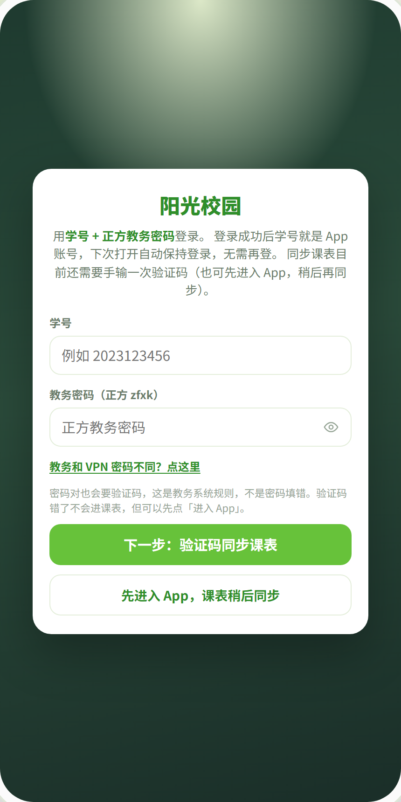

| 操作 | 说明 |
| --- | --- |
| 下一步：验证码同步课表 | 立即拉验证码，同步课表（推荐） |
| 先进入 App，课表稍后同步 | 先逛功能，稍后在课表/学业中心再同步 |
| 教务和 VPN 密码不同？ | 展开后可单独填 WebVPN 密码 |

学号会同时作为 App 账号尝试登录；密码仅本机保存（勾选「记住」时）。

---

## 3. 首页

底部导航：**首页 · 服务 · 发布 · 消息 · 广场 · 我的**。

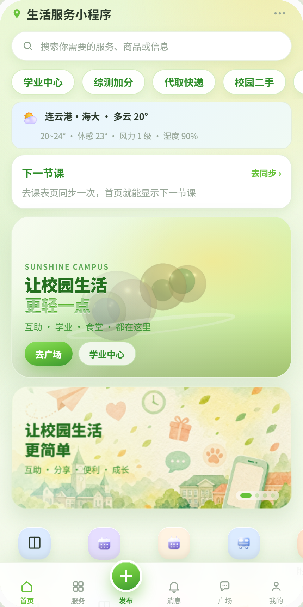

常见入口：

- 顶部快捷：**学业中心**、综测加分、代取快递、校园二手  
- 天气卡片（连云港 · 海大）  
- **下一节课**（需先同步课表）  
- 轮播进入广场 / 学业中心  

---

## 4. 服务页

校园服务总目录，可进学业、成绩、考试、课表、广场、食堂等。

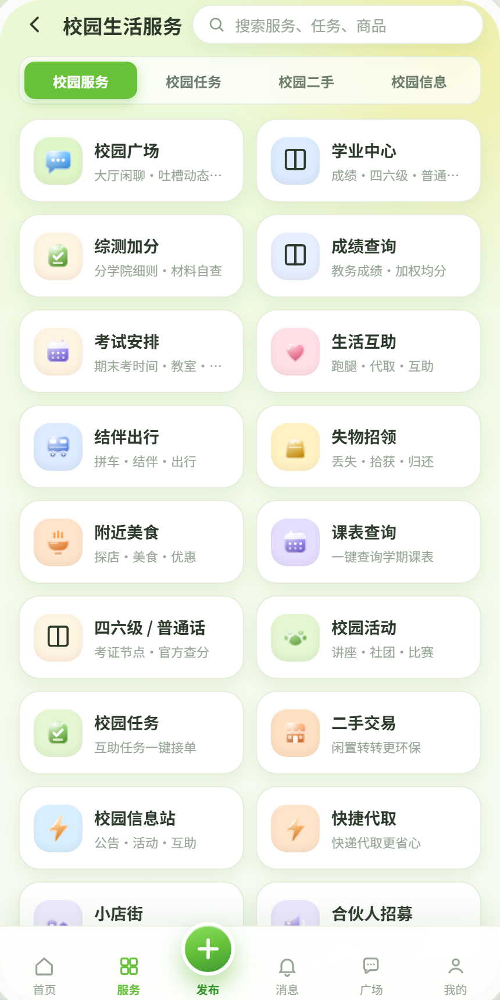

与学业相关的入口：

- 学业中心  
- 成绩查询 → `/study?tab=grades`  
- 考试安排 → `/study?tab=exams`  
- 四六级 / 普通话 → `/study`（考证）  
- 课表查询 → `/schedule`  

---

## 5. 学业中心

路径：**服务 → 学业中心**，或首页快捷进入。

### 5.1 总览

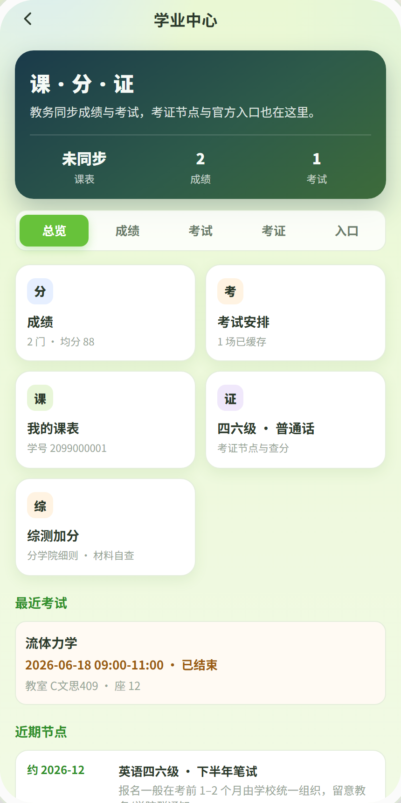

顶部「课 · 分 · 证」汇总课表 / 成绩门数 / 考试场数。Tab：**总览 · 成绩 · 考试 · 考证 · 入口**。

### 5.2 成绩（教务同步）

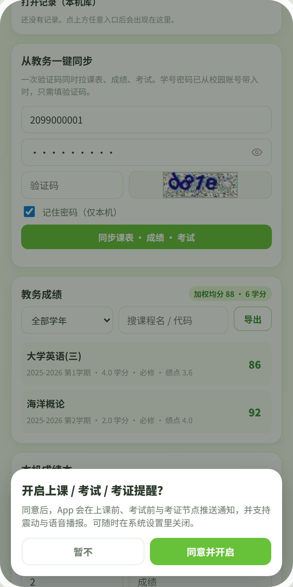

1. 上方可改学号、教务密码，输入验证码  
2. 点 **「同步课表 · 成绩 · 考试」**（一次验证码三项一起拉）  
3. 下方列表显示课程、学分、成绩、绩点；可筛选学年、搜索、导出  

首次同步后若弹出「开启上课 / 考试 / 考证提醒？」：

- **同意并开启**：系统通知 + 后续震动/语音弹窗  
- **暂不**：可稍后在设置里打开上课提醒  

> 线上 jou-api 版本需 ≥ `2.3.0-grades-exams`，否则只能出课表、成绩考试为空。

### 5.3 考试安排

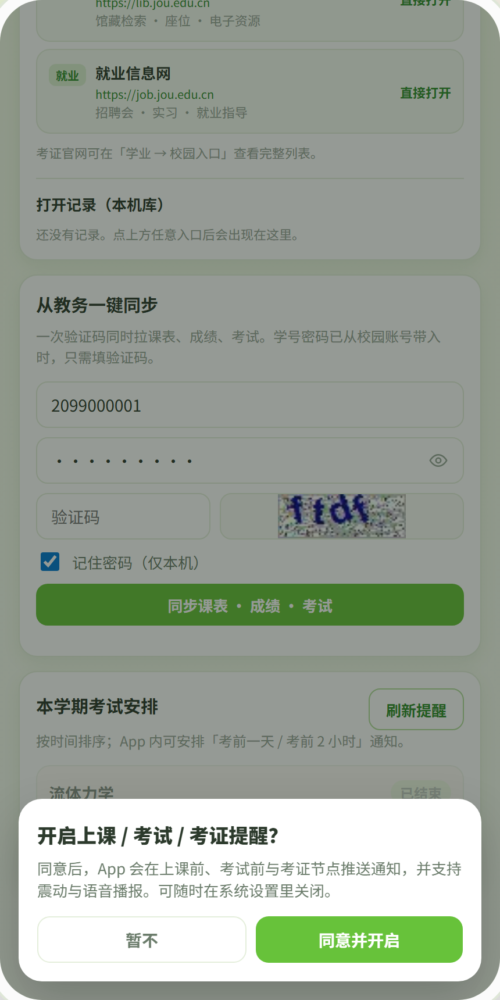

- 同步后按时间排列本学期考试  
- **刷新提醒**：预约考前 1 天 / 考前 2 小时 / 开考时通知  
- 打开 App 且临近考试时，会有应用内弹窗（并震动+语音）  

### 5.4 考证 · 一键提醒（重点）

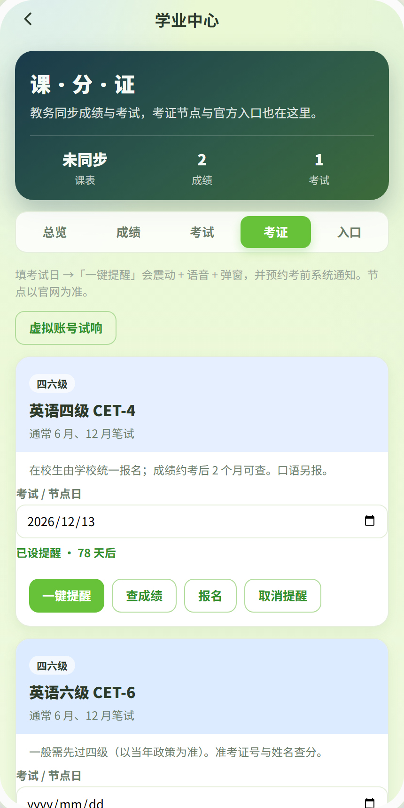

对四级、六级、普通话、计算机等级、教资、考研、国考等：

1. 选择 **考试 / 节点日**  
2. 点 **「一键提醒」** → 震动 + 语音播报 + 弹窗，并预约考前系统通知（前 7 天 / 前 1 天 / 当天上午）  
3. **「虚拟账号试响」**：不依赖真实报名，立刻验证三种提醒效果  
4. 「查成绩 / 报名」打开官方网站；「取消提醒」清除本机日程  

### 5.5 校园入口

「入口」Tab：本机保存学号与密码后，一键打开 WebVPN / 教务 / 官网等（密码不入库，仅本机）。

---

## 6. 课表

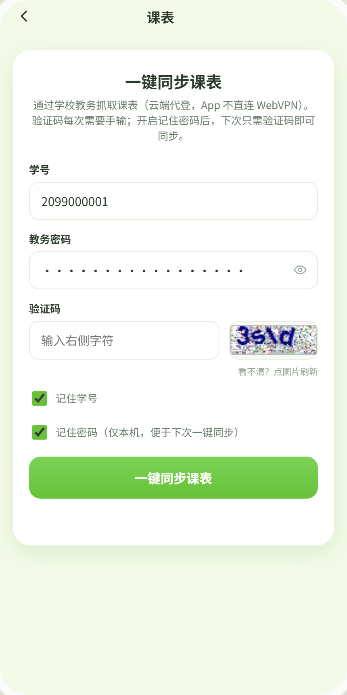

- 输入学号、密码、验证码同步个人课表  
- 同步时可顺带拉成绩与考试  
- 设置里可开「上课弹窗 / 通知」，提前 10～30 分钟提醒  

---

## 7. 广场与其它

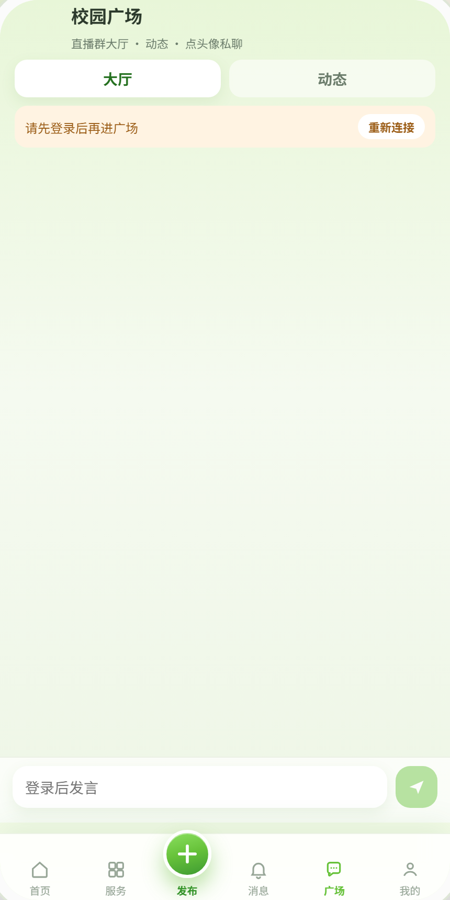

广场为同学聊天/发布区；消息、发布、二手、食堂等见底部导航与服务页。

---

## 8. 设置与提醒开关

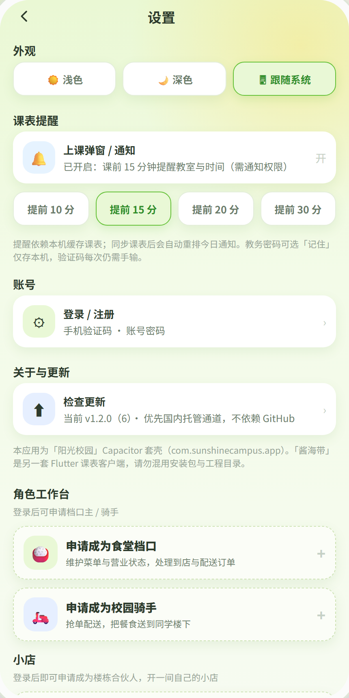

| 区块 | 作用 |
| --- | --- |
| 外观 | 浅色 / 深色 / 跟随系统 |
| 课表提醒 | 上课弹窗与提前分钟数 |
| 账号 | 登录 / 注册 |
| 关于与更新 | 检查更新 |
| 角色工作台 | 申请档口主 / 骑手 / 小店合伙人 |
| **管理员**（需管理员身份） | 角色审核、合伙人、财务、内容 |
| **成员治理**（仅站长） | 添加 / 移除普通管理员 |

---

## 9. 管理权限（站长）

详细矩阵见 [`docs/admin-permissions.md`](../admin-permissions.md)。

| 角色 | 能力摘要 |
| --- | --- |
| 普通用户 | 发帖、下单、同步学业等 |
| 管理员 | 角色审核、内容、财务、看合伙人列表 |
| 站长 `is_super_admin` | 上表全部 + **通过合伙人** + **成员治理增删管理员** |
| Bootstrap 站长学号 | **`2023120448`**（首次登录自动升站长） |

成员治理入口：**设置 → 成员治理**（`/admin/members`）。未登录站长时页面会提示无权限。

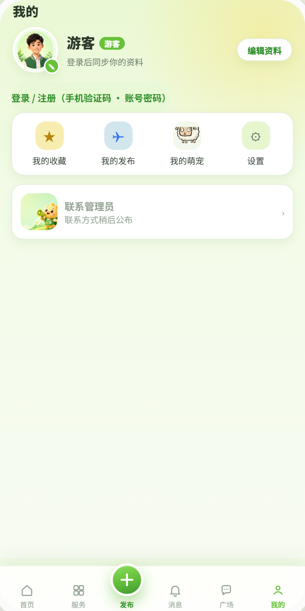

---

## 10. 虚拟账号自测清单

截图所用为虚拟数据，正式环境请用自己学号。

| 场景 | 步骤 | 预期 |
| --- | --- | --- |
| 门禁 | 填学号密码 → 先进入 App | 进入首页 |
| 成绩/考试 | 学业中心同步（需验证码） | 列表有数据；健康检查 `version` 含 grades |
| 考证试响 | 考证 Tab →「虚拟账号试响」 | 震动 + 语音 + 弹窗（勿静音） |
| 考证日程 | 选日期 → 一键提醒 | 显示「已设提醒 · N 天后」 |
| 站长 | `2023120448` 登录 → 设置 | 出现「成员治理」 |
| 普通管理员 | 站长添加另一账号 | 该号有管理员区，无增删管理员 |

---

## 11. 常见问题

**Q：课表有了，成绩/考试还是空？**  
A：确认云托管 jou-api 已部署到 `2.3.0-grades-exams`；同步时勾选/传入 `grades`、`exams`；教务成绩页需点「历年成绩」类按钮（服务端已自动 POST）。

**Q：没有震动或语音？**  
A：系统勿开静音；浏览器/WebView 需允许通知；部分机型需给 App 通知与震动权限。语音依赖系统中文 TTS。

**Q：和「酱海带」什么关系？**  
A：酱海带是另一套 Flutter 课表客户端；本 App 为 Capacitor 套壳 `com.sunshinecampus.app`，安装包与工程勿混用。

**Q：密码安全吗？**  
A：教务密码仅本机混淆存储，不同步到业务库；云端代登只在当次请求内存使用。更强方案见 `docs/optimizations.md`。

---

## 12. 相关文档

| 文档 | 内容 |
| --- | --- |
| [admin-permissions.md](../admin-permissions.md) | 管理权限矩阵与 RPC |
| [optimizations.md](../optimizations.md) | 后续修改与优化建议 |
| [tools/jou-api/README.md](../../tools/jou-api/README.md) | 课表/成绩 API 与部署 |

---

## 附录 · 截图索引

| 文件 | 界面 |
| --- | --- |
| `00-campus-gate.png` | 首次校园门禁 |
| `01-home.png` | 首页 |
| `02-services.png` | 服务目录 |
| `03-study-home.png` | 学业总览 |
| `04-study-grades.png` | 成绩同步 + 提醒授权弹窗 |
| `05-study-exams.png` | 考试安排 + 提醒授权 |
| `06-study-certs.png` | 考证一键提醒 |
| `08-schedule.png` | 课表 |
| `09-plaza.png` | 广场 |
| `10-settings.png` | 设置 |
| `12-profile.png` | 我的 |

重拍截图（开发机）：

```bash
npm run dev -- --host 127.0.0.1 --port 5173
python docs/manual/capture_shots.py
```
