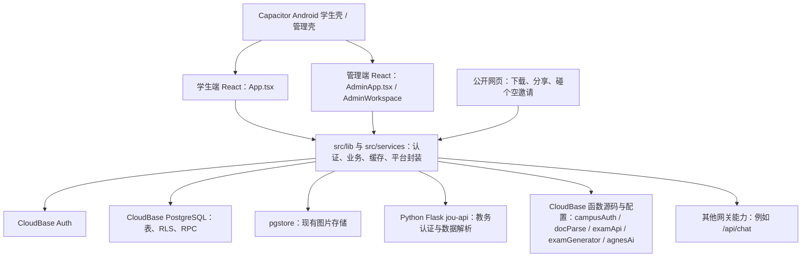
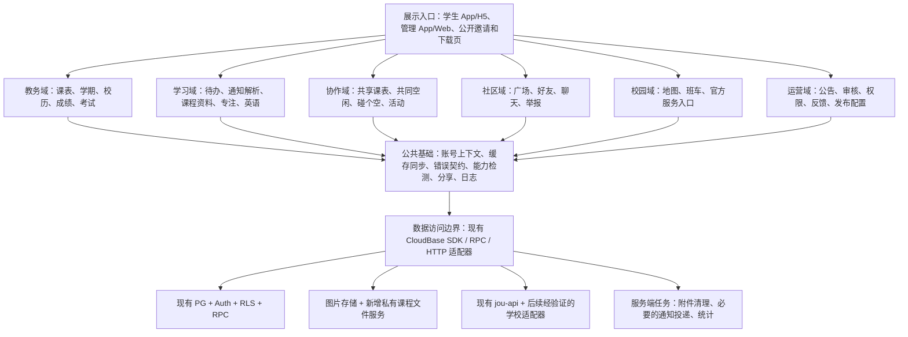

# 哦狐：实际项目架构与功能完善方案

分析日期：2026-10-31  
代码基线：当前工作区与本地产物为 `1.2.145`，线上 Android／OTA 当前也已核验到 `1.2.145`；不等同于手机已安装版本。
项目位置：`C:/Users/upwar/Desktop/新建文件夹 (4)`。  
基线分析：现状架构、需求取舍、阶段建议与验收标准见正文；统一产品、官网、域名及安装包方案见[哦狐项目总设计与官网发布方案](./哦狐项目总设计与官网发布方案.md)，后续源码工作与核验结果持续记入文末台账。生产数据库写入仍需单独核验；2026-10-31 已按用户授权将 1.2.145 APK、OTA 与官网发布至 CloudBase，并逐项核验线上包与清单。当前版本 IPA 尚未构建：iOS workflow 已加入本地正式代码，但当前 GitHub 账号对目标仓库无推送权限。

## 1. 项目判断与改造方向

哦狐已经是一个包含教务同步、学习工具、校园服务、社区、组队和管理后台的综合应用，不适合按一份新产品需求从零重写。

当前最值得做的，是把以下两条流程做完整：

1. **个人学习流程**：同步课表 → 查课程、成绩与考试 → 整理课程资料 → 通知生成待办 → 按时提醒 → 进入专注 → 查看完成记录。
2. **同学协作流程**：授权分享课表 → 找共同空闲 → 发起碰个空 → 邀请或发现搭子 → 确认时间地点 → 改期、取消和活动结束。

建议保留 React、TypeScript、Vite、Capacitor、CloudBase PostgreSQL 和现有 Python 教务服务，采用**按业务划分模块、逐步调整边界**的架构。先解决数据归属、校历、分页、数据库迁移和原生能力一致性，再增加课程资料、多人课表等已有明确需求的功能。

不建议当前同时扩张插件市场、开发者 SDK、独立桌面客户端、多套皮肤和大规模 AI 自动化。这些会扩大维护范围，无法直接解决目前最影响使用的课程、任务、提醒和组队问题。

## 2. 资料范围与判断标准

### 2.1 本次实际分析的资料

| 资料 | 本次用途 | 局限 |
| --- | --- | --- |
| 桌面 `校园助手规划文档.html` | 读取保存页中可见的 17 项需求总结、边界和阶段建议 | 页面显示“正在加载更早的消息”，部分生成文档显示无法加载；未保存下来的原始问答和文件不能补造 |
| `校园助手规划文档_files/` | 核对保存页的依赖与素材 | CSS、网页运行脚本和 `hw.png` 头像属于保存网页的资源，不是哦狐源码或额外产品需求；未执行其中脚本 |
| 当前项目 `src/` | 路由、页面、业务服务、缓存、账号和平台调用 | 有代码不代表生产环境已配置或真实流程已通过 |
| `tools/jou-api/` | 教务代理、解析、会话、限流和容器部署结构 | 本次未使用学校账号验证接口；该目录被部分默认文件搜索规则忽略，已单独核对 |
| `cloudfunctions/`、`docs/sql/`、`docs/release/` | 云函数、数据库权限、RPC 和迁移资料 | SQL 文件存在不代表当前生产库已执行；迁移资料存在缺失 |
| `android/`、`tools/`、`public/download/` | 原生提醒、图片保存、打包、更新与官网分发 | 未验证手机已安装的原生版本，也未重新核验公开下载文件 |
| 既有产品与交付文档 | 核对历史决定和未完成事项 | 例如 `UI-FUNCTION-INVENTORY.md` 基线为 1.2.30，不能覆盖当前源码判断 |

附件中的文字是分析对象。本方案提取适合哦狐的目标，不把附件里的开发口令或建议自动当成本次修改代码、部署或删除功能的授权。

### 2.2 状态口径

- **已有实现**：找到了页面入口、业务调用或原生实现；仍须按场景验收。
- **部分实现**：有部分流程或算法，存在明确缺口。
- **仅规划／本轮未发现**：只有文档、名词、外链，或在本次相关源码范围内未找到实现；不据此断言其他服务器绝无该能力。
- **条件任务**：依赖学校授权、真实规则、测试账号、原生工程或运营条件，条件具备后才进入交付承诺。

本文中的新目录、模型、接口和指标均为建议，不表示已经部署。

## 3. 当前项目的真实架构

### 3.1 运行结构



云函数代码目录、部署清单、网关路由并不完全一致；`agnesAi` 是本轮新增源码，尚未部署。当前工作区的服务与数据库基线核对见[服务目录](<C:/Users/upwar/Desktop/新建文件夹 (4)/docs/architecture/service-catalog.md>)，其中生产状态仅在实际读取后才标为已核实。

这不是纯前端、本地存储应用。当前业务依赖账号、云端关系库、存储、教务代理和其他网关服务。不能套用 CampusHub“无需账号、全部本地、双击 HTML 即完整运行”的介绍。

`cloudfunctions/campusAuth` 虽然仍在目录中，实际是安全停用的旧建号兼容端点，业务调用被拒绝；它不属于当前可用的校园认证能力。校园身份与教务绑定应按实际认证流程分析，不能凭该目录名判断已经接通。

### 3.2 已有基础应继续使用

| 现有基础 | 实际价值 | 后续做法 |
| --- | --- | --- |
| 学生、管理双入口与 Android 双壳 | 已区分页面和发布目标 | 保留，不恢复已退出主链路的商家、骑手、支付等多壳体系 |
| H5 BrowserRouter、原生 HashRouter | 已处理两种运行环境的路由差异 | 提取统一链接生成能力，保留现有路由 |
| 懒加载、页面错误边界、启动门 | 已有加载与恢复基础 | 增补可诊断状态，不另建一套启动系统 |
| CloudBase PG + RLS + RPC | 已支持客户端按权限访问关系库 | 简单个人 CRUD 继续经 RLS，复杂事务放 RPC 或服务端 |
| 会话代次与异步归属检查 | 已防止部分账号切换后的旧请求回写 | 保留并推广，提取到独立账号会话模块 |
| 课表与学业缓存 | 已区分部分分类失败、空结果和旧快照 | 增加学校、绑定与学期上下文，不重建第二套缓存 |
| 原生课程提醒计划、恢复和过期策略 | 已有较多 Android 保障代码 | 优先真机验收、统一其他提醒口径 |
| 碰个空数据库状态机 | 已有人数、时间、报名和锁行处理 | 增补成局之后的流程，不重写匹配系统 |
| 构建、准备发布、发布校验工具 | 已有类型检查、目标隔离和版本检查 | 补全可复现性与能力兼容，不回到手工拷包 |

## 4. 将规划中的 17 项逐项落到当前项目

| 规划项 | 当前实际情况 | 贴合项目的处理建议 | 阶段 |
| --- | --- | --- | --- |
| 1. 五种桌面小组件 | Android 学生版源码现已新增“下一节课、今日课表”两个 AppWidget，轻触直接打开课表页；未构建或真机验收。尚无 iOS WidgetKit 工程 | 首期展示正在上／下一节课和今日最多三节及剩余数量；后续补全天课程展示、单节课程详情直达、待办和考试。iOS 单列条件任务 | P2 |
| 2. 首页自由布局 | 已支持当前账号在本机选择、排序 1–6 个快捷服务；不是任意卡片增删 | 在现有首页上增加固定类型卡片的显示、排序与恢复默认，先不做自由画布 | P2 |
| 3. 完整课表 | 已有教务同步、周／日视图、调休设置、提醒与 ICS 导出；手动课程编辑、多人分享未闭环 | 先修校历与上下文，再补个人课程覆盖、多人课表与共同空闲 | P0–P1 |
| 4. GPA 与学业分析 | 已有成绩、考试同步、筛选、上游绩点展示及文本导出；当前统计主要为参考加权均分 | 独立规则化 GPA，先专业课筛选，再做预测；培养方案和体测待真实规则／接口 | P2／条件 |
| 5. 社区与树洞 | 广场、聊天、二手、失物、活动、好友等已有；独立匿名树洞未形成独立能力 | 优先分页、治理和消息一致性，再评估独立匿名域，不能把普通帖子加匿名标签充当树洞 | P0–P3 |
| 6. 学习通与学习中心 | 待办、专注、英语、题库已有；学习通真实账号／作业同步未发现。单词计划、复习卡和自定义词现已接入按账号隔离的本地学习仓库，旧数据显式恢复入口已加入单词页 | 先补课程资料并联动通知待办；学习通自动同步作为授权条件任务；单词学习仍待账号切换运行时验证 | P0–P1／条件 |
| 7. 校园生活 | 地图、班车、运动、快递及校园服务入口已有；校园卡、图书馆主要为官方外部入口 | 统一标注“内置服务／官方跳转／尚未接入”，不把跳转描述为余额查询或内置选座 | P0–P2 |
| 8. 评价中心 | 有食堂／商店等评价相关遗留代码；未发现课程、教师、食堂统一评价中心完整链路 | 先做有审核条件的地点／服务评价，教师课程评价在治理准备好后再开 | P3 |
| 9. UI 个性化 | 主题模式、按钮、狐狸组件已有；当前选择逻辑只允许 classic/pure，仍有历史皮肤定义残留；“我的”列表行采用统一线框图标，简单版服务目录使用紧凑功能网格 | 保持经典版＋简单版；两版功能一致，继续统一图标、状态、滚动与无障碍 | P0–P2 |
| 10. 通知、AI 与自动化 | 课程／考试／待办提醒、站内消息、AI 对话已有；后台推送、数据授权和自动化没有统一闭环 | 先统一通知中心和提醒诊断，再做可核对的校园简报；AI 写操作先预览确认 | P0–P3 |
| 11. 账号、安全、同步 | 已有登录、校园账号、部分账号隔离和云数据；本地手记成绩仍有归属残留，离线与同步分散 | 明确账号／学校／设备边界，补私有资源、离线队列、数据导出与删除闭环 | P0–P2 |
| 12. 管理与更新 | 已有独立后台、成员、内容、公告、举报、消息与更新入口；通用远程开关、事务审计和真实后台推送需补 | 在现有后台扩展投放与审核，不再搭第二套；敏感操作统一事务和审计 | P0–P2 |
| 13. 官网与发布 | 已有下载、二维码、分享海报和 iOS 外部教程；存在版本硬编码、能力分散 | 分离官网和 App 资源，统一发布清单，明确各平台真实可用状态 | P0–P2 |
| 14. 开放生态 | 有部分多校入口、公开邀请、组队、学习目标；无完整插件／SDK 生态 | 优先共同空闲、协作与可复用学校适配器；插件、桌面壳和推荐系统后置 | P1–P4 |
| 15. 渐进开发 | 现有项目适合渐进改造，但大页面和遗留文件较多 | 每次围绕一个完整使用流程提取模块、回归验收，避免全仓搬家 | 全程 |
| 16. 工程架构 | 已有 PG、API 封装、Docker 教务服务、测试和发布工具；迁移链与测试编排不完整 | 补真实基线与统一契约，不重选技术栈、不盲目引入微服务 | P0 |
| 17. 测试与双渠道 | 有多类测试文件和发布校验；当前正式更新判断限定 production，未形成完整实验版制度 | 区分单测、权限、浏览器、真机与发布验收；实验版先做隔离，再发布 | P0–P2 |

### 4.1 需要收紧或协调的规划

1. **线上支付**：按规划边界保持不接入平台充值、支付、转账、资金托管。二手和互助保留信息与联系流程；历史钱包、收银台等遗留文件不代表需要恢复其功能。
2. **校园卡官方付款码**：优先打开核实过的学校官方 App／页面；若不能直达个人付款码，就进入官方校园卡入口。不要猜测深链，不在哦狐内生成、缓存或内嵌展示付款码。
3. **iOS 签名**：附件的“不开发签名服务”与现有外部自签教程要区分。现有外部工具入口、无签名 IPA 不能描述成哦狐自身已提供签名或普通 iPhone 一键安装。是否继续保留外部教程属于分发产品选择，本分析不擅自删除。
4. **主题扩张**：规划提出更多主题和壁纸，但此前已明确只保留经典版、简单版。建议继续两版，不重新上线多套皮肤。
5. **导航扩张**：规划列出的“首页、课表、学习、校园、社区、评价、通知、我的”是业务分类，不应变成八个底部按钮。保留现有五个主入口。

## 5. 应优先解决的实际问题

### 5.1 P0：数据库和服务基线不可复现

`tools/deploy-db.mjs` 登记了 15 个 `docs/release/*.sql`，逐项核对后确认 15 项均在当前工作区缺失；现已增加全量预检和 `--check` 本地检查入口，发现任何登记文件缺失或不含可执行语句时，在提交 SQL 前列出问题并中止。当前目录唯一 SQL 是未登记的 `meet-invitations.sql`（22,394 字节，SHA-256 `69debfdd2e4287e839bc602b0977027b6d328480476374eb30c31a922db7afb1`）；该校验和只标识本地文件，不代表生产执行状态或可安全重放。现有注释还记录了同名 RPC 被历史脚本覆盖、部分 SQL 手工执行未登记的情况。

本机代码、函数清单和网关路由的逐项映射已整理在[哦狐服务与部署能力目录](<C:/Users/upwar/Desktop/新建文件夹 (4)/docs/architecture/service-catalog.md>)；它只记录工作区证据，不代表生产数据库或函数已在线核验。

工作区另有 2026-10-15 的只读数据库元数据快照 `docs/audit/cloud-schema-readonly-2026-10-15.json`，采集范围排除了业务数据和函数执行。快照当时记录 `function_rate_limits` 未启用 RLS，`authenticated` 有表读写／更新／删除权、`anon` 有读取权；`rate_limit_hit` 为 `SECURITY DEFINER` 并允许 `anon`／`authenticated` 执行。该旧快照没有函数正文，不能证明 2026-10-31 的当前授权，也不能据此断定可利用影响；它与服务端限流代码存在高风险权限面，需要优先用当前只读 schema 与授权信息复核。限流 API 在服务端故障关闭，只保护通过云函数的调用，不等于底层表和 RPC 无法被客户端直接访问。迁移源缺失且 CloudBase 角色模型／函数调用身份未核实前，不生成猜测性的 REVOKE／GRANT SQL，以免同时锁死云函数的合法限流调用。

这意味着：当前目录不能仅靠既有部署入口完整重建数据库，新增一张表或一个 RPC 前也难以确认生产基线。全量预检只防止“迁移文件缺失／为空时先执行一部分”的本地操作风险，不验证 SQL 正确性、生产迁移历史或执行原子性；**不能通过创建空 SQL 文件、盲目重放历史脚本来解决。**

建议先建立：

- 生产库只读结构快照：表、列、索引、约束、RLS、授权、RPC、存储策略；不导出用户业务数据。
- 带版本、校验和、执行记录的迁移目录；与现有 `docs/sql`、实际生产结构逐项对应。
- 空白测试环境重建、旧版升级、失败中止与恢复演练。
- 一份服务清单：PG、存储、三个业务云函数、已停用的 `campusAuth` 兼容端点、`jou-api`、AI 网关分别记录源码位置、部署目标、负责人、健康检查、停用状态和版本。

`/api/chat` 的前端调用存在，但本工作区四个云函数与 `jou-api` 没有给出完整的对应服务实现。应补齐或登记其独立仓库／部署来源，不直接把它算成本目录可以全量重建的能力。

### 5.2 P0：账号隔离需持续审计，手记成绩本地隔离已有实现

手记成绩已使用 `study.gradeBook.v2:uid:<uid>` 按账号分桶；读写用 `qbank` 会话代次避免切换账号时旧操作写入。同步成绩由 `academic-cache.ts` 按 UID 隔离。旧版 `study.gradeBook.v1` 无所有者记录，只有用户主动调用 `claimLegacyGradeBook()` 才能认领。

本轮继续核对发现，单词学习原先虽已有 `study-storage.ts` 按 UID 保存计划、复习卡和自定义词，并提供旧数据认领逻辑，但实际页面仍读写旧全局键，且恢复组件没有挂到页面。由此，单词计划、复习进度和自定义词在同一设备的不同账号间可能混用，旧版数据也未出现在新恢复流程中。本轮已把计划、SRS 卡和自定义词的读写切到 `study-storage.ts`，让英语总览和单词页响应学习仓库版本／账号变化，并在单词页显示旧数据显式恢复入口；速对和无尽闯关在账号切换时丢弃旧局，避免旧局写入新账号。旧键只保留为迁移读取来源，不再作为新写入目标。

后续存储审计发现，下载词库初始化还会读取没有账号归属的旧版考证词汇进度，并把“已学”记录写入当前账号的 SRS 复习卡。现在下载词库只安装／移除词汇内容，不再导入个人学习进度；`ohhu-personal-vocab-progress` 仅在用户通过 `study-storage.ts` 确认恢复旧学习记录时处理，避免另一账号打开词库即继承旧进度。下载的词库内容本身仍为设备级缓存，不包含个人学习状态。

班车订阅原先共用 `ohu.bus-subscriptions.v1`，且原生通知不带账号所有者；同一设备换账号后会显示上一账号的订阅并继续弹出提醒。现在班车订阅设置按 UID／访客分桶，通知 ID 加入账号维度并带 `ownerUid`；账号切换的个人提醒清理纳入班车通知编号区间，保留当前账号通知、清除其他账号与无主旧通知。旧 v1 键没有所有者信息，保留但不自动归属给新账号；班车页现显示旧设置摘要，并要求用户明确确认属于当前账号后，才重新排入新账号通知计划并记录认领者。旧设置无法匹配当前官方班次的记录不会导入。

综测自查页的学院选择、材料勾选和自估分此前也写入三个无主 localStorage 键。现在改为 UID／访客独立 bundle，本机保存失败会给出即时反馈；旧版无主记录只在用户明确确认“属于我”后合并到当前账号，并由本机认领标记阻止其他账号再次导入。该数据仍只在本机，不是官方成绩或云同步记录。

本项目前是源码实现，尚未运行 A／B 账号切换、旧数据认领、存储损坏和弱网场景验证；不要据此宣称所有本地个人数据都已隔离。后续继续审查：

- 静态复核已确认，专注计时／统计按 UID scope 存储，专注页面待办计划和完成交接键按 UID 区分；待办提醒镜像、排序、负荷上限及考试缓存也按 UID 隔离，个人原生提醒（包括班车提醒）在会话切换时清理／替换。班车旧 v1 本机设置无账号归属，保留且仅在班车页由用户确认属于当前账号后重新排程；旧榜认领和其他无主数据仍按各自入口显式确认。
- `focus-prefs`、专注声音设置、待办提醒开关／提前量、考试提醒偏好和课程提醒选项当前使用全局本机键；这些是设备通知策略和设备能力偏好，不是任务、成绩等个人记录。后续若希望提醒偏好随账号跨设备同步，再单独定义产品语义。
- 综测自查的学院选择、材料清单与估算分现按 UID／访客在本机分桶；旧三键 `zhongce.collegeId`、`zhongce.checks.v1`、`zhongce.scores.v1` 仅在显式确认后恢复一次，恢复标记也仅保存在本机。它不代表正式校级成绩。
- 无尽闯关排行榜已改为按 UID 分桶，访客使用独立分桶，仍仅保存在当前设备且不跨设备同步。旧版 `petdex.words.endless.lb.v1` 没有账号归属，只在登录后显示显式认领入口；用户确认后才复制到当前账号，并记录本机认领者，其他账号不再读取或认领该旧榜。旧键保留，不自动迁移或删除。该实现目前仅完成源码静态核对，账号切换、旧榜认领和写入失败恢复仍待运行时验证。
- 小海阿狐单词助记缓存过去使用全局键，缓存项的 key 包含用户输入的单词和释义，可能包含自定义词内容。现改为 UID／访客独立缓存；旧全局键只作为无主临时生成缓存，在新缓存首次读取时清除，不导入任何账号。
- 全局 localStorage 盘点已继续到任务收藏：旧 `campus-task-favs` 曾由所有登录账号共用，现改为 UID／guest 分桶；旧无主收藏只有用户在“我的收藏”明确确认归属后才合并，写入与归属标记校验成功才删除旧键。其它键仍需逐项审计，不能把本地分桶描述为跨设备同步。
- 校园地图中的本机打卡、个人地点和照片按 UID 保存；地图页面账号切换时现在会关闭并清空动态、打卡、地点编辑和评论草稿，提示尚未提交的地图内容已清理。发布动态会在照片上传后、提交前再次核对账号／校区请求代次；云端打卡和地点提交在账号或地点范围变化后不再继续下一步请求，迟到响应也不会覆盖新会话的忙碌状态。它只约束客户端后续步骤，已发送到服务端的请求不能由页面撤回；此改动不代表数据已云同步或账号切换流程已运行验收。
- 通用身份仍由 `qbank` 管理；提取为 `account-session` 是架构整理项，不应误记成当前缺少基本竞态保护。
- 学业中心的 AI 学习工具草稿与答案只驻留组件内存；`StudyHubPage` 通过 `useQbankRevision()` 订阅身份修订，并以 UID 与 revision 作为内容组件 key，账号切换会卸载旧组件并清空这些页面草稿。静态核对未发现草稿落盘或跨账号复用；由于没有真机账号切换验收，不将其描述为运行时已验证。
- 旧无主数据保留并明确认领或导出，不自动认给新登录账号。

待办与成长池现已补上会话代次保护和客户端补偿：待办创建／编辑／完成／删除后的页面反馈只在原账号会话仍有效时处理；“放回成长池”先创建并取得真实想法 ID，再删除指定待办；删除失败时尝试撤销刚创建的想法，并刷新两边核对。成长池转待办同样使用数据库返回的真实待办 ID关联，不再按标题猜 ID；关联失败时尝试删除刚创建的那条待办。成长池状态更新现在要求写操作返回目标 ID，若未返回则回读并逐项确认请求字段；这样不会把被 RLS 拒绝或零行更新误当作“已关联”。跨表操作将同一账号会话代次向下传至创建、状态更新、删除与补偿函数；每个写调用在发起前和异步返回后检查会话，切换账号后不再启动下一步写操作。两种删除补偿会先在当前会话下确认目标记录存在且可见；只有删除返回目标 ID，或删除前已确认目标存在、删除后回读确认已消失时才报告成功，避免把原本不存在／无权访问误报为删除成功。写入返回不确定、账号切换或补偿未获服务端确认时，页面提示先刷新核对，避免用户重复操作。客户端多步写仍不等于数据库事务；网络中断后的幂等提交和原子性仍需核实 schema/RPC 基线后补齐。

待办普通编辑与完成状态更新也不再只依赖“无错误”响应。`updateTodo` 沿用调用方捕获的账号会话，优先要求更新返回匹配目标 ID；未返回时按该 ID回读并逐项比较本次提交字段，只有确认一致才发布待办变更事件并让页面显示成功。专注结束自动完成所绑定的待办也沿用开始完成操作时的会话。若结果不可确认、目标不可见或账号已切换，页面显示待核对错误，不把零行更新伪装成成功。CloudBase `UPDATE ... RETURNING` 与回读行为仍需隔离数据库验证。

学校选择、课表校历和布局偏好要分别声明是“设备偏好”还是“账号偏好”，不能所有 localStorage 一律云同步，也不能一律跨账号共用。课表节次作息本地副本现按 UID 隔离，访客使用独立键；没有归属的旧版全局作息只保留在旧键中，不自动分配给新登录账号。登录用户在“节次时间”设置中确认归属后，才复制到当前账号本机并尝试同步到 `schedule_prefs`；同步失败会明确提示，本机恢复仍保留。

本轮已将个人校历覆盖按哦狐账号写入本机独立分桶；访客使用独立 guest 桶，不会读取其他账号规则。旧版全局键 `schedule.calendar.overrides` 保持原样且不再自动加载，只有用户在校历页确认“属于我”后才复制到当前账号；该恢复按日期合并，优先保留当前账号已有规则。校历数据仍只在本机，不代表跨设备云同步。学校选择与布局偏好仍需区分语义：官方入口指引中的查询学校现按 UID／访客本机分桶保存；该选择只控制指引内容，不改变当前教务绑定、课程缓存或提醒归属。旧查询学校键不自动迁入。真正教务学校／绑定上下文及布局偏好仍需分别核定。

久未登录回归提示 `AwayLoginHost` 已接入学生端 `PhoneShell`；登录前的离开天数快照现在带当前 UID，提示只在已登录账号与快照 UID 一致时展示，“今天已提醒”状态按壳和 UID 分桶。旧版无 UID 的会话快照不再显示，避免账号切换时复用另一账号的回归天数或关闭状态。提示弹层复用原生 `DialogLayer`，提供模态焦点管理和 Escape／系统返回关闭，并遵守减少动态效果设置。当前只完成源码静态核对，登录回归流程仍需浏览器、WebView 和多账号运行时验证。

### 5.3 P0：校历与学期可能直接影响课程和提醒准确性

课表 AI 入口支持粘贴老师／教务通知，也支持用户直接用一句话描述自己的课表修改意图；示例覆盖整日停课、补课和单课调整。歧义内容仍进入核对说明，不自动猜测或写入，逐项预览确认后才应用到本机个人校历。应用成功后先明确说明本机校历已保存，再单独呈现系统提醒重排结果；提醒排程或桌面镜像失败会按结构化状态告警，不用“未／失败”等消息字样猜测错误，避免“未来没有待提醒课程”一类正常结果被误标为失败。旧版 App 不支持后台滚动补排时，作为能力提示显示；通知原始失败信息保留给用户排查。

应用后的保存／提醒结果显示在课表主视图、AI 入口附近，不依赖默认折叠的工具详情；消息同时说明个人校历保存范围和排程结果，确保用户确认后能直接看到结果。成功应用后，若第一项调整位于当前已同步课表周次范围，页面自动切换到该日期的日视图，便于马上核对；若日期超出快照周次范围，不伪造空白课表，保留调整并提示到个人校历查看。

AI 正在分析时锁定通知输入、剪贴板按钮和示例，保证预览对应用户提交的那段原文。

AI 请求超时、断网或服务未配置时保留用户输入与本次发送确认；错误提示提供明确的“重试分析”按钮，复用当前表单提交路径重新发送，不自动无限重试、不清空输入，也不把请求失败显示为校历保存成功。窄屏错误区改为纵向布局，重试触控目标至少 44px。学习中心现有八项 AI 工具和聊天 AI 已有源码入口，课表解析为第九项独立功能；这些入口已接入本地前端代码，但真实服务要依赖已轮换密钥、限流 RPC、CloudBase 函数与网关路由部署，不能从源码存在推断线上可用。

Agnes 客户端统一将网关响应按 JSON 安全解析；HTTP 404 且返回非 JSON 错误页时显示“AI 服务入口暂时不可用”，不误显示“没有内容”或空成功。共享请求封装在获取身份凭据前检查已取消的 signal；请求期间用户关闭弹层或切换页面时传播取消，不再当成 50 秒超时提示；具体配置仍需在 CloudBase 控制台核验。此状态只是定位入口／路由不可达，不能断言函数未部署。

客户端收到 `ok: true` 但答案为空白时，按可重试错误处理，不向学习工具、聊天或课表页返回静默空结果。服务端已有非空检查，客户端校验用于兼容网关异常和旧服务响应。

课表 AI 输入框为空时提供停课、补课和自然语言单课修改示例；点击示例只填入文本，不自动分析或修改课表。

AI 草案的每项变更新增“影响预览”：停课显示当天当前课程，补课显示拟采用星期在该教学周的同步课程，新增／取消／替换显示当天课程与按原节次匹配的具体范围；不匹配时明确提示，不把 AI 摘要当作已验证的课程结果。已确认的单次课程变更使用统一日期投影，供周／日课表、首页、课程提醒、碰个空空闲时间建议和 ICS 导出读取；保存后通过校历／课表事件刷新课表页、首页与提醒宿主，碰个空每次重新计算建议时读取最新投影。用户已选定的旧空档不会被后台静默改写，重新生成建议后仍须本人确认。

课表 AI 首次预览遇到彼此重叠的新增／替换课程或同一原课程节次上的重复取消／替换时，会取消勾选冲突候选；用户手动选择冲突项时只撤销刚操作的候选，保留之前选择并说明原因。最终应用再次核对冲突。节次模型字段仅接收 1–11 的整数或数字字符串，错误类型不参与应用。

候选列表同时显示已选择数量，以及低把握度、原课不匹配或候选间冲突的待核数量；可一键清除勾选，但不会自动选择低把握候选。

若 AI 返回零个可应用候选，空状态会结合模型核对说明告诉用户补充日期、课程名称或节次，并提供“回到通知修改”按钮聚焦原输入框；通知内容保留，编辑后旧草案失效并须重新分析。不能把无候选误显示成已处理或保存成功。

每条影响摘要并列显示候选日期与星期，再列出可核对的当天课程或原课匹配信息，减少只看数字日期造成的误选。

同一日期的多个整日停课／补课候选互相冲突：预览会默认取消勾选冲突项，手动选择时撤销刚操作的项目并解释“同一天只能应用一条整日规则”；最终应用前还会再次阻止此类组合，避免写入顺序决定最终课表。

取消／替换原课时，若课程名称不存在、所填原节次全部或部分与当天课表不符，预览分别显示日期、匹配课程名、缺失节次和课表实际节次，并阻止该候选应用，便于修正而不猜测匹配对象。

模型候选缺少／格式错误的日期、调整类型、补课星期、课程名或节次时，预览逐条说明缺失字段并排除该项；重复节次、同日整日规则冲突和重复候选也给出相应原因。新课程教室、教师不是阻止保存的必填字段；未识别时明确显示“可补充”，并保留人工编辑。模型自身的核对说明仍与结构化校验提示一并呈现。

`schedule-cache.ts` 的内置学期起点 `2026-08-31` 仅作为后备值；课表页现在允许按当前哦狐账号在本机设置学期开始日。周次、课表视图日期、下一节课、ICS 导出和提醒校验均读取同一设置。更改后，旧快照保留供核对，但因其记录的学期起点不匹配而暂停用于首页和提醒；重新同步会将新起点写入快照。该设置不云同步，尚未接入学校学期接口。当前 `src/lib/timetable.ts`、`tools/jou-api/README.md` 和 `tools/jou-api/jou_client.py` 的响应契约只包含课程、成绩、考试及其分类错误，没有学期标识、学期起点或完整覆盖周次；因此不能把课程行中最大的 `week` 当成正式学期结束周。现有客户端会在当前教学周大于最大课程周次时将快照标记为待核对，这是保守的异常提示策略，并非上游已证明数据不完整；它可能把“后续周本来无课”也标成覆盖不足。学校校历与接口契约未取得可靠来源前，不猜测并写入动态学期值，也不宣称最大课程周就是学期覆盖上限。校历和课表缓存发生学期不匹配、早于学期开始或超出返回课程周次时，首页会停止把该快照当作有效课表。新增状态说明在首页和课表页共用；课表页继续保留本机快照供核对，重新同步入口不删除旧快照。课程提醒重排现在也先校验同一份快照；上下文无效时清理旧的本机课程提醒计划，不用旧周次继续安排通知。此前 `schedule-calendar.ts` 将国家假期和“高校常见补课映射”作为默认规则，直接影响上课日期、下一节课、ICS 和提醒。本地源码现已将内置国家日期改为建议，默认不再改变课程、ICS 或提醒；只有学生明确点“应用到课表”后才转为个人校历规则。真实学校校历仍未接入。

课表工具新增独立的「AI 一句话改课表」入口，放在课表日期选择旁，不再藏在校历工具区。流程以“粘贴通知或写一句修改要求 → 检查草案 → 确认应用”呈现；AI 可提出整日停课／补课，以及单次课程新增、取消、替换或调整建议。界面逐项展示并允许编辑日期、课程名、原／新节次、教师与教室；低把握结果默认不选，只有用户确认后才一次性写入当前账号本机校历。草案绑定生成时的规范化通知文本；用户修改文字后隐藏旧草案并要求重新分析，防止把旧分析应用到新通知。发送前明确说明文本会发给哦狐 AI 服务和 Agnes AI 模型服务商，并提供一次性确认；哦狐服务不持久保存通知原文，模型服务商的数据处理与保留依其政策，不能把它表述为绝不留存。相对日期会附上客户端提供的北京时间当天日期；模型推算出的日期以“请核对”状态呈现，仍由用户检查后选择。剪贴板读取有权限／环境受限回退；剪贴板按钮和输入框长按粘贴都会检查替换选区后的总长度，超限时整段拒绝、不静默截断通知；文本长度给日期上下文预留空间。一次草案最多接收 12 项变化，模型超量时整份草案拒绝应用并要求分段分析，不截取前半段。多条拟新增课程之间以及候选与现有课表间的节次冲突会在确认前提示并阻止错误应用。重复课程按日期、课程名和节次匹配；取消／替换填写原节次时只移除这些节次，未填写则移除匹配课程的全部节次；界面明确提醒取消课程时留空代表整门取消。手动编辑节次严格接受 1–11 的整数，非法字符和越界值保留在输入框并显示字段级错误，修正前禁止应用，不会静默丢弃输入。替换前还要与保留的原节次检查冲突，同日明确勾选且唯一匹配的取消／替换会从新增课程冲突计算中扣除对应节次。模型返回节次的校验也拒绝布尔值、越界值和非数组格式，避免宽松类型转换误造课程。跨日调课要求拆成明确的取消与新增。确认说明注明仅保存到当前设备的个人校历，不修改教务系统且暂不跨设备同步。单次课程变更使用统一日期投影，供周／日课表、首页、课程提醒、碰个空空闲判断和 ICS 导出读取；校历管理可撤销单项变更。能力已接入 `agnesAi` 源码，但云函数密钥、限流 RPC 与生产路由尚未核验／部署，因此线上可用状态未知。

课表主入口与课程详情快捷入口均保持独立，不与八项通用学习 AI 混成一个表单；主入口在日期选择后单独突出展示，学习 AI、多人课表分享和官方课表指引收进默认折叠的“更多课表工具”，减少课表首屏的入口堆叠。主入口摘要明确“确认后仅修改指定日期的本机个人课表”，避免用户误以为会改动每周固定课或教务源数据。学业中心八项 AI 工具已通过 `AgnesStudyTools` 接入，聊天 AI 通过 `ChatPage` 接入；这些是当前工作区源码状态，不代表云函数、密钥池或网关已经部署。

服务端提示已增加长期／重复修改的拒绝规则：要求每周重复、从某教学周起持续生效或调整整学期固定课表时，AI 不生成某个日期的伪候选，而在核对说明中标注“长期重复课程修改尚不支持”。客户端识别该范围提示后会取消所有候选选择、禁用应用按钮，并引导改写为明确日期的一次性调课；这能防止模型把长期要求误落成单日覆盖，但线上模型是否遵循仍须隔离环境验证。

输入为空时显示五个可编辑示例，覆盖整日停课、按其他星期补课、改教室／节次、新增单次课和取消单次课。示例按钮只填入文本并重置本次发送确认，不发送请求；相对日期会按当前北京时间解析并标记需要核对。例子不包含整学期固定课表修改，避免将一次性日期覆盖误当成周课表调整。该示例覆盖仅完成源码静态核对，真实日期解释仍需 AI 隔离环境验证。

课表 AI 的独立入口只在已有有效课程数据时显示；空课表用户先完成绑定／同步，避免把只写入个人日期覆盖、但当前课表无法投影的新课程误认为已生效。入口使用统一的线条火花图标和短说明；分析弹层采用固定标题与底部操作区、候选列表独立限高滚动，窄屏输入使用不触发自动缩放的字号，粘贴、选择、关闭和确认等主要目标至少 44px，并为键盘焦点与减少动态效果提供样式。课程详情继续保留带原课程信息的快捷入口。统一 DialogLayer 内容面板负责滚动；课表 AI 的整屏内容面板也必须保留纵向滚动，不能因满屏样式隐藏溢出。标题与确认区在内容滚动时吸顶，并遵循顶部／底部安全区；候选列表继续独立限高滚动。固定确认区同时概述已选项数量及前两项日期／操作，超出部分汇总计数，让用户滚到列表末尾仍能复核将写入的变更。分析期间显示真实忙碌状态和“不会修改课表、仍须人工确认”说明，并通过 polite live region 播报。系统减少动态效果时停止旋转动画，不模拟百分比进度。源码布局经静态核对，尚未在浏览器或 Android WebView 目视验收。

为避免用户把单次事件误认为学期内每周都生效，草案入口会显式标明“只影响选定日期，不改变每周重复课程和教务系统记录”；固定周课表调整暂不属于该 AI 功能范围，用户不应应用单日例外来代替整学期改课。

课程详情也可直接发起「用 AI 帮我调整这门课」。此入口把所选日期、课程名、节次、教师和教室作为独立上下文，通知原文仍由用户粘贴；发送披露同时覆盖上下文和通知。模型只在通知明确涉及所选课程时提出候选，最终仍走同一预览、冲突检查和确认写入流程；它不代替现有教务课表，也不执行自动改课。

课程详情入口的逐次发送确认应与实际请求范围一致：携带课程上下文时，确认文案明确列出所选课程信息和通知；从课表主入口发起时只确认通知文本。课程上下文不会因入口自动发送而被笼统隐藏在“当前通知”确认语里。

持续完善的20小时内，功能任务同时检查入口可发现性、输入与错误状态、预览／确认边界、手机窄屏和无障碍反馈；若后端或原生依赖尚未部署，界面必须明确说明当前不可用，不能用假数据伪装已上线。

学期设置输入的是实际开学日期，不要求恰为周一；教学周统一按周一至周日划分，第一周为包含开学日期的自然周。周次差值按本地日历日期计算，不用固定毫秒间隔，避免跨时区或夏令时设备在日期边界误判周次。第一周开学日前的周一／周二不展示课程，也不导入 ICS；早于真实开学日期仍由快照状态判为“学期尚未开始”。

教务响应按请求项区分“明确成功的空课表”与“缺失／格式错误／请求失败”：请求了课程时，响应必须包含合法 `rows` 数组；合法空数组才代表教务明确没有课程，并允许清除旧课程及对应提醒。网络错误、分类失败或缺少 `rows` 会在写入缓存前中止。同步页现在只有本机快照写入成功后才切换可见课表；保存失败时保留原缓存和当前表单状态，避免把未持久化响应显示成已更新。

教务同步还使用账号会话代次之外的请求序号：同一账号启动较新的手动／验证码／后台自动同步后，较早请求的迟到结果不得再写成绩、考试、课表缓存、凭据或页面状态。写入各缓存分类和重排提醒前后都会核对该同步轮次；这解决“同账号旧响应覆盖新响应”的本地竞态，不代表上游请求已取消，也不构成多分类缓存的数据库事务。静态核对已覆盖 `PhoneShell` 静默启动与课表页手动入口共用的序号边界；运行时并发和原生提醒计划仍需设备验证。

个人校历覆盖现按哦狐账号在本机隔离；旧版无主校历不会自动认领，必须由用户在校历页确认后复制。数据仍未云同步，跨设备共享及学校级官方校历仍待建设。另需区分三种数据：

1. **国家节假日提示**：用于说明，不自动判定本校停课或补哪天的课；学生核对学校通知后可逐日应用。
2. **学校已核验校历**：记录来源、生效学期和版本，承担课程日期计算。
3. **用户个人覆盖**：临时停课、换教室、加课、调课，允许撤销，并显示来源。

用户应用校历规则后，按“已确认个人覆盖 → 原始课程安排”计算；规则不明时显示待核对，不把猜测应用到真实提醒。课表周次超出已返回课程范围时，快照仍保留在本机供用户查看和复核，但首页不将其作为当前课表，提醒重排会暂停并清理旧提醒。当前仍需建设学校级已核验校历及学期来源；账号本机日期设置不能替代学校官方学期配置或跨设备同步。

### 5.4 P0：列表能滚动不等于数据完整

通用 `queryRows` 的默认路径仍在 limit 后进行客户端排序；待办页首屏读取 200 条并支持历史游标分页，首页则在服务端先筛选未完成事项、按截止时间排序后读取最多 200 条，并在超过窗口时显示“至少”口径；其他管理列表仍需逐项核对。管理端任务／求助审核现按 `created_at DESC, id DESC` 分别游标分页，每类首批 30 条并支持继续加载；查询只选择审核卡片字段，不读取联系方式。商品按两类来源、评论按三类来源分别以相同双字段游标分页，每来源每页 30 条并多取一条判定后续页；搜索只覆盖已加载记录，页面可继续加载更早内容，统计卡仍保留既有最多 300 条的“至少”窗口口径。二手与互助公开列表已改为数据库先按 `created_at DESC, id DESC` 稳定排序。校园任务大厅和二手集市现按同一双字段游标每页读取 30 条，并通过多取一条判断是否还有下一页；二手集市的类别筛选在服务端分页前生效，关键词继续匹配已加载商品并可逐页继续搜索。广场动态使用 ID 游标继续加载，并在接近列表底部时自动请求下一游标页，同时保留手动加载／重试按钮；浏览量榜和点赞榜现在分别使用有界范围分页、独立继续加载与失败重试，排行会在手动刷新时重新计算，动态浏览量／点赞数变化期间跨页顺序可能变化。动态首屏刷新与更早页请求使用互斥的同步锁和请求代次：刷新期间不会并发启动翻页；账号／会话变化、离开页签或卸载会使旧请求失效，迟到的 `finally` 不能清掉新请求的锁，也不会让“正在加载”状态永久卡住。

需要补的是服务端稳定排序、分页、筛选和聚合。不能只加滚动条后声称所有记录都可访问。管理员举报列表当前已新增按 ID 倒序的游标分页，每页 50 条并多取一条判断是否还有记录；页面显示已加载数量而不冒充总数。管理内容页商品／评论现已支持多来源历史分页，顶部统计和设置页待处理徽标仍使用有限探测窗口，超过窗口时显示“至少 N”，读取失败显示未知，不误报精确数量。管理消息摘要最多读取 200 条待处理举报和最近 100 条通知；界面现在明确报告最近窗口口径及“至少”数量，不能作为全量未读／待审总数。学生与管理通知中心首屏读取最近 100 条，并支持按通知 ID 倒序游标继续加载历史、失败后重试；未读分组数量只统计已经加载的记录。学生端“全部已读”仍调用账号 RPC，不受当前分页窗口限制；管理端批量已读仍只提交当前已加载的管理通知 ID。其他管理列表与服务端待审总数仍待逐项核对。

广场“校园动态”和“热门榜”现在使用页面内独立滚动区，标题／公告／分类入口保持可见；广场内容根节点需使用纵向 flex 布局，才能让内层列表按剩余视口高度收缩并触发 `overflow-y:auto`，单独设置 `flex:1` 不会生效。Android 下拉刷新会先判断手势是否从已滚动的内层列表发起，避免拦截列表回到顶部的滑动。当前热榜按累计浏览量／获赞数排序，最多各展示 8 条，排名相同按帖子 ID 倒序稳定排列；页面明确展示累计口径和实际返回条数。时间流首次与后续分页均多取一条判断 `hasMore`，不再用“本页刚好满”猜测是否有下一页；加载失败显示错误并保留可重试入口。帖子搜索按帖子 ID 倒序分页，每页多取一条判断是否有更多，失败可重试，末页明确提示；搜索失败在结果区显示错误，不会误显示成“没有找到帖子”。热门榜任一查询失败都会显示具体错误和重试入口，保留另一榜成功数据与已有旧数据，不再把失败画成“暂无排行”。动态刷新失败时显示错误和重试按钮，同时保留原有动态；刷新成功后以当前可见帖子作为锚点恢复阅读位置，若锚点帖子已不存在则保留浏览器默认滚动位置。服务端尚无按周期统计的字段，因此不能称为“本周热榜”或“实时榜单”。这些改动不代表数据范围已全量。

- 时间流按 `(created_at, id)` 稳定排序并返回下一页游标。
- 待办按用户选择的截止／完成／创建时间排序，服务端筛选未完成和历史记录。
- 刷新后合并去重，保持阅读位置；最后一页、加载失败和重试必须可见。
- 热门榜明确统计周期、排序规则、刷新时间；“前 N 名”可以是产品规则，但必须标明。
- 管理待审数、未读数使用服务端统计，不从截断后的列表长度推算。

### 5.5 P0：提醒需要统一规则和真机验证

课程提醒已有原生持久计划、补排、重启与时间变化恢复，并有 60 秒过期策略。本轮源码已将待办前台弹窗收紧为到期后 60 秒内，将考试各个提醒时点收紧为各自计划时间后 60 秒内；待办铃铛状态也不再把已过期提醒显示为已安排。待办提醒缓存现在不再只从最新创建的 200 条中筛选：页面另行从服务端读取最近 1 天已逾期及未来 7 天内未完成的事项，按截止时间选择最早的 40 项；超出设备排程容量时会明确提示，查询失败则保留旧提醒缓存并提示用户。创建、编辑、完成和删除待办的统一数据层现在发出账号会话受保护的变更事件，提醒宿主重新读取候选并替换本机计划；视觉提醒层因工作壳或专注沉浸态卸载时，`TodoReminderSyncHost` 仍保留无界面的同步监听，因此专注页完成待办等跨页面写入也会刷新。老师通知批量保存会在批次结束后统一发出一次刷新，避免逐条排程。单调递增的本地待办版本号阻止较早启动的轮询或刷新覆盖更新的候选缓存。需要继续真机核验通知是否及时取消／重排及权限失败反馈。Android 插件补丁现在对课程、待办、考试与考证定时通知统一附加／校验个人事件身份、账号归属和 60 秒过期时间，并在重启恢复时丢弃已过期事件。桌面覆盖提醒镜像也将新旧计划统一限制在原定时间后 60 秒内，恢复／触发前再次检查过期；过期历史卡不会因为旧版本缺少 `expiresAt` 而获得更长补发窗口。另修正了自动验证码同步的数据持久化完成后直接丢弃提醒排程结果的问题：现在复用统一提醒协调器刷新所有提醒类别，提醒失败／权限提示会单独附在“同步成功”结果后；学业数据已保存与提醒未排上会明确分开。尚未获得哦狐通知授权时也说明本次没有刷新计划。项目 `postinstall` 会运行 `patch-package`；当前已安装的 `node_modules/@capacitor/local-notifications` 中可见事件归属与过期检查，说明补丁已应用到本机依赖源码。尚未构建或真机核验，因此不能写成“所有安装包提醒已验证”。考证页面另有未来七天提示卡，它是日期提示而非错过的定时通知，不受本轮修改影响。

建议统一定义：

| 类型 | 提醒行为 | 历史内容 |
| --- | --- | --- |
| 课程临近／开课 | 预定时间后超过 60 秒不再振铃；课前提醒还应在开课时失效 | 通知中心可显示记录，不重新播报 |
| 待办截止／考试／考证定时通知 | 各提醒事件按自己的计划时间计时，超过 60 秒不补发；提前提醒作为独立事件计算 | 逾期状态保留，不因为不补响而隐藏任务 |
| 社区消息／管理通知 | 与课程准点提醒分开，按消息时效和用户偏好处理 | 允许查看未读历史，避免把旧消息反复当新提醒 |

提醒设置已新增只读“提醒诊断”：展示当前账号（掩码）、所选课表学校、通知与精确闹钟权限、当前账号已排的下一条原生提醒与未来提醒数量、匹配当前账号的后台课表计划数量及最近错误，并可手动刷新。现有 Android 检查同时显示电池优化、开机恢复、覆盖提醒权限与当前版本能力。提醒计划服务暂不返回可核验的计划版本号，因此界面不伪造版本；诊断仍未在设备上核验原生返回数据和权限变化。

Android 的通知权限、精确闹钟权限与系统限制会影响行为，原生代码存在也不意味着所有手机后台必达。应分开验证“划掉最近任务”“系统强行停止”“息屏”“重启”和“关闭权限”，不把这些状态混为同一场景。[Capacitor 7 本地通知文档](https://capacitorjs.com/docs/v7/apis/local-notifications)、[Android 闹钟文档](https://developer.android.com/develop/background-work/services/alarms)。

### 5.6 P0：图片保存和分享能力不一致

设置分享图和碰个空邀请卡现在共用 `src/lib/share-image.ts`：Android 只有在 `ShareGallery` 插件实际可用时才报告保存成功；旧包明确提示需要更新安装包，不再静默尝试 WebView 下载；H5／微信只报告已发起下载。插件调用失败会把原生错误反馈给页面。Android 10 及以上只有在 MediaStore 最终发布图片成功后才 resolve；发布失败会删除暂存项并向页面返回错误。iPhone 原生页面现通过 Web Share API 将 PNG 文件交给系统分享面板；只有用户在面板中选择“存储图像”才会进照片，哦狐本身仍不直接写入 iOS 相册。当前源码已完成统一分发，但 Android 真机权限、相册结果、iOS 分享面板与旧包表现仍需实测；安装包尚未更新。

- 分享图统一 PNG 校验、相册保存、浏览器下载和失败提示；成功提示只在原生插件成功返回后展示。
- iOS 没有哦狐直接写相册能力；分享图会交给系统面板，提示用户自行选择“存储图像”，取消或系统不支持分享图片时显示可操作提示。
- 公开二维码只编码可从外部访问的 HTTPS 业务链接；本地地址不得进入正式分享图。
- 公告、课表和 App 推广后续如加入图片保存，应复用同一服务，并按真实能力反馈。

### 5.7 P0：发布身份和平台能力要可核对

当前源码为 1.2.143。iPhone 下载页与教程已移除硬编码 1.2.140 直链，改为读取 iOS 发布清单，并要求清单中的版本／构建号与 H5 构建时生成的 `source-identity.json` 一致，只有学生 H5 输出会标记允许提供 iOS 下载；页面只接受同源下载路径、未签名状态、文件名、大小与 SHA-256 字段齐备的发布项。网站构建和学生下载暂存会先移除所有直接复制来的 IPA，只在清单标记可用、版本与源码一致且实际文件大小／SHA-256 校验通过时，才重新暂存该唯一 IPA。当前清单状态为 unavailable，因此尚无 1.2.143 IPA 下载；本步不生成 IPA，也不发布网站。旧 1.2.140 源文件仍留在工作区，但不会进入后续生成的 H5／学生安装包暂存。本地 `public/update.json` 仍为已登记的 1.2.116 发布信息，远端托管状态未经核验；工作区存在 1.2.143 APK 构建产物，但它尚未经过当前发布流程重新校验。暂不把源码版本冒充已发布版本，也不将未验证 APK 写入更新／下载清单。统一发布清单仍应覆盖官网、设置、APK、IPA 和界面更新，明确平台、构建号、校验值、状态与最低原生版本。

公开网站资源、安装包与 App 内必需资源应分离：下载用的大文件不随学生端、管理端及每次 OTA 一起打入。不能依赖每次新增安装包文件时再补一条硬编码排除。

已有 `build-multiplatform.mjs` 已统一运行 TypeScript 检查，应保留；旧方案中“原生构建未做类型检查”的描述已经过时，不应再作为当前缺陷。公告轮播和管理预览、经典／简单双版本选择已有实现；公告轮播在鼠标悬停或键盘焦点停留时暂停，读屏能识别公告分页按钮组。广场动态与热门榜源码已改为独立列表滚动，但列表完整性、刷新和榜单统计周期仍须按 §5.4 核验。

### 5.8 P0：高成本服务限流故障不能默认无限放行

文档解析／出题相关限流实现存在组件失败时放行的分支。建议将高成本 AI、解析任务与普通低成本读取区分：配额无法确认时暂缓高成本执行，提供可重试反馈并告警；服务端核对账号、调用预算与幂等键，不仅在页面禁用按钮。

这项结论是代码策略检查，不代表已经发生滥用或线上限流故障。

## 6. 建议的新架构

### 6.1 架构形式：现有后端上的模块化应用



无需另建微服务集群、消息队列平台或一套新账号系统。只有经容量测试确认现有服务成为瓶颈，再独立扩容对应部分。

### 6.2 业务职责

| 业务域 | 负责 | 不负责 |
| --- | --- | --- |
| 教务 | 上游快照、学期、课程发生时间、成绩考试、规则版本 | 社交公开展示、直接保存分享海报 |
| 学习 | 待办、课程资料、附件、专注与学习记录 | 替用户提交作业、保存教务密码 |
| 协作 | 授权共享、时间交集、组队状态和活动报名 | 默认公开完整个人课程与空闲轨迹 |
| 社区 | 帖子、关系、聊天、内容可见性、举报 | 拿普通用户资料表直接实现匿名作者隐匿 |
| 校园 | 官方入口、校区地点、班车、服务适配状态 | 未经验证代理学校资金业务 |
| 运营 | 公告、治理、权限、反馈、配置与审计 | 通过前端开关代替服务端授权 |

### 6.3 前端目录逐步归位

下列为**建议目标**，不是立即搬迁整个 `src`：

```text
src/
  app/                         # 两端入口、路由、运行时、边界
  modules/
    academic/                  # schedule / grades / exams / calendar
    learning/                  # todo / course-resources / focus
    collaboration/             # schedule-sharing / free-slots / meet
    community/                 # plaza / contacts / chat / moderation
    campus/                    # official-links / map / bus
    operations/                # announcements / review / users
  shared/
    session/                   # 从 qbank 提取通用身份与异步归属
    data/                      # 分页、结果契约、离线队列基础
    platform/                  # Android / iOS / Web 能力适配
    ui/                        # 按钮、图标、表单、弹层、状态组件
  lib/                         # 迁移期间保留兼容导出，逐步减少职责
```

优先拆的页面是 `ScheduleHome`、`StudyHubPage`、`TodoPage`、`PlazaPage`、`SettingsPage`：把本次新增功能涉及的表单、查询和状态机抽出去，保留原路径与公共接口。避免为了目录整齐一次改动全部导入。

后端仍保留现有 `tools/jou-api` 和 `cloudfunctions` 的可运行入口。数据库新增统一版本化迁移目录和基线清单；学校适配器、文件任务等新增代码先建立明确边界，再视维护需要归入 `services/`，不在同一轮同时改源码位置、镜像构建上下文和线上路由。

### 6.4 统一账号和教务上下文

建议公共上下文包含：

```ts
type AccountContext = {
  uid: string
  authRevision: number
}

type AcademicContext = AccountContext & {
  schoolId: string
  campusId?: string
  bindingId: string
  bindingRevision: number
  termId: string
  timezone: string
}
```

- 普通私有待办只要求账号上下文，不能因为没绑定教务就无法使用。
- 同步课表、学校密码、成绩考试和提醒计划使用完整教务上下文。
- 查询开始时捕获上下文；响应、落库、排提醒前核对代次；切换账号或绑定后拒绝旧结果。
- “查看另一所学校的介绍”不等于“切换当前排提醒的教务绑定”。
- 学校 `schoolId`、校区 `campusId`、学院、专业、年级是不同维度，不使用自由文本校区名充当学校身份。

### 6.5 统一查询与变更契约

不强制现有所有接口立刻改形状，先在各业务适配器内部规范化：

```ts
type DomainResult<T> =
  | { ok: true; data: T; requestId?: string; serverTime?: string }
  | { ok: false; code: string; message: string;
      retryable: boolean; requestId?: string }

type PageResult<T> = {
  items: T[]
  nextCursor: string | null
  hasMore: boolean
}
```

需要统一识别未登录、无权限、上游失败、解析失败、无数据、版本不兼容和服务尚未部署。查询失败不能伪装成空列表。

新增写操作使用 `clientMutationId`；数据库为“账号＋操作 ID”建立唯一约束，超时后查询原结果再决定重试。复杂状态变化使用事务 RPC，例如组队成局、配额扣减、审核与处罚，不由浏览器分几次写入凑一致性。

### 6.6 数据安全边界

继续使用 CloudBase PG 的表级授权与行级 RLS；权限应由数据库／服务端强制，页面只决定如何呈现。[CloudBase PostgreSQL 权限说明](https://docs.cloudbase.net/database/postgresql/initialization)。

| 数据 | 归属与可见范围 | 写入边界 |
| --- | --- | --- |
| 私人待办、课程资料、手记成绩、专注记录 | 本人；显式分享后只公开选中部分 | RLS 校验当前身份；不能信任客户端传入 ownerUid |
| 教务绑定与敏感凭据 | 本人设备／受控认证流程 | 默认不保存密码；Android 用系统保护的凭据存储；H5 明确不保存选项 |
| 校园公开内容 | 按学校、审核状态与发布规则读取 | 学校身份和发布权限在服务端核验 |
| 好友／组队数据 | 按成员与授权范围读取 | 加入、离开、撤销、改期通过事务校验 |
| 管理权限与审计 | 授权管理员 | 普通资料更新不得写权限字段；审计记录由服务端生成 |
| 课程附件 | 私有对象；授权成员按规则访问 | 服务端鉴权后给短时下载凭证，不能复用公开图片 URL 模式 |

当前 `local-secret.ts` 明确密钥与密文同存 localStorage，只能视为混淆存储，不能在文案中称为系统级安全加密。已有按 UID 的本地凭据归属应保留，在此基础上接原生安全存储。

## 7. 最应新增与补完的功能

### 7.1 多人课表与共同空闲：优先补已存在的底层

**当前状态**：`schedule-group.ts` 已有分享、导入、别名、撤销及空闲算法；学生课表页已有“分享课表、导入同学课表”入口和管理面板。忙闲分享会在发 RPC 前移除课程名称、教室与教师；自己生成的分享只用于管理，不能被重复选作共同空档中的同伴。新增了按真实日期分别换算每份课表教学周的共同空档算法，并将本人的假期与单日课程调整纳入投影。工作区仍没有对应 `schedule_share_*` 数据库定义，分享／导入／改名／撤销尚不能声称在线可用。分享数据没有其他成员的假期／单日调整和个性化节次时间，因此当前只覆盖固定周课表及共同节次，不等同精确的跨作息时间交集。

**入口与后续交互**：课表页已有“分享课表、导入同学课表”入口并打开多人课表面板；不新增底部主导航。当前共同空档结果只供查看，日期归一化、作息换算和服务端稳定后，再将候选日期带入碰个空并要求参与者确认。

**第一版完整流程**：

1. 分享者选择完整课程或仅忙闲，生成长期有效、可主动撤销的分享码。
2. 导入者预览授权范围，为每份课表设置自己的别名；修改别名不改对方课程。
3. 分享更新携带版本和更新时间；刷新后取得新快照，不以“一次复制”冒充持续同步。
4. 选择两人或多人，在明确日期范围、活动时长和可用时段内计算共同空闲。
5. 以实际日期和起止时间区间求交，纳入学期、调课和停课；不同学校作息不能直接按第几节比较。
6. 结果同时展示时间段与课表对照，区分“没课”与“本人确认有空”；用户可手动排除吃饭、兼职、路程等时间。
7. 选中结果发起碰个空，自动带入候选时间和参与对象，仍须对方确认。

**权限**：默认建议仅忙闲，完整课程分享必须明确选择；长期码仍可撤销和重置。被撤销后停止拉取、隐藏失效分享，并说明已导出／截图副本无法远程收回。服务端限制猜码和频繁导入，不公开学号、成绩和学校密码。

**验收**：两人／多人、不同学期起点、不同节次作息、空课表、停课补课、过期快照、分享撤销、改名、断网刷新、非授权访问及账号切换均有明确结果。

### 7.2 课程资料中心：最适合新增的学习主功能

**当前状态**：已有需求文档，尚未找到私有附件、课程资源页面、配额和回收站完整实现。

**入口与结构**：从学业中心进入“课程资料”，课表课程详情也可直接打开对应分组。自动读取我的课表给出课程建议，允许手动新增；课程分组使用稳定 ID，不以显示名称作为唯一标识。

| 已确认规则 | 建议实现 |
| --- | --- |
| 网址与附件随账号同步 | 课程、资源元数据放现有 PG；文件使用私有存储与受控下载 |
| PDF、Word、PPT、Excel 和图片 | 前后端验证扩展名、大小和实际类型；网页和脚本不作为可执行附件 |
| 单文件最多 20 MB | 上传前校验，服务端完成确认再校验；失败不生成可用附件记录 |
| 每账号 1 GB | 建议按 1,000,000,000 字节统一计算并在界面说明；数据库事务预留上传额度，含回收站文件 |
| 课程与附件均可回收 30 天 | 使用服务端删除时间，明确恢复截止；恢复、清理并发需锁定或状态校验 |
| 已打开资料支持离线 | 仅承诺已成功缓存的内容；显示缓存状态和清理入口 |
| 离线修改联网同步 | 按账号保存变更队列，冲突时保留两份版本或让用户选择，不静默覆盖 |

20 MB 同样建议以统一字节值实现，不混用界面 MB 与服务端 MiB。总量和单文件的精确定义属于实现细化，不能因口径不同让边界用户反复失败。

**上传生命周期**：申请上传并预留配额 → 上传对象 → 服务端确认对象与元数据 → 成功入库并结算配额；取消、过期或写库失败后释放预留并清理孤儿对象。重试复用上传 ID，不能重复扣量。

**删除生命周期**：软删除并隐藏 → 30 天内恢复 → 服务端清理任务永久删除文件和元数据 → 释放实际配额。清理失败进入重试状态，不在尚未删除时提示“已彻底清除”。本地离线副本也要记录删除版本并在联网时清理。

**课表同步规则**：上游换名、换学期或暂时无课，不自动删课程资料；使用独立课程分组及关联表，由用户确认合并同名课程。

**离线实现前提与限制**：目标是已成功缓存的 PDF／图片可离线打开，Office 文件是否可预览取决于设备能力。当前尚无通用原生文件存储／打开桥，因此本地文件打开也是本阶段待建设能力，不能直接复用浏览器下载后声称完成。应补文件存储、打开与失败反馈适配，不承诺所有格式在哦狐内完整编辑。外部网址收藏不代表第三方网站也能离线使用。

还要区分“页面已经打开后断网”与“关闭应用后断网重启”。Android 可利用随安装包提供的页面资源，但仍需实现附件持久缓存和打开能力；H5 若承诺断网冷启动，需要额外建设应用资源缓存、Service Worker、路由回退和更新策略。只把附件写入 IndexedDB 不能保证网页本身离线启动，验收报告必须分别记录。

科目包分享在个人资料功能稳定后再做。先确定分享链接、快照或持续订阅的语义，不默认公开所有附件，不分享学校密码、原始通知或带敏感参数的私人链接。

### 7.3 通知生成待办：作为已实现功能加固

保留本机识别 → 候选预览 → 逐项勾选编辑 → 确认后账号保存。弹层现在提供单独的“从剪贴板粘贴”入口和输入字数；剪贴板 API 不可用时提示长按粘贴；无论点击粘贴按钮还是在输入框长按，都会先核对替换选区后的总长度，超过上限即拒绝整段粘贴并说明分段处理，避免浏览器按 textarea maxLength 静默截断通知。原文只在当前输入会话保留，不上传解析、不写日志、不持久化草稿。日期识别支持阿拉伯数字年份和中文逐字年份；未写年份且该月日今年已过时，同时提供最近有效未来年份和今年两个日期选项，并提示确认，不自动把模糊日期当成确定值。单纯年份备选不会误报为多个截止日。保存途中若账号会话变化，停止后续写入并释放保存锁，避免旧弹层卡在“正在保存”；已完成部分仍以明确保存结果为准，不跨账号提示。候选默认未勾选，用户需逐项确认；学习计划／作业拆解将 AI 结果预填时，在本机自动生成相同候选预览，不自动勾选或保存。

需要补的重点：

- 多任务但未编号、仅写“今晚”、多个时间／链接等歧义提示，不猜测最终截止；“今晚／今夜”按北京时间当天、“明早／明晚”按次日处理，若没有具体时刻则标记待复核，要求填写完整日期和时间或明确确认不设置截止日期与提醒。日期后标注“（周三）”等星期注释时也应继续识别紧随其后的时间。未写年份、星期范围不明或识别到过去日期时，将候选标记为需核对，未勾选“我已核对这个截止日期”前不得保存；存在多个日期选项时，切换选项即视为用户明确选择。未写年份且今年对应日期已过时列出今年与最近有效未来年份选项，仍需用户核对。
- 只有日期时保留时间空白；保存精确提醒前要求补充时刻，或明确选择不设截止日期与提醒。当前待办模型以 `due_at` 时间戳表达日期，不能保存“有日期、无时间”的状态；本地确认不设截止后会按无截止待办保存。若产品需要保留纯日期，需先核实数据库 schema 与 RPC，再增加独立日期字段。
- 链接目前兼容性存入 `note`，建议通过向后兼容迁移新增独立 `source_url`；不覆盖旧备注，不把附件和链接挤进短备注。
- 批量保存尚无服务端操作幂等键；网络超时后只能提示核对已创建项，重试仍可能重复。需要在核实数据库和 RPC 基线后设计幂等保存。
- 保存后复用现有待办提醒偏好，不自动改开关、提前时间和通知样式。
- 课程关联为可选项，给后续“这门课的任务与资料”提供入口。

### 7.4 碰个空：完善成局后的实际使用

人格社交与成局体验的哦狐适配细则见[碰个空人格社交与成局体验方案](<C:/Users/upwar/Desktop/新建文件夹 (4)/docs/product/哦狐_碰个空_人格社交与成局体验方案.md>)。该方案以现有活动、E/I、时段与邀请二维码为基础，按隐私审计、成局闭环、兴趣软匹配、狐格玩法的顺序实施；不是已实现状态。

当前工作区已加入 16 款阿狐人格形象（统一 4×4 透明图集与可浏览图鉴弹层）、12 道原创校园情境题、测评结果确认／手动选择、个人类型与期望搭子类型，以及本机按账号保存的自选资料。人格题答案只在测评会话内使用。创建、回复和发现请求的客户端已携带可选狐格字段；本地 `meet-invitations.sql` 草案新增对应字段与校验，并把双向偏好计算成仅用于排序的汇总标记，不作为参加门槛；公开活动卡片不返回成员人格。该 SQL 未登记在数据库迁移清单，生产 schema／RPC 版本未知且未执行，因此跨设备保存和线上匹配尚未生效或核验。趣味测评不代表 MBTI 官方测量或心理诊断。

目前已有项目选择、人数、E／I 标记与偏好、公开发现、空闲填写、课表空档和邀请二维码。现有配对是筛选推荐、用户主动加入、发起人确认时间，尚不等于全自动成队。建议继续保留成员确认，在此基础上完善活动闭环：

```text
选择项目和时长 → 填有空时间 → 找邀请／发二维码
→ 报名 → 确认时间 → 确认地点 → 提醒与协商
→ 成行／改期／取消 → 结束与反馈
```

本地邀请源码已将 `meet_get` 降为活动摘要，并新增 `meet_get_member`：只有活动发起人、已登记参与者账号或匹配的访客参与令牌能取得成员昵称、E/I 与逐时段共同空闲；其他来访者只得到活动预览。客户端以 `detailsVisible` 显示对应说明。该改动依赖本地未登记 SQL 的部署，生产状态和兼容性均未验证。

“我的活动”列表按当前哦狐 UID 加载；账号切换后旧活动在新查询完成前不展示。列表读取失败单独显示错误和“重试加载”，不能再把查询失败折叠成“还没有活动”。这是客户端状态反馈，不代表后端活动数据、权限或生产 RPC 已验证。

找搭子结果与当前搜索条件绑定；修改学校、项目、希望搭子的 E／I 偏好、日期、时长或可参加时段后，会清除旧结果，避免用户把上一次学校／时间范围的活动误当成当前筛选结果。

碰个空路由把列表／创建表单和活动详情分别按认证 UID 与 Qbank UID／revision（访客使用独立标识）作为 React 身份键；登录账号变化会卸载旧页面状态，并使旧读取的迟到结果不再更新界面；旧成员名单、E／I 展示、空闲时段和表单草稿不会短暂残留到新身份页面。服务端请求仍依赖当前会话校验与 SQL/RLS，尚未做真机账号切换验收。

当前确认时间后，退出／关闭入口受到限制，未形成明确的地点、改期和取消流程。建议增加：

- 结构化地点：校区地点或双方确认的文本，不默认公开宿舍等敏感信息。
- 成局后的改期、取消、成员退出与通知，保留必要原因和状态历史。
- 活动详情中的交流入口，可复用现有聊天能力；是否建群由成员主动决定。
- 用户确认后添加到自己的日程／待办；取消后撤销对应提醒。
- 从个人填写学校名升级为规范学校 ID；明确“自选学校”和“已核验同校”两种状态。
- E／I 仅作自选标签和软偏好，不推断人格、不硬性拒绝不匹配者，不承诺配对成功。
- 达到人数上限、并发加入、重复报名、退出与确认同时发生时由服务端事务保证一致。
- 活动详情提供举报与屏蔽，复用现有治理后台并补齐组队对象类型、处理状态和申诉，不把公开匹配变成无人管理的信息池。

已确认时间的活动详情现提供“下载日历文件”：将服务端确认的北京时间起止时间转换为 UTC ICS，内容包含活动标题／项目及“集合地点尚未确认”的说明，不把校区字段误当作具体集合地点，也不写入参与者昵称、访客令牌或邀请码。只有起止时间格式有效且结束晚于开始时才开放导出；ICS 文本字段执行标准转义，并按 UTF-8 字节数折行。课表和碰个空共用的 ICS 下载器延迟释放临时文件 URL，避免点击后立即撤销导致部分浏览器尚未读取文件；页面只反馈“已发起下载”，不声称系统日历已自动导入。该项是本地源码实现，Android WebView、iOS 与各浏览器的文件下载／日历导入仍未运行验收。

碰个空页面复用学生端外壳在 `src/index.css` 中提供的按钮／链接按压缩放和减少动态效果规则，不再叠加局部缩放，避免按下时双重变形；页面移除系统点击高亮并保留清晰键盘焦点。主导航、“刷新／修改”等轻操作命中区，以及共同空档的“选这个时间”按钮均至少 44px；错误态返回链接改为可实际命中的 inline-flex。该项只调整页面交互与触控样式，不改报名／匹配规则，尚未在窄屏浏览器或 Android WebView 目视验收。

公开发现要减少不必要的成员信息和详细时间表暴露，邀请页可预览的字段与加入后字段分开。本地 `meet-invitations.sql` 的 `meet_discover` 原先复用详情 payload 并允许 anon 调用；当前工作区源码已改为最小摘要 payload、要求已登录账号，客户端发现类型也只保留摘要字段。该 SQL 未登记在部署清单，生产函数和权限仍未核验，不能据此宣称线上已修复。

### 7.5 成绩与 GPA：先真实规则，再预测

保留已有上游成绩、上游绩点、学期筛选和文本导出。参考加权均分继续用当前准确名称，不因为函数名含 `Gpa` 就改成“官方 GPA”。

建议顺序：

1. 学校、专业、年级、课程性质与规则来源配置。
2. 专业课／必修／选修筛选，上游绩点和本地估算明确区分。
3. 等级制、重修、补考、缓考及不计入课程的规则；无法确认时显示不纳入或待核实原因。
4. 在真实规则上做目标绩点预测，结果标为模拟，不写回官方成绩。
5. 培养方案、毕业学分进度需导入真实培养方案后再做，不凭总学分自行判断能否毕业。

### 7.6 首页卡片和 Android 组件

首页继续围绕今天的信息：下一节课、今日课程、待办、考试、继续专注、已确认活动。提供显示／隐藏、排序和恢复默认，先不做任意尺寸自由布局。

Android 学生版源码已新增两个只读桌面组件，复用同一份已校验的账号课表快照、校历和本地作息；新增源码尚未构建或设备验证：

- 下一节课：显示正在上课／下一节及时间、地点；没有课和数据过期分别显示。轻触直接打开课表页。
- 今日课表：显示当天前三节及剩余课程数量；没有课与数据过期分别显示。轻触直接打开课表页。

App 回到前台或课表、校历变化时会更新投影，Android Launcher 的周期更新作为补充。退出或切换账号会清除旧账号组件数据，同一账号冷启动保留最近快照供断网显示。后续应补全天课程浏览及课程直达，再增加待办、考试倒计时、校园快捷入口；以上均未做真机验收。

iOS 小组件需要独立原生 Widget Extension、数据共享和刷新策略，不是把网页卡片截图放上桌面；本地尚无 `ios/` 工程，单列后续能力项。[Apple Widget Extension 文档](https://developer.apple.com/documentation/widgetkit/creating-a-widget-extension)。

### 7.7 校园生活：统一服务可用状态

校园服务目录增加明确的能力状态：

- 内置查询：哦狐实际取得并展示数据。
- 官方跳转：打开已核实官方 App 或网站。
- 校内网络要求：提示所需网络条件，不把超时当无数据。
- 暂未接入／维护中：保留帮助，不收集不能使用的学校凭据。

服务目录源码现已为分类卡片和搜索结果标注“哦狐功能”“官方服务指引”“外部服务”或“哦狐地点／时刻数据”；快捷入口不显示额外标签以保持紧凑。标签由服务目录统一维护，未核实的校方数据接口不标成已接入。简单版在手机服务目录中将类别分组单列、入口改为四列紧凑网格并隐藏重复说明，保留图标、名称、访问状态和至少 44px 的主要触控高度，以减少长分类旁的大块空白；经典版布局不变。学生端服务页不放哦狐自推广下载按钮，安装与分享入口留在设置，公开下载页独立提供给校外访问者。“附近美食”读取失败支持页面内重试；部分校区读取失败时保留可用结果并明确提示。校园班车时刻已按江苏海洋大学信息化中心 2026-04-28 通知更新为 2026-10-01 至 2027-04-30 秋季作息版，包含双向完整列出的班次，并在页面显式标注有效期及官方通知链接；与当前时刻表不匹配的旧本机提醒会单独提示，用户确认后才取消，不会静默删除。尚未对每个入口做运行时及链接可达性检查，也未目视验收紧凑排版；出现不可用或维护中的具体服务后，再按实际状态增加对应标识和替代路径。

原有 `SchoolScheduleGuide` 组件此前没有路由或课表页入口。现在 `/schedule/guide` 已加入学生端路由，并从课表页导航可达；学生可选学校、查看校内／校外公开入口、复制查询步骤。江苏海洋大学分支明确指向哦狐内已有同步页；其他学校明确说明目前仅提供官方跳转、不在哦狐收集教务密码，且外部网页结果不会自动变成哦狐课表。查询学校偏好按 UID／访客独立保存在本机，不影响实际教务绑定和提醒上下文。当前完成源码静态检查，官方链接可达性、外部页面和窄屏视觉仍需运行验收。

全国学校接入卡片继续以江苏海洋大学为默认，并复用现有反馈渠道提交学校全称、教务供应商、公开入口网址和待评估的课表／成绩／考试／体测模块；提交网址不代表学校已接入。即使同为正方，也要逐校确认登录、验证码、学期参数和课表结构，其他学校在完成适配与真实验收前仍标作“官方入口指引”。

课表页新增“拍照上传课表，AI 一键整理”：压缩单张 JPG／PNG／WebP（输入上限 15 MB，送出前缩为约 0.95 MB、最长边 1800 px），发送前披露图片会交给哦狐 AI 与 Agnes AI 服务商处理并要求用户逐次同意；不保存照片或识别原文。模型只返回可辨认课程与核对说明，客户端逐条校验周次、星期和节次并提供编辑预览，用户确认后才切换当前课表。导入保存在账号／访客本机缓存；当前有效教务课表先备份，可恢复；导入日期使用可编辑学期起点，课表提醒按确认后的本机课程重排。前端与 `agnesAi` 云函数已增加图像请求源码，但函数、密钥、限流 RPC 与 `/api/agnes` 路由未核验／部署，线上图片识别不可视为可用。照片识别不代替成绩、考试或体测官方数据接口；体测仍通过已有官方查询和本机核对留档流程。

课表 AI 通知面板提供“从剪贴板粘贴”快捷操作；浏览器或 Android WebView 未开放剪贴板读取时，会提示用户在输入框长按粘贴。输入上限按 10,000 字服务端限制减去本次实际附加的北京时间、解析说明和可选课程上下文动态计算；超长剪贴板内容、选区粘贴或其他输入会整段拒绝并提示分段，发送前也会再次核对请求总长度，避免上下文使有效通知在提交后才失败。源码已改动，未在浏览器或真机验证剪贴板权限表现。

课表 AI 预览还会检查同一日期拟新增／替换课程之间的节次重叠；冲突建议默认不勾选，页面显示对应课程和节次原因。用户编辑日期或节次后再次选择时重新检查；确认应用前还会复查当前课表冲突，存在冲突或原课程未匹配时不允许写入。取消／替换同名课程时，若当前日期仍匹配多条课程，即使填写原节次仍无法唯一定位的项目也会被阻止，并要求补充条件或取消该项，避免一次通知误删多条课程。该保护只覆盖客户端预览的数据，通知 AI 真实返回与课表数据仍待运行时验收。

校园卡、图书馆优先把官方跳转、返回失败和替代路径做好。余额、消费、借阅、水电、报修若没有授权数据接口，先提供官方入口和个人手动提醒，不能用演示数值代替。

地图继续使用真实坐标与已核验点位；服务评价、组队地点可以复用地点 ID。未经核验的手绘参考和生成建筑名称不进入真实导航。

### 7.8 社区、树洞与评价：先治理基础

广场继续完善服务端分页、刷新、搜索、榜单周期、举报结果和消息一致性。校园动态与热门榜已使用独立内层滚动区；时间流和搜索均通过多取一条准确判断是否还有下一页，加载失败保留重试提示；搜索失败会显示独立错误，不再误报为空结果。搜索结果按帖子 ID 倒序分页并提示末页。浏览量榜和点赞榜分别展示查询失败并可重试，失败时保留可用的另一榜和旧数据。动态刷新失败会显示错误、支持重试并保留当前帖子；刷新成功时保留当前可见帖的位置，避免新帖插到顶部后打断阅读。大厅定时拉取失败也显示错误并复用“重新连接”，保留已有聊天记录；成功拉取后清除错误，意外抛错也会转成可见错误状态。大厅权限查询失败时会明确提示当前仍按兼容策略允许访问，并提供重新检查入口，不展示原始服务错误。点赞状态读取区分查询失败与成功空集合；失败时提示无法确认点赞状态、允许重试，并暂时禁用点赞切换。点赞切换 RPC 的响应也必须包含布尔 `liked` 和非负整数 `likes`；空响应、错误类型或损坏 JSON 都显示失败，不会把点赞状态和数量重置成假数据。管理员举报处罚读取原文作者时，已区分目标确实不存在与查询失败；查询失败会显示实际错误并中止处罚，不再误报“找不到发布者”。举报结案更新会检查目标举报行确实受影响；目标不存在或当前角色无权更新时返回错误，不会显示结案成功。后端仍有默认窗口，榜单仍为累计指标。校园活动已有报名能力，后续是在报名基础上补取消、人数、地点和签到，不能另建一套重复报名表。二手与互助列表支持 30 条一页的时间／ID 游标分页；类别筛选在查询前应用，关键词搜索会提示只覆盖已加载商品，并可继续加载更早结果。

**树洞作为独立业务域后置**：公众接口不能返回真实作者 UID、昵称、头像、学号；作者映射仅在受控服务端保存，普通管理员不因日常审核就自动获得查身份权限。确需追溯时使用专门权限、原因与审计，不宣称对平台绝对不可追溯。

**评价分两步**：先地点／服务评价，再课程／教师评价。都需要对象去重、举报、审核、申诉、反刷评和隐私控制。缺少足够样本时不生成貌似权威的排名；AI 摘要不得编造结论或代替审核。

管理端已有框架可复用。举报中的删内容、处罚、结案建议合并为事务 RPC，带操作幂等键和审计；失败时不能出现“已结案但处罚没执行”的误导状态。

管理员举报列表现在按举报 ID 倒序分页，每页读取 50 条并多取一条计算 `hasMore`；加载更早数据使用 exclusive `id < beforeId` 游标并按 ID 去重，页面摘要明确是已加载数量。原有 `fetchReports` 保持兼容，消息等旧调用不受影响。同一分类刷新失败时保留最近一次成功读取的记录，并明确标记为旧数据、暂停行内处理按钮；切换分类仍清空旧分类内容。服务端权限、游标查询运行时和事务处理仍需隔离环境核验。

管理消息摘要明确区分读取窗口：待处理举报达到 200 条上限时显示“至少 200 条”，否则显示当前查询结果；管理通知未读数标明当前已加载范围，支持继续查看历史，批量已读只处理当前已加载列表。学生通知页同样支持每页 100 条历史加载；单条已读按 ID 调用 RPC，“全部已读”调用账号范围 RPC，不依赖页面当前加载了多少行。管理端分页沿原始通知 ID 序列前进，再按管理端通知类型筛选展示，因此某页没有管理通知时仍可继续加载。以上 RPC 的生产端权限、函数语义与超过一页数据的游标行为仍需在隔离环境验证。

管理消息目前主要是读取站内表并在可运行时触发本地通知，不代表 App 被关闭后仍有真正的远程推送。需要及时到达的举报、活动取消等消息，后续由服务端投递和设备回执单独建设；与已经排入手机的课程定时提醒分开验收。

朋友圈发布器已改为先在本机编辑、发布时再上传：最多选择 9 张图片，每张可裁剪为正方形、4:3、16:9 或原图比例，并可添加表情贴纸、将当前或其他已选图片裁为圆形白边贴纸，拖动调整位置和大小。九宫格默认用纯白图片补足至 9 格，用户可关闭；纯图片动态也允许发布。图片贴纸仅做圆形裁剪与白边，不包含 AI 抠图。编辑输出最长边限制为 2048px；上传仍受既有图片大小与数量限制。该功能仅完成源码和 TypeScript 检查，裁剪坐标、贴纸触控、WebView 图片格式及发布后 9 格展示尚未浏览器／Android 实测。

首次进入说明已扩展为多段风险须知：明确教务／体测数据和提醒需以学校来源核对、AI 结果不保证准确、用户发布内容与线下交易／活动由参与者核实、外部服务和设备权限边界，并明确免责说明不排除法律禁止排除的责任。新增长度更完整的公告文档 `docs/legal/哦狐首次进入公告与使用须知.md`。首次引导增加“哦狐科技·插件共创”介绍；“我的 → 哦狐科技”说明用户／开发者可提交方案，管理员审核和接入核验通过后才接入，并通过联系管理员预填申请；申请不是自动接入，也不允许提交秘密凭据。服务页把本机保存的网址入口改称“网页快捷入口”，与待建设的代码插件目录区分。插件市场、代码沙箱和安装运行时仍未实现；当前仅有管理员留言入口与说明。

### 7.9 AI：从可核对简报开始

先用确定性规则生成“今日课程、截止待办、考试和已确认活动”摘要；缺少数据时显示未知，不能由模型补齐。

AI 可在用户主动开启后，解释已授权的摘要或提出学习计划。现有八项学习工具已接入学生端学习中心源码；课表通知解析作为独立第九项接入课表页，原文只在用户主动提交的单次请求中发送，AI 提案必须先由用户预览、编辑和确认。要求：

八项学习工具的发送前界面已加入输入范围披露和逐次确认；输入在请求期间锁定，结果绑定本次提交的文本。编辑输入后旧结果不再显示为当前结果，并提示重新生成。学业中心现将它们作为独立“AI 工具”标签展示，总览也提供直达卡片；输入区提供剪贴板粘贴按钮、超长内容拒收提示和字数反馈，剪贴板不可用时提示长按粘贴。已生成结果或输入内容出现时提供“清空”入口，一并重置草稿、旧结果、复制／错误提示与发送确认；课表 AI 也可清空通知、分析预览、节次草稿和隐私确认，便于重新粘贴或在共享设备上收尾。八项工具和独立课表 AI 请求期间都可停止本机等待并保留原输入；如果请求已送达服务端，取消不能撤回模型处理。AI 请求失败且本次输入与隐私确认仍有效时提供显式重试入口，不自动循环请求；窄屏错误布局保持触控按钮可见。这是本地源码入口与交互完善，不代表 Agnes AI 服务已完成密钥配置或云端部署。

八项学习工具在请求期间通过 polite live region 显示当前工具名称和真实等待状态，说明结果不会自动保存、完成后需核对；不模拟百分比进度。工具选择、粘贴、生成、复制和待办衔接按钮统一触控反馈与键盘焦点样式，主要操作至少 44px；旋转提示尊重系统减少动态效果设置。布局和读屏行为尚未在浏览器／WebView 实测。

八项工具按“理解与练习”（校园问答、资料摘要、考点、测验、词汇）和“计划与执行”（学习计划、作业拆解、考前规划）分组展示。结果旁根据当前工具说明内容依据和核对重点：校园问答不读取哦狐实时校园数据；资料类结果只依据用户本次提供的内容；计划类提示核对日期、考试安排和老师要求。不得让界面暗示工具自动访问课表、待办或教务数据。该分组及说明已加入本地源码，运行时可读性尚未验收。

八项工具各提供一个可编辑的示例输入，帮助用户理解输入格式。点击示例只替换当前工具草稿，不提交请求；同时清除旧答案、错误和逐次发送确认，明确提示用户先检查／修改再确认发送。资料类示例标注为虚构示例，不暗示来自用户课程；示例中的日期只是格式样例，不能自动写入考试或待办。示例按钮与剪贴板按钮并列，窄屏纵向排列，均保留至少 44px 触控目标和键盘焦点状态。当前只完成源码静态核对，示例内容的教学适用性和屏幕阅读体验仍待浏览器验收。

AI 学习工具现在在未登录时显示独立登录说明和手机号登录操作，不再允许用户填写发送确认后才因缺少访问令牌失败。登录回调复用学业中心已有账号登录弹窗；登录身份变化后仍由学业中心的会话修订键卸载旧工具状态，避免输入跨账号保留。该门禁只完成源码静态核对，未检查启动时身份加载和弹窗实际交互。

学习计划与作业拆解结果在确认文本有效时提供“整理成待办”快捷入口，复用现有本机通知解析器，预填 AI 结果后由用户重新识别、逐条编辑并确认保存；解析过程不再次调用模型，模型猜出的日期仍是可检查候选，不会直接变成确定截止时间。另保留“打开待办页”入口。用户确认后只将待办标题、截止时间和作业链接交给现有待办保存流程，不持久化整段 AI 回答；其他 AI 输出保持可复制，不显示不存在的保存／加入计划操作。

小海阿狐对话页已明确区分登录与访客使用的 AI 服务，并在发送前要求会话级确认；发送内容包括当前问题和最近对话上下文，快捷问题只填入输入框，不会绕过确认直接发送。单条问题上限 4,000 字并展示计数，减少上下文拼接时长消息被静默裁断。登录和访客请求都传入可取消信号；运行时可停止本机等待，将未完成问题放回输入框并从上下文移除，网络失败也不把同一个问题同时留在消息记录与输入框。展示前统一清理回复格式并要求 1–20,000 字的有效内容；清理后为空或超过上限时将本轮视为失败，不插入空／超长消息，并保留问题供重试。请求一旦到达服务端，客户端停止等待不能撤销模型侧处理。账号身份变化时清空当前聊天并中止请求。对话页尚未做多账号浏览器验收；访客服务的具体数据保留规则仍需服务配置方核实。

- 明确读取范围、发送数据类别、保留方式和撤回入口。
- 不自动读取或发送学校密码、通知原文、私信、完整成绩单和附件；用户主动粘贴通知的功能要在发送前展示发送范围，并提示先移除学号和联系方式。
- 回答引用所依据的课程、任务或校内信息，显示更新时间。
- 生成待办、修改时间和发送消息必须先预览，再由用户确认。
- 有调用限额、失败降级和成本上限，不依赖持续后台模型调用。

语音入口、知识库、自动规则编辑器可放后续，不与核心学习闭环同时建设。

## 8. 需要新增的数据与同步设计

### 8.1 数据模型建议

下列是逻辑模型候选，**不是已存在表名**；已有表应兼容扩展，不先统一重命名。

| 模型 | 关键数据 | 约束 |
| --- | --- | --- |
| School / Campus / AcademicTerm | 学校、校区、时区、学期起点、作息、规则来源与版本 | 公共配置与个人绑定分离；学校变更需可追溯 |
| AcademicBinding / SyncRun | 本人绑定、绑定版本、分项同步状态与快照版本 | 不保存明文密码；失败分类不覆盖成功分类 |
| CourseOccurrence / CourseOverride | 原始课程发生时间与个人修改 | 上游刷新不覆盖个人修改；保留原始快照 |
| ScheduleShare / Subscription | 分享范围、令牌摘要、撤销时间、订阅者别名与版本 | 码长期有效但可撤销；读取不绕过授权 |
| LearningCourse / Resource | 稳定课程 ID、课程关联、网址、标题与备注 | 课表删除不级联误删个人资料 |
| Attachment / UploadReservation | 私有对象键、字节数、类型、校验值、状态、配额预留 | 不保存永久公开私有文件 URL；并发上传不超额 |
| TrashItem | 删除对象、服务端删除时间、恢复期限、清理状态 | 30 天策略、恢复与清理并发一致 |
| MutationRecord / ChangeCursor | 幂等键、服务端版本、变更游标、删除标记 | 超时重试不重复；离线设备可获知删除 |
| ReminderEvent / DevicePlan | 业务事件、版本、到期和失效时间、设备计划 | 计划由业务数据派生，不能反向修改业务事实 |
| ModerationAction / AuditEvent | 操作人、对象、原因、前后状态和请求 ID | 服务端生成；内容处分与结案一致 |

### 8.2 离线和云同步的实际边界

当前待办提醒镜像不是完整待办离线仓库；专注统计主要本机保存；教务快照也不等于所有设备自动同步。本轮后续应先落一个领域，再复用基础：

1. 首先支持待办／课程资料的已缓存读取和离线编辑，采用按账号的 IndexedDB 存储；localStorage 继续承担少量偏好和兼容读取。
2. 每次变更带操作 ID、对象 ID、基础版本；联网后由服务端校验权限和冲突。
3. 文本冲突保留两个版本供选择；完成／删除等状态按明确规则处理，不能笼统采用“最后上传者覆盖”。
4. 队列分为待提交、提交中、已完成、冲突、失败；重试受控并能人工处理。
5. 账号退出时停止队列，不把旧账号操作提交给新账号；设备缓存是否保留必须清楚说明。
6. 附件“离线可用”以缓存成功为准；缓存不足、未缓存、系统清理后需要联网时均明确显示。原生重启离线、已运行 H5 离线、H5 断网冷启动分开验证，后者须完成页面资源缓存和更新策略后才对外承诺。
7. 原生提醒从同步后的业务快照生成；完成／删除待办后取消对应计划，不能只更新列表。

专注记录后续云同步采用稳定 session ID 幂等合并。跨设备同时计时先明确规则，不能把两台设备的同一轮专注重复计入。

### 8.3 学校适配器和容量

第一所学校继续使用现有江苏海洋大学适配器。增加学校前，声明支持的课表、成绩、考试、认证挑战、校内网络与作息规则；不能仅换学校名字继续向海大提交密码。

现有 `jou-api` 的验证码会话在进程内，README 明确要求单 worker、单实例。当前不要通过直接增加副本解决推广流量。扩容前先测并发、失败与等待，再决定是否迁移到有 TTL 的受控共享会话存储，并绑定请求上下文；不能将密码或 Cookie 长期落库。

学校上游应有并发闸门、限流、退避和熔断。读取已有快照可快速返回，教务重试不能因首页、课表、学业三个页面同时打开而触发三次登录。

## 9. 各端能力与分发边界

| 能力 | Android | H5／微信浏览器 | iOS 当前建议 |
| --- | --- | --- | --- |
| 课表、待办、资料与社区 | 复用现有 Web 业务，验收原生适配 | 验证路由、存储和登录；受浏览器能力限制 | 先保证 Web 业务可用；原生逐项验证 |
| 后台课程提醒 | 已有原生计划，需机型与权限验收 | 不承诺关闭页面后可靠准点提醒 | 尚不能用 Android 代码证明；另行实现与测试 |
| 图片进相册 | ShareGallery 已有，实现需统一接入并真机测 | 使用系统分享／长按／下载，不能假装原生相册保存 | 未发现对应原生插件，不承诺已完成 |
| 桌面小组件 | 待新增 | 不属于普通网页能力 | 独立 WidgetKit 工程任务 |
| 勿扰、屏幕固定、健康数据、图标变脸 | 各有 Android 专用实现或入口，需能力检测 | 提供可用降级，不显示无效按钮 | 独立平台核对，不能直接照搬 |
| 界面更新 | 沿用已有 Android OTA 兼容检查 | 网页部署更新 | 不把 Android 更新路径直接用于 iOS |
| 安装下载 | 官网列出可核对 APK | 官网与帮助页承接传播 | 无签名 IPA 与可直接安装包分开说明，不建设应用内签名服务 |

平台层建议返回结构化能力状态：支持、需要权限、需要原生升级、暂不可用。按钮的状态和反馈根据能力生成，避免每个页面单独判断 `IS_NATIVE` 后假设所有原生功能都存在。

学生端全局触感反馈仅在 Android 对指定关键按钮生效；按发布、保存、专注开始／完成、点赞和收藏等操作词识别，普通按钮不触发。按钮文案可包含“确认”“立即”等前缀，不应因此漏掉关键操作。

正式版与实验版需要独立发布清单、环境或受控测试数据、明确账号名单和切换规则；目前存在渠道检查不代表已完成灰度制度。实验开关不能授予数据库权限，也不能代替原生兼容检查。

## 10. 实施顺序与每阶段交付

下列按依赖排序，不承诺固定天数。实际工作量以数据库基线、真实学校规则和测试条件核对后确定。

### P0：先把现有功能变得可靠

范围：

1. 可回退源码基线与敏感文件排除；当前目录没有 `.git`，应关联或恢复用户已有仓库基线，不贸然新建并推送全部目录。
2. 数据库／服务清单与迁移修复；在测试环境验证可重建。
3. 手记成绩及遗留个人缓存归属；统一账号会话基础。
4. 学期与学校校历纠偏；同步状态按分类展示。
5. 待办、广场、管理列表的稳定排序与分页。
6. 各类提醒时效统一、诊断与 Android 真实场景验收。
7. 分享保存统一、原生能力检测与官网版本清单。
8. 成本型接口配额故障策略和服务端权限回归。

完成标准：A／B 账号不会互见私人手记；旧数据不丢；同步失败不清空正常数据；大量记录仍可访问；提醒过期策略一致；旧原生包收到清晰升级提示；数据库迁移在隔离环境可重现。

### P1：完成学习与协作主流程

分三个独立交付包，分别验收后再合并发布：

- **P1-A 多人课表**：数据库授权 → 页面 → 码导入与别名 → 更新与撤销 → 真实时间共同空闲 → 带入碰个空。
- **P1-B 课程资料**：私有数据模型与存储 → 网址／文件 → 配额 → 回收站 → 已缓存离线与同步冲突。
- **P1-C 待办与成局闭环**：通知保存幂等、独立链接、课程关联；碰个空地点、改期、取消、提醒与结束。

完成标准：用户能从真实课程找到资料、把通知变成任务，并使用共享课表发起一次可改期／取消的组队；任何一步失败都能恢复，不出现假成功。

### P2：在可靠数据上增强体验

- 真实规则 GPA 与专业课筛选，模拟结果单独标记。
- 首页固定类型卡片配置与恢复默认。
- Android 两个课程小组件，再逐步接待办和考试。
- 专注记录云同步与跨设备去重。
- 设置中的数据导出、同步诊断、缓存管理；账号删除流程覆盖附件、分享和本地残留。
- 公告定时与结束时间、投放目标、失败状态，在已有首页／广场预览上扩展。
- 同校匹配身份、反馈工单、真实后台通知投递按运营需要接入。

### P3：运营和授权条件具备后扩展

- 独立匿名树洞、评价中心与申诉治理。
- 学习通等平台的合法授权作业同步；没有条件时保留通知解析和官方入口。
- 培养方案、体测、借阅、水电等真实数据适配。
- 可追溯的 AI 简报、学习建议与授权操作。
- 第二所学校适配和独立 iOS 原生能力建设。

### P4：有明确用户与维护能力后再做

插件／SDK、Windows／macOS 客户端、开放 API、推荐系统、可视化自动规则、公开协作课包生态。

进入条件应是已有核心流程稳定、权限和审计完善、确有使用需求，而不是因为规划表里出现了该名词。

## 11. 测试验收与发布门槛

### 11.1 在现有测试上补统一编排

当前 `tools` 顶层有 97 个 `.test.mjs`，但 `test:release` 仅编排其中 10 个发布／外壳相关文件。本次只核对测试文件和入口，没有执行，不能写成“97 项测试已通过”。

建议增加核心、学习、社区、数据库权限、发布等测试组。保留已有解析、会话、提醒、课表和碰个空测试，将静态源码断言、逻辑行为测试、数据库集成、浏览器流程和真机结果分别报告。

### 11.2 对照规划的 12 类验收

| 类别 | 本项目必须验证的内容 |
| --- | --- |
| 完整功能 | 教务→课程→资料→待办→提醒→专注；分享→空闲→组队→改期／取消 |
| 旧功能回归 | 经典／简单主题、好友聊天、地图、公告、发布、学校官方跳转 |
| Android 真机 | 息屏、划后台、重启、权限撤销、相册写入、键盘、安全区与旧包升级 |
| iPhone／iPad | 本地源码／可行模拟器与 Web 验证；没有实测能力的原生项标待验，不假报真机结果 |
| Web 与管理 | 学生公开入口、登录、邀请、管理员权限、公告双预览、举报事务 |
| 桌面与大屏 | 管理工作台、学生预览、键盘操作与布局，不自动等同独立桌面客户端 |
| 安全隐私 | A／B 账号与跨学校越权、匿名字段、私有文件、分享撤销、日志脱敏 |
| 弱网离线 | 请求超时后的幂等、离线队列、冲突、附件中断、缓存被清理 |
| 性能稳定 | 低端机滚动、冷启动、长列表、动画、教务并发与数据库查询 |
| 第三方接口 | 真实授权样本、上游字段变化、验证码、网络限制、分类缺失与限流 |
| 迁移回滚 | 空库重建、旧结构升级、校验和、旧客户端兼容、失败恢复 |
| 安装包发布 | 学生／管理、版本／哈希、最低原生版本、离线启动、官网文件与清单一致 |

### 11.3 必须用真实数据覆盖的场景

- 教务成功空结果、仅成绩失败、换学期、调课停课、跨午夜和时区变化。
- 201 条以上待办、61 条以上广场帖子、超过默认读取窗口的管理内容，翻页不漏不重。
- 批量通知保存部分成功、超时后重试、同账号另一设备修改与账号中途切换。
- 多人不同作息共同空闲；分享撤销、失效快照和并发导入。
- 文件大小与总配额边界、并发上传、取消、孤儿清理、回收站恢复和到期清理冲突。
- 组队最后一个名额并发加入、确认后退队、改期取消及提醒联动。
- 普通账号直接调用管理员 RPC、伪造 UID／schoolId、猜分享码和未授权私有文件下载，服务端必须拒绝。

### 11.4 建议性能目标，不冒充现有测量结果

| 指标 | 初始目标与测量口径 |
| --- | --- |
| 启动展示 | 延续最多约 3 秒、页面准备好可提前进入；慢网络显示真实恢复状态，不用假完成动画掩盖错误 |
| 按钮反馈 | 按下立即有视觉响应；长操作显示进行中并防重复，结果成功后才确认 |
| 普通列表 API | 在约定测试环境记录 P50／P95、分页大小和失败率；初始目标 P95 不超过 1.5 秒，教务上游另计 |
| 长列表 | 分页或按测量引入虚拟化；约定中低端 Android 连续滚动无明显卡顿 |
| 生产资源 | 学生／管理／官网按用途打包，安装包和参考原图不进入 OTA；每版记录体积差异 |
| 观察指标 | 同步成功率、提醒计划失败、保存失败、接口超时、匿名化崩溃；不上传原文、密码与私人资料作埋点 |

首轮应先测现状，再调整预算；不为达到某个数字牺牲错误提示、数据完整性或权限。

### 11.5 每个交付包都应包含

- 明确范围、修改文件与受影响入口。
- 数据模型、权限、迁移和兼容策略。
- 已运行测试及结果，待真实环境验收的内容。
- 功能开关、故障降级、回退步骤和已知限制。
- 对应代码／Web 构建／原生构建身份，明确是否已发布。

数据库采用先加兼容结构、再发布客户端、观察后再清理的方式。回退不能默认删用户新数据；不可逆清理应先有备份和经过演练的恢复方案。

## 12. 下一轮最合适的具体工作包

建议先实施 **“核心可靠性基线＋学习与协作闭环”**，按以下顺序推进：

1. 补齐数据库与服务基线，修手记成绩归属、学校校历和列表分页。
2. 统一提醒口径、分享相册能力与版本诊断，验证当前 Android 包的真实行为。
3. 打通多人课表与真实日期共同空闲，接到已有碰个空。
4. 建设私有课程资料中心，落实上传、配额、回收站和离线同步。
5. 加固通知待办保存与组队成局后的改期、取消、提醒。
6. 再做 GPA、首页卡片和 Android 小组件。

这套顺序直接复用哦狐已经存在的课表、待办、专注、社区和管理能力，新增功能有明确入口、数据来源与验收标准，也能避免“页面越来越多，但真实使用流程不完整”的问题。

## 附录 A：关键代码依据

以下链接指向本次工作区；行号仅为本次分析时的位置。不存在生产环境验证结论的暗示。

| 依据 | 文件 |
| --- | --- |
| 管理端商品、评论与任务／求助审核查询 | [moderation.ts](<C:/Users/upwar/Desktop/新建文件夹 (4)/src/lib/moderation.ts:162>) |
| 项目版本与测试入口 | [package.json](<C:/Users/upwar/Desktop/新建文件夹 (4)/package.json:4>) |
| 当前学生端路由与原生／H5 路由 | [App.tsx](<C:/Users/upwar/Desktop/新建文件夹 (4)/src/App.tsx:19>) |
| 管理端独立入口 | [AdminApp.tsx](<C:/Users/upwar/Desktop/新建文件夹 (4)/src/AdminApp.tsx:16>) |
| 双壳与已退出的交易链说明 | [app-shell.ts](<C:/Users/upwar/Desktop/新建文件夹 (4)/src/lib/app-shell.ts:1>) |
| CloudBase PG／Auth／存储 | [cb.ts](<C:/Users/upwar/Desktop/新建文件夹 (4)/src/lib/cb.ts:1>) |
| 迁移清单与缺文件处理 | [deploy-db.mjs](<C:/Users/upwar/Desktop/新建文件夹 (4)/tools/deploy-db.mjs:38>) |
| 通用查询先 limit 后本地排序 | [market.ts](<C:/Users/upwar/Desktop/新建文件夹 (4)/src/lib/market.ts:94>) |
| 待办模型、查询与写入 | [todo.ts](<C:/Users/upwar/Desktop/新建文件夹 (4)/src/lib/todo.ts:56>) |
| 手记成绩按 UID 本地隔离、旧数据显式认领及参考均分 | [grade-book.ts](<C:/Users/upwar/Desktop/新建文件夹 (4)/src/lib/grade-book.ts:15>) |
| 同步成绩按账号缓存 | [academic-cache.ts](<C:/Users/upwar/Desktop/新建文件夹 (4)/src/lib/academic-cache.ts:45>) |
| 账号本机学期起点、课表快照与周次 | [schedule-cache.ts](<C:/Users/upwar/Desktop/新建文件夹 (4)/src/lib/schedule-cache.ts:11>)、[ScheduleHome.tsx](<C:/Users/upwar/Desktop/新建文件夹 (4)/src/pages/schedule/ScheduleHome.tsx:143>) |
| 国家节假日建议与用户确认应用 | [schedule-calendar.ts](<C:/Users/upwar/Desktop/新建文件夹 (4)/src/lib/schedule-calendar.ts:80>) |
| 校历按账号分桶与旧无主数据显式复制 | [schedule-calendar.ts](<C:/Users/upwar/Desktop/新建文件夹 (4)/src/lib/schedule-calendar.ts:35>) |
| 多学校能力状态 | [schedule-schools.ts](<C:/Users/upwar/Desktop/新建文件夹 (4)/src/lib/schedule-schools.ts:1>) |
| 教务响应契约 | [timetable.ts](<C:/Users/upwar/Desktop/新建文件夹 (4)/src/lib/timetable.ts:1>) |
| 教务实际服务与扩容约束 | [jou-api README](<C:/Users/upwar/Desktop/新建文件夹 (4)/tools/jou-api/README.md:1>) |
| 多人课表 RPC 包装与算法 | [schedule-group.ts](<C:/Users/upwar/Desktop/新建文件夹 (4)/src/lib/schedule-group.ts:73>) |
| 通知识别、预览与确认 | [NoticeTodoSheet.tsx](<C:/Users/upwar/Desktop/新建文件夹 (4)/src/components/NoticeTodoSheet.tsx:43>) |
| 批量写入不含原文 | [notice-todo-batch.ts](<C:/Users/upwar/Desktop/新建文件夹 (4)/src/lib/notice-todo-batch.ts:6>) |
| 已确认课程资料规则与规划状态 | [学习工具完善方案](<C:/Users/upwar/Desktop/新建文件夹 (4)/docs/CampusHub对照与哦狐学习工具完善方案.md:47>) |
| 课程提醒 60 秒失效 | [course-reminder-expiry.ts](<C:/Users/upwar/Desktop/新建文件夹 (4)/src/lib/course-reminder-expiry.ts:1>) |
| 待办到期提醒与账号铃铛状态 | [todo-remind.ts](<C:/Users/upwar/Desktop/新建文件夹 (4)/src/lib/todo-remind.ts:82>) |
| 原生课程计划与恢复 | [ReminderPlanStore.java](<C:/Users/upwar/Desktop/新建文件夹 (4)/android/app/src/main/java/com/sunshinecampus/app/ReminderPlanStore.java:30>) |
| 专注本机状态与去重 | [focus-store.ts](<C:/Users/upwar/Desktop/新建文件夹 (4)/src/lib/focus-store.ts:22>) |
| 首页本机快捷入口配置 | [home-preferences.ts](<C:/Users/upwar/Desktop/新建文件夹 (4)/src/pages/home/home-preferences.ts:1>) |
| 当前主题选择约束 | [ui-variant.ts](<C:/Users/upwar/Desktop/新建文件夹 (4)/src/lib/ui-variant.ts:99>) |
| 个人页列表图标 | [ProfilePage.tsx](<C:/Users/upwar/Desktop/新建文件夹 (4)/src/pages/ProfilePage.tsx:20>) |
| 简单版服务目录密度 | [services.module.css](<C:/Users/upwar/Desktop/新建文件夹 (4)/src/pages/services.module.css:74>)、[UiThemeSettings.tsx](<C:/Users/upwar/Desktop/新建文件夹 (4)/src/components/fox/UiThemeSettings.tsx:14>) |
| 课表通知 AI 解析、单次课程日期投影与安全写入 | [schedule-ai.ts](<C:/Users/upwar/Desktop/新建文件夹 (4)/src/lib/schedule-ai.ts:1>)、[ScheduleAiChangeSheet.tsx](<C:/Users/upwar/Desktop/新建文件夹 (4)/src/components/ScheduleAiChangeSheet.tsx:1>)、[schedule-calendar.ts](<C:/Users/upwar/Desktop/新建文件夹 (4)/src/lib/schedule-calendar.ts:37>)、[schedule-cache.ts](<C:/Users/upwar/Desktop/新建文件夹 (4)/src/lib/schedule-cache.ts:255>)、[agnesAi](<C:/Users/upwar/Desktop/新建文件夹 (4)/cloudfunctions/agnesAi/index.js:1>) |
| 公告少于两条不轮播与简单版展示 | [AnnouncementBanner.tsx](<C:/Users/upwar/Desktop/新建文件夹 (4)/src/components/AnnouncementBanner.tsx:9>) |
| 广场列表读取 | [plaza.ts](<C:/Users/upwar/Desktop/新建文件夹 (4)/src/lib/plaza.ts:203>) |
| 碰个空数据库状态、发现与授权 | [meet-invitations.sql](<C:/Users/upwar/Desktop/新建文件夹 (4)/docs/release/meet-invitations.sql:150>) |
| Android 设置海报保存 | [SharePosterSheet.tsx](<C:/Users/upwar/Desktop/新建文件夹 (4)/src/components/SharePosterSheet.tsx:25>) |
| 碰个空仍用下载式保存 | [MeetShareCode.tsx](<C:/Users/upwar/Desktop/新建文件夹 (4)/src/components/meet/MeetShareCode.tsx:216>) |
| 碰个空确认时间的日历导出 | [meet-calendar.ts](<C:/Users/upwar/Desktop/新建文件夹 (4)/src/lib/meet-calendar.ts:1>)、[MeetPage.tsx](<C:/Users/upwar/Desktop/新建文件夹 (4)/src/pages/meet/MeetPage.tsx:323>) |
| 任务收藏账号隔离与旧收藏显式恢复 | [favorites.ts](<C:/Users/upwar/Desktop/新建文件夹 (4)/src/lib/favorites.ts:1>)、[TasksPage.tsx](<C:/Users/upwar/Desktop/新建文件夹 (4)/src/pages/TasksPage.tsx:47>) |
| 本机密码封装的安全上限说明 | [local-secret.ts](<C:/Users/upwar/Desktop/新建文件夹 (4)/src/lib/local-secret.ts:1>) |
| 通用身份目前位于题库模块 | [qbank.ts](<C:/Users/upwar/Desktop/新建文件夹 (4)/src/lib/qbank.ts:64>) |
| 高成本限流故障关闭（源码已改，未测试／部署） | [rate-limit.js](<C:/Users/upwar/Desktop/新建文件夹 (4)/cloudfunctions/docParse/rate-limit.js:101>) |
| 类型检查与原生资源打包 | [build-multiplatform.mjs](<C:/Users/upwar/Desktop/新建文件夹 (4)/tools/build-multiplatform.mjs:53>) |
| 自动教务同步后统一刷新提醒 | [auto-sync.ts](<C:/Users/upwar/Desktop/新建文件夹 (4)/src/lib/auto-sync.ts:1>) |
| 集市公开列表服务端稳定排序 | [market.ts](<C:/Users/upwar/Desktop/新建文件夹 (4)/src/lib/market.ts:90>) |
| 任务大厅发布时间与 ID 游标分页 | [market.ts](<C:/Users/upwar/Desktop/新建文件夹 (4)/src/lib/market.ts:190>)、[TasksPage.tsx](<C:/Users/upwar/Desktop/新建文件夹 (4)/src/pages/TasksPage.tsx:60>) |
| 二手集市发布时间与 ID 游标分页 | [market.ts](<C:/Users/upwar/Desktop/新建文件夹 (4)/src/lib/market.ts:143>)、[MarketPage.tsx](<C:/Users/upwar/Desktop/新建文件夹 (4)/src/pages/MarketPage.tsx:68>) |
| 首页未完成待办服务端筛选与范围提示 | [todo.ts](<C:/Users/upwar/Desktop/新建文件夹 (4)/src/lib/todo.ts:67>)、[HomePage.tsx](<C:/Users/upwar/Desktop/新建文件夹 (4)/src/pages/HomePage.tsx:73>) |
| 待办提醒按截止时间选择排程候选 | [todo.ts](<C:/Users/upwar/Desktop/新建文件夹 (4)/src/lib/todo.ts:97>)、[TodoPage.tsx](<C:/Users/upwar/Desktop/新建文件夹 (4)/src/pages/TodoPage.tsx:171>) |

## 附录 B：后续条件清单

以下条件影响交付范围，缺少时继续完善可独立验证的代码与文档，不伪造完成状态：

- 当前生产 PG 结构、RLS、RPC、存储策略与服务版本的只读核对结果。
- 可用于隔离测试的环境与账号；不能把测试数据直接混入正式社区。
- 江苏海洋大学当前学期校历、作息、GPA 和重修计入规则的可靠来源。
- Android 真机及当前安装版本，用于后台提醒和相册保存验收。
- 学习通、其他学校、校园卡余额等服务的授权与可验证接口条件。
- iOS 原生工程、构建与可行测试条件；未具备时只对已验证 Web 能力作承诺。
- 私有文件容量预算、回收清理任务和缓存策略的实际配置。
- 树洞、评价与公开匹配所需的审核人员、举报处理和身份可见范围。

本文作为当前项目的实施分析基线；后续按明确工作包逐项完善，不把“规划中”“构建成功”或“页面可打开”写成“功能已上线且通过真实验收”。

## 实施进度台账（持续维护）

更新时间：2026-10-31（Asia/Shanghai）

| P0-RELEASE-UNIFY-145：项目设计、下载身份与正式网址对齐 | 已完成（本地设计／清单与线上 APK、OTA、官网已核验） | 新增 `docs/product/哦狐项目总设计与官网发布方案.md`，汇总学生端／管理端产品架构、官网路由、Android APK／OTA、iOS IPA 构建条件及发布步骤；README 增加规范官网与下载入口；官网落地页增加 CloudBase canonical 与分享 URL；将 `public/update.json` 中过时 1.2.116 更新为 1.2.145 APK URL、大小与 SHA-256；通过 release pipeline 重新准备并发布学生／管理 APK、双端 OTA 和网站文件。 | `npm run release:prepare -- --reuse-apk --min-native-build 144`：TypeScript 与学生／管理端 Vite production builds 成功，APK 字节哈希与已核验 1.2.145 相同；`npm run release:publish` 成功上传双 APK、双 OTA、403 个网站资源及更新清单。公网 HEAD 检查官网、学生／管理下载页、iOS 教程、update、user/admin OTA manifests、iOS manifest 及双 APK 全部 HTTP 200；线上 update 与两个 OTA 均为 1.2.145／145，最低原生 build 144；两 APK content-length 与已核验大小相符，清单 SHA-256 正确；iOS 状态仍为 `unavailable`；官网 canonical 为规范 CloudBase 下载入口。未执行 Android/iOS 真机安装验收。 | iOS 同版本 IPA 未构建：GitHub CLI 账号 `xiao-jj-78` 对 `wht66667-eng/ohu` 仍为 `pull:true, push:false`；本地有 workflow，但无法推送触发。品牌域名尚无已注册域名与 DNS 控制权，故当前使用线上可核验的 CloudBase HTTPS 默认域名。生产数据库与 AI 函数部署状态不因网站上传而改变。 | GitHub 仓库 owner 授予 `xiao-jj-78` Write 权限或切换有权账号，推送当前 `main` 后运行 iOS workflow、验证同版本 IPA 并上传清单；需要自有网址时提供域名和 DNS 权限，再绑定并更新 canonical／分享码。 |

| 步骤 | 状态 | 本步改动 | 核验 | 未完成／阻塞 | 下一步 |
|---|---|---|---|---|---|
| P0-RELEASE-IOS-GITHUB-PIPELINE-145：当前版 iOS 构建与推送准备 | 本地初始提交已完成；GitHub 推送受账号权限阻塞 | 新增 `.github/workflows/ios-build.yml`：GitHub macOS 26/Xcode 26 构建学生端、生成无签名 IPA 并上传 Actions artifact；新增 `tools/verify-ios-ipa.py` 核验 IPA ZIP 完整性、Bundle ID、版本／构建号、显示名及签名状态并生成网站可消费的 manifest；`capacitor.config.ts` 内置更新版本从 1.2.144 对齐到 1.2.145；`.gitignore` 排除本机 env、旧安装包、测试数据与临时产物，并新增项目说明 `README.md`。初始化本地 `main` Git 元数据、设置唯一 remote `wht66667-eng/ohu`，并创建 1,414 个源码／文档文件的本地初始提交，约 74 MB。 | GitHub API 确认目标公开仓库为空、默认分支 main；当前 CLI 登录账号 `xiao-jj-78` 对目标仓库为 `pull:true, push:false`。PyYAML 成功解析 workflow，Python 编译检查成功；提交候选密钥模式扫描 0 命中；本机 `.env.development`、`.env.production`、`.env.capgo`、旧 IPA、APK、QA 截图及用户数据已忽略。定向 `git diff --check` 覆盖本步新增／修改文件通过；未执行 Xcode 构建、远端推送或官网改动。 | 当前认证账号无目标仓库写权限，GitHub Actions 无法由本次推送触发；尚无 1.2.145 IPA artifact，官网仍正确显示 iOS unavailable。 | 为 `xiao-jj-78` 开通 `wht66667-eng/ohu` Write 权限，或切换至已有该权限的 GitHub 账号；然后将本地 main 推送至唯一 remote，运行 workflow，下载并复验 IPA 后按同版本 manifest 发布至官网。 |
| P1-SECURITY-QA-CREDENTIALS-1：私有教务隔离复现脚本移除明文登录值 | 已完成（本机 QA 工具） | `.codex/review131-guest-qa.cjs` 不再在工作区存储教务学号／密码常量，改为从本地 `OHU_QA_STUDENT_ID`、`OHU_QA_STUDENT_PASSWORD` 环境变量读取；缺少变量时在启动前停止，向浏览器评估上下文传入本机变量。变量值未写入台账或网页包。 | `node --check .codex/review131-guest-qa.cjs`：通过；`npm run security:check`：从 5 个 WARN 降为 4 个 WARN、0 FAIL，已不再报告该文件。检查未输出或记录变量值。 | 此复现脚本仍断言历史账号隔离问题为 true，不能作为当前代码存在该问题的证据；剩余警告包括单元测试中的固定测试值、缺 Git 元数据导致文件跟踪检查跳过、Docker 资源限制需在托管配置核实、遗留旧云函数 CORS 需确认未部署。 | 核对旧教务代理目录是否被任何当前部署入口引用；对剩余安全警告区分测试样例、有效配置缺口及无效历史文件，不改生产服务或数据库。 |
| P0-RELEASE-PUBLISH-145：官网、学生 APK、管理 APK 与两端热更新上线 | 已完成（线上 APK／网页／OTA 已核验；iOS IPA 受阻） | 通过 `npm run release:publish` 发布当前版本官网静态资源、学生／管理端 APK、两端 OTA bundle 与最后更新的发现清单；网站下载页显示安卓安装包 1.2.145，iOS 仍显示待构建，不展示旧 IPA。更新本方案与 `docs/architecture/service-catalog.md` 的线上状态、版本、APK 哈希／大小及迁移文件哈希。 | 发布测试 68/68 通过；`npm run security:check` 0 FAIL、5 WARN。CloudBase 上传日志确认 APK 两件、OTA bundle 两件、网站 403 个文件及最终 manifest 文件上传成功。线上 `update.json` 返回 1.2.145／145；user APK 50,268,870 字节、SHA-256 `41ccb0ad53e90a6bb8958c7ee5dd4a08b1180c19c96528bf961b83d7ac6c9f11`，admin APK 45,875,029 字节、SHA-256 `72b684b4db093f853d71480e149cf9c73341f461e3780c8d184e8294c1d71915`，均由 HTTP 200 完整下载并重新计算匹配；官网首页、服务页、管理端入口、安卓下载页、iOS 教程及 user/admin OTA manifest 均 HTTP 200，OTA 版本／构建 `1.2.145/145`、最低原生构建 144。`source-identity.json` 为 1.2.145／145 且 `iosDownloadAvailable:false`；iOS manifest 状态 `unavailable`。 | 未完成可安装 IPA 构建／上线。GitHub 只读核验显示用户指定的 `wht66667-eng/ohu` 为空仓库，无 Actions workflow；本工作区无 `.github`，旧版 1.2.135 workflow 位于另一独立旧源码副本，不能代表当前源码。发布安全检查尚有 5 项人工 WARN；包括疑似明文密钥赋值需辨别是否占位符、Git 元数据缺失导致跳过 tracked-files 扫描、遗留目录 CORS 配置及服务资源限制未在 Dockerfile 声明。 | 查找用户指向的 GitHub macOS workflow 所在的准确仓库／当前源码分支；取得与工作区 `1.2.145/145` 同版本、通过 IPA 身份与哈希校验的 artifact 后，再单独上传并启用官网 iOS 下载。之后继续拆分地图页面重脚本并处理可确认的构建警告。 |
| P0-RELEASE-APK-PREPARE-1：1.2.145 官网与安卓发布包准备 | 已完成（已发布，见 P0-RELEASE-PUBLISH-145） | `npm run release:prepare -- --reuse-apk` 基于已签名验证的 APK，重新生成学生端 H5／管理端 H5、user/admin OTA、下载页和发布清单，包版本 `1.2.145/145`，OTA 最低原生构建 `144`。发布说明包含碰个空人格、热更新与 iOS 下载状态核验修正。 | `release:prepare` 内置 TypeScript 检查与学生／管理端生产构建均成功；OTA 工具生成两端 bundle；确认官网 H5 的 iOS 可用状态由经哈希核验的同版本 IPA 决定，当前为 false。实际 APK 文件哈希与既有签名在本步前复核通过。构建输出含 MapLibre `CampusMapPage` 约 1.1 MB、Capacitor 动态导入警告及 `boot/campus-start.css` 资源警告。 | 发布已完成；APK 与 OTA 在线版本／文件完整性见本次线上核验记录。iOS IPA 仍受 GitHub 构建链缺失阻塞。 | 查明当前版本 iOS workflow 的正式授权来源；并独立优化地图页面的大脚本加载和核对构建资源警告。 |
| P0-RELEASE-IOS-AVAILABILITY-1：官网 iOS 下载可用状态与产物核验一致 | 已完成（源码与官网均已核验） | `tools/build-multiplatform.mjs` 与 `tools/student-download.mjs` 不再把“iOS 安装包可用”固定写为 true；只有 `ios-latest.json` 标记可用，且 IPA 与当前源码版本／构建号、文件名、大小、SHA-256 全部匹配并成功暂存时才置为 true。`tools/student-download.test.mjs` 增加无 IPA／不可用清单、同版本核验 IPA 和哈希不匹配三种场景。 | `node --test tools/student-download.test.mjs`：9 项通过；线上下载页与 IPA manifest 返回 HTTP 200，状态为 `unavailable`；源码身份 1.2.145／145 且 `iosDownloadAvailable:false`。 | 当前机器无 Xcode；指定 GitHub 仓库 `wht66667-eng/ohu` 只读核查为空仓库且没有 Actions workflow，工作区根目录也没有 `.github`；现有可见 iOS workflow 仅在 1.2.135 旧交付副本中。最新 IPA 不能从旧版源码构建。 | 查找用户指向的正式 GitHub macOS workflow 仓库／分支；取得当前源码对应、身份及哈希已核验的 artifact 后再上线 iOS 下载。 |
| P1-MEET-PERSONALITY-RELEASE-1：16 型狐格功能 Android APK 与热更新本地打包 | 已完成（本地产物，未发布） | 版本从 `1.2.144/144` 升至 `1.2.145/145`：更新 `package.json`、`src/lib/app-version.ts` 和 `android/app/build.gradle`。生成学生端及管理端签名 APK 到 `.release-out/apk/1.2.145-145/`；分别生成 student/admin OTA 到 `.ota-out/bundles/` 和 `.ota-out/prepared/`。两份 OTA 的最低原生构建设为 144，以兼容当前 1.2.144 原生壳。 | `npx tsc -b --pretty false`：通过；`npm run release:android`：两壳构建成功，工具校验 applicationId、versionName/code、arm64 ABI、现有签名证书。静态复核 APK SHA-256 与文件长度；两份 OTA 的 SHA-256 均与 manifest 一致，版本均为 1.2.145/145，minimum native build 为 144，ZIP 均包含 `meet-personality-sprite.png`。 | 仅完成本地打包；未上传官网／CloudBase、未替换下载链接或线上 manifest、未安装真机。数据库人格字段与 `meet-invitations.sql` 仍未登记／部署，故包内客户端的人格推荐需等后端迁移后才能在线生效。 | 在测试设备安装学生 APK 做升级与功能验收；确认后若需要用户可获取，再单独按发布流程上传 APK 和 OTA 字节并最后切换线上 manifest。数据库部署仍先依赖生产 schema／RPC 只读核验。 |
| P1-MEET-PERSONALITY-1：16 型狐格插画、测评与碰个空软匹配 | 已完成（本地源码；数据库待迁移核验） | 新增 `public/ohu-v7-assets/meet-personality-sprite.png` 透明 4×4 阿狐图集；`src/lib/meet-personality.ts` 管理 16 型角色资料与本机账号分区保存；新增 `MeetPersonalityPortrait.tsx`、`MeetPersonalityPicker.tsx` 与样式，提供可浏览的 16 型插画图鉴、12 道原创校园情境题、结果确认／手动选型、本人类型及期望搭子类型；`MeetPage.tsx` 将其接入找搭子、发起活动和参与回复。`meet-api.ts` 将类型作为可选参数提交，并解析发现页汇总标记。`docs/release/meet-invitations.sql` 增加可空字段及约束、成员详情受权展示、自选偏好汇总匹配与软排序；公开预览不返回个人类型。更新碰个空方案与本 §7.4。 | `npx tsc -b --pretty false`：通过，退出码 0。对 SQL 源静态核对：类型枚举校验存在；推荐不按人格排除活动；发现卡片使用摘要 payload，只有已获准成员详情 payload 才含自选类型；测评答案没有持久化逻辑。未运行浏览器／真机，也未运行 SQL 或线上 RPC。Tabbit 浏览器连接器启动返回码 1 且无诊断输出，页面视觉核验未能执行。 | `meet-invitations.sql` 未列入 `tools/deploy-db.mjs` 迁移清单；生产数据库结构及函数版本未知，不能直接执行此整份 SQL，也不能确认当前 App 与线上 RPC 参数兼容。尚未做测评流程视觉、无障碍和活动流程运行验收。 | 浏览器可用后核对 16 型选图、答题／返回／结果修改和窄屏弹层；数据库侧需先只读取得生产 schema／RPC 基线，再单独形成经审查的向后兼容迁移，并在隔离环境验证后才考虑登记或部署。 |
| P1-LEGAL-PLUGIN-1：首次进入公告与插件审核说明 | 已完成（本地源码与说明文档） | 扩展 `src/data/shell-onboarding.ts` 的学生端风险提示与插件共创引导；首次引导分页标记改为按卡片数量生成。`SettingsPage.tsx`／`settings-section.ts`／`ProfilePage.tsx` 将“哦狐科技”作为插件共创与更新入口，增加提交方案按钮并预填联系管理员表单；`ContactPage.tsx` 支持插件申请模板；服务页将只存本机的链接改称网页快捷入口。新增 `docs/legal/哦狐首次进入公告与使用须知.md`，同步方案 §7.8 与台账。 | `npx tsc -b --pretty false`：通过，退出码 0。静态核对首次引导页数动态渲染、插件入口到联系管理员表单的跳转和预填、服务链接不再标为插件、声明保留法定责任边界。未运行浏览器／Android 页面检查、真实反馈提交或法律顾问审阅。 | 代码插件审核、沙箱、目录发布与卸载能力尚未实现；管理员联系反馈仅用于接收方案，不能视为正式批准。当前隐私政策仍需运营主体核对实际数据处理与联系方式；法律文本未由律师审核。 | 在管理端用隔离账号确认插件提案留言能进入审核列表并可回复；再设计插件技术提交与沙箱接入前的安全规范，并完成隐私政策与正式运营信息核对。 |
| P1-MOMENTS-EDIT-1：朋友圈图片编辑、贴纸与九宫格 | 已完成（本地源码） | 新增 `MomentPhotoEditor.tsx` 与样式，实现比例裁剪、缩放、表情贴纸、已选图片／新图片圆形贴纸和拖动调节；`MomentComposer.tsx` 将选图保留为本机草稿，发布时才上传，支持最多 9 张及默认开启、可关闭的白图补格；`moments.ts` 允许纯图片动态；输出边长限制 2048px。更新 §7.8 与本台账。 | `npx tsc -b --pretty false`：通过，退出码 0。静态检查确认选图不立即上传、白图可选、图片上限 9、纯图片发布校验及编辑输出尺寸限制。未进行浏览器／Android 视觉、触控或真实发布验收。 | 圆形图片贴纸不含背景移除；裁剪坐标映射、触控拖动、HEIC/WebView 兼容、白图上传和帖子九宫格视觉、纯图片数据库约束仍待运行验收。无 APK／热更新。 | 在浏览器与 Android WebView 查看编辑器及发布结果，按实测修正触控和裁剪；确认纯图片动态的服务端约束后，再处理社区后续可靠性工作。 |
| P0-SCHEDULE-NATIONAL-2：课表照片 AI 识别与本机确认导入 | 已完成（本地源码；AI 服务端待部署） | 新增 `src/components/ScheduleImageImportSheet.tsx` 与样式：压缩照片、逐次授权上传、校验模型结构化课程、可编辑预览、确认后导入。`src/lib/agnes-ai.ts` 与 `cloudfunctions/agnesAi/index.js` 新增 `schedule-image` 多模态源码；服务端限 JPEG/PNG/WebP 与 1.4 MB 编码数据 URL，仅该功能可带图片。`src/lib/schedule-cache.ts` 增加 photo 来源标记、单账号/访客隔离、切换前快照备份和显式恢复；课表页在空态与更多工具提供入口，导入来源提示可恢复原教务课表。`ScheduleHome.module.css` 和 AI 导入样式补齐窄屏布局。`SchoolScheduleGuide` 的全国接入表单增加课表、成绩、考试、体测模块选择。更新 §8.3 和本台账。 | `npx tsc -b --pretty false`：通过，退出码 0；`node --check cloudfunctions/agnesAi/index.js`：通过，退出码 0。静态核对图片需勾选同意后才发送、来源图片不写缓存、成功保存要求用户确认、覆盖前快照可恢复、照片来源仍能经统一课表验证流程供首页／提醒使用。未进行浏览器/模拟器交互或真实 AI 请求。 | CloudBase `agnesAi`、新密钥、限流 RPC、网关路由及当前 Agnes endpoint 尚未核实／部署；在线识别暂不可用。照片 OCR 准确率、备份恢复、账号切换、提醒和周次表现未运行验收。全国自动教务同步仍只有江苏海洋大学；更多学校需公开入口与真实测试账号逐校适配。 | 先浏览器/Android 模拟器验收照片导入编辑、确认、切换与恢复；随后在服务端基线和 Agnes 配置就绪后部署 AI 图片分支，再凭经授权的学校测试账号做一个新学校的适配验证。 |
| P0-SCHEDULE-NATIONAL-1：全国教务系统适配申请入口 | 已完成（本地源码） | `src/pages/schedule/SchoolScheduleGuide.tsx` 与 `SchoolScheduleGuide.module.css` 增加全国学校接入卡片和申请表，支持学校全称、系统类型、所需课表／成绩／考试／体测服务与公开网址；经现有 `feedbacks` 提交给哦狐科技，不新建数据库。表单拒绝含 URL 凭据、localhost 和常见私网 IPv4；明确不收集账号、密码、验证码或个人课表截图。默认学校仍是江苏海洋大学，正方等供应商必须逐校核验。 | `npx tsc -b --pretty false`：通过，退出码 0。静态确认默认选择 `jou`、反馈复用 `createFeedback`、提交字段与网址校验。未实测登录提交、管理员收件、手机布局或学校网址可达性。 | 目前只有江苏海洋大学自动教务同步；其他学校仍为官方跳转指引。接入申请不等于适配完成。 | 配合已完成的 P0-SCHEDULE-NATIONAL-2 做浏览器/Android 照片导入流程验收；学校适配需学校公开入口和真实测试账号。 |
| P0-PHYSICAL-1：体测成绩本机留档与趋势图 | 已完成（本地源码） | 新增 `src/lib/physical-test-results.ts`，按哦狐 UID／访客分桶本机保存学年、日期、总分与最多 12 项单项记录，写入时复核账号会话；仅保留最多 100 条，不上传云端。重做 `src/pages/SportsResultsPage.tsx`：官方入口后可粘贴查询页文字并在本机提取成绩，核对后保存；不保存粘贴原文；展示最新／最好成绩、趋势图、历次记录，并提供学业中心／课表入口。`src/pages/SportsPage.tsx` 增加体测成绩快捷入口，样式位于 `sports-results.module.css`。 | `npx tsc -b --pretty false`：通过，退出码 0。静态检查 UID 分桶、保存会话校验、字段范围、原文不进存储的数据路径、SVG 趋势图和官方查询说明。未运行浏览器、复制权限、账号切换、Android WebView 或真机。 | 学校没有已确认的哦狐个人成绩 API，当前需要用户手动打开、复制和确认；跨设备同步与自动采集未实现。不同格式成绩页的识别、真实成绩核对、空/多次成绩图表和数据隔离仍需运行验收；尚未重新构建 APK／热更新。 | 在浏览器模拟中核对学习通导入与体测录入页面的窄屏交互、粘贴权限和账号切换；若结果正确，再评估把结构化体测成绩接入学业汇总页。自动同步需学校正式接口与授权。 |
| P0-LEARNING-1：学习通通知导入待办 | 已完成（本地源码） | `src/pages/TodoPage.tsx` 将待办入口明确为“导入学习通作业 / 老师通知”，`src/components/NoticeTodoSheet.tsx` 增加学习通导入文案、官方入口快捷按钮和复制粘贴提示；复用本机通知解析、候选逐项确认、保存现有待办与现有提醒设置，不保留老师通知原文，不读取或保存学习通凭据。 | `npx tsc -b --pretty false`：通过，退出码 0。静态确认现有解析与 `saveNoticeBatch` 保持本机候选核对流程，保存数据仅含标题、日期时间与作业链接；未运行浏览器、Android WebView 或真机。 | 这是用户主动复制通知的半自动导入，不是学习通账号自动登录或后台抓取；课程名称尚无独立待办字段，需由用户在标题中保留课程名。提醒效果仍需设备验证；当前改动未进入 APK／热更新。 | 体测成绩本机留档、最好成绩与历史趋势已在 P0-PHYSICAL-1 实现；学习通账号自动同步仍依赖正式授权接口。 |
| P0-SERVICE-1：补齐学习通、体测和自定义服务入口 | 已完成（本地源码，类型检查通过） | `src/lib/service-catalog.ts` 加入学习通官方入口与体测成绩查询指引入口；新增 `/sports/results` 页面，指向江苏海洋大学体育学院官方站并提供体测中心电话，不伪造个人查询数据。`src/lib/user-service-links.ts` 与 `ServicesPage.tsx` 新增最多 12 个本机 HTTPS 自定义服务入口（可添加、打开、移除；不执行脚本、不收集账号密码）；`ProfilePage.tsx` 增加“哦狐科技”入口，通往现有关于与更新页。 | 运行 `npx tsc -b --pretty false`：通过，退出码 0。静态核对路由已登记、学习通入口来自官方域名、体测指引明确说明未接入个人成绩接口、自定义链接按访客／UID 分桶并限制 HTTPS、无凭据 URL、本地保存。未运行浏览器、Android WebView、外链可达性或真机检查。 | 体育学院公开站点及电话不是个人成绩查询 API；学习通和学校体测数据均未获得正式授权接口。自定义入口仅本机保存；界面视觉和链接打开行为未实测。代码尚未重新构建或发布。 | 按用户最新要求继续“课程／学习通作业与提醒、体测历史记录及可视化”本地闭环；真实自动同步需学习通／学校体测系统提供授权接口，先实现可核对的用户导入和哦狐留档。 |
| P0-REL-144：学生端／管理端热更新与 APK 发布 | 部分完成（两端热更新已发布、双 APK 已构建；AI 服务端受阻） | 版本从 1.2.143 / build 143 提升为 1.2.144 / build 144；同步 package、Android、Capacitor 与 WEB 版本配置。学生端和管理端 OTA bundle 与 production manifest 已发布；APK 输出在 .release-out/apk/1.2.144-144/。 | TypeScript 与两端 Gradle Release 成功；APK 发布脚本验证包名、版本、原签名。两个 APK 已装入 API 35 模拟器并分别启动。公网拉取两端 manifest 与 ZIP，版本／端别／最低原生 build 143 正确，下载包 SHA-256 和字节数均与清单相符。`npm run security:check`：0 FAIL、5 WARN（工作区无 Git 元数据及本地审计告警；构建产物抽查未见明显密钥泄露）。 | AI 客户端九项入口随热更新发布，但 CloudBase 当前不存在 agnesAi 函数及 /api/agnes 路由；cloudbaserc 仅配置 TCB_ENV，缺少 AGNES_API_KEYS／CLOUDBASE_APIKEY，限流 RPC 也未核验。此前聊天里的旧模型密钥已暴露，不可复用，因此实时 AI 尚不可用。 | 先在 Agnes 控制台撤销旧密钥并配置新密钥，再补齐 CloudBase 服务端密钥与 rate_limit_hit 基线，部署 agnesAi 和路由，最后用测试账号验收九项 AI；无需暂停其余本地源码改进。 |
| P0-APK-143：学生端与管理端 APK 构建及启动预览 | 已完成（Release 包已生成、签名核验并在安卓模拟器启动） | 以当前工作区 1.2.143 / build 143 分别构建学生端与管理端；包及 artifacts.json 放在 artifacts/android-preview/1.2.143-143-20261031/，启动截图放在其 screenshots/。未上传热更新或发布到线上。 | 学生端与管理端 Gradle Release 均显示 BUILD SUCCESSFUL；发布脚本在验证两个 APK 后因同版本不可覆盖旧归档而退出，未覆盖旧文件。对新生成包核对包名、版本号、原发布证书 SHA-256；两包均在 API 35 Android Emulator 安装并启动。学生端到首次使用协议页，管理端到未登录后台入口；截图已保存。 | 未登录学生账号或管理员账号，未验证登录后功能、云端请求或真机行为；当前运行环境不是实体手机。 | 如继续验收，使用测试账号分别登录模拟器，检查学生端关键流程及管理端权限页；AI 服务和线上配置仍须独立确认，不能由本地打包推断为已部署。 |
| P2-HOME-1：首页固定内容卡片配置 | 已完成（本地源码，类型检查通过） | `src/pages/home/home-preferences.ts` 为首页“今日安排、今日任务、常用功能、校园动态与同学互助”加入按 UID／访客分桶的显示顺序，旧偏好无卡片字段时使用现有四卡默认布局；`src/pages/HomePage.tsx` 在快捷设置中加入首页内容管理，可显示／隐藏卡片、上下排序并恢复默认，至少保留一项；`HomePage.module.css` 提供纵向卡片布局、选中态和触控反馈。校区与常用入口写入会保留卡片偏好。 | 运行 `npx tsc -b --pretty false`：通过，退出码 0。静态核对四卡完整内容与现有读取逻辑仅通过可见列表排列／显隐控制，偏好仍保存在原本机 UID 键，不新增服务端数据。未完成浏览器目视或账号切换验收。 | 真实首页窄屏、深色／简单版、空余版式、管理弹层和登录账号切换尚未运行验收；未打包或发布。 | 重读完整方案，继续一项可在本机闭环的功能／交互优化；本首页布局与课表／AI 操作的窄屏视觉待浏览器或 WebView 验收。 |
| P1-AI-TODO-1：AI 建议转待办的超长结果提示 | 已完成（本地源码，类型检查通过） | `src/components/NoticeTodoSheet.tsx` 在 AI 建议超过本机识别上限时明确提示需删减至 10,000 字以内、不会自动截断或保存，并禁用识别按钮直至内容可处理；保留计数、编辑和本机预览流程。 | 检查 AI 结果超限状态、识别按钮禁用条件与现有输入上限逻辑；运行 `npx tsc -b --pretty false`，通过，退出码 0。未运行浏览器、AI 请求或账号保存流程。 | 真实 AI 长响应、窄屏提示和重新编辑后的无障碍播报尚未运行时验证；AI 云端仍未部署。 | 依方案继续一项可在本机完成的学生端交互改进；完成代码阶段后统一浏览器／WebView 验收，云端 AI 部署等待密钥轮换与服务端基线核实。 |
| P2-FOCUS-1：番茄钟主屏层级与环境音快捷面板 | 已完成（本地源码，类型检查通过） | `src/pages/study/StudyFocusPage.tsx` 将今日统计明确标注为概况，进度环按经典版狐狸橙／简单版中性主题着色；在目标卡后增加可展开的环境音面板，复用已有音源、导入与音量控件。`src/pages/study/focus.module.css` 调整统计胶囊、计时主卡、狐狸和时间字号、时长按钮、主操作、环境音面板、窄屏断点与减少动态效果。保留开始向导、计时、任务绑定、统计及原设置页逻辑。 | 运行 `npx tsc -b --pretty false`：通过，退出码 0。静态检查确认 `FocusMusicControls` 使用现有本机音源与保存函数，样式复用主题 token，简单／无狐狸皮肤继续使用中性色。未运行浏览器、截图、动画或真机检查。 | 实际视觉比例、折叠面板内音乐控件高度、窄屏底部导航遮挡、经典版深色和简单版对比度仍待浏览器／WebView 查看；本步未打包。 | 重读完整方案，继续检查 AI 工具结果转待办与课表变更的交互闭环；完成本地源码阶段后再集中做浏览器／真机验收，云端 AI 部署仍依赖轮换后的服务端密钥与限流／路由基线。 |
| P0-ENG-1：修复全项目 TypeScript 构建阻塞 | 已完成（本地源码） | 修复 `src/lib/moderation.ts` 三处 ISO 时间游标正则中的非法字符范围；`src/lib/schedule-ai.ts` 将模型日期先收敛为字符串，并把日期校验改为普通布尔检查；`src/lib/schedule-calendar.ts` 消除重复账号订阅导入并保持导入区规范；`src/components/meet/MeetShareCode.tsx` 删除未使用的 Capacitor 导入。 | 运行 `npx tsc -b --pretty false`：首次发现 7 项既有 TypeScript／正则错误，修复后再次运行通过（退出码 0，无错误输出）。未运行浏览器或模型调用。 | 这是类型与静态构建链路验证，不代表应用完整打包、AI 云函数部署、Agnes 调用或页面运行时已验收；没有 Git 元数据，无法提交级区分历史与本轮改动。 | 重读完整方案，继续用户要求的 AI 功能与界面交互完善；优先核验学习 AI 的输出转待办流程和课表 AI 的可操作预览，再决定下一项本地可闭环工作。云端发布仍须完成凭据轮换和限流／路由基线核对。 |
| P0-AI-UX-2：课表 AI 采用当前日期作指代上下文 | 已完成（本地源码） | `src/pages/schedule/ScheduleHome.tsx` 从主入口传入当前选中日期和星期；`src/components/ScheduleAiChangeSheet.tsx` 将参照日期与单课上下文分开构造，明确说明“这天”只能作为指代线索，且分别披露日期／课程信息的发送范围。保留单课详情进入 AI 的原有课程上下文、预览确认与本机校历写入范围。 | 静态核对主入口读取当前 `dayFocus` 对应日期、单课入口仍传课程与节次；核对提示词前缀和隐私说明对日期参照与课程上下文分别显示。运行 `npx tsc -b --pretty false`，全项目未通过，报错在 `MeetShareCode.tsx`、`moderation.ts`、`schedule-ai.ts`、`schedule-calendar.ts`；本步修改文件没有类型错误。未运行浏览器或模型请求。 | Agnes AI 仍未部署；用户曾在聊天暴露的密钥必须撤销并轮换，限流 RPC／云函数／网关路由和当前 CloudBase 环境变量未核实。选中日期指代效果尚未用真实模型请求验收。 | 重读完整方案，按用户要求继续 AI／UI 闭环；先定位并修复类型检查暴露的本地构建阻塞，再判断是否可在本地完成安全的集成验收。云端部署需先有新密钥和已核实的限流数据库基线。 |
| P0-AI-SEC-1：Agnes 密钥边界本地审计 | 已完成（静态只读核对） | 核对 `cloudfunctions/agnesAi` 仅从服务端 `AGNES_API_KEYS`／`AGNES_API_KEY` 与 `CLOUDBASE_APIKEY` 环境变量取凭据，未发现产品源码中匹配 Agnes API key 格式的硬编码；确认 `.env.capgo` 在忽略规则中，普通环境文件仅登记 `VITE_TIMETABLE_API` 名称。未读取或记录凭据值；未更改代码。 | 仅输出匹配文件名／变量名进行检查，不输出变量值；静态追踪缺少 AI 配置时 `configured=false` 并返回 503，缺少限流服务时 fail-closed；核对 `cloudfunctions/agnesAi/README.md` 已要求撤销聊天暴露密钥、仅配置新密钥到云函数环境变量。未查询云端当前配置，未部署或发起 AI 请求。 | 用户之前粘贴到聊天中的密钥不能靠源码检查撤销，仍须在 Agnes 控制台逐一撤销／轮换；CloudBase 当前环境变量、限流 RPC 和云函数部署状态仍未知。项目无本地 Git 元数据，不能做提交级差异核查。 | 重新读取完整方案，继续本地通知转待办流程的代码审查与可独立修复项；密钥撤销和云端部署保持外部依赖状态。
| P1-7.3c：通知转待办本地解析与保存流程核对 | 已完成（本地功能检查） | 静态复核 `NoticeTodoSheet.tsx`、`notice-parser.ts` 和 `notice-todo-batch.ts`：通知原文仅保留在当前弹层；候选默认不选；日期／时间歧义须确认；链接仅接收无内嵌凭据的 HTTP(S)；账号变更时停止后续批次；保存异常会提示先检查列表，避免盲目重试。未修改业务代码。 | 运行既有 `node --test tools/notice-parser.test.mjs`：7 项通过、0 失败；覆盖明确截止时间与链接、仅日期、半点／星期歧义、北京时间相对日期、编号多任务、无效日期／含凭据链接及输入上限。未运行 UI、数据库或账号切换验收。 | 纯日期截止保存、链接独立字段和批量幂等键仍需数据库 schema／RPC 基线；UI 真机／窄屏和账号切换运行时行为未验证。 | 重新读取完整方案；优先继续本地可交付功能。通知云端幂等、纯日期字段及课程资料同步仍待数据库基线。 |
| P1-UX-1：课表主操作与次要工具分层 | 已完成（本地源码，静态核对） | 保留独立且醒目的「AI 一句话改课表」入口；将八项学习 AI、多人课表分享／导入和官方课表指引移入默认折叠的「更多课表工具」，补充摘要、展开图标和简单版配色样式。更新 §5.3；未改变任何工具的业务调用。 | 静态核对 `ScheduleHome.tsx` 中主操作仍独立、三个次要入口均在 `details` 内且 `open` 未默认设置；核对 `ScheduleHome.module.css` 折叠态、展开态、窄屏按钮宽度和简单版变量。未运行构建、浏览器、AI 请求或分享 RPC。 | AI 目前仍只对指定日期写入本机个人校历；旧密钥轮换、Agnes 云函数／网关部署和分享 RPC 均不在本地 UI 改造范围内。视觉层级和真实点击体验尚未运行验收；项目目录没有 `.git`，没有回滚基线。 | 重新读取完整方案，继续一项可本机完成、与外部凭据和数据库无关的学生端交互改进；云端 AI 和多人分享仍等待密钥、服务端 schema 与隔离环境。 |
| P0-5.66：修复校园广场动态／热门榜内层滚动 | 已完成（本地源码，静态核对） | `src/pages/plaza/PlazaPage.module.css` 的广场根容器新增 `display:flex; flex-direction:column`，使固定高度页面里的 `.feedList` 能按剩余空间收缩，动态和热门榜的 `overflow-y:auto` 实际生效；公共聊天仍使用填满视口的同一列布局。更新 §5.4。 | 静态检查根节点固定高度、纵向 flex、头部／公告／标签 `flex-shrink:0`、动态／热门榜 `.feedList { flex:1; min-height:0; overflow-y:auto }`；下拉刷新仍由外层 PhoneShell 管理且可识别已滚动内层列表。未运行浏览器、Android WebView 或手势验收。 | 不同视口高度、Feed／Hot 的实际滚动条、无限加载触发、下拉刷新与键盘焦点仍须浏览器／真机验证；此前仅核对 flex 子项声明而漏查父节点 `display:flex`，现已修正。 | 重读完整方案，继续一项不依赖生产数据库、API 密钥或发布权限的用户可见 P0/P1 改进；广场滚动和分页触发待浏览器／真机验收。 |
| P1-A-1：多人课表分享与真实日期空档 | 部分完成（本地源码；后端未核验） | 新增 `ScheduleGroupSheet.tsx`，从课表 AI 工具区直达；包括忙闲／完整分享选择、分享内容确认、分享码生成与导入、导入课表本机改名、移除／二次确认撤销、真实日期选择和共同空档展示。新增 `commonFreeSlotsForDate`：按活动日期分别换算本人和每份分享课表的教学周，学期起点可以不同；本人数据经 `getScheduleRowsForDate` 投影本机假期和单日调课。共同空档只允许选择导入的同学课表，本人生成的分享只供管理，避免把本人重复计入人数。忙闲分享在发 RPC 前剔除课程名、教师和教室。更新 §7.1。 | 静态追踪课表入口登录门槛和面板挂载；核对分享、导入、改名、移除、撤销 API 调用；检查忙闲请求仅发送 week/day/sections 与通用名称；逐段检查真实日期、各自 termStart、本人校历投影、同伴课表过滤、共同节次集合及时间展示；未运行测试、构建、RPC、浏览器或账号操作。 | 工作区没有 `schedule_share_*` 数据库定义，生产 RPC、授权及分享响应字段裁剪未知，不能确认分享码可实际生成／导入。分享数据不含其他成员的假期、单日调课和节次时间设置；目前共同空档仍按固定课程节次、并使用本机节次时间换算，不能视为已覆盖不同作息的精确分钟级结果。活动详情和碰个空联动未实现。无本地 Git 回滚基线。 | 先取得当前生产 schema／RPC 的只读基线并准备可重建迁移源；再扩充经授权的校历／作息快照、验证服务端字段裁剪与权限，在隔离环境完成后联动碰个空并运行两人／多人验收。 |
| AI-1c：核实课表与学习 AI 的项目接入范围 | 已完成（源码与方案状态核对） | 核实学生端课表页已提供独立的「AI 一句话改课表」入口；支持通知粘贴／自然语言、示例填入、逐项预览编辑、冲突检查和确认后本机应用。学习中心八项 Agnes 工具（含校园问答）与聊天页也都已接入当前工作区源码；聊天页复用 `chat` 功能，课表助手使用额外的 `schedule-change`。同步修订 AI-1 状态，区分源码集成与云端部署。 | 静态追踪 `ScheduleHome.tsx` 到 `ScheduleAiChangeSheet.tsx`、`schedule-ai.ts`、`requestAgnes('schedule-change')` 的调用；核对学习中心八项工具、聊天调用和服务端白名单共九种 Agnes feature。未运行测试、构建、AI 请求或线上检查。 | 本地源码集成不代表服务已部署：以前公开的密钥须撤销并轮换，新密钥和 CloudBase API Key 需安全配置；限流 RPC、云函数、网关路由及登录账号调用仍需隔离环境验证。长期重复课程修改有意不在单日 AI 功能范围内。 | 继续一项可在本地完成的学生端功能／交互改进；AI 真实上线与逐项验收须等凭据轮换、限流依赖核验及云端部署权限齐备后再做。 |
| P2-9e：公告轮播交互期间暂停 | 已完成（本地源码，静态核对） | `src/components/AnnouncementBanner.tsx` 在鼠标悬停和键盘焦点停留期间暂停自动轮播，焦点离开整块横幅后恢复；公告分页点容器增加 `role="group"`，经典版和简单版行为一致。更新 §5.7。 | 静态检查暂停状态纳入定时器 effect 清理与重建；鼠标离开恢复，键盘在分页按钮之间移动保持暂停、焦点移出容器恢复；无公告／单条公告仍不启动定时器，减少动态效果设置仍关闭自动轮播。未运行测试、构建或浏览器／读屏验收。 | 悬停、键盘焦点切换、自动轮播恢复时序和屏幕阅读器公告分页识别尚未在浏览器验证；管理端预览固定单条，不受定时器影响。 | 重读完整方案，继续一项不依赖生产数据库、外部密钥或打包发布的学生端功能／交互改进；公告真实投放、预约上线及管理预览仍需测试环境和浏览器验收。 |
| P0-5.65：课表 AI 发送确认说明覆盖课程上下文 | 已完成（本地源码，静态核对） | `ScheduleAiChangeSheet.tsx` 按入口是否携带课程详情上下文，分别显示“发送所选课程信息和这段通知”或“发送当前这段通知”，与上方的数据披露和实际请求一致。更新 §5.3。 | 静态检查 React 确认文案条件与 `buildRequestPrefix(context)`、模型请求输入及数据披露使用同一 `context` 条件；未运行测试、构建、浏览器或 AI 请求。 | 课程 AI、学业中心八项 AI 和聊天入口均已接入工作区源码，但 Agnes 密钥池／限流 RPC／云函数／网关部署状态未核验；以前在对话中公开的密钥需撤销轮换后方可安全联调。AI 结果写入的个人校历仍只保存在当前设备，不同步修改每周课表或教务源数据。 | 重读完整方案，继续一项不依赖生产数据库、AI 密钥或打包发布的用户可见功能／交互优化；AI 线上调用需先完成凭据轮换与隔离环境部署验收。 |
| P2-8.3：桌面课表卡片直达课表页 | 已完成（学生版本地源码，静态核对） | 两个 Android Provider 为打开哦狐的 PendingIntent 增加 `/schedule` 目标；`MainActivity.java` 等 WebView 页面就绪后派发一次性 `native-schedule-widget-open` 路由事件，最多等待 20 次、每次 300ms，超时回退为打开 App，不无限轮询；`PhoneShell.tsx` 消费路由并导航至课表。`ScheduleHome.tsx` 添加桌面指引同步说明轻触可直达课表。更新 §4.1 与 §7.6。 | 静态追踪 Provider intent extra → Android 等待页面加载并移除一次性 extra → JS 全局路由兼容事件 → PhoneShell 消费／删除并导航的冷／热启动路径；检查回退计数有上限。未运行 Java 构建、前端构建、浏览器或 Android 真机。 | HashRouter 实际导航、冷启动加载时序、进程已在前台时 PendingIntent 更新及登录／首次启动门禁尚未设备验证；源码未进入 APK。 | 重读完整方案，继续一项本地可交付的课程小组件体验闭环；Android 真机验收和安装包待后续构建阶段。 |
| P0-5.64：AI 对话回复显示前校验 | 已完成（本地源码，静态核对） | `src/pages/ChatPage.tsx` 在登录／访客回复统一清理格式后，要求结果非空且不超过 20,000 字；空白或超长输出转为可重试错误，不插入空白消息，保留问题供编辑重试。更新 §7.9。 | 静态追踪登录 Agnes 与访客 `/api/chat` 共用 `displayReply` 校验；校验发生在新增 AI 气泡前，异常进入原有失败清理／恢复输入路径；成功消息使用同一清理结果。未运行测试、构建、浏览器或 AI 服务。 | 两个服务的真实输出长度和清理后排版未在浏览器／隔离 AI 环境验证；访客服务保留策略与线上服务状态仍未知。 | 重读完整方案，继续一项可本机闭环且不依赖数据库基线、API 密钥或发布的学习流程改进。 |
| P0-5.63：课表 AI 分析可中途停止 | 已完成（本地源码，静态核对） | `src/components/ScheduleAiChangeSheet.tsx` 增加“取消分析”，中止本机请求、保留通知输入、说明课表未改动及服务端处理无法撤回；取消后仍可在保留原确认状态下重试。`ScheduleAiChangeSheet.module.css` 将取消与分析操作并列，并加入窄屏双按钮布局。更新 §7.9。 | 静态追踪课表 AI 请求开始、取消、关闭／卸载、正常结果、错误、忙碌状态与人工重试；确认取消不会进入解析／应用路径，`onApply` 仍只在用户显式确认候选后调用。未运行测试、构建、浏览器、AI 请求或云端部署。 | 窄屏与软键盘布局、读屏焦点及真实 HTTP 中止尚未运行验收；服务端收到请求后不能保证停止模型计算。Agnes 线上配置与部署仍未知。 | 重读完整方案，继续一项不依赖数据库基线、外部密钥或发布的本地闭环；课表 AI 联调等待密钥轮换和隔离环境。 |
| P0-5.62：小海阿狐访客与登录对话统一可取消 | 已完成（本地源码，静态核对） | `src/pages/ChatPage.tsx` 为登录／访客对话共用“停止等待”；访客旧 `/api/chat` 调用现传 AbortSignal。停止时恢复问题到输入框并移除未完成气泡，失败也移除未完成消息、恢复输入，避免同一问题重复进入历史上下文。`ChatPage.module.css` 增加可聚焦、触控高度至少 44px 的停止按钮。更新 §7.9。 | 静态追踪成功、失败、手动取消、身份变化和卸载路径；确认 signed 与 guest 共用 AbortController、`askSunshine` 收到 signal、迟到响应由 request sequence 丢弃、取消后恢复问题且移除挂起消息。未运行测试、构建、浏览器、AI 请求或多账号验证。 | 访客服务是否响应连接取消、窄屏气泡操作区和读屏播报未运行验收；请求已到服务器后不能撤回模型计算。访客问答服务保留策略仍待服务配置方说明。 | 重读完整方案，继续一项不依赖生产数据库、密钥或发布的学生端学习交互改进；访客服务和 Agnes 线上能力待服务端核验。 |
| P0-5.61：学习 AI 生成过程可主动取消 | 已完成（本地源码，静态核对） | `src/components/AgnesStudyTools.tsx` 为八项学习 AI 请求加入显式“取消生成”；停止等待时保留输入、释放忙碌状态，并显示服务端已接收的模型处理无法撤回；可复用现有人工重试。`AgnesStudyTools.module.css` 补充取消按钮、窄屏布局与既有焦点／触控样式。更新 §7.9。 | 静态追踪活动 `AbortController` 的中止、引用释放、忙碌状态、迟到结果保护、错误提示和重试条件；核对按钮只在忙碌中显示、普通生成继续受输入和逐次发送确认约束、窄屏样式可换行。未运行测试、构建、浏览器、AI 请求或云端部署。 | 真实网络取消时机、窄屏布局和读屏播报尚未运行验收；请求被服务端接受后无法保证取消模型侧计算。Agnes 密钥轮换、限流 RPC、网关和云函数部署仍未知。 | 重读完整方案，继续一个不依赖生产密钥／写入／发布的核心学习流程改进；AI 线上可用性等待服务端安全配置和隔离环境。 |
| P2-8.2：Android 今日课表与下一节课小组件 | 已完成（学生版本地源码，静态核对） | 新增 `src/lib/schedule-widget.ts`，只把已校验、当前账号所有的今日课程投影到原生；`PhoneShell.tsx` 在学生壳登录态、Qbank 身份、课表／校历变化和 App 回到前台时同步；原生 `ScheduleWidgetPlugin` 与 `ScheduleWidgetStore` 以账号 UID 哈希隔离，账号变化／退出时清旧快照，同一账号重启保留最近投影供离线展示。新增两个 Android AppWidget：今日最多三节课、下一节／正在上的课；仅在 `src/user/AndroidManifest.xml` 注册。`ScheduleHome.tsx` 增加 Android 桌面添加说明与隐私提示；更新 §4.1 小组件状态。 | 静态追踪课表快照校验、课程例外与本地作息投影、Qbank 会话竞态、退出／换号清理、冷启动保留策略及点击打开 App；核对两个 Provider 的布局 ID、资源引用、更新周期和学生端 flavor 注册。未运行测试、Gradle／前端构建、浏览器、Android WebView 或真机安装。 | 原生源码未进入新 APK；尚未通过 Android 资源编译、系统桌面小组件选择器和真机账号切换／断网／跨日验收。桌面或锁屏可见课程信息，页面已提示用户按需添加；系统刷新频率由 Android Launcher 决定。 | 重读完整方案后继续优先级最高且不依赖生产写入、密钥或发布的本地功能；小组件等待源码构建与 Android 真机验收。 |
| P0-5.60：课表 AI 独立入口范围提示与现有 AI 接入复核 | 已完成（本地源码，静态核对） | `src/pages/schedule/ScheduleHome.tsx` 将课表主入口说明改为“粘贴通知或写一句调整要求；预览确认后，仅修改指定日期的本机个人课表”，课程详情入口也明确本次调整只影响选定日期。核对学业中心已挂载 `AgnesStudyTools` 八项工具，聊天页已接入 `requestAgnes`；更新 §5.3。 | 静态追踪课表页入口、课程详情上下文、`ScheduleAiChangeSheet` 人工确认与 `applyAiScheduleChanges` 写入路径；核对学习中心 8 项 `AgnesFeature` 与服务端 `FEATURES`，并检查它们由共享网关请求函数发送。未运行测试、构建、浏览器、AI 请求或云端部署。 | 用户提出的“AI一句话改课表”和既有八项学习 AI 已在当前源码中，不需另造重复功能。生产 Agnes 密钥池、限流 RPC、云函数和网关路由未核验／部署；密钥安全轮换与隔离环境验收仍是线上调用前置条件。固定每周／整学期课程修改、校历跨设备同步不属于现有功能。 | 按自动推进规则重读方案，继续一个可在本地独立完成且不依赖 AI 外部部署的高价值 UI／功能步骤；本机存储只读诊断先列为待开始。 |
| P2-8.1：设置页只读存储占用诊断 | 已完成（本地源码，静态核对） | `src/lib/settings-section.ts` 新增受学生端入口控制的“数据与缓存”分区；`src/pages/SettingsPage.tsx` 提供设置首页入口并隐藏管理壳入口；`src/components/StorageDiagnostics.tsx` 与样式显示 localStorage 条目数／近似大小、浏览器提供的网站总占用／空间上限及占比，支持手动重查。只在本机计算，不展示键值，不上传或删除数据。更新 P2 范围。 | 静态检查设置 section 标题、URL 分区权限、学生端菜单和管理壳不可访问；追踪 localStorage 只计算长度／条目数、`navigator.storage.estimate()` 缺失／拒绝时降级、忙碌锁避免重复请求、未知值文案与进度条比例边界。未运行测试、构建、浏览器或 Android WebView。 | 浏览器总占用是 origin 级估算，可能包含同域其它缓存；localStorage 大小只是近似值。页面没有缓存清理、云端配额或按账号容量报告；视觉与 WebView API 可用性尚未运行验收。 | 重读完整方案后继续 P0 学习闭环，优先检查课表与通知待办的资料联动／现有 AI 接入可用性；后端 AI 部署、服务密钥和数据库缺口单独维持阻塞记录。 |
| P0-5.59：碰个空搜索条件变更时清除旧结果 | 已完成（本地源码，静态核对） | `src/pages/meet/MeetPage.tsx` 在学校名称变化时清除旧的找搭子列表并重置当前查找错误；与原有项目、E／I 偏好、日期、天数、时长和空闲时段变更保持一致。更新 §7.4。 | 静态检查找搭子结果的每个查询条件变更处理器；确认学校输入是先前唯一没有清除 `results` 的条件，修复后各筛选条件均使旧结果退出当前视图。未运行测试、构建或浏览器交互。 | 需实际操作验证手机输入法编辑学校名称后结果区消失，且重新提交显示新查询结果；活动搜索仍依赖未核实的生产 RPC／RLS。 | 重读完整方案与台账，继续一项不依赖数据库迁移、外部密钥或发布的高优先级学生端功能／交互改进。 |
| P0-5.58：碰个空页面状态按账号隔离 | 已完成（本地源码，静态核对） | `src/pages/meet/MeetPage.tsx` 在路由层按认证 UID、Qbank UID／revision 和访客身份给活动列表、创建表单与活动详情分配 React key；账号身份变化时旧组件卸载，列表、参与者信息、E/I 与空档草稿不会继续留在新身份界面。更新 §7.4。 | 静态追踪 `MeetPage` 对公开列表路由和邀请码详情路由都使用认证／Qbank 身份 key；确认 `MeetHome` 与 `MeetDetail` 卸载清理分别使 `alive/current` 失效，并且共用 RPC 在响应后再次校验 Qbank 会话。未运行测试、构建、浏览器或多账号切换。 | 实际 A/B 登录切换、访客转登录、活动详情多身份呈现及 Android WebView 尚未运行验收；SQL/RLS 和部署版本未核验，无本地 Git 回滚基线。 | 重读完整方案和最新台账，继续一项可在本地独立完成、且不依赖数据库迁移或外部发布的核心交互／数据可靠性工作。 |
| P0-5.57：碰个空活动列表失败态与账号隔离 | 已完成（本地源码，静态核对） | `src/pages/meet/MeetPage.tsx` 将“我的活动”查询失败与成功空列表拆分；失败展示错误和重试按钮，不再同时显示空列表文案。结果记录所属 UID，UID 改变时先显示加载状态，旧账号活动不进入新账号视图。更新 §7.4。 | 静态追踪列表首次加载、成功空列表、读取异常、显式重试、登录状态变化及 A→B UID 变化；确认错误分支不再写入空数组，只有成功返回的空数组显示“还没有活动”，异步 effect 清理会忽略旧请求结果。未运行测试、构建、浏览器或数据库／账号切换实测。 | 窄屏错误展示、重试后服务端兼容性、多账号切换和线上 RPC/RLS 行为尚未运行核验；本地无 Git 回滚基线，服务端成局后的改期／取消等仍依赖核实数据库基线。 | 重读完整方案与台账，继续一项不依赖数据库迁移、外部密钥或发布的高优先级学习／学生端闭环改进。 |
| P0-5.56：AI 输入与结果一键清理 | 已完成（本地源码，静态核对） | `src/components/AgnesStudyTools.tsx` 为八项 AI 学习工具增加按需显示的“清空”操作，同时清理当前工具草稿、结果、复制状态、错误、粘贴提示与发送确认。`src/components/ScheduleAiChangeSheet.tsx` 增加课表 AI 清空操作，重置输入、预览、节次草稿、错误／粘贴状态及发送确认。两个模块样式均保持至少 44px 的操作高度及现有按下反馈。更新 §7.9。 | 静态追踪两处清空按钮的显示条件和 disabled 状态；确认课表旧预览与节次草稿同步清除、旧确认不残留；确认学习工具按当前所选工具清空，不改动其他工具草稿；核对两个样式模块触控高度。未运行测试、构建、浏览器、AI 请求或剪贴板操作。 | 窄屏按钮换行、焦点状态、读屏名称和 Android WebView 实际清理反馈尚未运行验收。AI 服务线上可用仍依赖密钥撤销／轮换、CloudBase 配置、限流 RPC 与网关部署；无本地 Git 回滚基线。 | 重读完整方案及台账，继续一项不依赖未核实数据库、泄露密钥或发布的学生端核心功能／交互优化；AI 线上联调等待安全配置与隔离环境。 |
| P0-5.55：相对时段通知识别与无截止确认 | 已完成（本地源码，静态核对） | `src/lib/notice-parser.ts` 将“今晚／今夜”解析为北京时间当天晚间，将“明早／明晚”解析为次日相应时段；未给具体时刻时增加待复核提示。`src/components/NoticeTodoSheet.tsx` 对此类表达和一般日期缺少时间的候选要求补全日期与时刻，或勾选明确不设置截止日期与提醒；编辑日期／时间会撤销无截止确认。更新 §7.3。 | 静态追踪相对日期、时段默认值、时间转换、缺少时刻警告、候选默认未勾选、完整日期时间校验及显式无截止确认保存路径；确认 `NoticeTodoSheet.module.css` 已有适用的触控确认样式。未运行测试、构建、浏览器、AI 或待办保存。 | “明早”语义按用户选择的次日规则实现；需用真实通知样例核验近午夜措辞和设备时区。待办模型以时间戳存截止时间，不能表达“仅日期”；如需保留日期需先核验 DB/RPC。无本地 Git 回滚基线。 | 重读完整方案和最新台账，选取一个不依赖未核实数据库、外部密钥或发布的 AI／学习页面交互改进，并检查对应现有源码。 |
| P0-5.54：校园地图草稿与异步写入按账号切换隔离 | 已完成（本地源码，静态核对） | `src/pages/CampusMapPage.tsx` 在账号切换时关闭并清空校园动态、照片、关联地点、昵称头像公开选项、打卡备注／公开选项、个人地点编辑、评论草稿和地点详情；若存在未提交草稿，提示已清理，避免误带入新账号。动态照片上传完成后、发帖前复核 UID 和地点范围；云端打卡按捕获的 UID／请求代次过滤迟到响应；个人地点上传的最终忙碌状态仅能由原请求代次修改。沿用本机打卡原有 UID 键格式，未迁移或删除历史记录。更新 §5.2。 | 静态追踪 UID／校区 scope 变化、无草稿／有草稿、照片上传前后、发帖提交前、打卡返回、个人地点准备与审核提交分支；确认新 scope 会使旧代次失效，旧请求的 `finally` 不清除新会话忙碌状态；确认本机打卡键名与原有格式一致。未运行测试、构建、浏览器或账号切换实测。 | 账号切换中正在传输的单次 HTTP 请求无法撤回；数据库端身份仍由现有认证与 RLS 决定。地图动态／打卡实际多账号、弱网与 WebView 行为尚未验证；本机无 Git 回滚基线。 | 继续审查其它尚未核定的本机个人数据读写，选择一个可独立修复且不依赖数据库迁移、密钥或发布的账号边界／交互问题；地图功能待隔离账号运行验收。 |
| P0-5.53：识别日期注释后的截止时间 | 已完成（本地源码，静态核对） | `src/lib/notice-parser.ts` 的本机通知解析在识别日期后，允许跳过紧邻的“周三／星期三”或括号星期注释及分隔标点，再读取“晚上8点”“下午 3:30”等原有时间格式。更新 §7.3 解析要求。 | 静态检查正则只跳过日期后限定的一个星期注释及短分隔，不更改日期匹配、时间换算、后续候选拆分或保存路径；确认原本年份／星期歧义仍需 P0-5.52 的显式确认。未运行测试、构建或通知解析器运行验证。 | 中文括号／英文括号、单双位小时、冒号分钟与课务常见复杂文案尚未通过行为测试；不匹配时依旧留空并提示人工补时间。无数据库、AI、生产服务或发布变更。 | 重读方案并继续下一项可本地完成的学习／核心功能改进；解析器边界应在获准运行验证时加入表驱动样例核验。 |
| P0-5.52：通知待办歧义日期显式确认 | 已完成（本地源码，静态核对） | `src/components/NoticeTodoSheet.tsx` 为无年份、星期范围不明及过去日期候选增加待核对状态；日期候选默认不确认，用户切换候选、编辑日期或勾选确认后才允许保存。`NoticeTodoSheet.module.css` 增加适配现有主题的 44px 日期确认触控区。修订 §7.3 验收规则。 | 静态追踪解析器候选警告到每项待办状态；确认默认歧义项不可保存，单一明确日期不新增确认步骤；切换日期候选与手动编辑日期均确认该日期，主动取消勾选会再次阻止保存；批量保存前仍逐项校验。未运行测试、构建、浏览器或 Android WebView。 | 日期识别边界、读屏状态、候选切换、窄屏表单与确认后保存仍需运行验收；日期仅有一天无具体时刻的待办仍不能按计划保留“日期但不设提醒”，现有存储模型只有时间戳，需另行完成 DB 基线后设计。无本地 Git 回滚基线。 | 重新读取完整方案后继续一项不依赖数据库迁移、外部授权或发布的学生端闭环；日期-only 待办存储语义等待核实 schema/RPC。 |
| P0-5.51：接入学校课表官方指引并隔离查询偏好 | 已完成（本地源码，静态核对） | `src/App.tsx` 新增 `/schedule/guide` 路由；`src/pages/schedule/ScheduleHome.tsx` 在未绑定课表卡片和已同步课表的 AI 工具区加入指引链接，避免继续挤占顶栏。原 `SchoolScheduleGuide` 现由路由页面承载，可选学校、查看官方查询步骤和复制指引。页面分别呈现哦狐已支持的江苏海洋大学同步入口、其它学校的官方跳转与未接入声明；外链新窗口打开，切换学校会清除旧复制结果。`src/lib/schedule-schools.ts` 新增按 UID／访客分桶的查询学校偏好，未自动读取旧键，也不改变原教务提醒学校值。更新 §5.2、§7.7。 | 静态核对路由注册、课表入口、账号切换订阅、写入前会话校验、逐 UID 查询偏好、学校切换落盘反馈、已接入／未接入文案及官方外链安全属性。未运行测试、构建、浏览器、账号切换或链接可达性检查。 | 官方网站链接、复制权限、学校切换后窄屏布局和 Android WebView 未运行验收；其他学校仍不支持哦狐自动同步。无本地 Git 回滚基线。 | 按工作流重读方案，继续下一项可在本地安全完成的核心功能／交互优化；教务自动同步扩校需要学校授权、稳定接口及隔离环境。 |
| P0-5.50：回归提示接入学生壳并按账号隔离 | 已完成（本地源码，静态核对） | `src/components/PhoneShell.tsx` 在学生端常规页面挂载已有的 `AwayLoginHost`；`engagement.ts` 将 UID 写入登录前快照；提示组件只接受当前登录 UID 对应快照，关闭状态按壳／UID 独立保存。弹层改用共享 `DialogLayer`，获得模态焦点、系统返回／Escape 关闭和焦点还原能力；减少动态效果规则继续生效。更新 §5.2。 | 静态追踪学生端挂载、管理端／专注沉浸态排除、首次登录／少于两天／未启用图标变脸时不弹、UID 不匹配时不读取或展示快照、同日同账号去重以及关闭时只写当前账号键；核对 `DialogLayer` 提供原生模态、焦点转移／还原和系统返回处理。未运行浏览器、测试、构建或真机。 | 登录后回归弹窗的真实触发时序、多账号切换、简单版和 Android WebView 视觉仍待运行验证；旧无 UID 的 v1 快照和全局提示键保留但不再使用。无 Git 回滚基线。 | 按实施方案重读全篇并继续下一项可本地闭环的学生端功能；需测试账号的多账号流程待浏览器隔离环境可用后验收，数据库／服务依赖继续等待只读基线。 |
| P0-5.49：课表 AI 拒绝长期重复改动 | 已完成（本地源码，静态核对） | `cloudfunctions/agnesAi/index.js` 的 `schedule-change` 指令明确限定为指定日期的一次性校历修改；遇到每周／整学期长期改课要求时只输出范围说明，不得伪造单日候选。`src/components/ScheduleAiChangeSheet.tsx` 识别该说明后取消全部候选勾选、禁用应用并引导改写为单次调课。更新 §5.3。 | 静态追踪旧模型返回普通候选、返回范围说明但夹带候选、范围说明且无候选三条客户端路径；均禁止选择或应用超出范围的草案，并保留原通知供修改。核对服务端提示仍只把用户文本作为待解析内容。未运行测试、构建、浏览器、AI 请求或云端部署。 | 新提示只有部署后才会影响线上模型；模型实际遵循度、混合单次与重复请求和原生窄屏结果尚未运行验收。Agnes 密钥轮换、限流 RPC 与云函数／网关部署仍未完成。 | 继续按方案选择下一项可本地闭环的学生端功能与 UI 交互；重复课程编辑需单独设计数据模型和冲突／撤销流程，AI 服务上线需先完成凭据轮换及隔离验证。 |
| P0-1b：数据库迁移执行前全量本地预检 | 已完成（本地源码，静态核对） | `tools/deploy-db.mjs` 新增全量预检：全部 15 个登记迁移均存在且包含可执行语句后，才允许进入数据库执行流程；缺失／空文件会先完整列出并在任何 SQL 提交前中止。新增 `--check` 与 `npm run check:db-migrations` 只读本地检查入口。更新 §5.1 与服务目录。 | 静态解析 `FILES` 数组确认 15 个登记项、逐项读取工作区状态确认当前全部缺失；确认 package 脚本指向 `--check`，且该分支只读文件并在成功时明确不连接数据库。未运行命令、测试、SQL或连接云端。 | 15 项权威迁移源仍全部缺失；预检不验证 SQL 正确性、执行历史或失败原子性，生产 schema/RPC/RLS 未核验。 | 按工作流重读方案并继续一项不依赖未核实数据库的本地功能；迁移重建待恢复权威 SQL 与只读生产基线。 |
| P0-5.46：广场动态与热门榜解除固定加载窗口 | 已完成（本地源码，静态核对） | `src/lib/plaza.ts` 为浏览量榜与点赞榜查询增加范围分页和下一页标记；`src/pages/plaza/PlazaPage.tsx` 为两类榜单分别增加“加载更多”、忙碌状态、错误重试和到底提示，避免一类查询失败阻断另一类。广场动态列表在接近底部时自动请求下一游标页，同时保留手动加载／重试按钮。分页状态按服务端返回行数推进，合并时按帖子 ID 去重。更新 §5.4。 | 静态追踪榜单首屏取 8 项并额外读取 1 项判断后续、每榜独立范围推进、重复行过滤、独立失败提示与重试、页签／账号请求代次保护；确认动态 near-bottom 只在校园动态非搜索状态触发，并受 `loadingOlder`、`hasOlderPosts` 与请求身份保护；核对 CloudBase SDK 文档支持 `.range(start,end)`。未运行测试、构建、数据库或浏览器手势验收。 | 榜单指标变化可能让分页期间名次移动；刷新会重新计算榜单。动态内层滚动、短列表手动入口和下拉刷新竞争尚未在浏览器及 Android WebView 实测。 | 按持续流程重读完整方案，继续修复另一项可本机闭环的学生端功能／交互问题；当前广场滚动行为仍需本地浏览器目视验收。 |
| P0-5.48：Agnes AI 请求尊重已发生的取消信号 | 已完成（本地源码，静态核对） | `src/lib/agnes-ai.ts` 在等待登录凭据前检查外部 `AbortSignal`；请求期由用户取消时返回独立 `ABORTED` 状态，不误报为 50 秒超时。改动覆盖课表 AI、八项学习工具与聊天共用的请求封装。更新 §5.3。 | 静态追踪无输入、超长输入、调用前已取消、取凭据期间取消、fetch 期间取消、50 秒内部超时和普通网络失败分支；确认取消时不发起 fetch，外部取消与内部超时返回不同错误码。未运行测试、构建、浏览器、AI 请求或云端部署。 | 多页面卸载／取消时机和真实网络请求尚未运行验证；Agnes 服务仍受旧密钥撤销轮换、限流 RPC、CloudBase 配置与部署条件限制。 | 按自动推进规则重读方案，继续一项能本地闭环的核心交互改进；不得把源码接入描述为 AI 服务已线上可用。 |
| P0-5.47：广场首屏刷新与动态分页互斥 | 已完成（本地源码，静态核对） | `src/pages/plaza/PlazaPage.tsx` 为首屏刷新和更早页请求分别增加同步 ref 锁与请求代次；刷新期间不并发启动翻页，刷新开始时使正在执行的旧分页失效并复位忙碌状态。账号／会话切换、离开动态页签或卸载时同时使两类请求失效；迟到请求的 `finally` 只可释放自身代次的锁，避免覆盖新请求或遗留加载转圈。更新 §5.4。 | 静态跟踪 near-bottom 与手动按钮共用 `loadOlderPosts`，两类锁均在首个 `await` 前同步设置；确认首屏刷新会拒绝并发刷新、阻止更早页请求并递增旧分页代次；身份变化和 feed effect 清理会失效两类请求；陈旧请求的成功、异常和 `finally` 均不能修改新代次状态；现有 cursor、ID 去重和重试入口未改变。未运行测试、构建、数据库或浏览器／WebView。 | 真实滚动事件节奏、弱网下刷新与分页竞争、页签／账号切换后的视觉状态尚未运行验收。 | 按自动推进规则重读完整方案，继续一项可本地闭环的 AI／学习或核心页面交互改进；广场自动加载最终需在浏览器与 Android WebView 核验滚动和刷新竞争。 |
| P0-5.45：覆盖提醒镜像旧计划也执行一分钟失效 | 已完成（本地 Android 源码，静态核对） | `android/app/src/main/java/com/sunshinecampus/app/ReminderOverlayStore.java` 移除按提醒 ID 段决定 1 秒级/30 分钟级晚到窗口的分支；所有覆盖提醒镜像（含旧记录缺失 `expiresAt`）现统一以计划时间后 60 秒为最长期限。保留更短的明确到期时间，并沿用状态列举、恢复和触发前的过期检查。更新 §5.5。 | 静态核对计划写入、旧记录缺少 `expiresAt`、已有显式过期值、待安排计数、重启恢复与触发消费均调用同一 `expiresAt` 逻辑；确认旧 30 分钟窗口已移除。未运行 Gradle、构建、测试或 Android 真机。 | 已安装 APK 未包含本次原生源码改动；闹钟实际准时／延迟行为及重启后系统派发仍待设备验证。 | 继续重读方案并推进一项不依赖打包的学生端核心功能；提醒最终验收需新包与真机覆盖晚到、重启和权限场景。 |
| P0-5.44：待办更新结果确认与会话延续 | 已完成（本地源码，静态核对） | `src/lib/todo.ts` 的 `updateTodo` 加入有效 ID、已登录会话与非空变更校验；更新要求返回目标 ID，未返回时按目标读取字段并逐项比对。待办编辑、完成／撤销完成和专注结束自动完成均传入操作开始时捕获的 Qbank 会话；只有成功确认且原会话仍有效才通知页面数据已更新。更新 §5.2。 | 静态核对仅这三个生产调用点并检查均传会话；跟踪目标 ID 返回成功、零行／无返回回读匹配与不匹配、目标不可见、回读错误、写入异常后回读及账号切换分支。未运行测试、构建、浏览器、数据库或账号切换实测。 | CloudBase SDK 的 UPDATE RETURNING、RLS 下读回形状、网络超时后最终写入状态尚未在隔离库验证；普通待办更新无数据库原子版本条件。 | 重读完整方案，继续 P0 的本机数据可靠性或明确用户流程问题；数据库级事务、并发覆盖和运行时账号验证等待 schema/RPC 基线及隔离环境。 |
| P0-5.43：待办与成长池删除结果防误报 | 已完成（本地源码，静态核对） | `src/lib/todo.ts` 与 `src/lib/growth-pool.ts` 的精确删除／跨表补偿先在同一账号会话读取目标 ID，目标不存在、不可见或前置查询失败时不发起删除。仅在删除返回目标 ID，或已确认前置存在且回读确认消失时报告成功；补偿继续使用传入的原会话和真实 ID。更新 §5.2。 | 静态追踪前置查询错误、零行／RLS 不可见、目标存在、删除返回目标、删除未返回但回读仍存在、回读为空、回读失败和账号切换；检查所有成长池删除调用传递原会话。未运行测试、构建、数据库、弱网或多账号操作。 | CloudBase 真实 RLS 查询、删除 RETURNING、前置存在后并发删除／网络超时仍待隔离环境验证；检查与删除不是单一数据库事务。 | 重读完整方案后继续一项独立且可在本地闭环的 P0 可靠性改进；并发事务与幂等操作仍依赖可核实的 schema/RPC 基线。 |
| P0-5.42：成长池跨表操作沿用同一账号会话 | 已完成（本地源码，静态核对） | `src/lib/growth-pool.ts` 的创建、更新、删除及“转待办”流程允许调用方传入预期 Qbank 会话，并在发起写入前及异步返回后复核；`src/lib/todo.ts` 的 `createTodoWithId`、`deleteTodoConfirmed` 接受并检查相同会话；`src/pages/TodoPage.tsx` 将同一会话传过“记入成长池”“放回成长池”“转待办”“重新开放”和失败补偿。账号切换后不再以新账号身份继续下一步跨表写入。更新 §5.2。 | 静态搜索确认所有当前成长池调用点均传入捕获会话；追踪转换链的待办创建→成长池关联→待办补偿，以及放回链的成长池创建→待办删除→成长池补偿；底层函数会拒绝过期会话并在异步返回后检查归属。未运行测试、构建、数据库、账号 A/B 切换或网络中断验证。 | 客户端会话校验无法将已发出的请求撤回，也不能保证多表原子性；CloudBase 实际令牌切换竞态及弱网补偿未在隔离环境验证。 | 重读完整方案后继续处理一项仍可在本地闭环的学生端可靠性问题；待办与成长池事务化写入需经核实的数据库/RPC 基线和隔离环境。 |
| P0-5.41：成长池状态更新确认实际影响行 | 已完成（本地源码，静态核对） | `src/lib/growth-pool.ts` 的 `updateGrowthIdea` 不再把无错误的零行更新直接视作成功；写操作要求返回目标 ID，缺少返回行时按当前账号回读并比对请求字段。加入正整数 ID 和登录会话校验；跨账号切换时报告结果待核对，不将不确定状态传成成功。成长池转待办若状态关联未确认，原有精确 ID 补偿流程会撤销刚创建的待办。更新 §5.2。 | 静态追踪已返回目标行、零行／未返回数据、错误后实际已写入、错误后未写入、目标不存在／RLS 不可见、回读错误及账号切换分支；确认只按真实 ID 查找，没有按标题推断。未运行测试、构建、数据库或账号切换验证。 | CloudBase SDK 对 `UPDATE ... RETURNING` 的实际支持、RLS 返回形状、网络超时后的最终写入状态及补偿事务性未在隔离环境验证；成长池与待办跨表写仍非原子事务。 | 重读完整方案后继续待办／成长池流程中的下一个本地可修可靠性问题；跨表原子写等待确认生产 schema/RPC 基线与隔离数据库。 |
| P0-5.40：AI 学习工具未登录入口 | 已完成（本地源码，静态核对） | `StudyHubPage.tsx` 将已有账号登录弹窗回调传给 `AgnesStudyTools`；未登录时组件显示独立登录说明和“手机号登录”按钮，隐藏可编辑／提交工具区。生成处理器仍有 UID 防线，避免未来误移除 UI 门禁后匿名请求。更新 §7.9。 | 静态追踪学生学业中心只创建一个组件实例且传入当前 `ownerSession.uid` 与登录回调；未登录分支在显示工具表单之前返回，服务端调用仍要求 access token；`StudyHubPage` 的会话 UID／revision key 在身份变化时卸载旧页面草稿。未运行浏览器、登录弹窗、启动身份加载、测试或构建。 | 登录弹窗在学业中心的实际显示、登录后是否自然返回 AI 标签、启动时空 UID 短暂渲染和不同登录态均未运行时核验；Agnes 线上密钥、限流 RPC、函数和网关部署仍未完成。 | 重新通读项目方案和最新台账，再继续一项不依赖外部密钥、生产数据库或发布的最高优先级闭环；登录／AI 服务联调需要可用隔离环境。 |
| P0-5.39：课表 AI 一句话示例覆盖五种单次调整 | 已完成（本地源码，静态核对） | `src/components/ScheduleAiChangeSheet.tsx` 将空输入时的示例从三项扩到五项，覆盖停课、补课、改教室／节次、新增单次课程和取消单次课程；示例仍由用户点击后填入输入框，不直接发送，已有确认重置与旧预览失效保护保持不变。更新 §5.3。 | 静态核对五种意图各有对应样例；代码中的样例点击仅执行 `setInput`、清理粘贴错误并重置隐私确认，不调用 `analyze`；输入变化后现有 `previewMatchesInput` 会使旧草案不可应用。未运行测试、构建、浏览器、日期解析或 AI 请求。 | 五个长按钮在窄屏下的视觉密度、示例日期与周几解析、低把握是否默认未选都未实测；Agnes 密钥轮换、限流 RPC、CloudBase 函数及路由部署仍受外部条件阻塞。 | 重读完整方案后继续课表或学习流程中一项可本地完成的高价值改进；浏览器／隔离 AI 验收及线上部署仍待安全凭据和环境。 |
| P0-5.38：八项学习 AI 输入示例与安全交互 | 已完成（本地源码，静态核对） | `src/components/AgnesStudyTools.tsx` 为校园问答、学习计划、资料摘要、考点、自测、作业拆解、考前规划和词汇讲解分别增加可编辑示例；点击只填当前工具草稿，清除旧答案／错误／确认并提示检查，不会发起模型请求。示例资料标为虚构，不将样例日期当作真实日程。`AgnesStudyTools.module.css` 增加示例操作区、44px 触控高度、窄屏折行与焦点样式。更新 §7.9。 | 静态检查八个 `AgnesFeature` 均有独立示例字段，示例操作不调用 `requestAgnes`，仍须手动勾选发送确认并提交；切换工具的草稿仍按 feature 分开；检查示例、剪贴板按钮窄屏布局和焦点选择器。未运行测试、构建、浏览器、读屏或 AI 请求。 | 示例的可读性、切换后示例提示、窄屏布局和读屏播报未运行验收；Agnes 服务仍待撤销旧密钥、配置新密钥、核验限流 RPC 并部署函数／路由。 | 重读完整方案后，继续一个不依赖生产数据库、外部密钥或发布的学生端核心流程改进；浏览器验收与线上 AI 部署维持待办。 |
| P0-5.37：学习 AI 工具分组与依据说明 | 已完成（本地源码，静态核对） | `src/components/AgnesStudyTools.tsx` 将八项工具分为“理解与练习”“计划与执行”，各工具结果区显示对应核对说明：校园问答不读取实时校园数据；资料类回答依据本次粘贴内容；计划、作业和考前工具提示核对时间与老师要求。`AgnesStudyTools.module.css` 增加组标题和依据提示样式。更新 §7.9。 | 静态检查八个工具 ID 各归入一个分组、选择行为保留原来的输入草稿／确认门禁；结果说明由当前选中工具提供，旧结果仍要求输入一致才显示；未运行测试、构建、浏览器、读屏或真实 AI 请求。 | 分组在窄屏下的扫读效果、长标题折行和读屏播报尚未运行验收；Agnes 密钥轮换、限流 RPC、函数和网关部署仍待外部条件，不能声称线上可用。 | 重读完整方案，继续一项不依赖生产数据库、外部密钥或发布的学习闭环改进；真实 AI 调用仍等待安全凭据及隔离环境部署核验。 |
| P0-5.26：附近美食失败重试保留页面状态 | 已完成（本地源码，静态核对） | `src/pages/CampusServicePages.tsx` 将附近美食的全页刷新改为局部重新读取校区和地点；重试期间保留已有结果，显示刷新状态；部分校区失败时继续显示已读取地点并给出重试；全量失败保留空结果及可重试错误。`CampusServicePages.module.css` 增加部分失败提示与至少 44px 的重试触控目标。更新 §7.7。 | 静态检查初次加载、HTTP 返回错误、Promise 异常、部分成功、全量失败及重试路径；确认移除 `window.location.reload()`，失败时不把结果描述为空数据，重试由 `loadAttempt` 触发当前页请求。未运行测试、构建、浏览器或真实服务请求。 | 网络中断／恢复及多校区部分失败的真实交互未验证；返回 `error` 的服务端分类与运行时数据仍需浏览器环境核验。 | 重读完整方案后继续一项本地可闭环的学生端可靠性／交互改进；生产数据库和发布依赖维持待核验。 |
| P0-5.27：校园班车时刻更新至官方 2026 秋季表 | 已完成（本地源码，静态核对） | `src/pages/CampusServicePages.tsx` 按[江苏海洋大学信息化中心 2026-04-28 官方通知](https://xxzx.jou.edu.cn/info/1281/3251.htm)中的时刻表图片，更新班车有效版本为 2026-10-01 至 2027-04-30；补齐宋跳→苍梧→通灌方向全部 11 个班次，并校正逐站时间；页面新增版本有效期、临时调整说明和官方原文链接。更新 §7.7。 | 直接读取并目视核对官方通知原始 PNG 的线路列顺序与全部 11 行往返时刻；对照 `BUS_STOPS`、两方向数组索引和页面来源链接静态检查。未运行测试、构建、浏览器或真机。 | 官方通知写明日期及当前秋季作息版本；节假日及临时调度会变。旧提醒仍取决于本机通知插件可取消性和当前账号存储，尚未运行时验收；页面时刻与官方链接也未做运行时验收。 | 旧提醒处理已在 P0-5.28 完成；继续课表 AI 的操作流程完善，Agnes 服务端密钥轮换、函数部署和运行时调用仍需安全凭据及隔离环境。 |
| P0-5.28：班车时刻换版后的旧提醒复核 | 已完成（本地源码，静态核对） | `src/pages/CampusServicePages.tsx` 将本账号已保存班车订阅与当前正式线路逐一对照；不匹配项在班车页显示线路与数量，用户先展开清理选项并再次确认后，才按原通知 ID 取消本机计划并从本机设置中移除。取消失败保留原设置；账号切换时中止后续本机写入。`CampusServicePages.module.css` 增加官方来源链接的可触控样式。更新 §7.7。 | 静态追踪新旧时刻完全匹配、班次不匹配、网页／Native 路径、插件取消失败、账号在异步取消后切换和本地存储写入；确认没有自动清理或触碰课程／待办通知。未运行测试、构建、浏览器、通知插件或真机。 | Capacitor 通知 ID 是否都能被当前平台取消、Web 容器行为和账号切换竞态未实测；取消通知后本地写入失败可能造成记录与系统计划短暂不一致。 | 课表 AI 操作闭环已在 P0-5.29 完善；继续处理下一项可本地完成的学生端功能／交互，AI 线上部署仍需撤销历史泄露凭据、配置新密钥并在隔离环境验证。 |
| P0-5.29：课表 AI 应用后定位到可核对日期 | 已完成（本地源码，静态核对） | `src/pages/schedule/ScheduleHome.tsx` 在 AI 提案成功写入本机个人校历后，若第一项日期落在同步课表的有效周次范围，自动切换到该周和对应日视图；保存／提醒状态仍在主视图显示。日期超出快照覆盖范围时不伪造空课表，改提示用户到个人校历查看。更新 §5.3。 | 静态追踪写入失败、成功且日期在周次范围内／范围外、北京时间日期解析和提醒异步反馈；核对仅在本机存储成功后导航，仍不修改教务系统或跨设备同步。未运行测试、构建、浏览器、AI 请求或提醒排程。 | 多日期提案只自动定位第一项；日视图实际投影、周次边界、无课日与刷新时序未运行验收。AI 服务线上调用仍受密钥、限流 RPC 与部署状态限制。 | 继续按完整实施方案选择可本地闭环的学生端功能和交互优化；在允许运行验证的环境检查课表 AI 完整流程，并保持线上 AI 与发布状态如实标记。 |
| P2-9d：移除服务页 App 内下载按钮残留 | 已完成（本地源码，静态核对） | `src/pages/ServicesPage.tsx` 当前没有自推广下载 CTA；`src/pages/services.module.css` 清除 `.appCta` 及其响应式／减少动态效果样式残留。公开 `public/download/index.html` 仍保留校外下载页；`SettingsPage.tsx` 继续提供安装与分享页面入口，符合“App 内不放下载按钮”的要求。更新 §7.7。 | 静态搜索确认 `ServicesPage.tsx` 无下载 CTA，服务样式表无 `.appCta` 选择器；核对公开下载页仍含 Android 与 iPhone 下载入口，并且设置页仍有安装与分享链接。未运行浏览器、构建、部署或检查线上页面。 | 线上服务页是否仍被旧构建缓存影响、公开下载页当前 IPA／APK 资源可用性均未核验；本步未改动远端托管。 | 重读完整方案后继续一项可在本地闭环、且不依赖生产数据库、外部密钥或发布权限的学生端功能／交互改进；线上页面更新需按之后授权的发布流程执行。 |
| P0-5.25：课表 AI 与学习 AI 入口串联 | 已完成（本地源码，静态核对） | `src/pages/schedule/ScheduleHome.tsx` 将课表 AI 入口文案改为明确支持粘贴老师／教务通知和一句话描述，并增加直达 `/study?tab=ai` 的 8 项学习工具箱链接。`ScheduleHome.module.css` 为简单版增加单色、低装饰样式，并为学习 AI 链接提供至少 44px 触控高度和键盘焦点提示。已有 `schedule-change` 结构化预览、逐项编辑、人工确认和本机个人校历保存逻辑保持不变。 | 静态核对课表入口与 `ScheduleAiChangeSheet`、Agnes `schedule-change` feature 的连接；核对 StudyHub 接受 `?tab=ai` 并渲染 `AgnesStudyTools`；核对简单版样式只作用于 `[data-ui-variant='pure']`，焦点样式保留。未运行测试、构建、浏览器、AI 请求或云端部署。 | 课表 AI 目前只修改选定日期的本机个人校历，不改每周重复课程／教务系统，也不自动跨设备同步。AI 服务线上状态未知：历史聊天密钥须撤销轮换，新密钥、限流 RPC、CloudBase 函数与网关路由尚未核验／部署；本步没有云端部署授权或安全新凭据。 | 继续按完整方案选择一项不依赖生产数据库、密钥或发布的学生端功能／交互改进；真实 AI 服务启用需先完成凭据轮换与隔离环境部署核验。 |
| P0-5.23：任务收藏按账号隔离与旧数据认领 | 已完成（本地源码，静态核对） | `src/lib/favorites.ts` 将 `campus-task-favs` 新写入改为 `campus-task-favs.v2:<uid|guest>`，外部存储事件和 React 订阅按当前分桶更新；新增显式旧数据认领，先去重合并并核验目标值、写入认领者，再删除旧设备级键。`TasksPage.tsx` 的任务大厅和“我的收藏”都以当前哦狐 UID／访客 scope 读取、写入；收藏页显示旧数据归属提示及二次确认，保存失败保留旧键并反馈错误。`campus.module.css` 补充可窄屏折叠的恢复卡片。更新 §5.2 与附录 A。 | 静态追踪所有 `useFavIds`／`toggleFav` 调用仅存在于 `TasksPage.tsx` 且传入同一 `favoriteScope`；核对 UID 变化时 `useSyncExternalStore` 改订阅当前 key、两个账号和 guest 的 key 分离；检查旧收藏需用户确认、跨账号认领被拒、合并去重、校验写入后才清理 legacy。未运行测试、构建、账号切换或浏览器。 | 任务收藏仍只在当前浏览器／设备保存，不跨设备同步；A／B账号切换、访客过渡、双标签页同时认领、存储禁用／配额不足和窄屏卡片仍需运行时验收。旧键存在但未认领时保留在设备中。 | 重读完整方案后继续一项不依赖生产数据库、AI 密钥或发布权限的高价值代码／交互改进；其它无主私人数据继续显式认领，服务端及设备验收保持标记待办。 |
| P0-5.24：课表 AI 节次输入拒绝静默丢值 | 已完成（本地源码，静态核对） | `ScheduleAiChangeSheet.tsx` 将新增／移除节次编辑改为严格解析 1–11 的数字：非法字符和越界节次保留在输入框并给出字段级提示，不再静默过滤；所选候选存在非法节次草稿时禁止应用。明确说明取消课程的原节次留空代表取消整门课，而非“暂未填写”。更新 §5.3。 | 静态追踪 0、12、文字、小数与有效逗号／顿号列表的解析分支；检查非法草稿不会覆盖上次有效节次、会阻止最终应用，改为有效输入后才更新候选；检查仅对当前变更类型相关字段执行门禁，重新分析会清理旧草稿；核对取消整门课的空值语义在输入提示中可见。未运行测试、构建、浏览器或 AI 请求。 | 输入法、移动键盘、屏幕阅读提示、真实候选切换与最终应用仍需运行验收；AI 服务密钥与云端部署未核验，不能据此宣称线上 AI 可用。 | 重读完整方案后，继续一项无需真实密钥／数据库写入／打包的学生端功能或交互改进；保留课表 AI 运行时验收与服务部署为未完成事项。 |
| P2-9b：简单版服务目录紧凑浏览 | 已完成（本地源码，静态核对） | `services.module.css` 仅在简单版手机视口将服务类别改为单列、每类功能改为四列紧凑网格并收起重复类别说明；保留类别图标、服务名称、访问来源状态、键盘焦点与触控高度。`UiThemeSettings.tsx` 明确仅提供经典版和简单版，说明两版功能相同且简单版优先展示服务功能。更新 §7.7。 | 静态核对页面类目和服务仍由同一 `SERVICE_GROUPS`／`SERVICE_CATALOG` 数据渲染；简单版专属选择器限定在 520px 手机视口和 280px 内容容器，窄屏未满足条件时沿用原布局；经典版无新增选择器影响。未运行测试、构建或浏览器视觉验收。 | 真实手机不同宽度下四列可读性、触控区域布局、长分类滚动长度和深色简单版对比度尚未实测；服务目录数据、搜索和分类过滤逻辑未改。 | 重读完整方案后继续一项可本地闭环的功能或交互改进；先运行浏览器验收当前简单版手机密度，再根据实测调整，不打包或热更新。 |
| P2-9c：个人页列表图标恢复与统一 | 已完成（本地源码，静态核对） | `ProfilePage.tsx` 的列表行不再依赖按服务别名映射的插画资源，统一改用本地 `ProfileIcon` 线框图标；朋友圈、通讯录、校园账号、通知中心、设置和联系管理员都使用现有图标路径。保留快捷卡片上的校园服务插画与阿狐角色。 | 静态核对 `ProfileRow` 只渲染本地 SVG 图标、所有入口均明确传入图标名，箭头继续复用同一线框图标；无任何 ProfileRow 依赖 `StudentServiceArtwork`／动态外部图片。未运行测试、构建或浏览器截图。 | 实际设备图标描边粗细与屏幕阅读布局仍待目视验收；图标缺失的原始成因在浏览器源码复现前不能断言，现已移除该行对插画映射的依赖。 | 重读完整方案后继续改进一项学生端功能／UI；运行时验证图标可见性与简单版服务目录布局仍待浏览器验收，不打包或热更新。 |
| P1-B-0：课程资料中心后端基线只读盘点 | 等待前置条件（本地源码／配置核对） | 复核 `src/`、`cloudfunctions/`、`docs/release/`、`docs/sql/` 与 `tools/deploy-db.mjs`：未发现课程资料页面／客户端资源 API／附件关系表迁移；当前部署目录只有未登记的碰个空 SQL，登记的 15 份数据库迁移也全部缺失。未新增假上传页面或本地冒充云端的实现。 | 使用 `rg --files` 与服务目录核对源码、函数、网关及 SQL；确认 `cloudbaserc.json` 和现有 pgstore 图片策略不构成课程附件私有存储、配额事务、回收站或附件鉴权能力。未访问生产数据库、未读写对象存储、未执行 SQL 或部署。 | 生产 PG schema/RLS/RPC、对象存储权限与容量策略均未知；当前正式 GitHub 仓库为空，本地无 Git 基线。缺少这些前置条件时无法安全落实用户要求的账号云同步、1 GB 配额、30 天回收与私有附件下载。 | 保持课程资料云端能力未实现；继续不依赖数据库的学生端本地改进。取得只读 schema／RPC／存储策略后，再设计兼容迁移、服务端配额与签名下载，最后接页面和离线缓存。 |
| P0-5.18：教务同步旧响应拦截 | 已完成（本地源码，静态核对） | `src/lib/auto-sync.ts` 新增共享同步轮次；自动同步、验证码同步和课表页手动同步启动新轮次后，旧轮次在写缓存、刷新提醒或返回页面结果前失效。`src/pages/schedule/ScheduleHome.tsx` 手动与免验证码入口共同使用该轮次，迟到旧响应不再更新课表、显示错误或保存教务凭据。更新 §5.3。 | 静态追踪 `PhoneShell` 冷启动静默同步与课表手动入口；检查轮次守卫覆盖网络返回、课表／成绩／考试缓存、提醒异步结果及错误 UI，确认账号会话检查仍保留。未运行测试、构建、浏览器、教务请求或 Android 提醒验收。 | 同步分类缓存不是原子事务；请求不会被底层取消；原生提醒重排与真实并发时序仍需隔离环境／设备验证。AI 服务安全密钥轮换、CloudBase 限流和路由部署仍是线上 AI 可用的前置条件。 | 按自动推进流程重读方案并选择下一项可独立完成的 UI／功能闭环；AI 的真实服务联调等待密钥轮换与隔离部署条件，不打包、不热更新。 |
| P0-5.19：课表 AI 弹层触控与长预览可达性 | 已完成（本地源码，静态核对） | `ScheduleHome.tsx` 为独立课表 AI 入口及课程详情 AI 入口统一线条火花／箭头图标，并说明“粘贴通知或描述调整→先核对→再写入个人校历”；入口只在有效课表视图呈现，避免新课程仅写入个人日期覆盖却无法在无底表页面投影。`ScheduleHome.module.css` 加入图标布局和按压／焦点反馈。`ScheduleAiChangeSheet.module.css` 固定长弹层标题和底部操作区，候选列表独立限高滚动，扩展关闭、粘贴、选择、编辑与确认触控区，窄屏输入字号与安全区留白优化，并补充减少动态效果。`ScheduleAiChangeSheet.tsx` 为表单标记忙碌状态。更新 §5.3。 | 静态追踪入口只在 `hasData` 的课表分支渲染，课程详情上下文仍送入同一弹层；核对 DialogLayer 原生 dialog 与弹层单一滚动容器下 sticky 区域、候选独立滚动、移动断点和 focus-visible 规则。未运行测试、构建、浏览器视觉检查、AI 请求或 WebView 验收。 | 标题／底部粘滞在不同浏览器 dialog 滚动模型下的实际表现、长名单键盘滚动与读屏播报、系统字号和安全区仍待浏览器／Android 真机核验；线上 AI 服务的凭据轮换、限流 RPC、云函数和路由部署未完成。 | 按自动推进要求重新通读完整方案，再选择一个不依赖生产数据库、AI 密钥或发布的高价值学生端模块／交互闭环继续改进；保持不打包、不热更新。 |
| P0-5.20：课表 AI 分析等待反馈与读屏播报 | 已完成（本地源码，静态核对） | `ScheduleAiChangeSheet.tsx` 在请求期间增加 polite live status，说明正在整理日期／课程／节次、请求不会修改课表且结果仍需本人确认；`ScheduleAiChangeSheet.module.css` 增加主题化旋转指示并遵循减少动态效果偏好，不显示虚构的进度百分比。同步修正上一项的弹层滚动实现：滚动由 DialogLayer 内容面板单独承载，原生 dialog 外层不再另加滚动容器，AI 面板限宽。更新 §5.3。 | 静态核对 `aria-busy` 表单和 busy 条件播报共存；说明仅在请求中挂载，错误／成功后移除；关闭仍经 DialogLayer 退出后卸载并触发原有 AbortController 清理。样式只让统一内容面板滚动，焦点／缩减动画规则保留。未运行测试、构建、浏览器或 Android WebView。 | 真实 dialog 滚动、读屏重复播报、动画偏好和窄屏键盘仍待浏览器／设备验收；AI 后端密钥、限流、路由与线上调用尚未核验／部署。 | 按自动推进流程重读完整方案，再选一个可本地闭环的学习／社交体验改进；不触碰生产 AI 配置、数据库部署、APK 或热更新。 |
| P0-5.21：八项学习 AI 等待状态与按钮一致性 | 已完成（本地源码，静态核对） | `AgnesStudyTools.tsx` 为表单增加 `aria-busy`，请求期间显示当前工具名、不会自动保存及需核对的 polite live status；`AgnesStudyTools.module.css` 加入真实旋转状态提示并遵循减少动态效果设置，粘贴／生成／复制触控目标至少 44px，统一区域内按钮和链接的焦点与按压反馈。更新 §7.9。 | 静态核对 busy 文案随当前工具变化并只在请求期间显示；原输入与结果绑定、失败重试、同意门禁和待办二次确认路径未改；辅助说明不伪造模型进度。未运行测试、构建、浏览器、读屏或真实 AI 请求。 | 窄屏排版、减少动态效果、读屏播报重复程度与真实 Agnes 请求状态仍需浏览器／设备验证；服务密钥轮换、限流、路由和线上部署仍未完成。 | 按自动推进要求重读完整方案，继续一项可在本地闭环的功能／交互工作；不触碰生产 AI 配置、数据库部署、APK 或热更新。 |
| P0-5.22：课表 AI 保存与提醒反馈移出折叠区 | 已完成（本地源码，静态核对） | `ScheduleHome.tsx` 将个人校历保存／提醒重排结果移到 AI 入口下方的课表主视图，移除默认折叠的“课表工具与同步信息”内重复状态；成功范围与提醒异常反馈现在在用户应用 AI 变更后直接可见。更新 §5.3。 | 静态追踪 `finishAiScheduleApply → showMsg` 到 `hasData` 的主课表渲染分支；确认绑定页已有验证码／表单状态独立反馈，移动主状态不会覆盖分类错误或保存状态。未运行测试、构建、浏览器或设备。 | 多种通知提示并发时的视觉优先级、AI 保存后长文案换行和读屏播报尚未目视验收；AI 在线服务仍待安全密钥及 CloudBase 路由配置。 | 按自动推进要求重读完整方案，继续一项可在本地闭环的功能／交互改进；不部署服务、不打包、不热更新。 |
| P1-C-3：已成局活动日历导出 | 已完成（本地源码，静态核对） | 新增 `src/lib/meet-calendar.ts`，只对有效且完整的已确认起止时间生成 ICS，并按北京时间解释后编码为 UTC；活动详情显示下载入口，导出标题、活动项目及集合地点待确认提示，不包含成员昵称、访客令牌或邀请码；文本字段转义且按 UTF-8 字节数折行。`src/lib/schedule-cache.ts` 的共用 ICS 下载器延迟释放临时对象 URL，降低浏览器未读取完文件就被撤销的风险；页面说明仅为发起下载，不宣称自动导入日历。更新 §7.4 与附录 A。 | 静态检查日期格式和日历日期合法性、结束晚于开始、ICS 字段转义／UTF-8 折行、活动未确认／畸形时间不提供下载；追踪按钮到 `downloadIcs`，校验成功反馈明确为“已发起下载”。未运行测试、构建、浏览器、Android WebView 或系统日历导入。 | 文件下载在不同浏览器／原生 WebView 的落点、系统日历导入与时区显示尚未验收；地点、改期／取消及服务端提醒仍缺数据库字段／RPC 和可核对生产基线，当前活动数据不含真实集合地点。 | 按工作流重读完整方案，继续一个不依赖生产数据库、AI 密钥或发布权限的学生端闭环；成局地点、改期、取消与跨成员通知须待数据库只读基线及 RPC 兼容迁移条件。 |
| P1-C-4：碰个空按钮触控与按压反馈统一 | 已完成（本地源码，静态核对） | `src/pages/meet/MeetPage.module.css` 将导航、轻操作和共同空档确认按钮的最小高度统一到至少 44px，错误页链接改用 inline-flex 形成实际触控区域，并移除系统点击高亮、保留键盘焦点。按压缩放和 `prefers-reduced-motion` 直接复用 `src/index.css` 的学生端全局规则，不叠加局部 transform／transition，避免双重缩放。更新 §7.4。 | 静态检查实际 CSS：全局规则只覆盖学生端外壳内的可用按钮和链接；减少动态效果由全局媒体查询处理；本页仅保留焦点／点击高亮及目标尺寸规则，没有局部 `:active` 缩放；核对导航、轻操作、共同空档确认与错误链接样式。未运行测试、构建、浏览器视觉检查或 Android WebView 触控验收。 | 实际窄屏文字折行、全局按压效果视觉、读屏键盘操作尚未目视验证；不改变后端成局字段、报名、地点或提醒能力。 | 重新读取完整方案后继续其他可本地闭环的核心功能／界面优化；地点、改期与成员通知仍依赖经核实的生产 schema/RPC 和兼容迁移。 |
| P0-5.17：待办候选逐项确认默认不选 | 已完成（本地源码，静态核对） | `NoticeTodoSheet.tsx` 抽出纯本机候选转换；老师通知与 AI 结果预览中的候选均默认未勾选，未选择任何项时保存按钮禁用并说明需先勾选。AI 结果预填时在打开面板的本机初始化阶段自动解析，省去重复点击“识别并预览”；仍须逐项勾选、核对字段并明确点保存。更新 §7.3。 | 静态核对 `parseTodoDraft` 不触发网络或持久化；普通通知只在用户点击识别后解析，AI source 只因显式点击“整理成待办”而在本机预览；两类候选都 `selected:false`；保存入口依赖至少一个选择，保存方法仍二次校验。未运行测试、构建、浏览器、AI 请求或账号保存。 | 初次空白选择状态、读屏播报、自动本机解析的耗时、误选防护以及候选保存和账号切换仍需运行验收；通知批量保存尚无服务端幂等保障，结果不确定时仍须用户回待办页核查。 | 按持续工作流重读方案，继续下一项可在本地闭环的高价值学生端功能／交互；批量保存幂等需要核实数据库结构后再设计，AI 联调仍依赖安全凭据与服务部署。 |
| P0-5.16：AI 学习计划转待办的确认闭环 | 已完成（本地源码，静态核对） | `AgnesStudyTools.tsx` 在学习计划／作业拆解的有效结果下增加“整理成待办”，并将本次 AI 答案预填入既有 `NoticeTodoSheet`；面板打开时复用本机 `parseNotice` 生成候选，不再次调用 AI。`NoticeTodoSheet.tsx` 增加 AI 来源文案，明确结果只在本机预填／解析，确认后才保存所需字段；`StudyHubPage.tsx` 传入当前 UID；`AgnesStudyTools.module.css` 增加双操作区和窄屏纵向布局。更新 §7.9。 | 静态追踪 CTA 只在答案仍对应当前输入、工具为学习计划／作业拆解且有 UID 时出现；自动预览只运行本机解析、不勾选、不保存；保存仍校验当前 UID 并只发送标题／截止时间／链接，批次通知事件继续由既有服务发出。旧通知入口默认 source 不变。未运行测试、构建、浏览器、网络或真实 AI 请求。 | 本机解析器按明确编号拆任务；自然段输出可能成为单一候选，需用户检查拆分／标题；结果候选与最终保存、读屏／窄屏焦点以及 AI 生成日期的实际可用性尚未运行验收。Agnes 生产密钥、限流、云函数与网关仍未安全配置／部署。 | 按持续工作流重读完整方案，继续一项有价值的本地学习功能或交互完善；生产 AI 联调和更新包留待代码阶段完成及密钥／服务基线确认。 |
| P0-5.15：课表 AI 零候选补充路径 | 已完成（本地源码，静态核对） | `src/components/ScheduleAiChangeSheet.tsx` 在零候选时结合是否存在模型核对说明显示具体补充建议，并增加“回到通知修改”按钮，聚焦原通知输入框且保留文字；`ScheduleAiChangeSheet.module.css` 增加窄屏纵向排列与 44px 触控目标。更新 §5.3。 | 静态追踪零候选与带／不带 notes 的分支；按钮只聚焦原 textarea，不自动改写、发送或保存；用户编辑仍通过现有输入绑定使旧草案失效；窄屏可纵向排列。未运行测试、构建、浏览器或 AI 请求。 | 焦点移动、软键盘弹出、读屏提示与小屏滚动位置仍需 WebView 实测；线上模型是否能给出有用的缺失字段说明未核验。 | 按持续工作流重读完整方案，继续一项有实际价值的课表／学习功能或交互改善；线上 AI 与打包继续等待代码阶段完成及安全服务配置。 |
| P0-5.14：课表 AI 单次修改范围提示 | 已完成（本地源码，静态核对） | `src/components/ScheduleAiChangeSheet.tsx` 在通知输入区加入独立“本次修改范围”提示，明确 AI 只修改选定日期的个人课表，不改每周重复课程或教务系统记录；避免将单日例外误当整学期改课。`ScheduleAiChangeSheet.module.css` 添加沿用主题色的说明卡。更新 §5.3。 | 静态核对范围提示位于输入与分析流程前，且与单次校历例外、确认保存范围一致；提示对浅色／简洁主题复用语义 token，小屏按自然换行显示。未运行测试、构建、浏览器或 AI 请求。 | 实际视觉层级、屏幕阅读器顺序、用户是否理解重复周课表不变，仍需窄屏及辅助技术验收；固定周课表编辑仍未实现。 | 按持续工作流重读完整方案，继续处理一项对课表或学习流程有价值的本地 UI／功能闭环；不部署 AI 服务、不打包。 |
| P0-5.13：课表 AI 输入上限包含附加上下文 | 已完成（本地源码，静态核对） | `src/components/ScheduleAiChangeSheet.tsx` 以 Agnes 10,000 字服务端限制扣除真实日期说明、解析指引及课程详情上下文，动态计算通知可输入长度；剪贴板、选区粘贴、其他输入及发送前复核使用同一边界。移除固定 `maxLength`，超限时整段拒绝并提示拆分，避免静默截断。更新 §7.7。 | 静态追踪无上下文与课程详情上下文两种 prefix 构造；剪贴板按钮、textarea 粘贴选区替换长度、输入变更、计数提示和发送前总长检查均引用 10,000 字预算；提交 payload 使用同一构造的 prefix。未运行测试、构建、浏览器、Android WebView 或 AI 请求。 | 浏览器／WebView 不同粘贴入口、组合输入和临界长度仍待运行验证；剪贴板权限与 Agnes 服务端状态未核验。 | 按持续工作流重读完整方案，继续一个不依赖外部密钥、生产数据库或发布的核心流程改进；粘贴临界值和真实 AI 响应留待隔离运行环境验收。 |
| P0-5.12：AI 空白成功响应转为可重试错误 | 已完成（本地源码，静态核对） | `src/lib/agnes-ai.ts` 对成功状态、`ok: true` 但 `answer` 为空或全为空白的网关响应抛出 `EMPTY_RESPONSE` 与明确重试提示，避免学习工具结果区静默空白；聊天与课表共用该请求函数，因此也继承相同错误反馈。更新 §5.3。 | 静态核对成功非空回答仍去除首尾空白并返回；空串／纯空白命中错误分支；结构化服务端错误、404 和网络错误的既有提示优先级保持；三类调用方都捕获共享函数错误。未运行测试、构建、网络请求或部署。 | 真实网关异常响应及各页面显示状态尚未运行验收；线上配置、已轮换 AI 密钥、限流 RPC 和部署仍未核验。 | 按持续工作流重读完整方案，继续一项不依赖真实密钥、生产数据库或打包的 P0/P1 交互改进；真实 AI 调用待安全凭据和隔离服务环境。 |
| P0-5.11：AI 学习建议衔接待办入口 | 已完成（本地源码，静态核对） | `src/components/AgnesStudyTools.tsx` 在学习计划与作业拆解结果卡增加“打开待办页”入口；说明需先复制并手动填写具体任务与截止时间，AI 文本不自动写入待办。修正原先暗示可“保存或加入计划”的结果提示，避免呈现不存在的操作。`AgnesStudyTools.module.css` 补充手机纵向布局、焦点与按压反馈。更新 §7.9。 | 静态核对入口仅在结果与当前输入一致时显示，且只出现在学习计划／作业拆解两类；`Link` 指向现有 `/todo` 路由，不调用待办写入 API，AI 结果仍有复制和长按回退；窄屏转纵向且链接触控高度 40px。未运行测试、构建、浏览器或真实 AI 请求。 | 打开待办后仍需用户手动摘录步骤、核对并保存；自由文本转多个待办需另行设计结构化候选与逐项确认，不能静默解析；Agnes 新凭据、限流 RPC、函数与路由仍需安全配置和部署，线上可用性未知。 | 按持续工作流重读完整方案，继续一项不依赖密钥、生产数据库或打包的学习闭环改进；待办结构化转换需沿用候选预览和逐项确认，AI 线上验收等待密钥轮换与隔离环境。 |
| P0-5.10：AI 网关非 JSON 错误明确反馈 | 已完成（本地源码，静态核对） | `src/lib/agnes-ai.ts` 统一读取网关响应文本并安全解析 JSON；HTML／损坏 JSON 等非标准网关响应不再落入空结果，HTTP 404 在未取得服务端错误文案时映射为“AI 服务入口暂时不可用”，并给出 `ROUTE_UNAVAILABLE` 状态码。解析前限制 JSON 响应体为 256 KB，成功返回和服务端结构化错误保持现有契约。更新 §5.3。 | 静态追踪 JSON 成功、结构化错误、非 JSON 网关错误、空响应与超大响应体分支；确认 404 的服务端结构化消息优先保留，其他 HTTP 错误继续优先展示安全服务端文案。未发送网络请求、未构建或部署。 | 只有真实 CloudBase 响应才能确认网关是否返回 JSON、CORS 与身份错误；当前客户端文案不判定具体云端配置原因。暴露过的 Agnes 密钥仍须撤销，服务端凭据和限流依赖未核实。 | 按持续工作流重读完整方案，再处理一个前端 AI 接入或其他 P0/P1 闭环缺口；云函数部署、路由发布和真实 AI 调用需安全轮换凭据及隔离验收条件。 |
| P0-5.9：AI 请求失败保留输入并提供显式重试 | 已完成（本地源码，静态核对） | 课表 AI 与八项学习工具在失败后显示“重试分析／重试”，复用原表单提交和当前隐私确认，不自动连发；输入期间锁定机制和结果与本次输入绑定不变。`ChatPage.tsx` 登录／访客问答失败时若输入框仍为空，将失败问题放回输入框，并明确提示可编辑后重试；不覆盖用户在等待期间新输入的文字，也不跨账号会话恢复。错误按钮触控高度至少 44px，手机窄屏改为纵向布局。更新 §5.3、§7.9。 | 静态追踪课表与学习工具错误条件、表单重试路径、busy 锁、请求 abort、用户确认及输入绑定；聊天失败恢复只在当前会话、当前请求序号仍有效时执行，且仅填充空输入框。确认成功请求、账号切换和已输入新问题不触发恢复。未运行测试、构建、浏览器、真实 AI 请求或部署。 | Agnes AI 源码代理及 `/api/agnes` 路由已存在，八项学习工具、聊天与课表解析已有学生端入口；历史聊天中暴露的密钥必须撤销，新密钥与 CloudBase 服务密钥、限流 RPC、云函数及网关仍未核验／部署，故线上功能可用性未知。 | 按持续工作流重新阅读完整方案，再继续一项不需真实密钥、生产写入或打包的本地改进；线上联调须先安全轮换凭据并准备隔离服务环境。 |
| P0-5.3h：AI 候选缺失字段逐条解释 | 已完成（本地源码，静态核对） | `src/lib/schedule-ai.ts` 为无效／缺失日期、类型、补课星期、课程名、节次格式、重复节次、整日规则冲突和重复候选生成逐条原因；错误候选不进入可应用变更。`ScheduleAiChangeSheet.tsx` 在新课程影响预览中显示未识别教室／教师可按需补充，继续允许编辑。更新 §5.3。 | 静态核对解析错误行、无效课程节次、缺失原／新课字段、冲突和正常有效候选；确认最多 12 项边界、低置信度默认不选、无效项不写校历、模型原始 notes 保留在列表剩余名额中。未运行测试、构建或真实 AI 请求。 | 有效模型输出和老师通知样本尚未实测；多条字段错误时最多展开 8 条结构提示，余项聚合说明；错误行提示不含原始通知隐私文本。服务端模型提示有助减少遗漏，但生产函数、密钥和路由仍未部署／核验。 | 重读完整方案，继续检查 AI 数据请求失败、超时或格式异常时的用户恢复路径，保证输入不丢、重试安全、错误清楚且不误报保存成功。 |
| P0-5.3i：课表 AI 失败可见重试与输入保留 | 已完成（本地源码，静态核对） | `ScheduleAiChangeSheet.tsx` 将错误区接入当前表单 `requestSubmit()`，AI 请求失败且输入、隐私确认仍有效时显示“重试分析”；不触发确认保存，不清空用户原文。`ScheduleAiChangeSheet.module.css` 加入移动端纵向错误布局，按钮触控高度 44px。§5.3 补充请求失败恢复及八项学习工具／聊天／课表 AI 的源码接入与线上部署边界。 | 静态追踪 `analyze` 的输入快照、隐私确认、AbortController、busy 锁、catch/finally 与重试按钮条件；确认重试走唯一提交路径、发送时输入禁用、失败解除 busy、解析成功仍须预览并人工确认。核对窄屏 CSS 与主题颜色。未运行测试、构建、浏览器、真实 AI 请求或部署。 | Agnes 旧密钥已在聊天中暴露，必须撤销并轮换；新密钥、CloudBase API Key、限流 RPC、函数与网关路由未核实／部署。真实服务错误与窄屏交互仍待隔离环境验证。 | 已增加客户端非 JSON／404 网关错误反馈，见 P0-5.10；继续时重读完整方案后再选下一项工作包。 |
| P0-5.3g：原课程匹配失败给出字段级原因 | 已完成（本地源码，静态核对） | `ScheduleAiChangeSheet.tsx` 将取消／替换的原课校验细分为原课程名为空、当天无该课程名、原节次不存在／部分缺失和同名课程无法唯一定位；提示同时列出缺失节次与同步课表实际节次，并在原课证据不完整时阻止候选应用。影响预览同步显示匹配依据。更新 §5.3。 | 静态核对未填课程名、日期或名称不匹配、所填节次全部缺失、部分缺失、匹配唯一与同名多行等分支；检查不完整匹配仍由 `courseCheck` 阻止 `canApply`／`confirm`，不会自动放宽原课匹配。未运行测试、构建或真实通知。 | 课程名称大小写／空格归一只支持现有标准化规则；真实教务课程命名差异、连续节次拆分方式与多课程边界尚需有效样本核验。 | 重读完整方案，继续检查课表 AI 识别日期、节次与教室的解析提示是否在模型返回遗漏字段时逐项引导修改，并保持模型服务不可用时可读错误与人工校历不受影响。 |
| P0-5.3f：阻止同日整日规则互相覆盖 | 已完成（本地源码，静态核对） | `ScheduleAiChangeSheet.tsx` 将同日停课／补课候选纳入统一冲突判定，涵盖初次草案取消勾选、用户手动选择反馈、逐项冲突说明与最终应用前复核；阻止重复整日规则依保存顺序互相覆盖。更新 §5.3。 | 静态追踪初次解析、`update` 手动勾选、候选冲突展示、`canApply` 与 `confirm`；确认原课程节次冲突和同目标课程冲突仍共用门禁，互不冲突的课程增删规则可按原路径处理。未运行测试、构建或浏览器操作。 | 组合冲突需使用真实通知和复杂停课／补课样本运行验收；当前只在客户端预览端限制，服务端校历存储仍为本机 localStorage。 | 重读完整方案，继续核对 AI 预览是否能清楚解释原课匹配失败的具体字段（日期、课程名、节次）并帮助用户修正，不放宽歧义候选的人工确认要求。 |
| P0-5.3e：AI 候选日期与星期并列核对 | 已完成（本地源码，静态核对） | `ScheduleAiChangeSheet.tsx` 在每条影响摘要中并列显示候选日期和星期，再呈现当天课程、补课模板课表或原课匹配结果，便于快速发现日期／星期误读。更新 §5.3。 | 静态检查七天日期映射均由本地中午日期计算，避免 UTC 日期偏移；确认日期无效时先提示修正，停课、补课、新增、取消、替换均包含相同日期上下文。未运行测试、构建或浏览器。 | 中午本地日期对设备时区边界仅做源码核对；日期与课程匹配仍待真实通知和手机屏幕验收。 | 重读完整方案，继续完善 AI 草案中的原课匹配证据和待确认原因，使冲突、歧义、低把握与未匹配有一致的逐项说明；生产 AI 服务仍待安全凭据与路由配置。 |
| P0-5.3d：AI 草案选择与待核摘要 | 已完成（本地源码，静态核对） | `ScheduleAiChangeSheet.tsx` 在候选列表标题显示已选／总项数，新增依据低把握、原课匹配和候选冲突计算的待核数量，并提供一键清除所有勾选；不自动勾选项目、不改变既有应用门槛。`ScheduleAiChangeSheet.module.css` 增加主题化状态摘要和不低于 44px 的触控按钮，小屏可换行。更新 §5.3。 | 静态核对已选变化、零候选、低把握、未匹配、冲突及清除选择分支；清除只改变选择状态并清空旧错误信息，保留候选字段、隐私确认和冲突保护。未运行测试、构建或浏览器／读屏检查。 | 待核计数是提示信号，不代表用户已阅读；窄屏实际空间、键盘可达性和读屏播报频率尚未验收。 | 重读完整方案，继续补强课表 AI 的日期和原课证据可读性；审查当前预览是否显示候选日期星期、原课程定位字段及具体待核原因，保持人工最终确认。 |
| P0-5.3c：课表 AI 变更影响预览 | 已完成（本地源码，静态核对） | `ScheduleAiChangeSheet.tsx` 为每个 AI 候选增加“影响预览”，分别呈现停课前当天课程、补课目标教学周的指定星期课程、新增课程及当天已有课程、取消／替换按名称与原节次匹配的课程；补课星期未选或原课未匹配时显示待确认信息。`ScheduleAiChangeSheet.module.css` 增加窄屏可换行、沿用主题 token 的预览样式。更新 §5.3。 | 静态核对各变更类型、空课程、无匹配原课、未选补课星期、只替换原节次及长课程／教室文本分支；确认影响预览不改变原有选中状态、冲突校验、隐私确认和最终应用门禁。未运行测试、构建或浏览器视觉检查。 | 补课预览按所选教学周的同步原始课表显示，尚未叠加同日其他单次课程覆盖；窄屏高度、长列表滚动和读屏实际效果未验收。AI 准确性与生产服务仍待安全凭据、限流及部署条件。 | 重读完整方案，继续一项 AI 结果审阅交互：将识别依据／待核字段和多项选择摘要做得更易扫读，避免长文本掩盖关键日期与原课程；对照手机布局源码检查，不运行测试或打包。 |
| P0-5.3b：AI 课表变更的多入口投影静态复核 | 已完成（本地源码审查） | 复核 `schedule-calendar.ts`、`schedule-cache.ts`、`HomePage.tsx`、`ScheduleHome.tsx`、`class-remind.ts`、`meet-api.ts` 与 ICS 生成路径：已确认日期变更统一保存在账号本机校历；课表页与首页监听同一变更事件，课程提醒按投影重排，碰个空按投影课程过滤空档，ICS 也读取同一日期投影。本步未改源码。更新 §5.3。 | 静态追踪 `upsertConfirmedScheduleChanges → saveStored → announceCalendarChange` 事件到课表／首页刷新；追踪 `getScheduleRowsForDate` 到首页时间轴、`classesOnDate` 提醒及碰个空建议、`buildScheduleIcs` 导出。未运行测试、构建、浏览器、AI 请求、数据库或真机验证。 | 碰个空若用户已打开并已选定旧空档，不会自动改写已选时间，需用户重新生成／核对建议；跨设备校历同步仍未实现。日期边界、取消／替换组合和真机提醒时机未运行验证。 | 重读完整方案，下一步完善 AI 改课预览中的用户理解与确认交互（尤其日期、原课匹配与多条修改的可读性），并同步检查窄屏可操作性；AI 生产部署仍等待密钥轮换和服务配置。 |
| P0-5.3a：AI 改课后分开反馈校历保存与提醒排程 | 已完成（本地源码，静态核对） | `src/pages/schedule/ScheduleHome.tsx` 将 AI 应用后的反馈拆为“已保存到本机个人校历”与系统提醒排程结果；`refreshCal()` 返回提醒服务结构化结果，并把异常转换成明确的 failed 状态；只对提醒计划／桌面镜像明确失败告警，旧 App 不支持后台滚动补排时显示能力说明，正常的“未来没有待提醒课程”等消息不再因模糊字符串匹配被误判。更新 §5.3。 | 静态追踪 AI 确认保存成功后才刷新提醒；账号会话变化时阻止旧会话反馈；保存失败仍不触发成功提示；提醒异常、计划失败、桌面镜像失败、旧 App 能力不足和正常空计划各走不同显示分支。未运行测试、构建、浏览器、AI 请求或真机验证。 | 提醒服务在 Android 与 H5 的真实排程、旧版 APK 能力、通知权限和用户可见消息布局均未运行时验收；AI 生产路由、凭据和限流仍未核验／部署。 | 重读完整方案，继续检查课表 AI 的结果预览与真实课表投影是否在用户保存后刷新所有相关入口；按用户要求同时评估功能入口、交互与窄屏呈现，不执行部署或打包。 |
| P1-C-10：课表 AI 支持一句话修改意图 | 已完成（本地源码，静态核对） | `src/components/ScheduleAiChangeSheet.tsx` 将独立课表 AI 输入从仅限老师通知扩展为“通知或修改描述”，提示模型解析用户自然语言意图并保留歧义待核；补充单课修改示例与更直白的输入说明；主课表步骤、入口副文案和单课入口同步说明可直接描述修改要求；对剪贴板按钮及长按粘贴统一实施总长度校验，超限整段拒绝，防止 textarea 静默截断。`cloudfunctions/agnesAi/index.js` 更新 `schedule-change` 系统提示，明确区分解析文本与系统指令。课表改动仍按已有预览、冲突检查和确认门禁，仅写入本机个人校历。更新 §5.3。 | 静态核对学生端输入说明、剪贴板按钮、textarea 长按粘贴长度边界、示例、提交包裹说明和服务端提示一致；确认现有解析器字段校验、冲突检查、草案与输入绑定、用户确认及本地保存范围未移除。未运行测试、构建、浏览器或 AI 请求。 | 真实自然语言准确率与歧义提示未使用真实样本核验；Agnes 密钥须先撤销轮换，限流 RPC、云函数和网关路由尚未配置／部署，因此线上 AI 可用状态未知；本机校历仍不跨设备同步。 | 重读完整方案，继续一项本地可实现的高优先级功能／交互改进；AI 联调待安全密钥与隔离服务环境，数据库依赖待只读基线核验。 |
| P1-C-9：成长池跨表转换 ID 关联与失败补偿 | 已完成（本地源码，静态核对） | `src/lib/todo.ts` 新增返回真实 ID 的 `createTodoWithId` 与按目标 ID 删除并回查确认的 `deleteTodoConfirmed`；`src/lib/growth-pool.ts` 创建想法时取真实 ID、转换待办时用返回 ID 关联，关联失败按 ID 补偿删除；`TodoPage.tsx` 对放回／转换增加忙碌防重、删除失败时撤销刚创建想法、部分成功刷新两表并明确提示。更新 §5.2。 | 静态追踪插入、ID 校验、跨表第二步、补偿删除、账号切换和服务未确认分支；检查不再通过标题查找新待办，删除无返回行时先查询目标是否仍存在，避免把已提交删除误当作未删除。未运行测试、构建、浏览器或数据库操作。 | CloudBase PG 对 `INSERT/DELETE ... RETURNING id`、后续查询与 RLS 行为的实际支持、断网时服务端事务结果、跨表并发及幂等性尚未验证；真正原子性需数据库 RPC 基线。 | 重读完整方案，继续一项可在本地闭环的课表／学习 UI 或功能可靠性改进；数据库 RPC 与生产 schema 保持待只读基线核验。 |
| P0-5.2j：单词 AI 助记缓存按账号隔离 | 已完成（本地源码，静态核对） | `src/lib/fox-ai.ts` 将自定义词／释义对应的生成助记从全局 `petdex.foxWordTips.v1` 改为 `petdex.foxWordTips.v2:<uid>`／访客键；旧全局项作为无主的短期生成缓存，只在首次读取新缓存时清除，不自动归属任何账号。`WordsPage.tsx` 调用时传入当前 UID。更新 §5.2。 | 静态检查所有 `foxWordTip` 调用均带当前 UID；缓存读取、写入和命中查找使用同一账号键；旧键不会被解析或导入，清理失败也不会退回共享读取。未运行测试、构建、浏览器或账号切换。 | 账号切换后的缓存隔离、旧键清理和 localStorage 禁用场景未运行验证；旧助记缓存会被丢弃并可按需重新生成。 | 重读完整方案，继续一项本地可完成且对学习流程有帮助的功能；私有课程资料同步仍等待数据库／存储权限基线。 |
| AI-1e：学习 AI 工具箱粘贴与长度反馈 | 已完成（本地源码，静态核对） | `src/components/AgnesStudyTools.tsx` 为八项学习工具增加剪贴板粘贴按钮、读取失败／空剪贴板提示；超过 10,000 字整段拒绝，不截断后继续，手动输入也有上限反馈；粘贴后可先检查，且重置本次发送确认。工具切换会清除过时的粘贴提示。`AgnesStudyTools.module.css` 增加窄屏按钮布局、禁用态和提示样式。更新 §7.9。 | 静态检查成功粘贴、空剪贴板、权限不可用、超长拒收、手动超长输入、切换工具与发送确认重置分支；既有结果仍绑定提交文本，未改变发送披露。未运行测试、构建、浏览器、Android WebView 或 AI 请求。 | 剪贴板权限与 10,000 字边界尚未运行时验证；Agnes 云函数密钥、限流 RPC 与 `/api/agnes` 路由未配置／部署，AI 服务目前不能据源码认定线上可用。此前聊天中暴露的密钥不得复用，需由用户撤销并在服务端安全配置新密钥。 | 重读完整方案，继续一项可在本机完成的学习或数据可靠性改进；真实 AI 联调须等已轮换的新密钥与隔离环境，不部署或打包。 |
| P0-5.2i：综测自查数据按账号隔离 | 已完成（本地源码，静态核对） | `src/lib/zhongce-store.ts` 将学院选择、材料勾选和分数草稿合并为 UID／访客分桶；旧无主键只允许用户确认一次后复制，使用本机认领标记限定归属并保留旧键。写入核验账号会话、回滚写入失败，并发出数据变更事件。`ZhongcePage.tsx` 订阅账号 revision、以 UID key 清空旧页面状态，增加恢复确认和本机保存失败反馈；`ZhongcePage.module.css` 增加窄屏可换行的确认卡。更新 §5.2。 | 静态追踪读写均从当前 Qbank UID 解析；旧数据读取只用于检查／用户确认的认领；不同 UID 的记录分桶，访客另用 guest 桶；认领合并保留当前已修改字段、并在失败时恢复目标桶。页面显示本机／非官方提示。未运行测试、构建、账号切换、存储异常或浏览器操作。 | A／B 账号切换、访客转登录、旧数据认领竞争、localStorage 禁用／配额不足仍待运行时核验；旧记录在认领前始终保留。 | 重读完整方案，继续一项可独立完成且不依赖生产数据库、密钥或发布的 P0 数据归属或学习体验闭环。 |
| P0-5.2h：旧班车订阅显式恢复 | 已完成（本地源码，静态核对） | `src/pages/CampusServicePages.tsx` 在原生班车页增加旧 v1 订阅摘要、匹配当前班次的过滤和两步确认；用户确认后按当前 UID 重新创建带 `ownerUid` 的本机重复通知，再写入账号分桶和旧数据认领者标记；成功后清理旧通知，清理失败明确提示可能重复。新排程失败时撤销本次新 ID，旧设置保持不变。更新 §5.2。 | 静态追踪 legacy 读取、线路／时间合法性、已认领账号限制、用户确认、通知权限、会话变化回滚、账号键写入和旧计划清理；确认旧数据键不被删除，未经确认不会复制到账号。未运行测试、构建、原生通知、存储异常或账号切换。 | Capacitor 批量排程部分失败时的原生行为、旧提醒清理与账号交接仍需安卓真机验证；localStorage 配额或权限拒绝情形未实际触发。 | 重读完整方案，继续一项不依赖生产数据库、API 密钥或发布权限的 P0/P1 流程优化；班车提醒恢复需设备验收。 |
| P0-5.2g：校园班车提醒按账号隔离 | 已完成（本地源码，静态核对） | `src/pages/CampusServicePages.tsx` 将班车提醒设置改为 `ohu.bus-subscriptions.v2:<uid>`／访客分桶；通知 ID 按 UID 派生，通知元数据增加 `ownerUid`，页面身份 revision 变化时重新挂载当前账号内容。旧 `ohu.bus-subscriptions.v1` 不删除、不自动认领。`src/lib/personal-reminders.ts` 将班车提醒 ID 区间加入账号切换及登出清理。更新 §5.2。 | 静态追踪订阅读取、订阅／取消、本机通知排程及列表状态：均使用当前组件 owner UID；异步申请权限及排程前后校验 qbank 会话，身份已变化会撤销刚排的 ID、不写入旧账号分桶；通知清理按班车 ID 区间识别，并仅保留 ownerUid 与恢复账号一致的提醒。未运行测试、构建、真机或账号切换。 | v1 旧订阅无所有者，当前保留原键但不自动显示／迁移；需增加明确认领入口。原生通知清理与新编号兼容仍需真机验收。 | 重读完整方案，继续一项可本机完成的 P0 数据隔离或学生端交互闭环；旧订阅认领应在明确用户确认后实现，真机通知验收等待设备。 |
| P0-5.2f：阻止下载词库自动继承无主学习进度 | 已完成（本地源码，静态核对） | `src/services/words/downloads.ts` 移除从全局旧进度自动迁入当前账号 SRS 的逻辑；删除无调用的 `migrateLearnedWords` 与旧进度直接读取 API。`ohhu-personal-vocab-progress` 保留在 `src/services/words/study-storage.ts` 的显式旧数据恢复流程中，下载词库内容仍按原本地 IndexedDB 逻辑安装。更新 §5.2。 | 静态搜索确认 `loadVocabProgress` 与 `migrateLearnedWords` 已无引用；检查词库初始化、安装、删除都只更新下载词汇内容和订阅状态，不读取个人旧进度；确认显式恢复仍从 legacy key 解析并写入当前确认账号的 SRS bundle。未运行测试、构建、账号切换或 IndexedDB 实测。 | A／B 账号的旧进度认领、下载内容重载及恢复后的复习队列仍需隔离账号运行验收；下载词库 IndexedDB 是设备级内容缓存，未做跨设备同步。 | 重读完整方案，继续一项可在本地完成的数据归属或学习体验改进；生产数据同步、服务部署和发行仍等待核实基线／安全凭据／发布授权。 |
| AI-2u：课程详情直达 AI 改课 | 已完成（本地源码，静态核对） | `src/pages/schedule/ScheduleHome.tsx` 在单门课程详情增加「用 AI 帮我调整这门课」，将所选日期、课程名、节次、教师和教室传给 AI 草案页；课表总入口打开时清空上下文，关闭时一并清理。`src/components/ScheduleAiChangeSheet.tsx` 将上下文与粘贴通知明确分离，解析提示要求只在通知明确涉及该课时提出候选，并在隐私披露中说明课程信息也会发送。更新 §5.3。 | 静态追踪课程详情点击、日期／节次上下文构造、打开／关闭状态清理、模型输入包装、上下文展示、用户发送同意及原有预览和 `onApply` 确认门禁。未运行浏览器、测试、构建或 AI 网络请求。 | 尚需窄屏实测课程详情按钮与草案提示；需用真实通知确认上下文不会诱发无关候选；Agnes 凭据、限流 RPC、函数与网关尚未安全配置／部署，真实 AI 调用未核验。 | 重读完整方案后继续优化一项课表／学习流程交互；AI 在线启用需先轮换已暴露密钥并配置隔离服务环境。 |
| P0-5.2e：课表节次作息本地缓存按账号隔离 | 已完成（本地源码，静态核对） | `src/lib/schedule-prefs.ts` 将作息值与自定义标记写入 `schedule.periodTimes.v2` 的 UID／访客分桶；云端读取与保存明确使用当前 UID。旧全局数据保持不变，新增显式认领接口和当前账号认领标记。`src/pages/schedule/ScheduleHome.tsx` 在“节次时间”设置中发现旧自定义作息时显示确认恢复入口；复制到本机后再尝试同步，失败有说明，并刷新课程提醒。更新 §5.2。 | 静态追踪默认／自定义本机读写、恢复官方、远端读取、云端保存和认领流程：新账号不读无主旧键；访客和已登录账号使用不同键；旧数据只有用户确认才复制，云端保存仍沿用现有 `schedule_prefs` upsert；认领及异步保存均核验会话。未运行测试、构建、浏览器、账号切换或数据库写入。 | A／B 账号切换、访客互斥、旧作息认领、localStorage 禁用／配额不足和 `schedule_prefs` 运行时读写仍需隔离环境验收；真实数据库结构与 RLS 基线未确认。 | 重读完整方案后继续一个不依赖生产数据库、密钥或发布的学生端功能／交互改进；数据库与真实 AI 服务验收仍需安全隔离环境及轮换后的密钥。 |
| AI-1d：学业中心 AI 工具独立入口 | 已完成（本地源码，静态核对） | `src/pages/study/StudyHubPage.tsx` 新增可由 `?tab=ai` 直达的“AI 工具”标签；原八项工具从总览主体移入专属页，总览快捷卡片保留一键入口。`src/lib/service-catalog.ts` 在服务目录新增直达“AI 学习工具”卡片，同时保留原“AI 问答”对话入口和“学习计划”。Hero 标题／说明随 AI 标签更新。更新 §7.9。 | 静态核对 `TABS` 参数校验和键盘切换包含 `ai`；总览卡片调用 `switchTab('ai')`；专属标签渲染唯一 `AgnesStudyTools` 实例；目录分组 ID 与服务 ID 对应，直达路径为 `/study?tab=ai`；原组件的登录说明、逐次发送确认和输入隔离保持不变。未运行浏览器、测试、构建或 AI 网络调用。 | 学习工具真实服务仍未部署；历史消息中曾暴露的 API 密钥必须先撤销轮换，新密钥、服务端限流 RPC、CloudBase 函数和网关路由均待安全配置；尚未检查窄屏横向标签滚动。 | 继续一项不依赖生产数据库／密钥／发布的 UI 或用户流程闭环；AI 线上启用需先具备已轮换密钥与隔离部署验收环境。 |
| P0-5.4d：管理端商品与评论历史分页 | 已完成（本地源码） | `src/lib/moderation.ts` 新增 `fetchGoodsPage` 与 `fetchCommentsPage`；商品两类、评论三类来源各自按 `created_at DESC, id DESC` 使用 30 条游标页与 31 条探测，评论父商品名按页批量查询。`AdminContentPage.tsx` 合并并去重已加载页，轮询只刷新首屏，状态修改／删除后重置分页；增加加载更早、末页条件、当前加载范围搜索说明和带“≥”的已加载计数。原 `fetchAllGoods`／`fetchAllComments` 的 300 条探测统计路径保留。更新 §5.4。 | 静态核对游标格式校验、双字段稳定排序先于 `limit(31)`、各来源独立推进游标、记录按来源＋ID 合并去重、加载更多后刷新首屏不重置已加载尾游标；检查搜索无结果时仍提供继续加载入口，操作成功后重新从首屏开始，计数仅在有后续页时标“≥”。未运行测试、构建、浏览器或数据库查询。 | CloudBase PG 对复合 `.or()` 条件的运行时解析、真实时间戳边界、指定列在生产结构中的存在、管理员 RLS、超过 31 条跨页无遗漏／重复及搜索较早页仍待隔离数据库／浏览器验收；顶部统计仍是最多 300 条探测窗口，不是数据库全量 count。 | 按自动推进规则重读完整方案，继续一项可独立完成、不会伪造数据库结构或触碰生产写入的 P0/P1 用户流程改进；分页运行时验收依赖隔离数据库与管理账号。 |
| P1-C-8：通知日期候选提示区分年份歧义 | 已完成（本地源码，静态核对） | `src/lib/notice-parser.ts` 识别“今年／具体年份”且月份日相同的候选为年份选项，不再额外显示“发现多个日期，请选真正截止时间”；不同实际日期或多个截止日仍保留原提示。更新 §7.3。 | 静态核对年份标签归一化、候选日期重复去重及多日期提示条件；两种年份候选仍保留“未写年份，请确认年份”警示和手动选择器。未运行测试、构建、浏览器或通知识别。 | 需要在真实通知示例和窄屏上检查中文提示组合；日期语义仍需用户最终确认。 | 重读完整方案后继续一项可本地闭环的学习流程或 UI 改进；外部数据库和服务端部署保持待核验。 |
| P1-C-7：课表 AI 超长通知文档口径统一 | 已完成（文档） | 修正 §7.7 中过期的“超长通知提示已截断”表述，与 `ScheduleAiChangeSheet.tsx` 实际行为一致：超过 9,900 字拒绝粘贴并提示分段。更新实施台账。 | 对照输入上限、剪贴板超长分支、页面提示和 §5.3／§7.7 说明，确认均描述为拒绝整段内容、不静默截断。未运行测试、构建或部署。 | 仅经源码静态核对；剪贴板授权与真实提示仍待 WebView／窄屏验收。 | 重读完整方案后继续可本地实现的功能或交互完善；不进行打包或发布。 |
| P1-C-6：跨年日期候选与已过提示一致 | 已完成（本地源码，静态核对） | `src/lib/notice-parser.ts` 为今年已过的无年份日期寻找未来 8 年内最近一个有效日期；这让闰年 2 月 29 日也有可选择的下一次日期。若候选中存在未来日期，不再同时误报“识别到的日期已过”；今年候选仍保留供用户选择。更新 §7.3。 | 静态核对日期合法性仍由 `asDate` 校验；未来年份查找最多 8 年并受 9999 年上限约束；已过提示要求所有候选均早于今天，因此不会因备选今年日期误报。未运行测试、构建、浏览器或日期识别。 | 闰日、跨年候选顺序及多日期通知的组合仍需实际样本和窄屏预览验收；日期年份含义仍由用户最终确认。 | 重读完整方案后继续下一项可本机闭环的学习流程或交互改进，不部署、不打包。 |
| AI-2t：超量课表草案整体拒绝 | 已完成（本地源码，静态核对） | `src/lib/schedule-ai.ts` 收到超过 12 项课表变化时整体返回可读错误，要求用户分段分析；不再截取前 12 项后允许应用不完整草案。更新 §5.3。 | 静态核对结构验证后、候选逐条解析前执行数量上限；12 项以内沿原安全校验、冲突检查和用户确认流程，超过上限时解析抛错且 UI 不展示可应用预览。未运行测试、构建、浏览器或模型请求。 | 需用真实模型响应核对 12 项边界与分段后的连续通知；AI 服务仍依赖新密钥、共享限流和云函数／路由部署。 | 重读完整方案后继续一项可本地闭环的学生端流程／UI 改进；真实 AI 联调等待密钥轮换和服务端发布条件。 |
| AI-2s：课表 AI 拒绝截断长通知 | 已完成（本地源码，静态核对） | `src/components/ScheduleAiChangeSheet.tsx` 粘贴课表通知超过 9,900 字时不再只取前段继续分析，改为拒绝粘贴并说明分段复制，避免通知后半部分的停课／补课内容被静默遗漏。成功粘贴仍重置隐私确认并显示可先检查的提示。更新 §5.3。 | 静态核对空文本、长度恰好达到上限、超过上限、剪贴板不可用／拒绝、已有输入和成功粘贴分支；超长通知不会覆盖当前输入、不会触发分析、不会解除原有预览绑定。未运行测试、构建、浏览器、WebView 或 AI 请求。 | 剪贴板权限提示和 9,900 字边界需在安卓 WebView／窄屏验收；Agnes 云函数密钥、共享限流 RPC 和路由部署尚未核实，AI 不能宣称线上可用。 | 重读完整方案后继续一项可本地闭环的学生端功能或交互改进；AI 真正线上联调需先完成密钥轮换与服务部署。 |
| P1-C-5：通知日期年份与跨年选项 | 已完成（本地源码，静态核对） | `src/lib/notice-parser.ts` 支持 `2026年11月11日`、`2026-11-11` 及 `二〇二六年十一月十一日` 等四位中文／阿拉伯年份。对于未写年份且今年对应日期已过的通知，预览同时列出未来日期和今年的日期选项，未来日期优先显示；仍保留今年候选及年份确认提示，用户保存前可自行选择。更新 §7.3。 | 静态核对正则捕获组、阿拉伯／中文年份转换、日期有效性校验、已过日期的双候选及候选选择器的数据绑定；无年份但尚未到期的日期仍按今年呈现并提示确认。未运行测试、构建、浏览器或通知识别。 | 规则解析仍不能确定“本学期”“下月初”“今晚前”等相对表达，需用户手动确认；跨年候选展示仍需窄屏验收。 | 重读完整方案，再继续下一项可本地闭环的学生端交互或核心流程；真实 AI 服务上线仍需安全密钥配置和云端部署。 |
| P1-C-4：通知待办显式粘贴与字数反馈 | 已完成（本地源码，静态核对） | `src/components/NoticeTodoSheet.tsx` 增加“从剪贴板粘贴”按钮、字数计数与粘贴状态提示；读不到剪贴板时给出长按粘贴方式。超过 10,000 字时拒绝整段粘贴，避免静默截断后误解析；成功粘贴后清空旧预览并要求重新识别。`NoticeTodoSheet.module.css` 增加紧凑按钮行和移动端可换行提示。更新 §7.3。 | 静态检查空剪贴板、API 不可用／拒绝、超长通知、成功粘贴后旧预览失效、剪贴板按钮与保存忙碌／不确定状态联动；未运行测试、构建、浏览器或 Android WebView。 | 浏览器／WebView 剪贴板授权和窄屏实际显示尚未验收；链接仍兼容存于 note、批量写入缺服务端幂等键，不能在缺少 DB/RPC 基线时补造迁移。 | 重读完整方案后继续一项源码内可闭环的学习或学生端改进；服务端数据模型继续等待只读基线。 |
| AI-2r：课表 AI 冲突选择保留既有选择 | 已完成（本地源码，静态核对） | `src/components/ScheduleAiChangeSheet.tsx` 中，用户勾选或编辑一项后若与已选课表安排冲突，只撤销当前正在操作的候选，并保留此前已选的其他安排；提示明确说明结果及修改方向。AI 初次给出的互相冲突草案仍默认全部取消勾选，等待用户逐项选择。更新 §5.3 的交互验收说明。 | 静态追踪首次解析冲突、用户勾选、编辑日期／节次、取消选择和最终确认门禁：不会把另一条先前已选安排一起清掉；最终仍对所有已选项重查新增冲突和原课程冲突。未运行测试、构建或浏览器。 | 需在窄屏和真实课表下验收提示可读性及选择手感；AI 服务仍未部署，不能执行真实模型往返。 | 重读完整方案后自动继续一项可在本机源码内闭环的功能或交互改进；不发布或部署。 |
| AI-2q：课表 AI 节次字段严格校验 | 已完成（本地源码，静态核对） | `src/lib/schedule-ai.ts` 新增节次解析，仅接受 1–11 的整数或纯数字字符串；布尔值、对象、越界数字、重复项及非数组字段不会被宽松 `Number()` 转换成有效节次。跳过项的提示改为涵盖日期、类型和节次格式不清。更新 §5.3。 | 静态逐分支核对数值、数字字符串、重复、越界、boolean 和错误字段形状；确认无效节次会使候选跳过并增加说明，不会默认替换成第 1 节或造成整门课误删。未运行测试、构建、浏览器或 AI 请求。 | 仍需浏览器／真机检查真实模型输出格式；模型可能给出复杂节次表述时会被保守跳过，服务端仍未部署。 | 重读完整方案并继续一项可本机闭环的核心功能或 UI 改进；不部署模型服务或打包。 |
| AI-2p：阻止重复移除同一原课程节次 | 已完成（本地源码，静态核对） | `src/components/ScheduleAiChangeSheet.tsx` 新增原课程目标节次冲突判断：同日、同名原课且取消／替换目标节次重叠的候选不能同时应用；未填原节次视为整门课，冲突提示说明可择一保留。冲突会在 AI 候选预选、用户勾选／取消和最终确认三个阶段检查。更新 §5.3。 | 静态跟踪整日目标、部分重叠节次、互不重叠节次，以及新课节次冲突路径；确认多项冲突时取消勾选并且最终应用有独立门禁。未运行测试、构建、浏览器、AI 或教务服务调用。 | 同名但课程行节次异常重叠、重复课拆行的真实课表仍需真实界面验收；AI 线上调用仍待密钥轮换和云服务部署。 | 重读完整方案，再自动选择一项本机可闭环的功能／交互改进；不发布、打包或部署。 |
| AI-2o：改课时将已取消节次计入新增冲突校验 | 已完成（本地源码，静态核对） | `src/components/ScheduleAiChangeSheet.tsx` 的课程冲突检查现在考虑同日已勾选、且唯一匹配原课程的取消／替换项；只有被移除的原节次从冲突判断中扣除，旧课程剩余节次仍会阻止重叠新增。解析草案时也用整份候选列表检查，因此“一句话改课”明确拆成取消＋新增时不再被原课程自身误拦。更新 §5.3。 | 静态跟踪候选解析、用户勾选／取消、确认前二次检查：同日候选取消需唯一命中才可释放节次；歧义、未选择的取消不释放；新增之间仍由现有重叠检查阻止。未运行测试、构建、浏览器或 AI／教务请求。 | 需用真实通知和跨节课程在界面验收取消＋新增、同课部分调整、歧义重复课以及撤销；通知解析及线上 AI 依赖安全密钥轮换和部署。 | 重读完整方案后自动继续一项可在本地源码内闭环的核心功能或交互改进；不执行服务部署或发布。 |
| AI-2n：课表 AI 部分节次变更保留原课程 | 已完成（本地源码，静态核对） | `src/lib/schedule-cache.ts` 对课程取消／替换按原节次逐项移除；未填写原节次时仍可整条移除，部分移除后保留其余节次。`src/components/ScheduleAiChangeSheet.tsx` 检查替换新节次与未移除的原节次是否冲突，并将表单字段明确标为“要移除的原节次”。更新 §5.3。 | 静态追踪日期投影的 cancel／replace 分支和 UI 确认门禁：部分取消保留剩余节次；全部移除时不保留空课程；替换先移除目标节次，再加入新课；拟替换节次若与同一原课程的保留节次重叠会阻止确认。未运行测试、构建、浏览器、AI 或教务服务调用。 | 需要真实课表中跨节课程、单节取消、替换与校历撤销的交互验收；日期例外尚未跨设备同步；线上 AI 仍依赖已暴露密钥轮换、限流 RPC 核验和服务部署。 | 按自动推进规则重读完整方案，再选择一项可在源码内闭环的学生端功能／交互改进；不部署 AI 或数据库变更。 |
| AI-2m：聊天输入长度与截断反馈 | 已完成（本地源码，静态核对） | `ChatPage.tsx` 将单条聊天限制为 4,000 字，显示当前字数并为长通知提示分段；发送函数另有长度保护，防止快捷输入或非界面调用绕过。`ChatPage.module.css` 增加移动端字数说明样式。更新 §7.9。 | 静态核对输入 `maxLength`、发送前长度门禁、字数绑定同一 state；未运行测试、构建、浏览器或 AI 服务调用。 | 实际中文输入法、剪贴板长文本和小屏底部空间仍需运行验收；模型端上下文策略未在线核实。 | 重读完整方案，继续下一项依赖条件允许的功能或交互完善；保留 AI 服务密钥与部署阻塞。 |
| AI-2l：对话 AI 发送披露与账号切换清理 | 已完成（本地源码，静态核对） | `ChatPage.tsx` 按登录／访客状态展示对应服务的数据说明，需勾选同意后才可发送；快捷问题改为填入输入框，不能直接外发。发送携带最近对话上下文；账号变化时清空会话状态并取消 Agnes 请求，不能取消的访客请求以身份序号校验丢弃迟到结果。`ChatPage.module.css` 新增移动端紧凑披露与确认区。更新 §7.9。 | 静态追踪 chip、表单与回车三种发送入口都经过 consent gate；账号切换序号和中止控制保护异步回复；未运行测试、构建、浏览器或 AI 网络请求。 | 对话页账号 A/B 切换、访客接口真实数据处理和窄屏空间仍需运行核验；AI 服务在线配置／部署未完成。 | 重读完整方案，继续下一项能够本机闭环的学生端改进；线上 AI 联调仍待已轮换密钥与部署。 |
| AI-2k：学习 AI 发送确认与结果版本关联 | 已完成（本地源码，静态核对） | `AgnesStudyTools.tsx` 为八项工具增加发送范围说明和逐次确认；仅确认后可提交，改输入／切工具会重置确认；请求期间锁定输入并支持卸载中止请求。生成结果记录提交文本，编辑后显示旧结果提示并隐藏旧结果；`AgnesStudyTools.module.css` 增加说明、确认和陈旧状态样式。更新 §7.9。 | 静态追踪确认门禁、工具切换／输入变更、忙碌状态、请求取消、结果与输入关联；未运行测试、构建、浏览器或模型网络请求。 | 窄屏、读屏和真实服务商数据保留规则尚未实机核验；Agnes 线上服务仍依赖新密钥与云端部署。 | 重读完整方案，自动选择下一项可独立完成的学生端可靠性或 UI 交付；线上 AI 联调等待密钥轮换与部署条件。 |
| AI-2j：防止改课草案误匹配多条同名课程 | 已完成（本地源码，静态核对） | `ScheduleAiChangeSheet.tsx` 对取消／替换课程增加唯一匹配检查：按课程名和已填写原节次筛选后仍命中多条时显示阻止原因，确认逻辑已有 `courseCheck` 门禁，因此不能应用；原节次标签与占位提示明确要求在同名课程不唯一时填写。更新 §5.3。 | 静态追踪匹配逻辑和确认按钮条件：无匹配与多条匹配都会阻止应用；唯一匹配路径仍按现有保存流程执行。未运行测试、构建、浏览器或 AI 网络请求。 | 真实课表中同名课程分布、日期例外与重复课程情形仍待交互验收；未验证模型对原节次字段的填充质量。 | 重读完整方案，继续下一项可本机完成、具备明确学生端价值且不依赖生产密钥／数据库／发布的工作；保留课表 AI 真实数据验收事项。 |
| AI-2i：学习 AI 草稿账号切换隔离复核 | 已完成（源码审查） | 只读核对 `StudyHubPage.tsx`、`useQbankRevision.ts`、`qbank.ts` 与 `AgnesStudyTools.tsx`：StudyHub 内容组件以 UID／identity revision 作为 React key；账号会话变化更新 qbank revision，使旧页面卸载；AI 输入草稿与结果仅存组件 state，不写入本机存储。更新 §5.2。未发现需改业务代码的问题。 | 静态追踪身份切换事件订阅到 key 变化及 AI 组件卸载，未运行测试、构建、浏览器或账号切换实测。 | 仍需在两个真实测试账号间切换验证卸载和异步响应；AI 服务商密钥及线上部署问题不在本只读审查范围内。 | 重读完整方案，继续下一项可本机完成且不依赖生产密钥、数据库或发布的 UI／功能改进；需在真机登录态下验证的部分保留清单。 |
| AI-2h：课表 AI 发送范围与同意确认 | 已完成（本地源码，静态核对） | `ScheduleAiChangeSheet.tsx` 在分析前说明通知会发送到哦狐 AI 服务及 Agnes AI 模型服务商、哦狐不持久保存原文且模型服务商政策可能不同；新增一次性确认框，未确认时不能发请求；通知文字通过手动编辑、剪贴板或示例改变时重置确认。`ScheduleAiChangeSheet.module.css` 增加披露与确认控件样式。更新 §5.3。 | 静态核对请求由 `analyze` 与禁用按钮两处阻止未确认提交；请求期间输入及确认框禁用；输入变化重置确认；未运行测试、浏览器、构建或 AI 网络请求。 | 手机窄屏阅读、屏幕阅读器与真实服务商数据处理规则尚需运行／法务资料核对；线上 Agnes AI 未完成新密钥配置与部署。 | 按自动推进规则重读方案，继续一项不依赖生产数据库、密钥或发布的高优先级代码与交互改进；AI 上线仍待安全配置与部署条件。 |
| AI-2g：改课通知与草案绑定 | 已完成（本地源码，静态核对） | `src/components/ScheduleAiChangeSheet.tsx` 记录每份预览所依据的规范化通知文字；用户编辑通知后旧草案不再显示，改为提示重新分析；确认处理再次校验输入与草案一致，开始新分析时清除旧草案及输入绑定。`ScheduleAiChangeSheet.module.css` 增加过期草案提示样式。更新 §5.3。 | 静态追踪分析开始／成功、手动编辑、剪贴板粘贴、示例填入、输入被清空、确认应用的状态；只有草案输入与当前文字一致时才生成可确认项。未运行测试、构建、浏览器或 AI 网络调用。 | 文本编辑、分析超时及慢响应的浏览器／WebView交互尚未运行验收；线上 Agnes AI 仍待密钥轮换、限流 RPC 与云函数／路由部署。 | 按自动推进规则重读完整方案，继续处理一项不依赖生产数据库、密钥或发布的高优先级交互／功能问题；AI 线上调用待安全配置与部署条件。 |
| AI-2f：课表 AI 独立入口与步骤引导 | 已完成（本地源码，静态核对） | `src/pages/schedule/ScheduleHome.tsx` 将入口移到周／日日期选择下方，文案改为「AI 一句话改课表」，明确先预览核对再应用；从靠后的校历工具区移除重复入口。`src/components/ScheduleAiChangeSheet.tsx` 将对话框命名统一为一句话改课表，并增加“粘贴通知 → 检查草案 → 确认应用”步骤条；对应样式在 `ScheduleAiChangeSheet.module.css`。更新 §5.3。 | 静态核对主课表入口位于日期导航之后、单课变化预览仍在用户确认后应用；步骤条有语义化有序列表及屏幕阅读器标签。未运行浏览器、测试、构建或 AI 网络调用。 | 窄屏实际排版与无障碍读屏尚未运行验收；线上 Agnes AI 仍依赖轮换新密钥、共享限流 RPC 和 CloudBase 函数/路由部署，现有源码集成不等于线上可调用。 | 按自动推进规则重读完整方案，继续审查一项可本机完成的高优先级 UI／功能闭环；线上 AI 启用等待安全密钥与环境权限。 |
| P2-9a：关键操作触感文案识别 | 已完成（本地源码，静态核对） | `src/lib/student-haptics.ts` 将关键操作检测从“按钮文案必须以操作词开头”改为在可访问名称／按钮文字中查找发布、保存、专注开始／完成、点赞和收藏操作词；普通按钮及禁用按钮仍不会触发。更新 §9。 | 静态核对只处理 Android 原生平台、可信用户点击、启用按钮；带“确认”“立即”等前缀的目标文案可识别，普通按钮仍被过滤。未运行浏览器、测试或 Android 设备。 | 实际各页面按钮可访问名称覆盖与系统触感开关遵循情况仍需真机验收；文案变化仍需抽样维护。 | 重读完整方案，继续检查一项不依赖数据库、密钥或发布的学生端完整性工作；触感强度和系统偏好待真机环境。 |
| AI-2e：分析期间锁定课表通知输入 | 已完成（本地源码，静态核对） | `src/components/ScheduleAiChangeSheet.tsx` 在 AI 请求期间禁用通知文本框、剪贴板按钮和示例按钮；`ScheduleAiChangeSheet.module.css` 增加禁用态反馈。更新 §5.3。 | 静态核对请求 `busy` 状态贯穿文本编辑与粘贴/示例入口禁用，避免预览与当前输入错配；未运行测试、浏览器或 AI 网络请求。 | 慢速网络、超时、取消与回到可编辑状态仍需运行时验收；线上 AI 服务未配置/部署。 | 重读完整方案，继续下一项本地可实现的用户流程或界面闭环；线上验证依赖新密钥、限流 RPC 与云函数路由。 |
| AI-2d：一句话改课表输入示例与入口说明 | 已完成（本地源码，静态核对） | `src/components/ScheduleAiChangeSheet.tsx` 在空输入框上方新增停课、补课、新增课程三个示例；点击仅填充文本，不触发 AI 分析或写入。`ScheduleAiChangeSheet.module.css` 令示例在手机宽度下换行。`ScheduleHome.tsx` 的独立 AI 入口文案补充说明也支持单课变更。更新 §5.3。 | 静态核对示例覆盖三类通知并仅调用输入状态更新；示例组有无障碍名称；输入非空时自动隐藏；入口文案覆盖整日与单课范围。未运行浏览器、测试或 AI 调用。 | 示例日期依赖模型相对日期解析准确性，线上 AI 未部署；需后续验证长屏与窄屏显示。 | 重读完整方案，继续下一项本地可实现的核心功能或 UI 闭环；模型真实效果待密钥配置和测试环境。 |
| AI-1c：八项 AI 输出统一为移动端纯文本 | 已完成（本地源码，静态核对） | `cloudfunctions/agnesAi/index.js` 为聊天、学习计划、资料摘要、考点、自测题、作业拆解、考前规划和词汇讲解提示词统一补充简体中文纯文本要求，避免输出 Markdown 标题、加粗标记和表格；课表通知功能维持机器可读 JSON 协议。 | 静态核对八个面向学生的文本工具共享格式约束，`schedule-change` 未套用纯文本约束而继续要求结构化 JSON；未运行模型调用、测试或部署。 | 模型仍可能不完全遵循格式；实际返回与手机显示需新密钥配置、云端部署和真实调用验收。 | 重读完整方案，继续下一项可本地闭环的学生端改进；线上 AI 验收仍待密钥轮换、限流 RPC 和网关路由条件。 |
| AI-1b：AI 学习结果复制反馈 | 已完成（本地源码，静态核对） | `src/components/AgnesStudyTools.tsx` 为生成结果复制增加成功反馈；不支持剪贴板 API 或读取／写入被拒时，提示用户长按结果文本选择复制。切换工具或开始新生成时清除旧复制状态；`AgnesStudyTools.module.css` 增加按钮按下反馈。 | 静态核对复制成功与异常回退两条 UI 路径，确认结果文本保持可选择，重新生成不会显示上一结果的复制状态；未运行浏览器、测试或 Android WebView。 | WebView 实际剪贴板授权和系统文本选择表现尚未验证；服务器 AI 尚未配置／部署。 | 重读完整方案，继续处理一项可本地闭环的用户体验或功能可靠性工作；外部 AI 配置与部署等待新密钥及测试环境。 |
| AI-1a：八项学习工具输入隔离 | 已完成（本地源码，静态核对） | `src/components/AgnesStudyTools.tsx` 将八项工具输入拆分为页面内独立草稿，切换工具不再把前一工具的资料带入；AI 生成期间禁用工具切换，结果标题与当前工具保持一致。页面隐私提示说明草稿仅在当前页面暂存。`AgnesStudyTools.module.css` 增加按钮指针与生成时禁用样式。 | 静态检查提交仍只使用当前 feature 对应 input；工具切换通过 feature key 读写草稿；busy 时工具按钮禁用；未运行测试、构建、浏览器或线上 AI 调用。 | 页面刷新或离开后草稿会清除；AI 线上调用依赖 Agnes 密钥轮换、限流 RPC 与函数路由配置。 | 重读完整方案后继续下一项可在本机闭环的学生端稳定性工作；云端部署及 AI 服务验收等待安全密钥与测试环境。 |
| AI-2c：课表 AI 保存范围说明 | 已完成（本地源码，静态核对） | `ScheduleAiChangeSheet.tsx` 在分析说明、确认按钮、隐私提示中注明调整仅写入当前账号本机个人校历、不修改教务系统、不跨设备同步且可撤销；`ScheduleHome.tsx` 保存成功反馈同步说明范围。更新 §5.3。 | 静态核对本机按 UID 校历键与文案一致；确认前、确认按钮及保存成功提示均说明修改范围；未运行测试、构建、浏览器或跨设备同步场景。 | 课表例外目前确实只在本机，尚无云端课表例外同步；用户更换设备需重新设置。 | 重读完整方案并继续一项可本地闭环的学生端功能；校历云同步要等数据库基线与迁移登记核实后再设计实施。 |
| AI-2b：课表 AI 多项调整冲突拦截 | 已完成（本地源码，静态核对） | `src/components/ScheduleAiChangeSheet.tsx` 增加新增／替换课程之间的同日节次冲突检测；冲突条目默认不选，编辑后复核，提交前拦截与现有课表的重叠或未匹配原课；卡片显示关联课程并说明同一时间只能择一应用。更新 §5.3。 | 静态核对初次分析、勾选／编辑和最终确认三个阶段的冲突检查；`off`／`makeup`／`cancel` 不被误作为新增占用，`add`／`replace` 按日期和节次比较；未运行测试、构建、浏览器或 AI 运行时。 | 不同通知条目的语义依赖真实样本验收；学校的节次时间、跨单双周规则与并行课表仍需数据源完善。 | 重读完整方案，继续下一项可本地闭环的 AI／学生端功能；密钥轮换、云端部署和真实课表账号验收仍受环境配置限制。 |
| AI-2a：课表通知剪贴板交互与长度边界 | 已完成（本地源码，静态核对） | `src/components/ScheduleAiChangeSheet.tsx` 增加剪贴板粘贴按钮、空剪贴板／权限受限提示、超长粘贴整段拒绝；文本输入上限从 10,000 调整为 9,900，为附加的日期上下文留出请求长度。`ScheduleAiChangeSheet.module.css` 增加窄屏可用的标签行和按钮样式。更新 §5.3／AI 交互记录。 | 静态核对 Clipboard API 不可用和拒绝读取均有长按粘贴回退；空内容不覆盖文本，超长内容清楚提示；9,900 字限制小于 `requestAgnes` 的 10,000 字含上下文总限制。未运行测试、构建、浏览器或 Android WebView。 | WebView 的剪贴板授权、长按回退及 9,900 字边界尚未运行时核验；AI 线上解析仍依赖 Agnes 密钥、云函数与路由部署。 | 重新读取完整方案，继续下一项可本地完成的课表／AI 交互改进；云端密钥轮换、部署与真实账号调用需外部配置条件。 |
| P1-7.7a：服务目录来源状态标识 | 已完成（本地源码，静态核对） | `src/lib/service-catalog.ts` 增加服务接入来源类型和统一标签；官方指引、外部快递服务、哦狐地点／班次数据采用明确分类，其余在应用内实现的服务默认为“哦狐功能”。`ServicesPage.tsx` 在分类卡和搜索结果显示来源状态，屏幕阅读标签也包含来源；快捷入口维持紧凑。`services.module.css` 增加窄屏可换行标签样式。更新 §7.7。 | 静态核对服务目录的四类状态、显式标记的官方指引／外部服务／地点时刻数据、页面卡片及搜索结果显示路径、快捷入口不渲染额外徽标；未运行测试、构建、浏览器或链接可达性检查。 | 每个服务入口的实际在线状态、外链可达性和校园网依赖还未运行核验；新增维护状态需有真实故障证据后标注。 | 重新读取完整方案，继续完善下一项可本地闭环的 AI／学生端交互工作；AI 云函数密钥与线上路由部署、数据库基线和运行时核验仍需相应环境。 |
| P0-5.3b：学期首周周一对齐与日历日周次 | 已完成（本地源码，静态核对） | `teachingWeekForDate` 将实际开学日所在周回退到周一作为第 1 教学周，并用 UTC 日历序号计算自然日差；`dateOfTeachingDay` 使用相同周一边界生成周视图日期。`getScheduleRowsForDate` 隐去实际开学日前的首周日期，课表页说明首周包含开学日。更新 §5.3。 | 静态核对教学周计算、周视图日期、快照前学期判断、课程投影、提醒调用与 ICS 周起始都指向统一周一边界；未运行测试、构建、浏览器、真机或跨时区场景。 | DST／非中国时区边界和跨年周次尚未运行验证；生产学校学期来源仍未知。 | 按持续完善流程重读方案并继续一个独立的 P0/P1 源码工作；跨时区日期边界留待允许运行验证后核对。 |
| AI-2：课表通知理解与用户确认应用 | 已完成（本地源码接入，运行时未验收） | 课表 AI 解析最多 12 条整日规则或单次课程 add/cancel/replace；预览可逐项编辑日期、原／新课程、节次、教室、教师，低把握默认不选。客户端附加北京时间日期上下文，模型可将相对日期建议为需用户核对项；本地课表检查发现原课程不匹配或节次冲突时，该项默认取消勾选并显示原因。整日规则与单课变更经 `upsertConfirmedScheduleChanges` 单次本机存储写入；新增 `CourseDateException` 及日期投影，周／日课表、首页、`classesOnDate`（提醒与碰个空）和 ICS 共用结果；校历弹层新增单项撤销。AI 提示词规定跨日调整要拆成明确取消＋新增，含糊内容不得猜测。更新 §5.3、附录 A。 | 静态追踪 AI 字段校验、北京时间上下文、低置信度默认未选、课表匹配／冲突提示、UI 确认、同一账号本机原文不落盘、单次写入和变更事件刷新；检查 `getScheduleRowsForDate` 在按日期基课表上应用取消／替换／新增，且提醒、碰个空与 ICS 调用统一 projection。未运行测试、构建、浏览器、CloudBase 或提醒／ICS 运行时验证。 | 仍需核验多条单课与同日冲突提醒、教室／节次输入边界及课表归属切换；CloudBase `agnesAi` 密钥、限流 RPC 与生产路由未核验／部署，AI 在线不可确认。无 Git 回滚基线。 | 静态源码阶段继续处理一个用户可直接感知的稳定性缺口；AI 真实解析、相对日期、提醒和导出行为待隔离账号／测试环境可用后验证。 |
| P0-5.3a：按账号设置课表学期起点 | 已完成（本地源码） | `src/lib/schedule-cache.ts` 新增账号本机学期起点读取／保存；内置 `2026-08-31` 仅作后备。周次计算、快照验证与写入、首页下一节课、课表周视图日期、碰个空课表空档校验及 ICS 导出共用当前设置。`ScheduleHome.tsx` 在课表工具中增加日期输入；修改后保留旧快照供核对并提示重新同步，旧快照学期不匹配期间首页与提醒校验会停止使用。新增对应样式并更新 §5.3 与附录 A。 | 静态追踪全部学期起点、周次、快照验证／写入、ICS 调用点；确认动态默认值覆盖提醒／首页／课表／碰个空／导出路径，旧快照 mismatch 由原状态保护。未运行测试、构建、浏览器、数据库或真机检查。 | 学期日期仅本机按账号保存；官方学校学期起点与教务接口字段尚未取得，输入错误需用户重新设置；生产数据及提醒暂停与恢复场景未实测。 | 继续下一项可在源码阶段闭环的 P0/P1；仍需数据库只读基线、真实校历来源和隔离账号完成官方学期联动与同步验收。 |
| P0-5.4c：管理端统计标注截断与查询失败 | 已完成（本地源码） | `src/lib/moderation.ts` 对商品／评论各表读取 301 条探测项但只展示 300 条，提供 `truncated`；管理端总览计数在触顶时显示“≥N”。设置页待处理徽标也以 201 条探测、最多计 200 条，达到窗口显示“≥N”，查询失败显示问号而非误报 0。 | 静态核对两张商品表、三张评论表均有一条探测记录且展示裁切到 300；待处理反馈／电动车分别探测 201 并裁切计数；查询失败返回未知；管理统计值与 UI 的至少标志贯通。未运行测试、构建、浏览器或数据库查询。 | 当样本恰好达到 300／200 时，源码无法区分“刚好等于上限”和“还有更多”，探测项只能识别严格超过窗口；精确总量需要后端 count 或数据库运行时确认。 | 按自动推进规则重读完整方案，选择下一项可本地完成的 P0/P1 功能；商品和评论历史分页仍依赖表结构核验，生产权限与准确总数待隔离环境。 |
| P0-5.4b：管理端商品与评论读取顺序提示 | 已完成（本地源码） | `src/lib/moderation.ts` 的二手、电动车、闲置评论、反馈和成交评价查询改为先按 `created_at DESC, id DESC` 排序再取各表 300 条；`AdminContentPage.tsx` 明示商品与评论搜索只覆盖各来源最近最多 300 条。更新 §5.4 与附录 A。 | 静态核对所有五个管理列表查询均将 `newestFirst` 传入 `queryRows`，并在读取上限前服务端排序；页面明确“最近 300 条”读取范围。未运行测试、构建、浏览器或数据库查询。 | 商品与评论仍未分页，旧内容超过 300 条时无法从管理页检索；字段仍沿用旧映射，生产列定义和管理员 RLS 未核验。 | 按自动推进规则重读完整方案，继续选取可在本地实现的剩余 P0；商品／评论多页加载应在核实表字段后实施，隔离数据库验证待条件具备。 |
| P0-5.4a：管理端任务／求助审核分页与字段最小化 | 已完成（本地源码） | `src/lib/moderation.ts` 将原先两表各读取 300 条全字段改为每表 30 条稳定双字段游标分页，只选择审核卡片所需列；`AdminContentPage.tsx` 增加继续加载、更早记录计数、当前已加载范围搜索提示，刷新及删除后从首屏重置。更新 §5.4。 | 静态核对字段列表不含 `contact`、`creator_uid` 等联系／身份字段；数据库排序先于 `limit(31)`，游标校验时间戳与正整数 ID；两表游标独立推进、合并按来源和 ID 去重；当前筛选无结果但存在历史页时仍可继续加载。未运行测试、构建、浏览器或数据库查询。 | CloudBase PG 对指定字段、管理员 RLS、复合 `.or()` 游标、时间戳精度及多页删除／刷新行为仍未在隔离环境验证；关键词只搜索已加载页，需逐页继续覆盖历史。 | 按自动推进规则重读完整方案，选择下一项可在本地源码完成且不依赖生产写入、外部授权或发布的剩余功能；分页真实数据核验待隔离环境。 |
| P0-5.7a：iOS 下载版本与 IPA 清单校验 | 已完成（本地源码） | `public/download/index.html` 和 `ios-guide.html` 不再写死 1.2.140 链接；新增 `ios-latest.json` unavailable 清单及 `ios-download.mjs`，仅当前原生版本／构建匹配、学生 H5 明确允许下载且标为未签名的 IPA 才启用下载。`tools/build-multiplatform.mjs` 写入当前学生端 `source-identity.json`、移除旧式硬编码排除并从 Web／App 输出删掉未核验 IPA；新增 `tools/ios-download-release.mjs` 按清单、版本、文件大小和 SHA-256 校验，仅把唯一合格 IPA 加到学生 H5。`tools/student-download.mjs` 同样只暂存合格文件。更新 §5.7。 | 静态核对下载页无旧 IPA URL、源码版本与构建身份读取路径、未签名／同源／SHA-256 与大小约束、旧 IPA 从输出清理及合格文件暂存路径；未运行测试、构建、IPA 打包或网站发布。 | 目前清单为 unavailable；当前 1.2.143 IPA 尚未构建／校验。旧发布网站和旧直接链接未因源码修改而变化；用户要求代码阶段完成前不打包、不热更新。 | 继续下一项可纯本地完成的 P0 功能；代码阶段结束后，需在可产出 iOS IPA 的 macOS／Xcode 环境构建未签名包、核实 SHA-256 并更新清单，再经用户明确授权发布。 |
| P0-5.2d：待办与成长池会话切换保护 | 已完成（本地源码） | `src/pages/TodoPage.tsx` 的待办保存、完成、删除、放回成长池、成长池编辑与状态操作均在异步边界复核原账号会话；放回成长池在两次表写之间检查会话，成功删除后同步移除历史分页数据。`src/lib/growth-pool.ts` 的转待办流程在创建后及查询后检查会话，列表读取失败／会话变化时说明可能部分完成，不继续更新成长池。更新 §5.2。 | 静态追踪各相关异步操作开始、请求返回及跨表第二步前的会话判断；未运行测试、构建、浏览器或账号 A/B 切换场景。 | 后端写入若与账号切换同时完成，第一张表可能已提交；当前 insert 不返回生成 ID，跨表流程没有原子性／幂等键，生产数据和 RPC 基线未核实。 | iOS 下载版本校验已记录在 P0-5.7a；继续下一项可纯本地完成的 P0 客户端改进，跨表幂等事务待数据库基线与迁移登记确认。 |
| P0-5.5e：待办跨页面写入刷新提醒镜像 | 已完成（本地源码） | 新增 `src/lib/todo-data-events.ts` 和待办变更修订号；`src/lib/todo.ts` 在同一账号会话下完成创建、编辑、完成或删除后发出事件。`RemindHost` 正常工作态、`src/components/TodoReminderSyncHost.tsx` 在提醒视觉层被工作壳／专注沉浸态卸载时，都会监听并调用 `refreshTodoReminderState`，重新读取最近到期候选、更新 UID 镜像并替换本机计划。旧轮询／刷新结果若落后于新待办修订号则丢弃。老师通知批量保存只在批次结束后发一次事件。`TodoPage.tsx` 在“放回成长池”成功删除后清除已加载历史记录。更新 §5.5。 | 静态核对待办写入口、会话与修订号保护、普通和沉浸挂载路径、事件订阅清理、通知批次单次刷新；未运行测试、构建、浏览器、数据库、Native 通知或真机验证。 | 设备通知权限与重排失败需真机核验；本机进程内修订号不能协调多个标签页，跨标签同步仍未实现。通知批次仍无服务端幂等键。 | 下一步继续核对待办／成长池多表操作在账号切换期间的回滚与部分成功反馈；服务端原子事务等待数据库/RPC 基线确认。 |
| P0-5.5d：通知待办保存中的账号切换清理 | 已完成（本地源码） | `src/components/NoticeTodoSheet.tsx` 在 `saveNoticeBatch` 返回账号会话已变化时，释放批量保存锁并结束 busy 状态；批次继续由保存服务在每一项前后检查会话，阻止切换后继续写入，不以旧账号结果刷新当前账号列表。更新 §7.3。 | 静态核对账号初始校验、逐项保存前后会话检查及 `result.changed` 清理路径；未运行测试、构建、浏览器、数据库或账号 A/B 切换验证。 | 会话变化与某一条网络写入同时发生时，服务端是否已经提交仍可能不确定；现有接口无幂等键，不能安全自动重试，尚需核对待办列表。 | 继续审查待办完成、编辑、删除及批量通知写入后本地提醒镜像的刷新／失效，按现有 API 能力修复可闭环部分；服务端幂等设计等待数据库/RPC 基线。 |
| P0-5.5c：待办提醒候选跨首屏查询 | 已完成（本地源码） | `src/lib/todo.ts` 新增 `fetchTodoReminderCandidates`，服务端筛选最近 1 天至未来 7 天内的未完成待办，按截止时间、ID 稳定排序，读取最早 40 项并探测是否超出设备提醒容量。`TodoPage.tsx` 并行刷新待办首屏和提醒候选；提醒查询失败保留上次缓存，页面显示可见提示，不再把提醒缓存故障误报为待办列表同步失败；超过 40 项时说明设备只安排最早到期的 40 项。更新 §5.5 与附录 A。 | 静态核对查询筛选、排序和 41 条容量探测发生在缓存覆盖前；账号会话校验后才写入缓存；提醒查询失败不覆写旧缓存且不阻断待办页，成功时与现有 60 秒过期提醒策略衔接。未运行测试、构建、数据库、浏览器或 Android 真机验证。 | CloudBase PG `.gte/.lte` 时间过滤、RLS 账号边界、时区／空截止时间、41 条以上候选及已有原生提醒重新排程仍待隔离环境和真机核验。 | 通知保存账号切换锁已在 P0-5.5d 修复；继续审查待办状态变更与提醒缓存同步，运行时验证待隔离环境。 |
| P0-4d：首页未完成待办窗口和统计口径 | 已完成（本地源码） | `src/lib/todo.ts` 新增 `fetchOpenTodosForHome`，先在服务端筛选 `done = false`，按截止时间升序、ID 倒序稳定读取最多 200 条并多取一条判断是否超出窗口。`HomePage.tsx` 改用该查询，首页只显示待处理事项；计数明确显示“未完成”，超出窗口时标成“至少 200 项”。完整待办页仍使用自己的首屏和历史分页。更新 §5.4 与附录 A。 | 静态核对首页查询在 `limit` 前执行未完成筛选和双字段排序，映射保留负荷默认值并传递 `hasMore`；首页文案不再用截断窗口推算已完成／总量，提醒联动仍只读取未完成事项。未运行测试、构建、浏览器或数据库验证。 | CloudBase PG 的空截止时间排序、RLS 账号过滤、201 条以上实际返回和首页指标展示尚未运行时核验；超过 200 条时首页显示的是至少数量和当前优先窗口，不是全量精确总数。 | 按自动推进规则重读完整方案，继续核对完整待办页的状态切换、历史分页和提醒镜像边界；运行时验证待隔离账号与数据库测试环境。 |
| P0-4c：二手集市稳定游标分页 | 已完成（本地源码） | `src/lib/market.ts` 新增 `fetchItemsPage`，使用发布时间与 ID 复合游标，每页 30 条并多取一条探测；类别过滤在服务端分页前应用。`MarketPage.tsx` 将后续页合并去重，提供重试和末页提示；客户端关键词搜索覆盖已加载页，未找到时可以继续搜索更早商品。筛选切换清空旧历史页，旧筛选请求返回时丢弃结果。更新 §5.4、§7.8 与附录 A。 | 静态检查服务端两级排序先于 `limit(size + 1)`，游标字段经过格式校验，分页追加按商品 ID 去重；首次列表轮询更新时重置旧页，关键词变化不丢失已加载页；分页失败不清空商品列表并提供重试。未运行测试、构建、浏览器或数据库验证。 | CloudBase PG `.or()` 对复合游标的实际解析、时间戳精度、相同发布时间边界、筛选／刷新竞态及 31 条以上真实结果未在隔离环境核验；关键词仍是已加载数据上的客户端匹配，必须逐页继续才能覆盖全部历史商品。 | 二手与任务大厅分页、首页待办范围已在源码补充；按自动推进规则重读完整方案，继续核对完整待办页的状态切换、历史分页和提醒镜像边界；数据库与 UI 运行时验证待隔离环境。 |
| P0-4b：校园任务大厅稳定游标分页 | 已完成（本地源码） | `src/lib/market.ts` 新增 `fetchTasksPage`，按 `created_at DESC, id DESC` 排序并用双字段 exclusive 游标继续读取；每页 30 条，多取一条判断后续页，类别条件在分页前应用。`usePollingRows` 透传可选 `hasMore`；`TasksPage.tsx` 为任务大厅增加加载更多、去重、失败重试和末页提示，切换类别或首屏记录变化时重置历史页。更新 §5.4、§7.8 与附录 A。 | 静态检查游标仅接受有限字符格式的时间戳与正整数 ID，过滤条件组合为时间较早或时间相同且 ID 较小；服务端排序先于 `limit(size + 1)`；页面追加历史页并按 ID 去重，类别切换清理旧页，错误不覆盖已加载列表。未运行测试、构建、浏览器或数据库验证。 | CloudBase PG `.or()` 对复合游标的实际解析、时间戳精度、同时间大量记录、筛选切换和超过 31 条结果仍未在隔离环境核验。 | 任务大厅与二手集市分页已在源码加入；继续按自动推进规则检查待办列表的服务端筛选与读取上限，运行时数据库验证仍待隔离环境。 |
| P0-4a：集市公开列表稳定排序 | 已完成（本地源码） | `src/lib/market.ts` 为 `queryRows` 增加 opt-in 的 `newestFirst` 服务端排序，只给公开二手与互助列表加 `created_at DESC, id DESC`，并将数据库读取上限直接设为各自 50 条；默认查询与管理端调用不变。本地排序同步用 ID 打破相同发布时间的并列。 | 静态核对 `fetchItems`、`fetchTasks` 均在 `limit` 前配置两级数据库排序、之后才应用 50 条上限；查看其它 `queryRows` 调用没有传 `newestFirst`，保持原有读取行为。未运行测试、构建、浏览器或数据库查询。 | CloudBase 对两个公开视图的 `created_at`／`id` 排序及时间相同边界尚未在隔离环境核实；管理列表默认 300 条窗口问题仍在。 | 任务大厅与二手集市分页已在源码加入；按自动推进规则继续核对待办历史分页、统计和提醒镜像边界，运行时查询留待隔离环境。 |
| P0-3h：自动课表同步提醒结果反馈 | 已完成（本地源码） | `src/lib/auto-sync.ts` 将自动／验证码同步保存成功后的“后台丢弃排程结果”改为等待 `refreshAllReminders()`，把提醒协调器的错误和提示放入独立 `reminderStatus`；通知授权未开启时说明本次未刷新提醒。`src/pages/schedule/ScheduleHome.tsx` 在自动同步完成提示中区分学业数据结果、提醒状态和账号信息保存状态，不把提醒失败伪装成教务同步失败。 | 静态核对两条同步成功路径均在缓存持久化后等待统一提醒协调器；缓存保存失败仍提前返回；提醒异常不会将已保存的教务数据报告为保存失败；页面在自动同步成功分支展示可选提醒状态且将其作为需要留意的反馈。未运行测试、构建、浏览器、教务接口或真机通知验证。 | 提醒协调器的权限分支、多个提醒类别排程、弱网／账号切换和旧 APK 行为仍需隔离账号及 Android 真机验证；没有运行时结果。 | 按自动推进规则重读完整方案，继续一项不依赖生产写入、外部授权、打包或发布的学生端功能改进；本步验证留到允许运行验证的阶段。 |
| P0-3g：教务学期与课程覆盖元数据契约审查 | 已完成（源码审查） | 核对 `src/lib/timetable.ts`、`tools/jou-api/README.md`、`tools/jou-api/jou_client.py` 的课表响应结构及快照校验；确认上游和前端契约均未提供学期 ID、学期起始日或完整课程覆盖周次，故本步不添加未经证实的字段或日期。更新 §5.3，写明最大课程周次不是学期结束的证据及现有保守校验的误报可能。 | 静态检索 `term_start`、`termStart`、`term_id`、`semester`、`last_week`、`total_week`、`coverage`；检查 `QueryOkResp`、教务服务 README 和解析器实际组装的 `student_id`／`rows`／`grades`／`exams` 字段，以及 `validateScheduleSnapshot` 以最大课程周判断超范围的逻辑。未运行测试、构建、教务登录、浏览器、真机或数据库验证。 | 真实学期来源和“完整课程范围”语义依赖可核验学校校历或教务服务协议；当前“最大课程周次即覆盖上限”可能误报学期后段无课周，不能据此更改为伪造学期终点。 | 按自动推进规则重读完整方案，继续一项无需真实学期资料、生产写入或发布即可完成的学生端可靠性代码修复；学期元数据接入待可信来源与接口支持。 |
| P0-3f：课表同步账号切换竞态静态审查 | 已完成（源码审查） | 复核课表页身份重挂载、验证码请求、手动同步、自动同步、成绩／考试写入、课程缓存和提醒排程的会话代次检查；未发现账号 A 的旧响应能在账号 B 身份下写缓存或更新当前页面的路径，因此本步未改业务代码。 | `ScheduleHome` 订阅 Qbank revision 并以 `uid:revision` 为页面 key；同步开始前捕获 session，响应后在保存前检查 `isQbankSessionCurrent`；验证码另有请求序号及会话检查；`saveScheduleCache`、学业缓存和自动同步持久化各自再次校验 session；提醒由 `runPersonalReminder` 串行执行并检查账号代次。未运行测试、账号切换、构建、浏览器、原生或数据库验证。 | 账号切换发生于教务请求在途时的真实 A/B 账号场景尚未运行；原生旧提醒清理仍待真机核验。 | 按自动推进规则重读完整方案；继续检查同步返回成功但课程周次／学期信息不足时的可信度边界，并优先寻找无需学校私密数据或生产写入即可修复的客户端问题。 |
| P0-3e：课表同步空结果与缓存保存边界 | 已完成（本地源码） | 静态核对 `src/lib/timetable.ts` 对请求课程数据的响应要求：请求了课表就必须返回结构有效的 `rows` 数组；缺失或格式错误会在缓存写入前作为协议失败，合法空数组代表明确成功空课表。`ScheduleHome.tsx` 仅在 `saveScheduleCache` 成功后才切换到返回课表，并且仅持久化成功后更新周次；缓存写入失败保留原快照和同步表单，不把未保存的课程伪装为已更新。部分成绩／考试失败仍保留相应旧缓存。更新 §5.3。 | 静态检查 `academicResponse` 对请求分类的必填响应校验、同步页写缓存与切换可见状态的顺序；自动同步在完整成功数据写入后才返回 `ok`，同步异常不触碰原课表缓存；手动同步的空数组与缺失 `rows` 走不同路径。未运行测试、构建、浏览器、教务服务或数据库验证。 | 上游是否将合法 `rows: []` 用于“教务明确无课”、是否返回完整学期数据仍需隔离账号或服务端契约确认；本机存储满、真机本地提醒清理与同步部分失败交互未实测。 | 按自动推进规则重读完整方案；继续检查课表账号切换与同步请求竞态能否阻止旧账号响应覆盖当前账号视图或提醒。真实账号和设备验证仍待隔离环境。 |
| P0-3d：课表上下文异常提示与旧提醒保护 | 已完成（本地源码） | 新增共享的 `describeScheduleSnapshotStatus`，让首页与课表页对学期不匹配、学期未开始、超出已同步课程周次等状态显示一致解释；课表页保留已有本机快照并提供重新同步，不因校验失败删除旧数据；取消重新绑定时恢复进入表单前正在查看的缓存课表。`class-remind.ts` 在排程前校验缓存，无法确认当前有效时不使用旧行排课，并清理本机旧提醒计划。更新 §5.3。 | 静态检查发现首页原先使用 `validateScheduleSnapshot`，课表提醒却直接读取缓存行，课表页也没有呈现校验状态。本步将提醒、首页与课表页接到同一校验状态函数；核对无效快照分支先清理本机课程提醒，再返回状态说明；核对同步表单“返回浏览”会恢复之前查看的缓存行。未运行测试、构建、浏览器、同步数据或真机验证。 | 固定学期起点 `2026-08-31` 尚未由学校可靠来源核实；“最后一个返回课程周次即缓存覆盖上限”可能把真实无课后周判断为待核对，需基于教务接口契约确认其返回是否覆盖完整学期。尚未运行 native 提醒计划清理或提醒权限验证。 | 已由 P0-3e 静态检查成功空结果、部分失败和缓存写入边界；继续按 P0-3e 台账核对账号切换与同步请求竞态，避免旧会话回写。 |
| P0-3c：课表视图统一使用缓存学期起点 | 已完成（本地源码） | `src/pages/schedule/ScheduleHome.tsx` 删除重复的 `TERM_START` 日期定义；当前教学周改用 `schedule-cache.ts` 的 `guessTeachingWeek()`，周视图日期由共享的 `SCHEDULE_TERM_START` 计算。更新 §5.3，明确此步只消除重复定义，不代表已接入动态学期配置。 | 静态检索确认 `ScheduleHome.tsx` 不再定义第二个学期起点；缓存写入、验证、教学周计算、ICS 默认值仍以 `schedule-cache.ts` 为唯一常量来源，周视图的周次和日期引用同一来源。未运行测试、构建、浏览器、同步数据或真机验证。 | `2026-08-31` 仍是固定后备日期；当前教务接口契约没有学期起点字段，真实校历／学期来源、按学校或绑定动态配置及旧快照迁移策略未解决。不得据此推断当前学期实际开始日期。 | 按自动推进规则重读完整方案；继续检查课程同步状态是否会在日期／学期上下文不匹配时清楚保留旧数据并提示用户；动态学期配置仍依赖可核实的学校来源与兼容方案。 |
| P0-3b：个人校历按账号隔离与旧数据显式恢复 | 已完成（本地源码） | `src/lib/schedule-calendar.ts` 将规则存储从无主全局键切换为按哦狐 UID 分桶，访客使用独立桶；旧键保持原样，新增读取摘要和用户确认复制接口，按日期合并且不覆盖当前账号规则；账号切换时广播现有课表缓存刷新事件，跨标签页变更也可刷新。`src/pages/schedule/ScheduleHome.tsx` 说明校历仅本机按账号隔离，并在发现旧规则时提供显式“确认属于我，复制到此账号”入口。更新 §5.2、§5.3 与附录 A。 | 静态检查 `schedule-calendar.ts` 无环依赖（仅依赖 `qbank`，而 `qbank` 不导入课表模块）；所有规则读写、提示忽略、删除和清空均使用当前账号键；旧无主键只在用户点击恢复时被读取；复制失败有反馈、成功后以账号分桶读取。`SCHEDULE_CACHE_EVENT` 可通知首页与原提醒监听器重算。未运行测试、构建、浏览器、账号切换或真机验证。 | 课表校历尚未跨设备同步；学校官方学期／校历来源及固定学期起点 `2026-08-31` 未解决。旧全局规则现不再自动影响课表，用户需确认后复制。 | 按自动推进规则重读完整方案；继续审查固定学期起点的可配置边界与缓存失效表现，不猜测真实校历日期；跨设备校历同步需先有核实后的数据模型与迁移基线。 |
| P0-3a：国家节假日不再自动改写学校课表 | 已完成（本地源码） | `src/lib/schedule-calendar.ts` 将内置国家放假／常见调休从有效日历规则改为建议；`getOverrideForDate` 只返回已保存的用户确认规则。新增 `applyGovRule`，逐日确认后保存为个人规则；自然日仍按课程原星期计算。`ScheduleHome.tsx` 更新提示与“应用到课表／忽略／恢复提示”入口，并在校历保存失败时不显示成功；`docs/product/哦狐_实际项目设计与实施方案.md` 更新 §5.3 与附录。 | 静态核对 `getDayStatus`、`effectiveDayForDate` 的下游首页下一节课、日期课程、系统闹钟与 ICS 均只读取有效用户规则；国家建议仍在设置列表可见，应用后生成个人规则，忽略只隐藏建议；短句调课及自定义保存失败可见错误。未运行测试、构建、浏览器或真机验证。 | 江苏海洋大学实际校历尚未接入；用户设备上旧版本时期依赖国家规则自动停课的日期现在默认恢复自然星期，需用户核对后逐条应用；固定学期起点 `2026-08-31` 和全局校历缓存归属仍待处理。 | 按自动推进规则重读完整方案，继续检查学期起点与个人校历的账号归属；不猜测学校新学期日期，真实学期配置依赖学校可靠校历来源。 |
| P0-2w：管理通知历史分页与批量已读口径 | 已完成（本地源码） | `src/pages/AdminNotifyPage.tsx` 改用 `fetchNotificationsPage` 加载最近 100 条及后续历史；按原始通知 ID 游标递进，再用现有 `filterNotesForShell` 仅显示管理通知；增加加载中、失败重试、去重和已加载范围提示。单条已读及批量已读成功后同步更新本地已加载历史，批量 RPC 仅提交当前已加载且属于管理通知的未读 ID。更新 §5.4、§7.8。 | 静态核对账号 UID 过滤、ID 倒序游标、分页探测由共享数据层完成、管理通知过滤在分页后执行，空白历史页仍保留继续加载入口；确认批量已读输入从管理端 `unread` 列表生成，历史行仅按相同 ID 更新。未运行测试、构建、浏览器或数据库验证。 | CloudBase PG `.lt` 查询、超过 100 条原始通知中的管理端类型稀疏分布、管理员权限与已读 RPC 结果仍未在隔离环境验证。 | 按自动推进规则重读完整方案，继续一项可独立完成且不依赖生产写入、外部授权或发布的 P0 可靠性改进；通知运行时验证留待隔离环境。 |
| P0-2x：无尽排行榜账号隔离与旧榜认领 | 已完成（本地源码） | `src/services/words/endless.ts` 将新排行榜改为 `petdex.words.endless.lb.v2:<uid>` 分桶，访客独立使用 `guest` 分桶；v1 旧榜仅展示认领摘要，不自动迁移。登录用户明确确认后才把旧记录合并到当前 UID 分桶，并先写入认领者标记，防止另一账号读取／认领；读取损坏或写入失败时保留原记录并显示错误。`WordEndlessPage.tsx` 增加账号切换刷新、隐私说明与认领交互，`wordplay.module.css` 增加对应提示样式。更新 §5.2。 | 静态核对新读写键均根据当前 UID 生成；访客和登录用户互不读取；旧 v1 只在显式认领动作中读取；旧榜无主时登录用户可认领，认领者不匹配时拒绝，重复 ID 合并；解析失败与 localStorage 写入异常不会删除旧键，页面显示本机保存／认领状态。未运行测试、构建、浏览器或账号切换验证。 | 成绩仍仅本机保存且不跨设备同步；账号 A/B 实际切换、两个标签页并发认领、存储配额／隐私模式写入失败和损坏数据恢复尚未运行验证。旧榜首次认领只能基于本机操作确认，无法验证设备历史使用者身份。 | 按自动推进规则重读完整方案，继续一项可独立完成且不依赖生产写入、外部授权或发布的 P0 数据归属改进；在隔离环境补做账号切换及认领验收。 |
| P0-2v：学生通知历史分页与全部已读范围 | 已完成（本地源码） | `src/lib/notify.ts` 新增 `fetchNotificationsPage`，按 ID 倒序、每页最多 100 条并多取一条判断后续页，采用 exclusive `id < beforeId` 游标。`src/pages/NotifyPage.tsx` 增加历史加载、错误重试、去重和当前已加载未读数说明；“全部已读”不再由当前页未读数禁用，仍通过既有账号 RPC 执行。`src/pages/work.module.css` 增加历史提示与末页样式。更新 §5.4、§7.8。 | 静态核对 UID 过滤、游标正数校验、ID 倒序、100+1 探测、返回裁切、末页游标、失败保留已有页面并显示重试；检查加载中禁用重复分页、账号会话失效后丢弃结果，已读 RPC 成功后更新已加载历史行。未运行测试、构建、浏览器或数据库验证。 | CloudBase PG `.lt` 游标查询、实际超过 100 条的连续分页、`notify_mark_all_read` 生产端是否严格限定当前账号及写入结果尚未验证；当前未读数只涵盖已加载通知。 | 按自动推进规则重读完整方案，继续一项可独立完成且不依赖生产写入、外部授权或发布的 P0 可靠性改进；分页和 RPC 运行时验证待隔离环境具备后进行。 |
| P0-2u：管理消息数量与批量已读范围说明 | 已完成（本地源码） | `src/pages/AdminMessagesPage.tsx` 为最近 100 条通知与最多 200 条待处理举报明确标注统计范围；达到举报读取上限时显示“至少”而非总数。`src/pages/AdminNotifyPage.tsx` 说明当前已加载范围与批量操作只提交当前已加载的管理通知 ID。更新 §5.4、§7.8。 | 静态核对摘要读取上限与标签一致；举报正好达到 200 行时显示“至少 200 条”；管理摘要通知范围明确；批量写入只取当前 `unread` 列表 ID。未运行测试、构建、浏览器或数据库验证。 | 精确全量未读／待审统计仍依赖服务端 count 能力。 | 按自动推进规则重读完整方案，继续一项不依赖生产写入、外部授权或发布的 P0 列表可靠性改进；精确统计依赖后端能力核实。 |
| P0-2t：管理员举报列表游标分页 | 已完成（本地源码） | `src/lib/reports.ts` 新增 `fetchReportsPage`：按 ID 倒序、每页最多 50 条、多取一条判断后续页，接受 exclusive `beforeId`；保留原 `fetchReports` API 兼容其他调用。`AdminReportsPage.tsx` 增加加载更早、失败重试、去重和明确的已加载计数；`AdminReportsPage.module.css` 补充状态样式。更新 §5.4、§7.8。 | 静态核对首屏与后续页均使用同一状态筛选和 ID 倒序，游标从本页末条 ID 生成；过滤输入无效游标；切换分类重置游标；页请求失败保留已加载记录并可重试；其他旧 API 调用签名未改。未运行测试、构建、浏览器、数据库或管理员权限验收。 | 真实数据超过 50 条时的连续翻页、CloudBase PG `lt` 行为、并发插入／状态变更期间无漏项，以及管理列表总数仍需隔离环境验证；其他管理列表仍需检查读取窗口。 | 按自动推进规则重读完整方案，继续一项无需生产数据库写入、外部授权或发布的 P0 管理可靠性改进；验证数据库运行时依赖隔离环境。 |
| P0-2s：举报列表刷新失败保留可见记录 | 已完成（本地源码） | `src/pages/AdminReportsPage.tsx` 同分类刷新时不再提前清空记录；失败时保留上次成功列表并在错误提示中说明数据未确认，同时禁用行内处理操作。切换分类仍先清空列表。更新 §7.8。 | 静态核对初次读取仍无旧记录可显示；分类切换先清空；同分类刷新失败保留列表并显示错误；错误期间删除、处罚、结案按钮全部禁用；刷新成功后错误清除并以最新结果替换。未运行测试、构建、浏览器、数据库或管理员权限验收。 | 浏览器弱网时的视觉反馈、刷新恢复和 CloudBase 管理员读取权限尚未验证；原文删除／处罚与结案仍缺少服务端事务闭环。 | 按自动推进规则重读完整方案，继续一项可独立完成且不依赖生产数据库写入、外部授权或发布的 P0 社区可靠性改进；运行时和管理权限验证留待隔离环境。 |
| P0-2r：举报结案确认实际更新 | 已完成（本地源码） | `src/lib/reports.ts` 的 `resolveReport` 改为更新后返回 `id` 并核对目标举报行；数据库错误照常返回，零行更新会提示“举报不存在或当前账号无权处理”，调用方不会误报已结案。更新 §7.8。 | 静态核对驳回、标记处理、删除后结案及处罚后结案都统一调用 `resolveReport`；只有返回确认的目标 ID 才作为成功；删除或处罚已完成但结案失败仍由页面展示部分成功。未运行测试、构建、浏览器、数据库或管理员权限验收。 | CloudBase SDK 对更新后 `.select('id')` 的真实返回及生产 RLS/权限策略尚未在隔离环境核验。 | 按自动推进规则重读完整方案，继续一项不依赖生产数据库写入、外部授权或打包发布的 P0 社区／管理可靠性改进；更新返回契约与管理员权限留待隔离环境验证。 |
| P0-2q：举报处罚作者查询错误可见 | 已完成（本地源码） | `fetchPlazaMessageById`、`fetchPlazaPostById` 和 `fetchCampusPostById` 返回 `{row,error}`，区分目标不存在与数据库／网络错误；`AdminReportsPage.tsx` 在处罚流程读取作者时遇到错误会抛出原始可读错误，由现有操作错误反馈显示并中止处罚。更新 §7.8。 | 静态核对三种内容类型的作者查询均检查 error 后再判断 row；确实查无目标仍走“找不到发布者”，查询错误不会继续调用 `applySanction`；未运行测试、构建、浏览器、数据库或管理员角色验收。 | 管理员举报页的实际读取权限、RLS 和弱网反馈仍需隔离环境核验；处罚操作的服务端事务与审计仍属后端待核事项。 | 按自动推进规则重读完整方案，继续一项不依赖生产数据库写入、外部授权或打包发布的 P0 可靠性改进；管理权限和举报事务留待隔离环境核验。 |
| P0-2p：点赞切换响应校验 | 已完成（本地源码） | `togglePostLike` 现在要求 RPC 返回对象包含布尔 `liked` 与非负安全整数 `likes`；空响应、非对象、无效字段或损坏 JSON 返回错误，不再默认成“未点赞、0 个赞”。更新 §7.8。 | 静态核对错误响应和异常仍返回错误；有效 JSON 字符串／对象经过同一字段校验；页面只有 `error === null` 才更新点赞状态和列表计数。未运行测试、构建、浏览器或数据库验证。 | 线上 RPC 的准确响应契约和浏览器真实返回仍待隔离环境核验；本地只读 schema 快照记录其返回类型为 JSONB，但未包含函数体。 | 按自动推进规则重读完整方案，继续一项不依赖生产数据库写入、外部授权或打包发布的 P0 可靠性改进；线上 RPC 行为留待隔离环境验证。 |
| P0-2o：广场点赞状态读取失败反馈 | 已完成（本地源码） | `fetchLikedPostIds` 返回点赞 ID 集合及独立错误，不再把服务错误转成空集合；`PlazaPage.tsx` 只在成功时覆盖当前账号点赞集合，错误时显示“点赞状态暂时无法同步”和重试按钮，并暂时禁用点赞切换。账号／会话变化仍清空旧账号状态。更新 §7.8。 | 静态核对 API 调用方只有学生端页面；成功空结果与错误有不同分支；错误不会覆盖既有集合，跨账号旧集合仍先清除；失败时不允许以未知状态发起切换。未运行测试、构建、浏览器、数据库或服务权限验证。 | 弱网与 RLS 错误下提示／重试效果尚未运行时验证；`plaza_post_likes` 的生产读取权限未核对。 | 按自动推进规则重读完整方案，继续一项不依赖生产数据库写入、外部授权或打包发布的 P0 社区可靠性改进；运行时与 RLS 行为留待隔离环境验证。 |
| P0-2n：大厅权限查询失败提示 | 已完成（本地源码） | `PlazaPage.tsx` 在 `fetchPlazaGate` 返回 `lookupError` 且没有有效封禁时显示说明：当前仍按兼容策略开放大厅，并提供“重新检查”按钮调用现有大厅初始化流程。没有显示后端原始错误，也没有改变 fail-open 访问行为。更新 §7.8。 | 静态核对提示只在权限查询失败且账号／大厅未被限制时显示；重试会重新检查门禁并刷新消息；不改变 `assertPlazaWrite` 与现有服务端／客户端门禁规则。未运行测试、构建、浏览器、数据库或生产权限检查。 | 查询失败提示、重试恢复和生产封禁策略仍需隔离环境／浏览器核验；当前 fail-open 策略保持不变。 | 按自动推进规则重读完整方案，继续一项不依赖生产数据库写入、外部授权或打包发布的社区可靠性改进；生产门禁策略需单独核实。 |
| P0-2m：校园大厅轮询错误可见 | 已完成（本地源码） | `PlazaPage.tsx` 的大厅定时拉取在服务返回错误时设置大厅错误提示；意外抛错也会被捕获并显示，继续复用“重新连接”重试入口。失败不调用消息合并，因此保留已加载聊天记录；成功拉取后清除错误。更新 §7.8。 | 静态核对错误分支不会调用 `mergeLobbyMessages` 或清空 `msgs`，返回错误和异常均可见，成功路径更新消息并清除大厅错误；未运行测试、构建、浏览器、Android WebView 或数据库验证。 | 轮询网络中断、错误提示出现及恢复、旧消息保留仍需浏览器／Android WebView 实测。 | 按自动推进规则重读完整方案，继续一项不依赖生产数据库、外部授权或打包发布的 P0 社区可靠性改进；运行时行为留待浏览器／设备核验。 |
| P0-2l：广场动态刷新失败反馈 | 已完成（本地源码） | `PlazaPage.tsx` 为 feed 首屏／轮询刷新错误增加独立状态；失败时在动态区显示错误和“重试加载动态”，保留现有帖子；成功后清除错误。账号切换会清理旧的 feed 错误，广场大厅错误不再与 feed 刷新错误共用状态。更新 §5.4、§7.8。 | 静态核对 `fetchPlazaPosts` 返回错误时不清空 `postsRef`／帖子列表；错误区对有内容和空内容都可见并可重试；成功读取清除 feed 错误；大厅错误仍保留原状态路径。未运行测试、构建、浏览器或数据库验证。 | 弱网刷新、已有内容保留和错误重试尚未在浏览器／Android WebView 实测。 | 按自动推进规则重读完整方案，继续一项不依赖生产数据库、外部授权或发布的 P0 列表可靠性改进；运行时体验留待浏览器／设备核验。 |
| P0-2k：广场热门榜失败可见与保留数据 | 已完成（本地源码） | `PlazaPage.tsx` 为浏览量榜和点赞榜查询错误提供汇总状态；单榜失败时保留另一榜成功结果与此前数据，错误区可重试，只有两榜均成功且为空才显示暂无排行；热门榜空态不再读取校园动态的旧错误。更新 §5.4、§7.8。 | 静态核对两路查询独立应用成功结果、组合错误信息、异常捕获及重试调用；核对榜单空态与动态错误状态分离。未运行测试、构建、浏览器或数据库验证。 | 运行时两个榜单独立失败、旧数据保留和重试效果尚未通过浏览器／隔离接口核验。 | 按自动推进规则重读完整方案，继续一项可独立完成的 P0 状态可靠性改进；线上统计与服务错误分类仍待服务端核验。 |
| P0-2j：广场动态刷新保留阅读位置 | 已完成（本地源码） | `PlazaPage.tsx` 为帖子卡片加稳定 `data-post-id`，动态刷新提交新列表前记录首条可见帖及其相对滚动区位置，并在 DOM 更新后恢复锚点；空列表和搜索模式不尝试恢复。更新 §5.4、§7.8。 | 静态检查仅 feed 滚动容器绑定锚点 ref；旧卡片可定位且刷新前后用同一容器顶部作为位置基准，帖子删除或锚点不存在时不强行跳转。未运行浏览器滚动、测试或构建。 | 新帖子尺寸变化、图片异步加载、帖子编辑／删除及 Android WebView 的滚动时序仍需浏览器／真机核验；未改变服务端排序与游标。 | 按自动推进规则重读方案，继续一项可独立完成的 P0 列表或交互可靠性改进；滚动行为实测留待浏览器／设备环境核验。 |
| P0-2i：广场搜索结果分页 | 已完成（本地源码） | `src/lib/plaza.ts` 的 `searchPlazaPosts` 增加安全校验后的 `beforeId` 游标，每页多取一条计算 `hasMore`，返回前裁到请求大小；`PlazaPage.tsx` 增加加载更多、错误重试、去重及末页提示；`PlazaPage.module.css` 增加末页样式。更新 §5.4、§7.8。 | 静态核对首次／后续请求均按帖子 ID 倒序，游标为 exclusive `id < beforeId`，每页 40 条加探测条，防止合并重复 ID；错误、重试、成功空结果和末页分支均有对应状态。未运行测试、构建、浏览器或数据库验证。 | 仍需在超过 40 条匹配数据的隔离环境检查无遗漏／重复，并核实 CloudBase PG 对 `ilike` 与游标组合查询的运行时支持。 | 按自动推进规则重读完整方案，继续一项可独立完成的 P0 列表／状态可靠性改进；运行时数据库验证留待隔离环境具备后进行。 |
| P0-2h：广场搜索错误与空结果区分 | 已完成（本地源码） | `src/pages/plaza/PlazaPage.tsx` 新增独立搜索错误状态；搜索失败时结果区明确显示错误并提供“重试搜索”，输入变更、清空和账号会话变化会清除旧错误；仅成功且结果确为空时显示“没有找到帖子”。`PlazaPage.module.css` 增加搜索错误提示样式。更新 §5.4、§7.8。 | 静态核对服务端返回错误、Promise 抛错、成功空结果、输入变更和清空状态分支；未运行测试、构建、浏览器或真实接口验证。 | 错误提示及重试交互尚未在浏览器／Android WebView 实测；接口是否区分权限、网络和服务未部署错误仍取决于 `searchPlazaPosts` 返回信息。 | 按自动推进规则重读方案，继续一项不依赖生产数据库和发布权限的可靠性改进；搜索接口错误分类待服务端能力核验。 |
| P0-2g：广场分页末页与重试反馈 | 已完成（本地源码） | `src/lib/plaza.ts` 的动态首屏和后续页改为多取一条计算 `hasMore`，返回前裁到页面大小；`PlazaPage.tsx` 使用真实 `hasMore` 控制“加载更早动态”，空结果会清空旧内容，加载失败显示错误且按钮可重试；`PlazaPage.module.css` 补充分页按钮和错误态样式。更新 §5.4、§7.8。 | 静态核对首屏 60 条＋探测条、后续页 30 条＋探测条，空页及错误分支，确认管理端仍只消费 `rows/error` 且返回字段兼容。未运行测试、构建、浏览器或数据库验证。 | 未以超过 60 条的真实数据验收无遗漏／重复；查询仍以 ID 倒序分页，不能覆盖数据库服务端过滤或生产 RLS 状态。 | 按自动推进规则重读方案，继续一项可独立完成的 P0 列表可靠性改进；生产数据库和服务端聚合工作继续等待可核验基线。 |
| P0-2f：广场热榜口径与排序 | 已完成（本地源码） | `src/lib/plaza.ts` 为浏览量／获赞量排序增加帖子 ID 倒序的并列规则；`PlazaPage.tsx` 将 8 条限制抽为常量，并把热榜说明改为累计指标及当前实际展示条数。更新 §5.4。 | 静态核对查询先按累计指标倒序、再按 ID 倒序并应用 limit；页面标签读取各自返回数组长度，不声称周期榜或全量排行。未运行测试、构建、浏览器或数据库查询。 | 排名仍基于总累计值且每榜最多 8 条；按周／日统计需要服务端周期指标和经核对的数据接口。 | 按自动推进规则重读完整方案，直接继续一项独立的 P0 社区列表可靠性改进；依赖服务器统计或生产数据库的工作保持待核验。 |
| P0-2e：广场动态与热门榜滚动 | 已完成（本地源码） | `PlazaPage.module.css` 将学生端广场动态与热门榜设为 App 页面内独立滚动区，保留顶部广场介绍、公告和分类入口；`usePullRefresh.ts` 识别已滚动的内层列表，用户向下回滚时交给列表处理，列表到顶后才由页面下拉刷新接管。更新 §5.4、§5.7、§7.8。 | 静态核对广场根容器高度、feedList 的 flex／overflow／min-height，以及原生下拉刷新在内层滚动位置大于 0 时不启动手势拦截；未运行测试、构建或浏览器／真机操作核验。 | 不同屏幕高度的可视空间、Android WebView 触控和 H5 手势仍需实机／浏览器确认；本步没有改变后端帖子分页与榜单取数范围。 | 按自动推进规则重读方案，继续完善一个不依赖生产数据库与发布权限的 P0 功能；数据分页与榜单周期仍待独立处理。 |
| P0-5.5b：设置页提醒诊断 | 已完成（本地源码） | `ReminderDisplaySettings.tsx` 新增只读诊断卡：显示掩码账号、所选课表学校、系统通知和精确闹钟权限、当前账号未来原生提醒数量与下一条提醒、账号匹配的后台课表计划数量及最近错误；可刷新，并在账号切换、App 返回前台和原生恢复事件时刷新。诊断按 UID 过滤系统计划与错误，不展示提醒标题中的个人任务内容。更新 §5.5。 | 静态核对 H5 与原生状态分支、UID 过滤和竞态保护；检查网页不宣称关闭后准点通知，计划/恢复/覆盖错误按 owner 匹配，点击刷新仅读状态。未运行测试、构建、浏览器或 Android 真机核验。 | 原生 `getPending` 的时间类型、旧 APK 支持度、权限变化和真实下一提醒尚未在设备核对；系统服务未提供计划版本号，本页面不显示虚构版本号。 | 按自动推进规则重读方案，继续选择一项不依赖生产数据库、外部授权或打包发布的核心代码改进；提醒诊断设备验收留待代码阶段完成后。 |
| P0-5.5：待办／考试／考证提醒 60 秒过期 | 已完成（本地源码） | `todo-remind.ts` 前台逾期弹窗改为到期后 60 秒内有效，`hasTodoRemind()` 不再把过期铃铛显示为已排程；`exam-utils.ts` 将晚间、提前和开考提醒分别设为事件时间后 60 秒过期；`reminder-presentation.ts` 为考试与待办通知写入过期元数据；`cert-remind.ts` 为考证通知写入事件时间及过期时间；`patches/@capacitor+local-notifications+7.0.7.patch` 扩展 Android 原生事件归属、投递过期、账号校验和重启恢复清理，覆盖课程、待办、考试和考证定时通知。更新 §5.5 与附录。 | 静态检查各通知计划以 `reminderAt`／计划时间计算 60 秒截止；检查 Android 补丁对 managed reminder 传递原始事件标识、验证 UID 与事件一致性、投递前过期丢弃、重启恢复时删除过期事件；确认课程仍独占 AlarmClock 路径。静态检查已确认 `package.json` 的 `postinstall` 执行 `patch-package`，且当前已安装的 Android 依赖源码包含 owner UID 与过期检查。未运行测试、构建或真机验收。 | 补丁已应用到当前本机 `node_modules` 依赖源码，但未构建成安装包；H5 与 Android 运行时迟到、重启、强停／划掉后台行为未实测。考证“未来 7 天”弹窗仍是日期提示，不属于定时通知过期机制。 | 按自动推进规则重读完整方案，选择下一项不依赖生产数据库、外部授权或打包发布的核心改进并直接实施；安装包构建和设备验证留待代码阶段后。 |
| P0-5.6：统一分享图保存反馈 | 已完成（本地源码；各平台运行待验） | `src/lib/share-image.ts` 统一验证 PNG、调用安卓 `ShareGallery`、iPhone 系统分享和浏览器下载；`SharePosterSheet.tsx` 与 `MeetShareCode.tsx` 共用入口。Android 旧包提示需更新；iPhone 交给系统面板，只有用户选择“存储图像”才写入照片。更新 §5.6。 | 静态检查两个分享入口、平台分支、文件 MIME、`canShare` 能力判断与取消提示；未运行测试、构建、浏览器或真机。 | Android 权限和 MediaStore、iOS WKWebView 文件分享面板、微信内保存及旧包体验均未运行验证。 | 继续检查不依赖生产数据库的核心页面流程；代码阶段完成后按版本清单统一构建并在 Android／iOS 真机验证。 |
| P0-5.30：相册写入只在 MediaStore 发布成功后确认 | 已完成（Android 本地源码，静态核对） | `android/app/src/main/java/com/sunshinecampus/app/ShareGalleryPlugin.java` 检查 Android 10+ `MediaStore` 清除 `IS_PENDING` 的更新行数；更新失败时进入原有回滚分支删除暂存图片并拒绝 Promise，避免界面显示“已保存”但相册没有可见图片。更新 §5.6。 | 静态追踪插入 URI、字节写入、`IS_PENDING` 发布更新及失败清理；低于 Android 10 仍走旧存储权限分支，H5／其它原生系统未改。未运行 Gradle、构建、测试或真机。 | 系统 MediaStore 返回行数、授予旧版存储权限及照片 App 实际索引均未真机验证；已安装 APK 尚未包含当前源码变化。 | 重读完整方案后继续一项可本地闭环的 P0 功能；最终需在 Android 真机验证保存成功与失败两条路径，并在代码阶段结束后再按既定流程打包。 |
| P0-5.31：复核限流数据库控制面历史授权 | 等待当前只读云端基线（已取得历史证据） | 对 `docs/audit/cloud-schema-readonly-2026-10-15.json` 做只读元数据检查，发现快照当时 `function_rate_limits` 未启用 RLS、authenticated 有表写权限、anon 可读；`rate_limit_hit` 为 SECURITY DEFINER 且 anon／authenticated 可执行。更新 §5.1 与服务目录。 | 仅解析仓库内 2026-10-15 快照与本地 `agnesAi`／其它限流调用源码；快照声明不含业务数据或函数执行。未连接云端、执行 SQL、调用 RPC 或测试安全影响。 | 快照已过期且未保存函数正文；当前云端授权可能已经变化。无法确认客户端直接访问效果、CloudBase 服务端执行身份和安全撤权后必要的函数权限。 | 取得当前生产 schema、RPC 定义／授权和服务身份的只读核验；恢复权威迁移源码及可回退步骤后，再制定最小权限补丁和隔离环境验证。在此之前不执行权限变更、不把历史状态写成当前漏洞已确认。 |
| P0-5.32：发布版本身份与现有清单对照 | 已完成（只读静态核对，发布前置项仍未完成） | 对照 `package.json`、`src/lib/app-version.ts`、Android Gradle、现有 APK 构建元数据、`public/update.json` 与 iOS 清单：当前源码和本地 APK 构建标识为 1.2.143／143；本地更新清单仍登记 1.2.116／116；iOS 清单 unavailable。更新 §5.7。 | 只读检查版本字段、下载 URL 和已有 APK `output-metadata.json`；确认 `prepare-release.mjs` 会从校验后的双 APK生成发布 manifest，`publish-release.mjs` 会要求 source identity 与 packet 一致。未运行脚本、构建、签名校验、网络发布或远端 manifest 请求。 | 远端托管 manifest 可能与本地文件不同；本地 1.2.143 APK 是否匹配当前源代码、签名证书与最终功能尚未重新校验；发布前缺 release packet 与可验证 IPA。 | 代码阶段完成后统一构建与验证 APK／OTA／网站资源，再生成匹配清单；取得真实未签名 IPA 后方可开放 iPhone 下载。不得单独把 `public/update.json` 改成未发布源码版本。 |
| P0-5.33：iPhone 分享卡改用系统图片分享面板 | 已完成（本地源码，静态核对） | `src/lib/share-image.ts` 在 iOS 原生环境把 Base64 PNG 转为 `File`，确认 `navigator.canShare({files})` 后调用系统分享面板；取消或不支持时显示明确消息。`SharePosterSheet.tsx` 改成跨平台“保存／分享图片”操作，并说明 iPhone 需在系统面板选择“存储图像”。更新 §5.6。 | 静态追踪 iOS／Android／Web 分支，确认 Android 仍写入 Ohhu 相册，iOS 不声称直接存相册，浏览器继续下载。未运行测试、构建或 iOS／Android 真机。 | iOS WKWebView 是否支持分享 PNG 文件、系统面板的“存储图像”选项受系统版本与上下文影响，必须真机检查；iOS 安装包尚未构建。 | 重读完整方案后继续下一项本地可完成的学生端功能／交互；最终 iOS 验收需可安装的签名测试包，Android 仍需核验当前包内原生插件版本。 |
| P0-5.34：通知待办长按粘贴拒绝截断 | 已完成（本地源码，静态核对） | `src/components/NoticeTodoSheet.tsx` 为通知输入框增加 `onPaste` 校验，按当前选区替换后的完整字符数计算长度；超过 10,000 字即阻止整次粘贴并提示分段处理。移除依赖浏览器静默截断的 `maxLength`，并为输入变更增加同一上限防护；按钮粘贴仍整段校验。更新 §7.3。 | 静态检查选区／光标替换长度公式、超限 `preventDefault`、边界内交由浏览器原生粘贴、剪贴板按钮的整段拒收、手动输入上限以及旧预览在内容变更后失效。未运行测试、构建、浏览器或 Android WebView。 | 浏览器和 Android WebView 长按粘贴、组合输入法及 10,000 字边界仍待运行时验证；本步未触碰待办云端模型、提醒设置或生产数据。 | 重读完整方案后，继续下一项不依赖生产数据库、外部授权或发布的学生端闭环优化；通知输入边界须在浏览器／WebView 运行验收时覆盖光标插入和选区替换。 |
| P0-5.35：课表 AI 长内容弹层可滚动 | 已完成（本地源码，静态核对） | `ScheduleAiChangeSheet.module.css` 将课表 AI 整屏内容面板从隐藏溢出改为自身纵向滚动，并限制横向溢出；内容区填满短屏且长内容可继续滚动。标题和底部操作区在滚动时保持可见，并适配顶部／底部安全区；窄屏保留原有字段字号、按钮触控目标和候选列表独立限高滚动。更新 §5.3。 | 静态检查 `DialogLayer` 的内容 section 同时承载 `.surface` 与 `.dialog` 样式，确认满屏高度样式不再裁切正文；外层原生 dialog 仍保持全屏，滚动限制位于 AI 内容面板；标题／操作区 sticky 边界与 CSS 安全区变量一致。未运行测试、构建、浏览器或 Android WebView。 | 低屏设备、多条候选、软键盘弹出、吸顶按钮与滚动嵌套行为尚待运行时验收；本步未改变 AI 接口、课表数据或部署状态。 | 重读完整方案后继续一项本地可完成且对学生端有直接价值的功能／交互优化；课表 AI 长内容与软键盘布局待浏览器／Android WebView 验收。 |
| P0-5.36：课表 AI 固定确认区显示变更摘要 | 已完成（本地源码，静态核对） | `ScheduleAiChangeSheet.tsx` 在吸底确认区加入已选变更数量及日期／操作摘要，优先展示前两项并汇总其余数量；没有选项时提示先勾选，有待核验项时提示先检查。`ScheduleAiChangeSheet.module.css` 让摘要在窄屏上保持可读，确认与取消按钮仍有触控空间。更新 §5.3。 | 静态检查摘要仅从当前输入匹配的预览与已选候选生成；覆盖整日停课、补课、新增、取消和替换文案；未知补课星期有兜底；未选、可应用和已选但存在问题三态分别提示。未运行测试、构建、浏览器或 Android WebView。 | 手机窄屏下长课程名截断、键盘遮挡吸底区和屏幕阅读器播报仍待运行验收；实际日期和课程影响仍以候选卡片为准，本地／云端保存语义未改变。 | 重读完整方案后继续推进其他核心流程或 AI 模块的本地完善；本轮确认区与滚动表现待浏览器／Android WebView 实机验收。 |
| P1-C-2：碰个空邀请预览与成员详情授权 | 已完成（本地源码） | `docs/release/meet-invitations.sql` 将 `meet_get` 改为摘要，并新增 `meet_get_member`；仅发起人 UID、参与者 UID 或与该参与记录匹配的访客 token 可读完整 payload，其余访问返回摘要。`meet_payload`／`meet_preview_payload` 增加 `detailsVisible` 标志；`meet_leave` 对无效凭证和退出成功均只返回摘要，避免被用作详情旁路。`src/lib/meet-api.ts` 改为按本机参与 token 调用授权 RPC；`MeetPage.tsx` 隐藏预览访客看不到的成员、共同空档并说明加入后可查看。碰个空适配方案已同步。 | 静态核对授权分支、token SHA-256 与参与写入相同、UID 所属校验、函数权限撤销和角色授权；同时核对 `meet_leave` 对无效凭证及退出后的响应均为摘要；页面按 `detailsVisible` 分支。未执行 SQL、测试、构建、生产读权限核验或浏览器验收。 | SQL 尚未登记，生产 schema 与 RPC 版本未知；旧服务端没有 `meet_get_member` 和 `detailsVisible`，新客户端必须等兼容 SQL 在核实后的目标环境部署后才可运行。无 Git 回滚基线。 | 按自动推进工作流重读方案，继续检查不依赖生产数据库的核心页面流程；生产 RPC 依赖项保持源码/文档状态，等待只读生产结构核验。 |
| P1-C-1：碰个空公开发现隐私收敛 | 已完成（本地源码） | `docs/release/meet-invitations.sql` 新增不含参与者昵称、E/I 和个人空档汇总的 `meet_preview_payload`；`meet_discover` 改用摘要且检查注册账号，权限仅授予 authenticated。`src/lib/meet-api.ts` 新增 `MeetRoomPreview`，发现 API 投影只返回卡片字段；`MeetPage.tsx` 列表改用摘要类型。更新碰个空方案与 §7.4 记录线上未核验边界。 | 静态检查公开发现调用路径：卡片仅使用标题、项目、学校、日期和人数；公开响应固定空参与者/空档数组；匿名权限撤销，服务端身份检查保留。未运行 SQL、测试、构建或线上权限检查。 | SQL 文件未登记，生产 schema/RPC 状态未知。 | 邀请预览与成员详情权限收敛已记录在 P1-C-2；继续按自动推进规则寻找可独立完成的客户端闭环，数据库变更等待生产基线核验。 |
| P1-C-0：碰个空人格社交方案适配 | 已完成（文档） | 新增 `docs/product/哦狐_碰个空_人格社交与成局体验方案.md`，将通用社交设想收敛到哦狐现有活动、E/I、课表空档、公开发现和邀请二维码；明确生产 SQL 未核验、人格自愿、偏好软排序、公开数据最小化与分阶段成局流程；在 §7.4 加入索引。更新 `ohu-project-workflow` Skill，要求持续完善时每项完成后自动选下一项并继续，不逐项请求确认。 | 对照用户提供方案章节及 `MeetPage.tsx`、`meet-api.ts`、`schedule-group.ts`、`meet-invitations.sql` 静态核对；未运行应用测试、构建或数据库操作。`quick_validate.py` 验证 Skill 有效。 | 生产数据库/RPC权限、当前部署版本和迁移登记仍未知；功能实测未执行。 | 继续碰个空隐私审计；生产核验依赖可只读访问数据库服务版本与权限。 |
| P0-2d：待办列表稳定游标分页 | 已完成（源码） | `src/lib/todo.ts` 新增按 `id` 倒序的 keyset 分页，保留首屏 200 条读取并提供更早页游标；`src/pages/TodoPage.tsx` 加入加载更早、失败重试与已加载统计说明，并在已加载历史条目完成编辑／勾选／删除时更新本地列表；`src/pages/todo.module.css` 增加分页反馈样式。 | 静态复核查询边界为 201 条探测、返回最多 200 条，后续页以最后一条 ID 作 exclusive cursor；确认首屏轮询和提醒镜像仍沿用首屏数据，历史页错误不会清空既有记录。未运行测试或构建（本轮不执行）。 | 需在有 201 条以上数据的隔离测试账号核对无重复／遗漏、刷新后的历史页状态和服务端 `order`／`lt` 兼容性；角标统计明确仅计已加载记录。 | 后续在允许运行验证的条件下核对 201 条以上边界；再处理列表稳定排序与广场／管理端分页。 |
| P0-2c：专注与提醒账号／设备归属复核 | 已完成（源码审查） | 复核 `focus-store.ts`、`FocusTimerContext.tsx`、`StudyFocusPage.tsx`、`todo-remind.ts`、`todo-order.ts`、`todo-energy.ts`、`academic-cache.ts`、`personal-reminders.ts` 与提醒偏好模块；在 §5.2 记录 UID 数据与设备级设置边界。未发现需在本步修改的跨账号私人数据读写路径。 | 静态确认专注仓库使用账号 scope、计划／待办交接键带 UID；待办镜像校验 ownerUid、排序和负荷 cap 使用 uid local key 并有账号校验的云同步；学业缓存校验 ownerUid；原生提醒计划带 ownerUid 且会话变化时清理。提醒开关／时间等全局键只控制设备提醒策略。未运行测试、构建或真机账号切换验证。 | 本机无 Git 回滚基线；登录账号切换及原生通知实际清理仍未运行验证。无尽排行榜分桶及旧榜认领已在 P0-2x 静态实现，仍需运行时验收。 | 按自动推进规则继续 P0 数据归属与列表可靠性改进；在隔离环境补做账号切换、旧榜认领及提醒清理验收。 |
| P0-2b：单词学习数据账号隔离 | 已完成（源码） | `src/services/words/plans.ts`、`srs.ts` 与 `src/data/words/banks.ts` 统一通过 `src/services/words/study-storage.ts` 按当前 UID 保存计划、复习卡和自定义词；旧键仅保留为显式认领来源。`WordsPage.tsx` 加入恢复入口及账号／数据修订刷新，`EnglishHubPage.tsx` 随学习仓库变化刷新计划、统计和词数；`WordDuelPage.tsx`、`WordEndlessPage.tsx` 在账号切换时阻止旧局继续写入；更新 §4、§5.2 记录。 | 静态核对主要单词页／英语页调用路径，确认新读写不再引用 `petdex.words.plans.v1`、`petdex.words.activePlan.v1`、`petdex.words.srs.v1` 或 `xm_custom_words`；这些旧键只保留在 `study-storage.ts` 的迁移名单。未运行测试、构建或登录账号切换实测。 | 账号 A／B 隔离、旧数据显式认领、缓存损坏恢复、词库下载和游戏进度仍需运行时验证；无尽排行榜分桶和旧榜显式认领已在 P0-2x 静态实现，尚未运行时验收。当前正式 GitHub 仓库为空且本地无 Git 回滚基线。 | 继续 P0 数据归属审查及自动推进；取得隔离环境后，运行账号切换、旧数据认领、损坏数据恢复及游戏记录写入验收。 |
| P0-2a：手记成绩账号隔离只读复核 | 已完成（源码审查） | 复核并更正本方案 §5.2 与附录 A 的过时描述。当前 `src/lib/grade-book.ts` 使用 UID 独立存储键；旧版无主数据只允许登录用户显式认领；读写用 `qbank` 会话代次防止切换账号时竞态写入。未修改业务代码。 | 静态阅读 `grade-book.ts`、`StudyHubPage.tsx`、`qbank.ts` 与 `auth.tsx`，确认页面订阅账号变化、认证流程更新 Qbank UID、手记成绩读写按 UID 及会话代次处理。未运行测试、构建或账号切换实测。另确认项目目录无 `.git`，不能做提交级基线比对。 | 其他个人数据模块尚未逐项复核；源码行为尚未运行时验证。当前正式 GitHub 仓库为空，本地无 Git 回滚基线，暂不改业务代码。 | 先完成 P0-1a：待用户指定仓库出现可核对源码提交并恢复本地 Git 元数据后做提交级核对；随后继续 P0 账号数据隔离盘点与安全修复。 |
| P0-1a：本地服务与迁移清单 | 进行中 | 新增 `docs/architecture/service-catalog.md`，梳理 Web、CloudBase Auth／PG／pgstore、jou-api、五个云函数源码及 `/api/chat` 的本地代码、配置、路由和已知缺口；逐项核对 `tools/deploy-db.mjs` 的 15 项登记迁移，确认当前工作区全部缺失；记录唯一未登记 `meet-invitations.sql` 的 SHA-256；按用户指定仓库 `wht66667-eng/ohu` 重新检查 GitHub。 | 目标仓库为公开仓库，默认分支 `main`，但 GitHub 返回空仓库（HTTP 409），无提交、分支、代码或迁移文件。本地项目无 `.git`，无法提交级比较。此前候选仓库 `xiao-jj-78/sunshine-campus` 已标记为非正式依据。全过程未向 GitHub 写入、未下载／覆盖 SQL、未查询生产 schema、未运行测试或 SQL。 | 当前工作区无法回退；目标 GitHub 仓库为空；15 项权威迁移源及生产 schema／RLS／RPC、云端实际函数和路由版本、健康检查仍未知。 | 待正式仓库有当前代码的提交且本地恢复 Git 元数据后，做提交级核对；再用生产只读 schema／RPC 和迁移执行记录确认数据库基线。此前不推送、不补造迁移、不执行 SQL。 |
| P0-8：高成本接口限流故障关闭 | 已完成（源码） | 文档解析和 AI 出题生成在限流库、RPC 或响应结构不可用时不再继续消耗 CPU／模型额度，统一返回可重试的 503；低成本出题状态读取继续使用现有故障放行策略。文件：`cloudfunctions/docParse/rate-limit.js`、`cloudfunctions/docParse/index.js`、`cloudfunctions/examGenerator/rate-limit.js`、`cloudfunctions/examGenerator/index.js`。 | 已逐段检查高成本与低成本调用分支；未运行测试或构建，未部署。 | 线上 CloudBase 限流表／RPC 可用性及部署后状态仍未验证；Agnes 新函数也仍待密钥配置与部署。 | 服务清单和迁移文件清点完成、测试环境具备后，再验证限流故障关闭与共享 RPC；不得对生产库做写入验证。 |
| AI-1：Agnes 学习与课表 AI 接入 | 本地源码已完成；线上部署待办 | 工作区源码包括学习中心八项工具（校园问答、学习计划、资料摘要、考点提炼、自测题、作业拆解、考前规划、词汇讲解）、聊天页复用校园问答，以及课表独立入口「AI 一句话改课表」（通知／自然语言输入、预览编辑、冲突核验、确认后应用到本机校历）。服务端 `agnesAi` 白名单共九种 feature，使用密钥池、登录校验和共享限流；相关文件：`cloudfunctions/agnesAi/`、`cloudbaserc.json`、`src/lib/agnes-ai.ts`、`src/components/AgnesStudyTools.tsx`、`src/components/ScheduleAiChangeSheet.tsx`、`src/pages/ChatPage.tsx`、`src/pages/schedule/ScheduleHome.tsx`、`src/pages/study/StudyHubPage.tsx`。 | 静态核对前后端 feature 白名单及课表入口到代理的调用链；未执行构建、功能测试、模型请求或线上核验。 | 以前公开的旧密钥需撤销并轮换；新密钥及 CloudBase API Key 尚未安全配置，限流 RPC／云函数／网关路由部署状态未知。所有 AI feature 的实际登录调用、限流和错误反馈仍待隔离环境验收。单日课表修改只保存到当前账号的本机校历；每周重复课程编辑不在当前范围。 | 完成密钥轮换和安全配置，核实限流数据库／RPC 后，再在隔离环境部署代理和路由并逐项验收九种 feature；在此之前只继续本地可完成的代码与 UI 工作。 |


