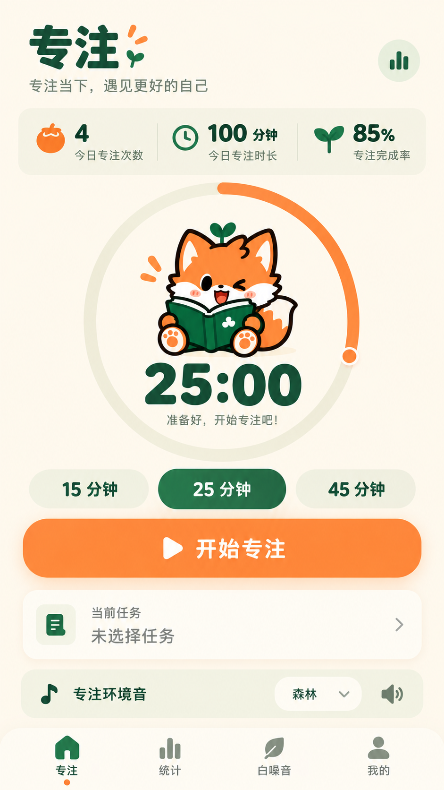

# 哦狐 App：完整需求、当前状态与后续实施交接

> 整理日期：2026-10-27，北京时间。供接手本项目的其他模型直接使用。
>
> 本文汇总用户在本次会话中的明确要求、已经写入代码的改动、已有验证及尚未完成的事项。源码和真实运行结果是实现状态的最终依据；设计图、历史报告、局部测试与真机验收不能相互替代。

## 1. 接手后先做什么

用户最后确认的下一项工作是：**检查“同步课表：登录教务、更新课程和提醒”这条完整流程**。随后继续成绩、考试、待办及提醒验收。

另有一项明确未完成的视觉要求：**番茄钟必须继续按用户最新参考图完整重做**。当前页面只是初步接入圆环与狐狸，用户尚不满意，不能将它视为最终交付。

建议执行顺序：

1. 阅读本文和本地源码，保留已经完成的修改。
2. 检查教务登录、验证码、课表同步、更新课程及重排提醒，先解决真实功能问题。
3. 按最新参考图完成番茄钟视觉、交互和连续动画。
4. 继续成绩/考试、待办和手机输入体验；同步逐页清理透明素材及统一非狐狸图标。
5. 本地逐页展示与用户验收；再准备新版 APK，连接手机完成真实安装和送达验证。
6. 管理端单独适配，最后处理正式发布。

这是用户明确要求的现有项目维护工作。不要另建 Expo/React Native 项目替换现有 App，不要重新发起已经回答过的偏好问题。

## 2. 工程和环境

### 2.1 必须使用的实际工程

```text
C:\Users\upwar\Desktop\新建文件夹 (4)
```

聊天环境曾显示 `C:\Users\upwar\Desktop\新建文件夹`，但实际修改、构建、素材和文档在带 `(4)` 的目录。执行命令时显式设置工作目录，先检查 `package.json`。

本地没有可靠的 Git 工作区状态可供直接假设；之前在上述目录执行 Git 状态查询返回“不是 Git 仓库”。先确认当前实际状态，保留用户已有修改，不要据此擅自重建项目。

### 2.2 技术栈

- React 19、TypeScript、Vite、React Router。
- CSS Modules、全局主题变量、`motion/react`。
- Capacitor 7：同一前端用于网页和 Android WebView。
- Android 原生 Java 插件、本地通知、系统闹钟及可选提醒守护服务。
- 腾讯云 CloudBase 相关后端，代码位于 `cloudfunctions/`。
- 桌面环境：Windows / PowerShell；用户时区 Asia/Shanghai。

### 2.3 当前版本与服务

| 项目 | 当前已确认状态 |
| --- | --- |
| `package.json` | `sunshine-campus`，`1.2.136` |
| 学生 Android 包名 | `com.sunshinecampus.app` |
| 管理 Android 包名 | `com.sunshinecampus.admin` |
| 常用开发地址 | `http://127.0.0.1:43123/`；使用前确认服务仍在运行 |
| 番茄钟页面 | `/study/focus` |
| 狐狸隔离验收预览 | 配置 `.fox-v1-qa/config.mjs`，端口 43129；是测试环境，不是真实在线账号 |
| 最近已记录安装的手机包 | 历史学生端 1.2.136，早于后续多项界面与提醒修改 |
| 本次提醒修改后的新版 APK | 尚未生成、未安装、未发布 |
| 手机连接 | 最近检查没有检测到设备；用户明确说暂时不方便连接，先查代码 |

不要因为源码版本仍是 1.2.136，就推断历史同版本 APK 已包含最新代码。

### 2.4 主要目录

```text
src/pages/                 页面和页面样式
src/pages/schedule/        课表、教务登录与同步
src/pages/study/           学业中心、番茄钟等
src/components/focus/     番茄钟导航、设置、弹窗、任务、音频等
src/components/fox/       狐狸展示、图鉴、头像选择、请求状态
src/lib/                  数据、同步、提醒、主题、素材与业务逻辑
src/context/              番茄钟状态、Toast 等
public/brand/             品牌与狐狸素材
android/                  Android 工程、插件、服务、接收器
patches/                  依赖补丁，含本地通知原生修改
cloudfunctions/           后端
tools/                    构建、发布和自动检查
docs/                     方案、历史审计、交接与验收记录
.tmp-diagnostics/         本地检查日志与诊断脚本
.fox-v1-qa/                狐狸/页面隔离预览与截图
.release-out/             已生成的历史安装包等
```

## 3. 用户已经确认的产品原则

1. **优先修复功能和操作流程。** 尤其是不能用、不好用、提醒异常及键盘挡住操作。
2. **先本地逐页验收，确认效果后再打包发布。** 用户也曾要求检查改动是否已经进入 APK；必须如实回答。
3. **学生端全部页面先适配，管理端随后单独处理。** 两端已有隔离不可破坏。
4. **原有狐狸元素保留。** 页面继续使用绿衣阿狐；其他非狐狸按钮图标统一绘制。
5. **所有应为独立插画的抠图都要透明底。** 去掉残余耳朵、邻近图案、浅色矩形、底色和拼图接缝；照片及完整场景图按用途保留。
6. **使用真实状态与数据。** 不用设计图里的示例数字充当统计，不假装请求成功、通知送达或后台保活。
7. **问题一次问清一个关键点。** 用户喜欢“你问我答”；已确认的答案持久有效，常规代码排查和修复直接推进。

## 4. 学业功能：下一步应继续实施的检查

### 4.1 用户选定的范围和优先级

优先范围是课表、成绩、待办、提醒。提醒已完成下面第 5 节的本轮代码修改，真实手机送达尚待验证。最新选择是先继续“登录教务 → 同步课表 → 更新课程 → 更新提醒”。

### 4.2 教务登录、课表同步

重点代码入口：

- `src/pages/schedule/ScheduleHome.tsx`
- `src/pages/schedule/SchoolScheduleGuide.tsx`
- `src/lib/auto-sync.ts`
- `src/lib/timetable.ts`
- `src/lib/schedule-cache.ts`
- `src/lib/schedule-credentials.ts`
- `src/lib/schedule-prefs.ts`
- `src/lib/schedule-calendar.ts`
- `src/lib/academic-cache.ts`
- `src/pages/study/StudyHubPage.tsx`

需要实际核对：

- 首次教务绑定、已绑定回填、记住学号/密码开关与账号归属。
- 自动识别验证码和手输验证码回退，验证码错误、密码错误、会话超时、断网及重试。
- 请求中防止重复提交，失败时保留合理的用户输入，切换账号后旧请求不能覆盖新账号。
- 同步的课表、成绩、考试分别成功或失败时正确报告；不能因部分失败清空上次可用数据。
- 当前学期、学期起始日、教学周、节次、夏冬作息、自定义作息及调课规则的实际计算。
- 空课表、未同步、缓存不属当前账号、超出课表覆盖期等状态需区分，不能都写“今天没课”。
- 取消、移动或修改课程后，原提醒被撤销，新提醒按真实时间重排。
- 退出、切换 App 账号、切换教务绑定时，旧账号课表与提醒不得串到新账号。
- 访客没有个人提醒归属，应准确解释同步与提醒的差别。
- 前后台恢复与进度提示不应反复触发登录或重复同步。

以上是本轮下一步验收清单，不表示全部缺陷已经确认，更不表示都已修复。

已有相关测试可先检查：`tools/timetable-http.test.mjs`、`tools/academic-sync-session.test.mjs`、`tools/academic-terms.test.mjs`、`tools/schedule-cache.test.mjs`、`tools/schedule-prefs-session.test.mjs`、`tools/schedule-schools.test.mjs`。

### 4.3 成绩、考试与待办

后续检查成绩与考试的学期切换、空状态、缓存归属、成绩计算、同步失败保留旧数据及考试提醒。成绩应使用实际教务数据；本机手工成绩与教务成绩要保持来源清楚。

待办应检查新增、编辑、删除、完成、撤销完成、到期时间、排序、筛选、失败回滚、账号隔离和对应提醒。完成番茄钟后是否完成关联待办，应保留用户确认，不自动替用户勾选。

入口包括 `src/pages/TodoPage.tsx`、`src/lib/todo.ts`、`src/lib/todo-remind.ts`、`src/lib/grade-book.ts`、`src/lib/academic-cache.ts` 及学业中心。按源码核对真实路径和调用，不要据旧报告直接宣布缺陷仍存在。

## 5. 课程提醒：已确认规则、已改代码及边界

### 5.1 用户真实反馈

- 提醒时间异常，提醒过后还提醒。
- 课程上完后又提醒。
- 有时该上课了却没提醒。
- 使用 Android 安装版哦狐；明确场景是**从最近任务列表划掉 App 后漏提醒**。
- 本轮不方便连接手机，明确授权先检查、修复代码。

### 5.2 最新明确规则

- 保留两个独立时点：**课前 15 分钟 + 开课时**。
- 每个时点只提醒一次，两个不同阶段不应被误判为重复。
- **课程提醒到原定时间满 1 分钟后作废。** 用户选择该规则来避免延迟补发。
- 课前提醒还受开课时间限制，开课提醒还受下课时间限制；取更早的失效边界。
- 原生安全顺延排程不能顺延“原提醒时间”，也不能延长其有效期。
- 铃声、震动和系统权限仍按真实设置执行。

### 5.3 2026-10-27 已完成的本轮修改

| 内容 | 当前状态 |
| --- | --- |
| 应用内课程提示的最大延迟 | 30 分钟改为 1 分钟 |
| Android 课程通知最大延迟 | 30 分钟改为 1 分钟；也作用于旧保存通知 |
| 桌面覆盖课程提醒 | 同样限制 1 分钟，包括旧卡片；非课程覆盖卡片保持原规则 |
| 设置页文案 | 已说明 1 分钟作废与课程边界 |
| 任务移除恢复 | 可选提醒守护服务收到 `onTaskRemoved` 后恢复未来原生课程排程 |
| 守护关闭与账号规则 | 不重新开启用户关闭的守护，沿用原计划中的账号和恢复偏好检查 |
| 依赖重装持久化 | 已同步更新 `patches/` 中本地通知补丁 |

关键文件：

```text
src/lib/course-reminder-expiry.ts
src/lib/class-remind.ts
src/lib/reminder-presentation.ts
src/lib/reminder-plan.ts
src/lib/personal-reminders.ts
src/components/RemindHost.tsx
src/components/CourseReminderSettings.tsx
android/app/src/main/java/com/sunshinecampus/app/ReminderPlanStore.java
android/app/src/main/java/com/sunshinecampus/app/ReminderPlanReceiver.java
android/app/src/main/java/com/sunshinecampus/app/ReminderOverlayStore.java
android/app/src/main/java/com/sunshinecampus/app/KeepAliveService.java
android/app/src/main/AndroidManifest.xml
patches/@capacitor+local-notifications+7.0.7.patch
```

本地通知的实际依赖代码中也修改了 `CourseReminderPolicy.java`；不能只保留 `node_modules/` 的改动而丢弃补丁。

### 5.4 已有验证

- 本轮提醒及相关课表自动检查 **213 项通过、0 失败、0 跳过**。
- 包括真实 Java 课程接收器、补排及守护服务代码在无副作用平台替身下的控制流执行。
- 网页生产构建通过。
- Android 学生端 Java 编译通过：`compileUserDebugJavaWithJavac`。
- 日志：`.tmp-diagnostics/reminder-regression-2026-10-27.log`、`.tmp-diagnostics/reminder-build-2026-10-27.log`、`.tmp-diagnostics/reminder-android-compile-2026-10-27.log`。
- 详细记录：`docs/课程提醒检查与修复-2026-10-27.md`。

213 项不等于全项目功能都已验收，也不证明真实手机已经收到通知。

### 5.5 尚未证明的事情

任务移除回调能否送达、厂商系统是否保留和执行闹钟、是否响铃/震动，尚未用用户手机验证。恢复补救只在开启守护且收到系统回调时有机会执行；不得承诺所有清理后台方式都能送达。

历史存在的系统排程、开机恢复、精确闹钟和独立通知卡，不是“跨品牌云推送已经接通”的证据。不要把常驻卡仍显示等同于到点一定提醒。

真机验收需分别覆盖：前台、回桌面、锁屏、划掉最近任务、重启解锁、通知/精确闹钟权限变化、课程取消与时间变化、退出/切账号、前后两阶段、重复广播、到期作废及铃声震动组合。不要为了测试更改真实课程或生产数据；需合成事件时明确隔离并清理。

## 6. 番茄钟：用户要求的是最新参考图的完整效果

### 6.1 最高优先级视觉参考

用户原话：**“参考这种制作，我需要完全是这样子的效果。”**

用户最后提供的目标图已保存到项目，避免临时附件失效：



参考路径：`docs/ui/番茄钟最终参考-2026-10-27.png`。

较早文件 `docs/ui/番茄钟概念设计-2026-10-27.png` 和 `docs/ui/番茄钟设计稿与动效方案-2026-10-27.md` 可作补充；若与最后参考图的视觉要求冲突，以最后参考图为准。旧方案中的“主计时卡”等结构不能成为拒绝还原最新画面的理由。

### 6.2 必须还原的视觉特征

- 暖象牙白整页背景，柔和浅绿/米色辅助区域，森林绿文字和狐狸橙强调。
- 大号“专注”标题、芽叶/橙色点缀，副标题“专注当下，遇见更好的自己”，右侧统计快捷入口。
- 三列浅色统计条，图标、主数值、单位和说明有清晰层级。
- 页面中心是大面积独立圆环；浅底轨道、橙色圆弧、圆润端点与端点标记，不能继续只用当前卡片里的绿色小圆圈近似代替。
- 圆环中上部显示较大的绿衣读书阿狐，下方是大号倒计时与状态文案，狐狸不能挡数字。
- 15 / 25 / 45 分钟三颗胶囊按钮；选中项森林绿、白字，其余为浅色。
- 大号橙色圆角“开始专注”主按钮，明确的播放图标。
- “当前任务”白色卡片，任务图标、内容和进入箭头。
- 浅色“专注环境音”栏，音源选择与音量控制。
- 底部导航风格、间距、触控面积与整页氛围接近参考。
- 先针对 390px 左右常见手机宽度完成，再验证 320px、常见较宽手机、深色、系统字体放大和安全区。

图中“4 次、100 分钟、85%”全部是示意，不能写死。当前已有今日时长/完成次数/连续天数；**完成率需要真实分母和存储口径**，不能把连续天数当完成率。若当前记录不足，准确处理未知状态，再补充真实计算方案。

参考底栏是“专注、统计、白噪音、我的”，当前产品是“计时、任务、统计、设置”。重构导航前应明确功能映射，保留任务、音频、设置和返回入口；不能只换图标文案却留下错误跳转。若涉及实质流程选择，再进行简短问答。

### 6.3 当前代码实际上做到哪一步

- `src/pages/study/StudyFocusPage.tsx` 和 `src/pages/study/focus.module.css` 已有第一版圆环、真实倒计时及狐狸展示。
- 圆环目前是绿色 `conic-gradient`，仍有计时卡和旧布局；**未完整达到最新目标图**。
- 新透明素材 `public/brand/ohu-original/focus-reading-blink-v1.png` 是四格横向读书眨眼图。
- 专注中约每 10 秒低频播放一次眨眼；暂停及减少动态效果时不循环。
- 素材未加载时回退原有读书阿狐，休息切换趴下姿势，真实完成事件短暂切换庆祝姿势。
- 已在隔离页面检查过 320px、深色、15/45 分钟显示切换、素材加载及减少动态；不代表所有计时状态和手机后台已经实测。
- **开始、暂停、继续、休息等完整连续动作帧尚未制作。** 不能把现有几个不连续姿势冒充完整逐帧动画。

### 6.4 需要制作的状态动效

| 真实状态 | 目标表现 | 触发约束 |
| --- | --- | --- |
| 准备 | 看书、抬头、轻点头 | 进入时一次，随后静止 |
| 开始 | 放书、坐正、开始学习 | 实际启动成功才播放，约 600–900ms |
| 专注 | 轻呼吸或眨眼 | 低频约 8–15 秒一次，避免干扰读数 |
| 暂停 | 停笔、抬头 | 一次过渡，暂停期间静止 |
| 继续 | 点头并继续学习 | 实际恢复后一次 |
| 休息 | 合书、伸展、趴下 | 真实进入休息才触发 |
| 完成 | 抬头、开心、举爪 | 真正完成且记录成功，约 1–1.5 秒 |
| 错误/权限受限 | 思考并配真实提示 | 提供真实可执行的解决入口 |

新帧统一尺寸、比例、透明底和锚点，防止狐狸在切帧时突然变大或跳位。动画卸载、切页、切后台、关闭动态效果均不得重置倒计时或重复结算。

计时与数据入口：`src/context/FocusTimerContext.tsx`、`src/lib/focus-timer.ts`、`focus-store.ts`、`focus-stats.ts`、`focus-notify.ts`、`focus-notification-plan.ts`、`focus-audio.ts`、`focus-music.ts`、`focus-lock.ts`，以及 `src/components/focus/FocusInteractions.tsx`。

要保留暂停/继续、延长、提前结束、休息、后台恢复、声音、提醒、勿扰、屏幕固定、待办关联、统计及下一轮设置。提前结束不播成功庆祝、不计为完整专注。

## 7. 狐狸、透明底素材与品牌风格

### 7.1 两套狐狸分工已确认

| 素材 | 用户确定用途 |
| --- | --- |
| 原有绿衣阿狐 | 页面插画、首页常用功能、番茄钟、服务与加载等 |
| V1 夸张变脸阿狐 | 启动封面、头像/聊天贴纸/表情图鉴、可选桌面变脸 |

不要把全站绿衣狐狸都换成夸张大头像。首页常用功能用户已明确要求换回原来小狐狸插画，后续也不要再改成统一四格色块。

### 7.2 透明抠图要求

用户反复指出过以下位置：服务页分类按钮、最近使用图标、个人页账号卡狐狸下方残余耳朵、成长插画旁残余图案、其他页面按钮图片。要求所有应独立展示的素材具有真实透明通道和完整干净轮廓。

透明 PNG 存在不代表裁切正确：源图若是拼图，即使背景已透明，裁切范围也可能包含隔壁耳朵、书本或其他狐狸。检查时必须把素材放到浅、深、彩色背景并放大查看。

优先入口：`src/lib/fox-sheet.ts`、`src/components/fox/FoxSheetPose.tsx`、`src/components/brand/StudentServiceArtwork.tsx`、`src/components/HomeServiceIcon.tsx`、`public/brand/ohu-original/`。

不要靠把头像放大后裁掉问题边缘解决：用户已经反馈过狐狸太高、挡住文字、跑出按钮边框。需要固定图像区域、保留文字区域、限制绘制尺寸并逐页验收。

### 7.3 V1 素材及已实现范围

原始压缩包：`C:\Users\upwar\Downloads\ohu_fox_assets_v1.zip`。

- 首发 16 款全部可作为头像和聊天贴纸选择，**不按登录天数锁定**。
- 登录天数仅影响自动变脸和启动封面展示。
- 另有 4 张备用图，未放入首发运行时选择目录。
- 16 款已接入头像选择、贴纸和图鉴，保留照片上传/裁剪入口。
- 首页和我的页“戳脸、点狐狸弹一句提示”互动按用户选择取消，保留静态插画与加载动画。
- 桌面 App 自动变脸默认关闭，用户在设置主动开启；不得擅自默认打开。
- Android 桌面变脸已有本地实现与测试，真实桌面行为未验收；iOS 原生图标/桌面组件不能宣称已经实现。

参考：`src/lib/fox-v1.ts`、`src/lib/fox-v1-assets.ts`、`docs/ui/阿狐V1本地接入记录-2026-10-27.md`、`.fox-v1-qa/README.md`。

全站素材是否都清理完成尚未逐页证明，仍需继续检查。

## 8. 启动、切页和登录动画：已确认规则

- 每次完全重新打开 App 时播放冷启动动画；从后台切回不重复。
- 首页实际准备好可以提前进入，装饰动画最多约 3 秒，包含淡出；不用固定时长阻塞用户。
- 首页/服务/广场/我的之间，快速切页只轻微转场；加载慢才出现阿狐加载。
- 哦狐账号登录与学校教务登录/课表同步都使用动画，配文对应各自真实请求。
- 动画不伪造登录成功、同步成功或进度百分比；失败后保留输入并给出重试。
- 三种封面：怼脸、天数成就、漫画变脸；结合真实登录状态随机选择。
- 登录状态和天数未知时不编造数字、不展示假成就；真实记录到达不能重播整段故事。
- 使用现有透明阿狐姿势与位移动效还原用户分镜；完整连续新帧需另行制作。
- 系统减少动态效果时使用静态或最小淡入。

当前源码已接入三种启动封面、约 3 秒上限、300ms 慢路由 loading 阈值、180ms 快页面淡入以及原位登录请求反馈。已有局部逻辑和隔离浏览器检查，**未安装进本次新 APK、未用真实账号完成全部登录/同步动画验收**。

关键文件：`src/lib/boot.ts`、`src/lib/startup-cover.ts`、`index.html`、启动相关 CSS、`src/components/fox/FoxRequestIndicator.tsx`。按实际源码追踪剩余关联入口。

已保存的用户分镜：

- `docs/ui/启动动画用户分镜-2026-10-27.png`
- `docs/ui/页面转场用户分镜-2026-10-27.png`
- `docs/ui/账号登录用户分镜-2026-10-27.png`
- `docs/ui/阿狐变脸用户参考-2026-10-27.png`

现有验收及预览：`docs/ui/fox-v1-startup-2026-10-27/验收记录.md`。开发模式可用 `/?preview=boot&startup=face&view=student`，另有 `achievement`、`comic`。这些开发预览不能被当成真实登录成功证据。

## 9. 按钮、图标、深色模式与手机输入体验

### 9.1 按钮交互与图标

用户已经选择：

- 所有学生端按钮轻快克制：按下微缩，松开回弹。
- 普通按钮仅视觉反馈。
- 发布、保存、开始/完成专注、点赞收藏等关键操作给予一次轻微触感，尊重系统触感开关。
- 狐狸元素按钮保留原插画；其他图标统一绘制，具体视觉细节由实施者判断。

目前共用非狐狸服务图标已改为深绿圆润线条，学生端按钮/链接有通用按压效果；Android 触感桥接已接代码。**全站独立图标仍需逐页检查，手机触感未实机验收**。

`src/lib/student-haptics.ts` 当前按按钮名称识别关键操作，后续应检查实际各状态下的覆盖和重复触发风险，必要时改为明确语义标记；不要给所有键盘输入或普通按钮无差别振动。

用户曾明确投诉个人页“通知中心、联系管理员”等图标空白。局部已修过，继续检查透明素材、SVG 填充/描边、主题颜色和资源加载，防止只剩色块。

首页常用功能中狐狸与文字曾重叠、狐狸过高或越界，已做局部尺寸修复；所有断点仍应复核。

### 9.2 深色模式

- 快捷开关放在首页、服务、广场、我的四个主页面；专注页原有开关保留。
- 切换作用于整个 App。
- 记住用户手动选择，设置里可改回“跟随系统”。
- 四个主页面已有入口，需继续核对全页对比度、弹窗、图标、表单、状态栏和系统字体放大。

### 9.3 输入法/键盘

用户实际问题是：**键盘挡住重要界面，输入和发送不方便**。用户贴过自定义输入法教程，但当前工作应集中在现有 App 的输入交互，不应据教程擅自安装 skill、重建 Expo 工程或实现拼音引擎。

需逐页检查聊天、广场评论/发布、待办、登录、教务验证码及各弹窗：

- 键盘弹出后当前输入框、确认/发送按钮可见，底部安全区和滚动区域合理。
- 键盘弹出/收起不重复偏移、不跳动，不因网页 resize 与原生 resize 双重处理而抬升两次。
- 中文输入组合未结束时不误发送；Enter、换行和发送按钮行为清晰。
- 多行输入自动增高有合理上限；长内容不挤掉发送入口。
- 防止连点重复发送，发送失败保留草稿，附件上传状态真实。
- Android 原生 WebView 真机检验；桌面缩小窗口不能替代输入法验收。

已有部分输入与交互改动的历史记录，但完整逐页真机验收未完成。重新核对源码及已有键盘测试，避免把历史记录直接当作全部完成。

## 10. 其他已提出的页面要求

### 10.1 校园地图

用户原话是“你就画图就可以了，其他的标记楼的地名让管理员账号来改”。

- 手绘校区图提供布局参考；最终要接近用户展示的 App 地图界面效果。
- 地图画面、搜索分类、图钉和地点卡片要形成完整界面；不要把带手机框的参考图整张当作可交互界面。
- 建筑/地点名称与标记由管理员账号编辑维护；不能为了画面好看捏造真实地理信息。
- 学生查看与管理员编辑权限继续隔离。
- 用户界面参考已保存：`docs/ui/校园地图效果用户参考-2026-10-27.png`。
- 入口：`src/pages/CampusMapPage.tsx`、管理员地图相关页面；已有方案见 `docs/ui/项目结构与地图优化方案-2026-10-26.md`。

### 10.2 个人页、学业中心和信息站

- 个人页账号卡曾被要求重新设计，避免头像、狐狸、资料、按钮和说明互相挤占；成长插画需干净透明。
- 阿狐图鉴使用本次图片库，当前首发 16 款已接入，继续验收外观与真实保存流程。
- 学业中心 `/study` 曾要求整体重设计，顶部介绍/行动区布局已有局部修复，尚无用户对完整最终稿的确认。
- 校园信息站 `/info` 的发布悬浮按钮位置不合理，已移到标题右侧并保留原发布流程和权限；需继续核对与底部发布入口的关系。

### 10.3 校园卡与完美校园

用户要求：手机已安装完美校园时，点击校园卡官方入口直接打开完美校园；未安装时使用合理的官方后备入口。

已有 `AppProbePlugin.java`、Android 包可见性声明及页面入口修改；曾使用候选包名 `com.newcapec.mobile.ncp`。**实际第三方包名、启动成功与回退行为尚未在用户手机验收**，不要宣称已经确定兼容所有版本或 iOS。

## 11. 目前已有成果和不能宣称完成的事项

| 项目 | 交接时状态 |
| --- | --- |
| 课程提醒 1 分钟过期与原生恢复补救 | 代码已改；213 项相关检查和网页/安卓编译通过；手机未验收 |
| 教务登录 → 更新课表 → 更新提醒全流程 | 用户最新选择的下一项，尚未完成本轮全流程检查 |
| 成绩、考试、待办完整验收 | 待继续 |
| 番茄钟按最新用户图精确改版 | 未完成；当前为第一版绿色环/旧卡片布局 |
| 番茄钟四帧眨眼素材 | 已生成并接入，仍需与最终视觉统一 |
| 番茄钟完整连续状态动画 | 未完成 |
| 16 款透明头像、贴纸、图鉴 | 已接入，有隔离检查；真实上传/聊天链路仍需验收 |
| 三种冷启动、慢加载和原位请求反馈 | 已接代码并有局部测试，真实登录/原生生命周期待验收 |
| 全站透明抠图与所有图标 | 有局部修改，全面逐页验收未完成 |
| 四大主页面深色模式入口 | 已接入，全面主题检查未完成 |
| 按钮视觉与关键触感 | 通用代码已接入；全页语义覆盖及手机触感待验收 |
| 键盘遮挡和发送体验 | 待继续逐页与真机验证 |
| 完美校园拉起 | 代码已接，目标手机待验收 |
| 最新代码打包、安装、发布 | 尚未完成；不能把旧 1.2.136 APK 当作本轮新包 |

## 12. 可用命令与验证方式

以下 PowerShell 命令在实际工程根目录运行。已有服务正在使用端口时先检查，避免重复启动占用端口。

```powershell
Set-Location 'C:\Users\upwar\Desktop\新建文件夹 (4)'
npm run dev -- --host 127.0.0.1 --port 43123
npm run build
```

提醒相关检查的本轮可复现命令：

```powershell
$reminderTests = Get-ChildItem tools -File -Filter '*.test.mjs' |
  Where-Object { $_.Name -match 'remind|schedule-cache|schedule-prefs|keep-alive' } |
  Select-Object -ExpandProperty FullName
node --test @reminderTests
```

Android 本地学生端 Java 编译的成功方式：

```powershell
$env:ANDROID_HOME = Join-Path $env:LOCALAPPDATA 'Android\Sdk'
$env:ANDROID_SDK_ROOT = $env:ANDROID_HOME
Set-Location android
.\gradlew.bat :app:compileUserDebugJavaWithJavac --offline --console=plain '-Pandroid.overridePathCheck=true'
```

工程路径含中文，需要上述路径检查参数；工程有 User/Admin 变体，`compileDebugJavaWithJavac` 不是明确的目标。Java 编译成功不等于正式 APK 已生成或签名验收通过。

番茄钟相关测试：

```powershell
node --test tools/focus-timer.test.mjs tools/focus-store.test.mjs tools/focus-music.test.mjs
```

狐狸隔离页面：

```powershell
node node_modules/vite/bin/vite.js --config .fox-v1-qa/config.mjs
node .fox-v1-qa/verify.cjs
node .fox-v1-qa/login-check.cjs
```

这些脚本中的模拟账号、上传回调、虚构课程和截图只能作为隔离测试数据。不要将它们引入生产入口，不要用测试脚本修改用户真实浏览器中的协议、权限、账号或存储状态。

本地 Playwright 不在工程直接依赖中；历史脚本使用已有运行时的 Playwright。换机器时先检查工具是否可用，不要把绝对缓存路径当成项目运行依赖。

## 13. APK 与发布要求

历史 APK：

```text
.release-out/apk/1.2.136-136/SunshineCampus-User-1.2.136.apk
```

历史文件大小 38,731,968 字节，历史验收记录在 `docs/ui/Android本地安装验收-1.2.136-2026-10-26.md`。不要覆盖这个历史安装包来冒充已发布同版本。

用户手机此前通过保留数据覆盖安装过 1.2.136，但当时的包早于这些后续修改。重新连接后读取手机实际安装版本和包名，再决定安装步骤。

准备新包时：

- 使用新版本并同步工程内相关版本信息、构建号和锁文件，先检查现有发布脚本要求。
- 保持学生/管理包名与原有签名，不卸载、不清数据来规避更新问题。
- 通过 `tools/release-android.mjs` 等现有流程生成对应端安装包，验证包名、版本、签名和资源。
- 可先使用 `npm run release:plan` 了解实际计划；注意正式构建脚本可能含其他产物步骤，执行前先读源码。
- 本地安装验收与上传发布分别处理；当前用户选择是先本地逐页验收。
- Java、Manifest、系统通知或原生插件修改必须进入新 APK；网页热更新不能替换它们。
- 不输出密码、签名密钥、云端凭证、用户课程明细或设备私密日志到交接文件或聊天。

## 14. 建议的交付标准

### 14.1 功能

- 真实使用流程可跑通，请求、错误、重试、取消和空状态有准确反馈。
- 数据和提醒按当前账号隔离，晚到请求不能覆盖新账号。
- 课程更新后提醒同步更新，失效提醒不补发，同一时点不重复。
- 后台相关能力给出真实设备与场景的验收结果。
- 发布、保存、完成待办与发送消息均处理失败和连点重复提交。

### 14.2 视觉与动画

- 番茄钟页面与用户最后参考图直接并排对比，逐项检查比例、主色、留白、圆环、狐狸大小、字号、按钮和底栏。
- 所有需要透明的独立素材清理干净；狐狸不越界、不挡字。
- 保留狐狸按钮特色，统一其余图标及按下反馈。
- 320px、常见手机宽度、深色、字体放大、键盘和安全区均能正常操作。
- 动画符合真实业务状态，减少动态设置有效，不制造虚假成功或进度。

### 14.3 每次报告

每轮清楚说明：改了什么、如何验证、哪些设备/服务没有验证、是否已经进入 APK、是否安装或发布。不要把“编译通过”“隔离浏览器通过”“真机通过”混成同一种完成状态。

## 15. 给接手模型的执行提示

你正在接手已有较多改动的哦狐校园 App。请继续现有工程，先读取本文件定位实际代码，不要从零重建。

当前用户选定的下一步是“教务登录 → 同步课表 → 更新课程 → 更新提醒”。先检查现有测试与真实控制流，用可复现问题推动修改；对不需要用户账号或手机的部分直接完成，对确实缺少的输入一次询问一个关键问题。

同时保留“番茄钟按最后参考图完整重做”的待办。这一要求尚未完成，当前绿色环版本不是最终稿。所有示例数字必须替换为真实状态，无法计算的指标准确处理未知。

已经确认的规则不要反复询问：先学生端、功能优先、本地验收后打包、保留绿衣阿狐、16 款全部可选、自动桌面变脸默认关、启动最多约 3 秒、慢切页才出现 loading、保留课前 15 分钟和开课时两个提醒、延迟满 1 分钟作废。

请沿用已有测试、素材和文档，将尚未证实的内容标明待验证。完成后交付代码、截图/可运行本地页面、检查结果和真实的安装包状态。
