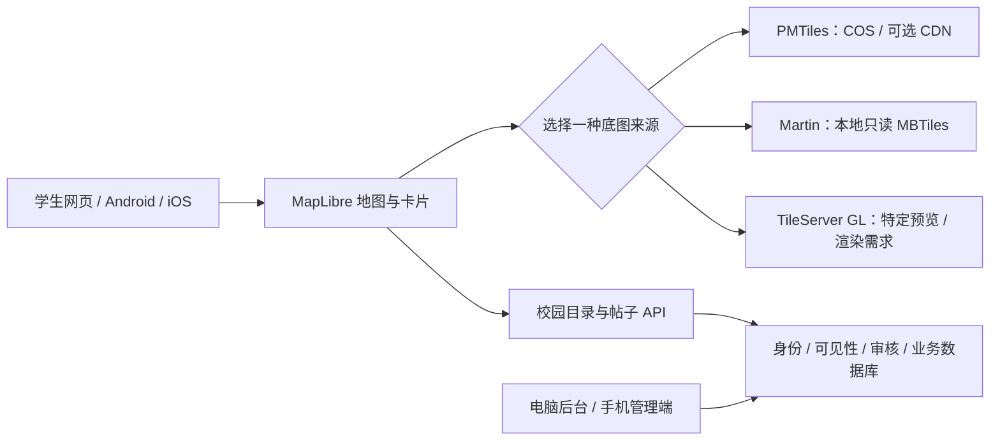

# 哦狐：校园地图与校园圈改版方案

编写日期：2026-10-23（北京时间）  
文档状态：需求分析与修改规划；尚未实施地图功能、为地图新建资源或发布地图新版。  
适用项目：`C:/Users/upwar/Desktop/新建文件夹 (4)`，承接现有账号、数据、学生端与管理端。

## 一、先确定方向

目标：选校园 → 看地图动态 → 详情 → 发布/互动/聊天；保留课表、提醒、好友和管理功能。地图外观取决于数据、样式和前端，TileServer GL不会自动生成社交界面。[MapLibre 数据源](https://maplibre.org/maplibre-style-spec/sources/)

建议顺序：**MapLibre + PMTiles + COS** 静态底图 → 需标准接口则 **Martin + 本地只读MBTiles** → 需原版预览/渲染则 **TileServer GL**。最低价格待实测。

本轮只交付规划。地图、配置和费用未实测，材料留空；不修改现有安装包和热更新。

## 二、五张参考图对应的功能

| 参考 | 可观察的内容 | 哦狐建议做法 |
| --- | --- | --- |
| 图1 | 全屏地图、学校选择、头像、动态卡片、定位/发布 | 地图/列表切换，按视野查询 |
| 图2 | 个人名片、院系/年级、装饰和动态 | 本人与公开主页分开，资料逐项公开；装饰后做 |
| 图3 | 校园、建筑标注、配图动态、校园圈/聊天 | 核实校园目录，复用私信 |
| 图4 | 回到定位点、地点关联卡片 | 点按钮才定位，拒绝可手选，不上传GPS |
| 图5 | 主题日报、往期、精选帖子 | 管理选文，原帖撤回则撤回引用 |

截图仅作交互参考；上海、南京校园不作连云港数据，不复制原商标、校徽、头像和内容。

“体力/魔力、金属质感、按压动效”未提供对应视频，无法判断制作软件与逐帧参数。列为后续参考；首期沿用哦狐视觉，不恢复归档游戏。

## 三、原部署说明需要纠正

| 原说法 | 应采用的准确表述 |
| --- | --- |
| MBTiles放镜像重启会消失 | COPY文件属于镜像，新实例仍具有它。临时写入才不可作为唯一副本；小型只读地图可内置，更新时重建镜像 |
| 必须 COS 文件系统挂载 | 挂载可选；还可镜像内置、启动下载或PMTiles静态读取 |
| Martin 256MB 就能在该平台运行 | 不能据此保证。CloudBase 当前概述的最小粒度为0.25核/0.5GB；本环境实际可选规格和峰值占用仍需核对 |
| 最小实例0即完全免费 | 缩零仅减少实例计算消耗；套餐、存储、请求、流量/CDN、镜像和日志等仍可能计费 |
| 没人访问马上缩零 | 官方说明包括持续约半小时无业务流量的缩零条件；实际服务设置和冷启动等待需验证 |
| 最大1、CPU70%适合所有情况 | 仅可做低并发实验配置，无法保证应对高峰；需根据内存、请求并发、冷启动和预算决定 |
| 使用 `urbica/martin:latest` | 当前官方镜像为 `ghcr.io/maplibre/martin`；固定验收版本/digest，不混用稳定版与beta文档 |
| Martin 地址为 `/{z}/{x}/{y}.pbf` | 先查 `/catalog` 与实际源的 TileJSON；常规路径包含 `/{sourceID}/{z}/{x}/{y}`，按服务器返回模板使用 |
| 任意 MBTiles 配 Protomaps 样式都可用 | MBTiles 只是归档格式；内部图层和属性必须匹配样式的 source-layer，不能直接混用不同 schema |
| 公网访问云域名加`:8080` | 8080/3000是容器内部端口；公网使用平台实际提供的 HTTPS 域名与路由，不擅自追加内部端口 |
| 官方镜像 CMD 再写一次 tileserver-gl | 官方镜像已有入口脚本；提供 `--file` 或 `--config` 参数，避免重复可执行命令 |
| 12MB、maxzoom16保证连云港校园细节 | 尚未收到文件。需核对范围、图层、时间、道路/建筑/中文标注；放大已有瓦片不会增加原始细节 |
| TileServer GL 加个搜索即可有 Nominatim | Nominatim 是独立地理编码服务，有数据导入、数据库和维护成本，不是预览页自带搜索 |

依据：[Docker 镜像层](https://docs.docker.com/get-started/docker-concepts/building-images/understanding-image-layers/)、[CloudBase 概述](https://docs.cloudbase.net/run/introduction)、[服务设置](https://cloud.tencent.com/document/product/1243/77197)、[Martin Docker](https://maplibre.org/martin/run-with-docker/)、[Martin API](https://maplibre.org/martin/using/)、[镜像入口](https://raw.githubusercontent.com/maptiler/tileserver-gl/master/docker-entrypoint.sh)。控制台版本可能有差异，以实际环境复核。

## 四、三种底图架构候选

底图静态缓存；帖子、头像和审核走业务API，私密动态不写入地图归档。

### A. 优先验证：MapLibre + PMTiles + COS

客户端按需读取静态底图，省去瓦片容器；仍付容量、请求和流量费用，CDN按缓存收益决定。[浏览器集成](https://docs.protomaps.com/pmtiles/maplibre)、[云存储条件](https://docs.protomaps.com/pmtiles/cloud-storage)

顺序：合法地图 → 核对图层 → 转换/验证 → 版本化上传 → CORS/缓存 → 三端测试 → 接业务卡片。转换不只是改扩展名，也不补建筑。[转换工具](https://docs.protomaps.com/pmtiles/cli)

实测 `206 Partial Content`、`Content-Range`及局部字节。CORS按三端实际Origin核对GET/HEAD/OPTIONS、Range/If-Match和ETag；CDN一起测。短期URL验证续期，前端不用长期云密钥。[COS 下载](https://cloud.tencent.com/document/product/436/14115)、[CORS](https://cloud.tencent.com/document/product/436/13318)

通过条件：样式兼容、Range/CORS、三端加载和费用可接受；否则转B，不能反复拉整文件。

### B. 次选：Martin + 本地只读 MBTiles

需要XYZ/TileJSON时采用。固定官方镜像，本地只读文件，默认 `0.0.0.0:3000`；COS HTTPS地址不能当本地路径。[CLI](https://maplibre.org/martin/run-with-cli/)、[MBTiles源](https://maplibre.org/martin/sources-mbtiles/)

比较镜像内置与私有COS启动下载：按大小、更新频率和冷启动选择。权威副本版本化保存，每个实例能重建缓存，校验完成才就绪。

启动下载要求：受限身份、超时/有限重试、`.part`文件、SHA-256和SQLite校验、原子切换、就绪检查；不边下载边查询、不改正在读取的库。

验收：`/health` → `/catalog` → `/{sourceID}` TileJSON → 返回的tiles模板 → 中文样式。核对bounds、zoom、vector_layers；不自拼后缀。[Martin API](https://maplibre.org/martin/using/)

COS挂载作为备选压测，核对实际驱动/缓存/随机读取；不当本地盘，不在其上写SQLite，也不套用其他FUSE权限要求。[COS挂载](https://docs.cloudbase.net/run/deploy/configuring/storage/cos)、[SQLite说明](https://www.sqlite.org/useovernet.html)

### C. 特需时采用：TileServer GL

需要官方预览或服务端栅格渲染时采用；社交页面仍要开发。[使用说明](https://tileserver.readthedocs.io/en/latest/usage.html)

固定官方镜像版本/digest，保留入口；文件传 `--file`，完整配置传 `--config`，不假定二者同时生效。内部8080与公网入口分开，核对public_url。

核验 `/`、`/styles.json`、`/styles/{id}/style.json`、`/data/{id}.json`及瓦片地址。完整版支持服务端渲染，light版不提供；仅客户端绘图先确认必要性。[接口](https://tileserver.readthedocs.io/en/latest/endpoints.html)

选定路线后再编写固定版本Dockerfile；本规划不附猜测域名/挂载路径的伪运行配置。

## 五、数据、样式、坐标先验收

| 核查对象 | 通过条件 |
| --- | --- |
| 来源与许可 | 文件来源、日期、许可、可公开分发条件明确；代码、样式、字体、图标与地图数据分别列清单 |
| 覆盖范围 | 核对连云港目标学校各校区，而非只验证一个城区；bounds、实际瓦片与校区边界一致 |
| 图层匹配 | vector_layers、属性名与style的source-layer/过滤器一致；不混用OpenMapTiles和Protomaps schema |
| 中文资源 | glyph/font、sprite JSON/PNG完整可访问；学校、教学楼、食堂等文字可读，缺项明确标记 |
| 地理精度 | 明确每批POI和坐标来源；地图、建筑锚点与定位对齐；不默改旧坐标 |
| 数据版本 | 记录SHA-256、大小、生成时间；新文件完整上传后切换配置，避免Range混读新旧字节 |

样式须配资源且匹配schema。[Protomaps资源](https://docs.protomaps.com/basemaps/maplibre)、[图层](https://docs.protomaps.com/basemaps/layers)、[OpenMapTiles](https://openmaptiles.org/docs/schema/)

MapLibre经度在前、纬度在后，用WGS84；高德通常GCJ-02。保留来源坐标类型，用多个真实控制点核验。[MapLibre](https://maplibre.org/maplibre-gl-js/docs/API/classes/LngLat/)、[高德](https://lbs.amap.com/faq/advisory/others/39838)

保留署名；高zoom重用不增加细节，缺POI用独立核实图层补。[署名](https://osmfoundation.org/wiki/Attribution_Guidelines)、[maxzoom](https://maplibre.org/maplibre-style-spec/sources/#maxzoom)

首期搜核实POI。Nominatim标准导入至少2GB内存；实验SQLite也需先导入再转换，另行估价。[安装](https://nominatim.org/release-docs/latest/admin/Installation/)、[SQLite](https://nominatim.org/release-docs/latest/customize/SQLite/)

## 六、现有项目需要怎样改

路径相对项目根目录；新增项尚不存在。当前未集成MapLibre/Leaflet或校园地图。

| 当前文件/模块 | 当前情况 | 计划修改 |
| --- | --- | --- |
| `src/App.tsx` | 路由、懒加载、双壳 | 增地图/公开主页/日报次级路由 |
| `src/components/PhoneShell.tsx`、`TabBar.tsx` | 首页/服务/发布/广场/我的 | 保留五项，广场增地图/列表 |
| `src/pages/plaza/PlazaPage.tsx`、`src/lib/plaza.ts` | 固定campus大厅，帖子无位置 | 保留旧数据，新公开帖子独立读写 |
| `src/pages/moments/*`、`src/lib/moments.ts` | 朋友圈三种可见范围 | 复用组件与会话防护，不自动公开 |
| `src/pages/ProfilePage.tsx`、`src/lib/auth.tsx` | 本人敏感资料 | 新增公开白名单和开关 |
| `ChatListPage.tsx`、`ChatRoomPage.tsx`、`src/lib/dm-entry.ts` | 会话/未读 | 取得真实线程后进入私信 |
| `src/lib/college-group.ts` | 单校学院key | 多校按学校限定，防串群 |
| `src/lib/schedule-schools.ts`、`campus.ts` | 课表学校、海大校区 | 地图目录独立，不等同教务绑定 |
| `src/lib/bulletin.ts`、`AdminNewsPage.tsx` | 公告编辑/状态 | 增日报日期、往期、选文 |
| `AdminContentPage.tsx`、`AdminPlazaPane.tsx`、`AdminReportsPage.tsx` | 既有治理 | 增校园帖子/地点/日报；电脑手机一致 |
| `src/lib/moderation.ts`、`reports.ts` | 尚无校园地图类型 | 补类型、权限、审核记录 |
| `src/lib/market.ts::uploadImages` | 公共URL | 清EXIF；私密媒体改受控读取 |
| `FirstRunHost.tsx`、Android manifest、iOS用途说明 | 一次定位请求/安卓声明 | 按需授权、拒绝降级、真机验证 |
| 新增 `pages/campus-map/*`、`lib/campus-map.ts` | 未实现 | 地图/视野查询/卡片/详情/失败重试 |
| 新增目录/帖子/公开资料/日报数据层 | 未建模 | 独立模型，服务端过滤 |

旧游戏路由已回到首页，只保留狐狸图鉴等现有功能。此改版不恢复游戏，也不改变未接通的其他高校课表适配。

## 七、数据与权限设计

现有Moment无学校/位置/地图同意字段。默认 `friends_only`；`public`意为“登录用户可见”。SQL仅向authenticated提供对应范围，好友还需有效好友边和accepted申请。

新增 `campus_posts`：新帖明确选择 `guest_public` 才可匿名浏览；旧 `moments.public` 保持原义，不回填位置。

| 建议模型 | 核心信息 | 服务端边界 |
| --- | --- | --- |
| schools / campuses | 稳定ID、名称、所属学校/城市、中心点、bbox、状态、地图版本 | 启用目录可公开读；授权管理员维护，坐标人工核验 |
| campus_pois | 校区、名称、类别、公共锚点、是否可发布、版本 | 公开白名单；拒绝禁用POI、错误校区和越界坐标 |
| campus_posts | 作者、学校/校区、正文、类别、媒体引用、可选POI、audience、status、时间、revision | 身份来自当前auth；游客仅读显式公开且已发布的白名单投影；用户不能自改审核状态 |
| 地图投影/API | 摘要、缩略图、公开作者信息、POI显示点、时间/类别 | bbox/zoom/游标/limit；聚类计数也先过滤权限，不返回原始GPS |
| 赞/评论/收藏 | 帖子ID、账号关联、时间、唯一约束、评论审核状态 | 检查父帖权限；收藏默认仅本人读；计数不暴露所有参与者UID |
| public_profile | 昵称/头像和本人允许公开的学校、院系、专业、年级 | 不返回手机号、实名、学号、楼栋、封禁原因、认证元数据和教务凭据 |
| daily_editions / daily_items | 日期、主题、封面、导语、选文引用、顺序、状态、编辑人 | 公开仅含已发布且原帖仍允许公开的内容；草稿仅管理读 |
| 审核/审计 | 目标类型/ID、原因、操作人、时点、前后版本 | 记录真实处理结果，服务端角色检查；手机和电脑使用同一权限规则 |

列表、详情、聚类、媒体、日报和缓存统一过滤权限；撤回同步失效。已被他人保存的公开副本无法收回，发布前告知。

现有公共图片URL不受动态行RLS保护。私密媒体需受控桶、鉴权取图/短期URL及历史处理，不能只改查询。

首期选公共POI/校区，不公开GPS、门牌或轨迹。定位只改本机视角，无位置帖留列表；公开图重编码去EXIF，限制体积/数量/格式。

## 八、游客、登录与使用流程

| 操作 | 游客行为 | 登录后行为 |
| --- | --- | --- |
| 选学校、看底图、看明确公开帖子/日报 | 可浏览，不索取教务账号 | 相同；记住本机视角与偏好 |
| 发布、赞评、收藏、私信、举报 | 调用现有App手机号登录面板 | 回到原动作继续填写/确认，不自动替用户发布或发送 |
| 关闭登录面板 | 取消后续动作，继续浏览 | 不应留待执行的后台写入 |
| 读取好友朋友圈 | 按现有登录门禁处理 | 仍按原有关系/可见性过滤，不混入游客地图 |
| 点定位 | 按需请求前台定位，允许拒绝 | 不因为已登录就跳过系统权限确认 |
| 学校教务同步 | 先App登录，再学校绑定 | 地图选校不切换课表账号，不自动重新排提醒 |

沿用session revision：A→B→A、退出/降权后，旧上传和请求不回填或串写。取消、失败、审核中、成功分别反馈。

## 九、视觉与三端页面流程

学生端：首屏学校/头像/地图，次层少量动态卡片，署名始终可见；点卡开详情，返回保留视野；密集处聚类。发布显示公开范围和POI。

公开主页仅显示授权资料和可见动态；本人页保留待办/设置/校园账号。装饰延后，收藏默认私密，不仿造学籍认证。

日报页：日期、导语、精选、往期；管理员选文，来源失效即撤回；有空期/未发布/失败状态，不摘要私密内容。

电脑：待审列表+地图预览，筛校/状态、审核、撤回、举报、POI和日报。手机管理保留全部功能，以列表→详情适配。双端继续分别打包。

沿用CSS Modules与 `--green/--fox-orange/--text/--surface/--card/--line`、圆角和安全区。借鉴浅绿地图、白卡和留白，不全局改黄底/金属风。

复用 `DialogLayer/ConfirmSheet/StateViews/Skeleton/ImageUploadField` 和Toast；动效用 `animations.ts/motion-pref.ts`，以transform/opacity、400ms内为主。减少动态时静态，触控至少44px、焦点可见、列表可替代地图。

## 十、失败状态与性能要求

| 场景 | 界面与实现要求 |
| --- | --- |
| 无帖子/没有选校园 | 明确空状态与下一步，不冒充网络失败、不填假数据 |
| 冷启动、地图加载中 | 骨架/进度状态、有限重试；底图和业务列表独立加载 |
| 样式/字形/瓦片加载失败 | 提供重试与列表入口，记录失败资源，不留下无提示白屏 |
| 定位拒绝/超时/系统关闭/校外 | 可手选校园；不强制精确定位、不误称已授权 |
| 网络断开、429/5xx | 保留可用内容和可理解提示，退避重试，不刷请求风暴 |
| WebGL不可用/上下文丢失 | 降级列表，恢复或重建地图实例，不影响聊天与课表 |
| 切校园/快速拖动/账号切换 | Abort或请求序号过滤旧结果；缓存带学校、视野与身份边界 |
| 离开页面/应用后台 | 销毁地图监听与实例、停止不必要轮询，不把广场4秒轮询扩展到每张地图卡片 |

压测起点：每视口约8张大卡、列表20–30条、拖拽结束约250ms查询，并非已测成绩。懒加载/版本缓存；私密API与公共瓦片分开缓存。

## 十一、费用怎样估算

区分套餐总支出与地图增量，确认产品/计费口径，不套旧价。[当前资源点](https://docs.cloudbase.net/quick-start/resource-point)、[历史计费范围](https://cloud.tencent.com/document/product/1243/48037)

PMTiles比较：容量 + Range GET/HEAD请求 + 拉取字节数 + 可选CDN。容器比较：实例计费驻留时长×规格 + 存储/请求/传输 + 镜像/构建/日志。零散访问可能使实例持续驻留；最大1也不能保证流量高峰正常。

记录至少一天：打开数、请求/字节、缓存命中、冷启动、驻留时长、CPU/内存、错误率；再按实际价格/余量估算及设告警，不承诺零费用。

## 十二、分期与停止条件

| 阶段 | 工作与交付 | 进入下一阶段的条件 |
| --- | --- | --- |
| P0 资料确认 | 本MD、地图样本/许可/元数据、校区清单、环境/计费核对 | 真实数据、范围与来源明确；路线选定 |
| P1 底图验证 | PMTiles优先小样；不满足则Martin；完整资源、Range/接口与三端测试记录 | 不白屏、不偏移、有中文标注和署名；冷启动/费用可接受 |
| P2 只读校园圈 | 学校/校区/POI目录、公开白名单API、地图/列表和详情 | 游客与权限矩阵通过、旧朋友圈无泄漏 |
| P3 发布与治理 | 登录发布、受控媒体、公开主页、赞评收藏、举报审核、三端管理 | 账号切换/重复提交/审核/撤回闭环通过 |
| P4 日报和交付 | 日报往期、缓存观测、安卓/iOS真机、回滚与发布记录 | 真实包验收和小范围试用通过后，再发布安装包/热更新 |

许可不清、校区缺失、坐标错或越权须修复再验收；无真机证据不标通过。金属动效、实时位置和大范围地址搜索不进首期。

回滚：新表/开关向后兼容，保留旧入口与上一底图版本；失败回列表，不删除旧业务行。

## 十三、可检查的验收单

- [ ] 连云港各目标校区的道路、建筑、中文名称、POI与真实控制点吻合；地图许可与署名可见。
- [ ] PMTiles真实链路206/范围/CORS/缓存通过，或Martin/TileServer GL的实际TileJSON和瓦片逐项通过；无全文件重复下载。
- [ ] 390px手机与1024px电脑、浅/深色、慢网/断网、WebGL失败均可操作；来源署名不被按钮挡住。
- [ ] Android WebView、iPhone Safari/WKWebView分别验证加载、定位拒绝、返回、锁屏再恢复和内存稳定性。
- [ ] 游客、陌生登录人、好友、本人、管理员分别测试列表/详情/聚类/媒体/日报；旧朋友圈三种范围保持原义。
- [ ] 发帖前明确公开范围；原帖删除/撤回/收紧权限后，地图与日报引用及缓存同步撤回。
- [ ] 手机号/实名/学号/楼栋/密码/精确GPS不出现在公开接口、GeoJSON、埋点或地图归档。
- [ ] 关登录不继续；A→B→A切换、退出和晚到上传/请求不串账号；重复提交不生成重复帖子或私信。
- [ ] 电脑与手机管理端同样能审帖、处理举报、维护POI/日报；服务端拒绝越权与自行改审核状态。
- [ ] 日报不引用私密内容，草稿不对外；帖子/图片下架与账号注销后的行为有验证记录。
- [ ] 请求量、字节、冷启动、实例时长、缓存命中率和预算按实际环境记录；未测项明确标未测。
- [ ] 现有课表绑定、账号隔离、提醒排程、好友/私信与双端打包回归通过；此规划不冒充已发布功能。

## 十四、需要补齐的材料

下表“填写值”刻意留空。状态仅说明未核对；不要求把密码、长期云密钥或Apple资料发到聊天里。

| 材料 | 填写值 | 状态 |
| --- | --- | --- |
| 实际地图文件/获取渠道 |  | 未提供/未核对 |
| 数据来源、生成日期、公开分发许可 |  | 未核对 |
| 文件大小、SHA-256、bounds、zoom、vector_layers |  | 未核对 |
| 学校/校区首期清单与核实的中心点/边界 |  | 未核对 |
| 中文样式、字体、sprite及各自许可 |  | 未核对 |
| 最终路线：PMTiles / Martin / TileServer GL |  | 未决定 |
| CloudBase产品类型、版本、环境与地域 |  | 未核对 |
| 最低CPU/内存、缩零回收、临时盘与冷启动约束 |  | 未核对 |
| 镜像固定版本、digest、架构与拉取授权 |  | 未核对；容器路线才需 |
| COS桶/版本化对象键、服务身份与只读权限 |  | 未核对 |
| 挂载驱动、缓存、只读设置与延迟 |  | 未核对；采用挂载才需 |
| 实际公网域名、HTTPS、CDN与缓存策略 |  | 未核对 |
| 网页/Android/iOS实际Origin及CORS规则 |  | 未核对 |
| 预估日活/打开次数/并发、月预算与告警 |  | 未核对 |
| 校园帖子类别、审核负责人、日报发布频率 |  | 未核对 |
| 安卓/iPhone测试机型、系统与验收负责人 |  | 未核对 |

本方案依据项目只读审查及官方文档编写；本地图规划未新建云服务、上传地图、迁移业务行或发布地图改版安装包/热更新。
